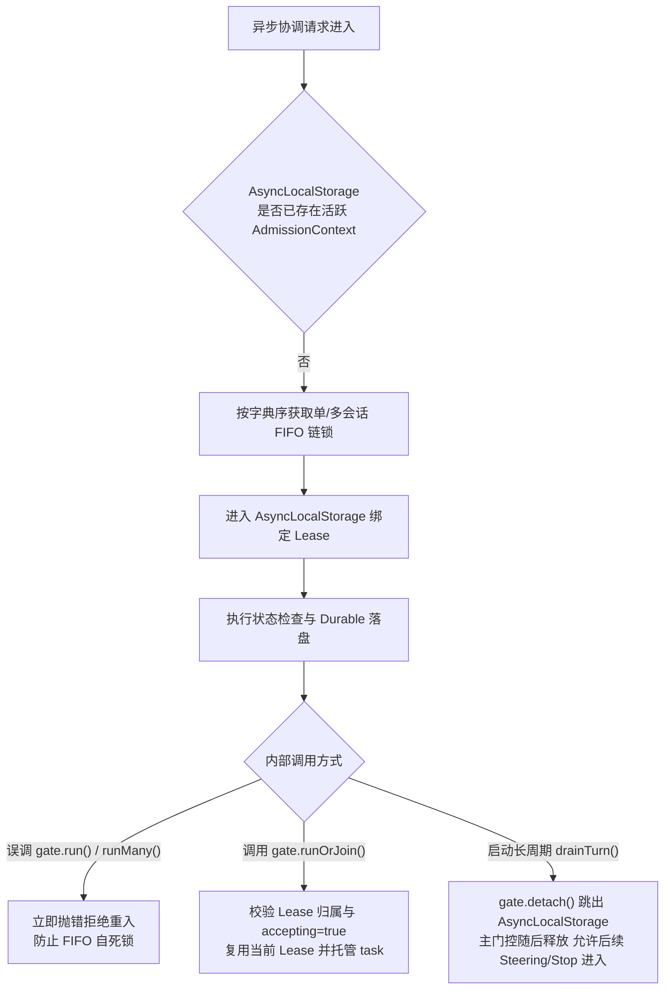
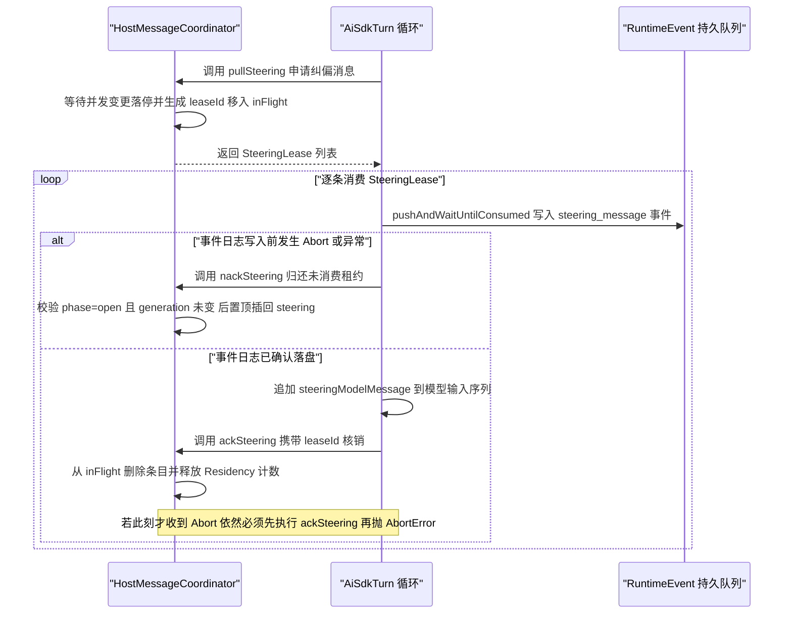
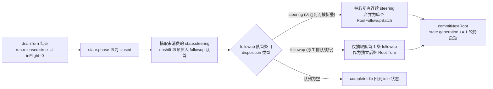

[返回手册目录](../README.md)

# 消息队列、互斥准入与背压控制（Queues & Admission）

当单智能体进化为支持桌面端、CLI、定时任务与多会话协调中心（WorkHub）并发接入的常驻 Runtime 时，“收到用户消息就调一次模型”的 naive 模型循环会立刻在并发边界上崩溃。同一毫秒内，桌面 UI、移动端同步、定时调度器或控制平面可能同时向同一个 `Session` 投递多条指令：有的要求立刻改变当前推理方向，有的要求等本轮完成后再顺序执行，有的还携带了仅能在空闲状态下生效的技能或编排切换意图。

如果系统没有严格的**串行准入边界（Admission Gate）**、**先持久化后入队的状态机**、**防丢防重的投递租约（Delivery Lease）**，以及针对子智能体和后台进程的**分层背压（Backpressure）**，就会不可避免地出现三类工程事故：
1. **并发竞态与状态撕裂**：两条并发消息同时判断会话处于 `idle`，各自启动一条根轮次（Root Turn），在共享上下文日志里写出交错的推理历史。
2. **中断丢失与重复执行**：Runtime 刚从内存队列弹出一条中途纠偏消息（Steering），尚未写进事件日志或尚未送入模型，Turn 恰好被取消或进程重启，消息就此蒸发；或者写了日志却未核销队列，下一轮又把同一条消息再执行一遍。
3. **资源雪崩与死锁**：多会话互相锁定顺序不一致导致锁死，或者模型在单轮内无限派生子智能体、启动上百个后台 Shell 进程却迟迟不释放配额，最终拖垮宿主进程的文件描述符与内存上限。

Maka 将这一整套问题收口在 Host 层的 **`SessionAdmissionGate` + `HostMessageCoordinator` + `RootTurnCoordinator`**，以及 Runtime 层的 **`AdmissionLimiter` + `ShellRunProcessManager`** 两道防线中。本章自顶向下拆解这套并发治理体系的设计哲学与工程细节。

---

## 1. 核心抽象：三条消息路由车道与“精确意图”边界

在进入锁与队列机制前，必须先厘清“到达会话的输入究竟代表什么”。Maka 并不把所有入站消息一视同仁地塞进单一 FIFO 队列，而是先依据**会话当前状态（`rootState.kind`）**与**调用方意图（`placement` / exact-Turn intent）**完成路由分流。

当一个会话在 Host 侧处于运行周期内时，其根轮次状态机仅呈现三种互斥形态：`idle`（空闲）、`active`（存在正在执行的 Root Turn）与 `reserved`（上一轮刚收尾，Host 正在为 Goal 续行或后继批次切换准备下一轮执行权）。与此同时，调用方提交消息时不仅指定文本与附件，还会携带控制语义：

| 入口场景 | 会话状态 (`rootState.kind`) | 路由判定 (`disposition` / 结果) | 核心语义与约束 |
| :--- | :--- | :--- | :--- |
| 普通消息或携带技能/编排配置 | `idle` | 直接启动 Root Turn (`startFromMessage`) | 允许绑定本次 Turn 专属的 `skillIds` 与 `turnOrchestration` |
| 携带 `skillIds` 或 `turnOrchestration` | `active` / `reserved` | 立即拒绝 (`session_busy`) | **精确意图保护**：不能把只针对独立 Turn 的技能或模式切换降级塞进正在运行的 Turn |
| `placement = "current_turn"` | `active` | 进入 **`steering`** 车道 | 运行中纠偏：在模型下一个 Step 前或 `end_turn` 收尾前抢占注入 |
| `placement = "next_turn"` | `active` | 进入 **`followup`** 车道 | 排队续行：等待当前 Turn 彻底结束后，以独立后继 Root Turn 启动 |
| 任意排队请求 | `reserved` | 拒绝 (`session_busy`) | 防止在轮次交接原子窗口期插入状态漂移的消息 |

> [!IMPORTANT]
> **为什么拒绝非空闲状态下的精确 Turn 意图，而不是默默排队？**
> 当调用方显式指定 `skillIds` 或 `turnOrchestration`（例如要求开启某项工作流技能或特定编排模式）时，如果会话正在忙碌，用户期望的是“明确得知系统忙”还是“过几分钟后在另一段完全不同的上下文里静默执行”？Maka 选择**快速失败（Fail-Fast 返回 `session_busy`）**，避免调用方误以为技能已按预期生效，同时保留当前运行 Turn 的编排隔离性。

---

## 2. 会话准入闸门（`SessionAdmissionGate`）：单锁、多锁排序与逃逸通道

Host 层协调多个会话和后台异步流时，第一道防线是 `SessionAdmissionGate`。它的职责可以用一句话概括：**保证针对同一 `sessionId` 的所有状态变更严格按 FIFO 顺序串行执行，并在跨会话协同操作时从数学上消除死锁。**

### 2.1 基于 Promise 链的单会话互斥与异步生命周期托管

与传统阻塞线程的互斥锁不同，Node.js / TypeScript 的 Host 协调器面对的是贯穿内存检查、SQLite 持久化与事件投影的异步临界区。`SessionAdmissionGate` 为每个 `sessionId` 维护一条单链表式的 Promise 链尾部映射 `#tails = new Map<string, Promise<void>>()`：
- 当操作 A 请求进入某会话临界区时，门控立即创建一个新的 `tailPromise`，把自身替换进 `#tails.get(sessionId)`，然后 `await` 前任 `previousTail` 完成。
- 这意味着**排队顺序在同步发起瞬间即已锁定**（严格 FIFO），后续操作即便在不同微任务中到达，也不会插队抢占。
- 更关键的是**后台子任务托管（`runAdmitted`）**：在一次准入临界区内，协调器可能需要派生与当前状态提交绑定的受托异步收尾任务，门控通过 `SessionAdmissionLease` 追踪 `state.tasks`；只有当主 `operation` 返回 **且** 所有登记在该租约上的 `state.tasks` 全部 settle 之后，`release()` 才会 resolve 自己的 `tailPromise`，放行下一个等待者。

### 2.2 死锁消除：`runMany` 的字典序全序加锁

在 WorkHub 多会话调度或跨会话结果回注（详见 [Agent Graph、Swarm 与 WorkHub 协作平面](./agent-graph.md)）中，协调器必须同时锁定“协调会话 + 目标工作会话”两个状态机。如果请求 A 先锁 `session_1` 再锁 `session_2`，而请求 B 先锁 `session_2` 再锁 `session_1`，Promise 链会永久互等死锁。

`SessionAdmissionGate.runMany(sessionIds, operation)` 用分布式锁经典策略彻底消除环路等待：
1. 对传入的 `sessionIds` 去重；
2. 执行**字典序排序（Lexicographical Sort）**：`[...new Set(requestedSessionIds)].sort()`；
3. 严格按照排序后的全序依次 `await` 各个会话的前置尾部；
4. 全部获取后，将这组有序会话绑定到同一个多会话租约中执行操作；
5. 无论成功还是抛错，按**逆序（Reverse Order）**释放租约。

### 2.3 重入保护与 `detach()` 逃逸边界

如果在持有某个 `SessionAdmissionLease` 的临界区内部错误地再次调用 `gate.run(sessionId, ...)`，Promise 链会等待自身释放——即典型的**自死锁（Self-Deadlock）**。同时，一条真正的 Root Turn 往往持续数分钟，如果让 Turn 执行体 `drainTurn()` 一直占着 `SessionAdmissionGate`，期间用户在 UI 上点击中断或发送一条 `steering` 消息就永远进不了门控！

Maka 依托 Node.js 的 `AsyncLocalStorage<SessionAdmissionContext>` 在编译和运行时之间筑起一道精确的重入与逃逸隔离墙：



这一设计确立了一条核心架构不变量：**`SessionAdmissionGate` 只保护“状态变更与准入决策”的微秒级至毫秒级临界区，绝不被长耗时 LLM/工具执行期占用。** `RootTurnCoordinator` 在准入并构造好运行上下文后，立刻通过 `gate.detach()` 脱离异步上下文启动 `drainTurn()`，从而把大门敞开给随时到达的 `steering`、`followup` 与 `turn.interrupt`。

---

## 3. 先持久化后入队与队列原子变更

在真实桌面宿主中，“消息已经告诉用户发出去了，但还没写进硬盘进程就崩了”是不可接受的；反过来，“已经写进数据库，但内存投影还没来得及更新，后台刚好把 Turn 结束了”同样会导致消息被遗忘。Maka 采用 **Durable-First Admission（先落盘确认、再入内存队列）** 与 **乐观并发修订号（Revision CAS）** 化解这一矛盾。

### 3.1 准入预检、配额上限与四次重试循环

`HostMessageCoordinator` 在接收一条准备排队的消息时，必须面对一个微妙事实：**若干预检逻辑本身是异步 I/O**（例如从数据库加载历史大小估算投影体积），而 `pullSteering` 等非持久化快速读取路径或生命周期钩子可能在异步间隙使队列状态发生变化（为避免粗粒度大锁阻塞）。因此，排队提交内部设计了一个最多 **`SUBMIT_ADMISSION_RETRY_LIMIT = 4`** 次的校验循环，只有在同一 `state.phase`、`state.revision`、`state.generation` 与 `state.reservedRoot` 保持一致的临界窗口内才真正提交：

1. **队列总容量上限**：合并检查 `steering.length + inFlight.size + followup.length < MESSAGE_QUEUE_MAX_ENTRIES`（硬上限 **64** 条），防止前端连击或失控脚本撑爆会话队列。
2. **投影字节上限预演（Worst-Case Fit Check）**：调用 `worstCaseMessageQueueProjection` 与 `successorAdmissionsFit`，提前演算**最坏情况**——即这条消息如果连同前面排队的记录一起序列化进前端 `QueueProjection`，以及未来它作为独立后继 Root Turn 启动时写入的准入记录，是否会突破协议载荷上限（`MESSAGE_QUEUE_PROJECTION_MAX_BYTES`）与单轮输入限制。换言之，**不接纳任何“接进来之后将来必定爆仓而卡死后续轮次”的消息**。
3. **落盘提交与内存入队**：在所有预检通过后，先调用 `MessageAdmissionStore.commitMessageAdmission(...)` 将消息准入记录原子写入 SQLite；随后才将 `LiveEntry`（初始态 `queued`）压入内存 `state.steering` 或 `state.followup` 队列，同时申请一条 `RuntimeHostResidency` 驻留引用计数（防止宿主进程误判会话空闲而卸载运行时实例）。

### 3.2 跨 Epoch 幂等与队列并发变更（`QueuedMutationExecutor`）

如果客户端在网络超时或进程重启后重放同一个 `operationId`：
- 若携带的 `originHostEpoch` 与当前宿主实例 `#hostEpoch` 一致，协调器直接命中内存中的 `#pendingSubmits` 正在进行的 Promise 或 `#completedOperations` 结果缓存，返回完全一致的确认回执；
- 若跨了宿主重启 Epoch，协调器则转向持久化证据链 `#queryDurableSubmitProof`（查询 `readRootTurnSourceMessageReceipt` 或 `readImmutableSteeringMessageProof`）：查到已落盘则安全回放确认，查不到但又无法排除已处理可能时返回 `outcome_unknown` 或 `operation_conflict`，绝不静默重复投递。

当消息处于 `queued` 状态尚未被模型拉走时，UI 允许用户对其进行撤销、编辑、排序或“插队提升”为纠偏消息。这类变更统一由 `QueuedMutationExecutor` 配合 `message-queue-state` 纯函数校验完成：

| 队列变更操作 | 目标车道约束 | 并发保护机制 | 核心拒绝条件 (`operation_conflict`) |
| :--- | :--- | :--- | :--- |
| `queue.retract` | 全部未进入执行的消息 | 写入撤回墓碑并递增 `revision` | 当存在已拉取但未结算的 `inFlight` 条目时拒绝全量清空或仅撤回未投递部分 |
| `queue.entry.retract` | 单条 `queued` 消息 | `entryId` 存在性校验 + 释放 `residency` | 目标条目已变为 `in_flight`（已被模型取走） |
| `queue.entry.update` | 单条 `queued` 消息 | 强制校验 `expectedQueueRevision` | `expectedQueueRevision` 不匹配或预演更新后突破字节配额 |
| `queue.entries.reorder` | 同车道内部重排 | 强制校验 `expectedQueueRevision` + `exactQueueReorder` 验证集合相等 | 不允许跨 `steering` / `followup` 车道混排，不允许增删条目 |
| `queue.entry.promote` | `followup` -> `steering` | 检查当前 `rootState` 仍为活跃打开 (`phase === 'open'`) 且队列未超限 | 当前 Turn 已进入收尾关闭期（`phase === 'closed'`）或 `in_flight` |

---

## 4. Steering 投递租约（`leaseId`）：从内存队列到模型上下文的二元结算

如果说准入闸门解决了“怎么安全进队列”，那么 **`Steering Delivery Lease`（纠偏投递租约）** 解决的就是智能体队列最容易出 Bug 的黑暗地带：**如何保证一条 `steering` 消息既不会因为异步取消而凭空消失，也不会因为已经写入日志又被回滚队列而执行两次？**

### 4.1 两个精准的拉取检查点（Checkpoints）

在 `AiSdkTurn` 驱动的模型单轮循环中，Runtime 不会用不可控的事件回调粗暴打断正在生成的 Token 流，而是在两个**安全且确定性的拓扑边界**主动向 Host 调用 `input.pullSteering()`：
1. **每次 Step 构建请求之前**：在拼装下一轮给 LLM 的 `messages` 前拉取所有积压的 `steering`，使模型在调用下一批工具或生成下一步推理前立刻看见用户的最新纠偏。
2. **即将接受无工具 `end_turn` 结束前**：当模型本轮没有发出 `tool_use` 而是准备结束回复时，Loop **不会立刻宣告 Turn 结束**，而是再次拉取一次 `steering`！只要用户恰好在模型流式吐字末尾发出了新指示，`AiSdkTurn` 会直接撤销这次“准备收工”的判定，把新消息压入上下文并开启新的模型 Step。

### 4.2 租约生命周期与“不可逆分水岭”

当 Host 响应 `#pull(run)` 时，会经历一段精密的状态转移：首先 `await #awaitSteeringMutations()` 等待任何并发抵达的 `current_turn` 提交或 `promote`/`reorder` 变更落停；接着将 `state.steering` 全部摘出，为每条消息分配唯一 UUID `leaseId`，将状态标为 `in_flight` 并移入 `state.inFlight.set(leaseId, entry)`，最后连同 `generation` 一并返回 `SteeringLease[]` 给 Runtime。

接下来在 `AiSdkTurn.drainSteeringInto` 中发生的事情，决定了整个系统的 **Exactly-Once（精确一次）投递语义**：



下面这段教学伪代码提炼了这一核心状态机的严谨逻辑：

```typescript
// 教学伪代码：Steering Delivery Lease 二元结算状态机
async function drainSteeringInto(turnInput, eventQueue, modelMessages, signal) {
  const leases = await turnInput.pullSteering();
  if (leases.length === 0) return false;

  // 尚未完成持久化落盘的租约游标列表
  const undelivered = [...leases];
  let abortedAfterDurableWrite = false;

  try {
    for (const lease of leases) {
      if (signal.aborted) {
        throw new AbortError("Aborted before durable write");
      }

      const eventId = generateEventId();
      const providerContent = buildUserProviderContent(lease.message);

      // 【不可逆分水岭】：必须阻塞等待 RuntimeEvent 存储引擎确认写入成功！
      await eventQueue.pushAndWaitUntilConsumed({
        type: "steering_message",
        id: eventId,
        message: lease.message,
      });

      // 一旦越过分水岭，该消息已属于持久会话历史，绝不允许再 nack 回队列！
      undelivered.shift();
      modelMessages.push(createSteeringModelMessage(eventId, providerContent));

      try {
        await turnInput.ackSteering([lease.id]);
      } catch (err) {
        if (isAbortError(err)) {
          abortedAfterDurableWrite = true;
        } else {
          throw err;
        }
      }

      if (signal.aborted || abortedAfterDurableWrite) {
        throw new AbortError("Aborted after durable steering commit");
      }
    }
    return true;
  } catch (err) {
    // 仅把“未过分水岭”的租约 nack 回队列；若中途中断时刚好完成最后一条写盘，仍确保 ack 完成
    if (undelivered.length > 0) {
      await turnInput.nackSteering(undelivered.map((l) => l.id));
    }
    throw err;
  }
}
```

注意图中与伪代码里的两个精妙不变量：
1. **Unshift 置顶保序归还**：一旦发生早期失败调用 `nackSteering`，Host 会先检查该租约对应的队列是否仍然处于 `state.phase === 'open'` 且 `entry.generation === state.generation`。如果仍属于当前有效 Turn，它不会把这些退回的条目 `push` 到队尾，而是按原始相对顺序 **`unshift` 置顶插回 `state.steering` 头部**，绝不让后发消息反超前发消息的逻辑时序。
2. **分水岭之后 Abort 依然核销**：如果外部取消信号恰巧发生在 `pushAndWaitUntilConsumed` 返回之后、发起 LLM HTTP 请求之前，系统已经把这条纠偏写入了永久事件流。如果此时错误地调用 `nack`，下一轮重放历史时模型就会看到“一条已经存在于历史中的消息”加上“队列里又送来一遍的同一条消息”。因此 Runtime 选择**先把已经落盘的那条租约完成 `ackSteering` 核销，再向上抛出 `AbortError`**。

---

## 5. Turn 收尾折叠、Follow-up 批处理与 StopFence

当一轮 `drainTurn()` 跑完（无论是正常完成还是报错结束），协调器面临最后一个棘手竞态：**就在模型决定结束、释放运行的毫秒间，用户又提交了一条新的 `steering` 消息，或者队列里本来就躺着几条 `followup` 消息，接下来该怎么过渡？**

### 5.1 收尾过渡不变量与未拉取 Steering 自动顺延折叠

`HostMessageCoordinator.beginTerminalTransition` 强制检查两条前置条件：`run.released === true`（执行流已经真正交还控制权），以及 **`state.inFlight.size === 0`**（绝对没有任何悬而未决的租约处于中间态）。满足后，它把状态从 `open` 切换为 `closed` 并执行“未消费纠偏折叠（Steering Fold）”：

- 任何在 `drainTurn` 最后一次拉取之后才抵达、还来不及消化的剩余 `state.steering` 条目，会被全部摘出，**逆序/保序 `unshift` 塞到 `state.followup` 队列的最前端**！
- 紧接着 `nextSuccessorItems(state.followup)` 决定下一条独立 Root Turn 的载荷形态，这里体现了一个极度考究的人机交互区分：
  - **如果队首是折叠下来的 `steering` 条目**：取走队首所有连续的 `steering` 条目，通过 `aggregateMessageContents` 合并为一个 **`RootFollowupBatch`（共享同一条后继 Turn）**。此时若批次大小大于 1，合成消息的 `userMessageId` 记为 `null`，表示多条来不及在原 Turn 生效的连发纠偏合并发起了新一轮聚焦响应。
  - **如果队首是原生 `followup` 条目**：只取**单条（`[entries[0]]`）**独立启动下一轮 Root Turn。因为原生 Follow-up 代表用户在对话语义上安排的“做完这件事后，再去做下一件事”（比如先修 Bug、再写文档、最后跑回归），强行合并成一轮会污染焦点与工具预算，逐条串行推进才最稳健。

完成切片挑选后，`RootTurnCoordinator.completeTerminalTransition` 原子地发布终端投影（`publishTerminalProjection`）：若后继为空则 `completeIdle` 回到空闲态；若有后继批处理，则立即调用 `startFollowupBatch` -> `commitNextRoot`，将 `state.generation += 1` 并把所有权轮转到下一条 `reservedRoot`，随即触发新一轮 `drainTurn()`。

### 5.2 `StopFence` 与跨代次隔离

当用户主动点击“停止生成”（`turn.interrupt`）、调用 `stopRoot` 或宿主正在优雅排空（`draining`）时，系统不会只发一个 `AbortSignal` 了事，而是由 `#commitQueueFence` 立下一道 **`StopFence`**：
1. 立即把当前活跃队列 `phase` 置为 `closed`；
2. 撤回当前所有尚未投递的 `queued` 消息并写入对应的取消墓碑记录，阻止中断之后“原本排在后面准备插队的消息突然自己又跑起来”；
3. **强制递增 `state.generation`**。任何早先在网络或微任务里飘着的旧代次 `ack`/`nack`/`pull` 请求，只要带着老 `generation` 回来，都会被精准识别为过期代次而被安全忽略。



---

## 6. Runtime 执行层背压：`AdmissionLimiter` 与进程配额边界

当消息经过 Host 准入与队列调度真正送入 Runtime 执行模型和工具后，并发问题从“消息竞态”转变为“算力与操作系统资源耗尽”。Maka 在 Runtime 层针对三种不同性质的昂贵负载设置了截然不同的背压与释放边界：

### 6.1 两层子智能体配额与可取消 FIFO 信号量（`AdmissionLimiter`）

子智能体派生存在“工具调用数量”与“实际创建会话数量”两个不同维度的爆炸风险（例如一个编排工具单次调用内可能会拉起一批子任务）。为此，`ToolRuntime` 部署了两道独立闸门：
- **单轮并发子智能体工具上限（`MAX_ACTIVE_SUBAGENT_TOOLS_PER_TURN = 5`）**：在调用标记了 `categoryHint === 'subagent'` 的工具前，通过 `reserveSubagentSlot` 计数控制同一时刻最多 5 个子智能体工具并发悬停。
- **单轮共享子会话运行容量（`MAX_ACTIVE_CHILD_AGENT_RUNS_PER_TURN = 32`）**：在底层窄接口 `spawnChildSession` 处部署一个 `AdmissionLimiter(32)`。`AdmissionLimiter` 是一个支持 `AbortSignal` 的 FIFO 异步信号量，提供 `acquire(signal)` 返回幂等的 `AdmissionPermit { release() }`；当超出 32 个活跃子会话时，第 33 个派生请求在 `waiters` 队列挂起等待前面的 permit 释放，而一旦父 Turn 中断，信号量支持直接 `resetTurnState()` 调用 `priorChildAgentRunLimiter.close(err)` 瞬间唤醒并拒绝所有阻塞中的等待者。

### 6.2 Code Mode 串行化与后台 Shell 全局失败即返配额

与子智能体按 Turn 隔离、支持排队等待不同，Code Mode 与后台 Shell 进程面对的是持久化且影响宿主的物理状态，因此背压策略截然不同：

| 执行负载类型 | 限流器与作用域 | 容量上限 | 超限行为 | 配额释放的精确边界 |
| :--- | :--- | :--- | :--- | :--- |
| **子智能体工具调用** | `ToolRuntime` 计数器（Turn 内） | `5` | 立即拒绝并发超限工具调用 | 对应工具调用执行完返回时 |
| **子智能体 Session 运行** | `AdmissionLimiter`（Turn 内共享） | `32` | 支持 `AbortSignal` 的 FIFO 挂起排队 | 子智能体运行结算 `release()` 或 `close()` |
| **Code Mode 执行单元** | `AiSdkBackend.codeCellAdmission`（跨 Turn 常驻） | `1` | FIFO 排队串行化，防并发污染内核 | 单次 Code Cell 沙箱彻底完成或中止 |
| **后台 Shell / PTY 进程** | `ShellRunProcessManager`（跨 Session 全局） | Shell `64` / PTY `8` | **不排队，直接 Fail-Fast 报错** | **直到物理进程退出、进程树排空且最终快照落盘完成** |

这里最值得深挖的是 `ShellRunProcessManager` 的**两阶段分离释放边界**：
1. 当模型调用 `runBackgroundBash` 时，只要后台进程拉起、注册 `live.visibleRef = true` 且 `markRunning` 落盘，工具立刻向模型返回简洁的 `compactShellRunContent`（附带任务 ID），让模型无需等待耗时编译完成就能继续思考。
2. 然而，**工具返回并不等于槽位释放！** 如果一返回句柄就释放全局 64/8 名额，模型连续触发几十次后台脚本就会瞬间突破宿主限制。因此，`slotReservation`（追踪 `reservedShellRuns` 与 `reservedPtyRuns`）会由 `ShellRunProcessManager` **持续死死攥在手里**，直到操作系统子进程真正退出、整个进程树 stdout/stderr 彻底排空（drained），并在 `finalizeLive()` 的 `finally` 块里把最终退出码和输出尾块持久化写入快照之后，才执行 `releaseLiveSlot(live)` 把名额归还给池子。
3. 同时，因为这 64/8 个名额属于整个宿主（跨所有 Session 共享），如果允许会话 A 的请求悄悄挂起等会话 B 的某个长驻测试进程结束，非常容易造成整页卡死甚至互等僵局；所以 `reserveSlot` 采用**明确报错拒绝（Fail-Fast）**策略，在错误文本里清晰提示当前限额，引导模型等待既有任务或显式调用 `StopBackgroundTask` 主动腾出名额。

---

## 7. 工程对比：Maka 与 Pi 的排队与准入设计差异

将 Maka 的这套协调基础设施与轻量级单机 Agent 框架 **Pi** 对照，能更直观看出架构定位如何反过来塑造并发模型：

| 对比维度 | Pi 架构设计 | Maka 架构设计 | 工程取舍分析 |
| :--- | :--- | :--- | :--- |
| **状态所有权与队列介质** | 以纯内存 `Agent` 实例为核心，默认 `steer()` / `followUp()` 驻留进程内存（可选实验性 `durable` 收件箱扩展） | Host 独占事实源：`SessionAdmissionGate` + SQLite `MessageAdmissionStore` 先落盘后入内存队列 | Pi 启动零依赖、延迟极低；Maka 付出持久化写校验代价，换取跨 UI/定时/Crash 重启零丢消息 |
| **多客户端与跨会话锁** | 默认假设单进程单调用方交互，极简排队 | `SessionAdmissionGate` Promise FIFO 链 + `runMany` 字典序防死锁 + `AsyncLocalStorage` 重入校验 | 多表面（桌面端/WorkHub/定时）并发修改同一个或两个关联会话时，必须靠全序锁消除竞态 |
| **Steering 丢包与重复防护** | 在工具调用之间或 `getSteeringMessages` 钩子同步摘出队列并注入上下文 | 显式 `leaseId` 租约：`inFlight` 过渡态 + `pushAndWaitUntilConsumed` 分水岭 + 二元 `ack`/`nack` | 若无 `leaseId` 租约与分水岭，流式中断恰好卡在入库瞬间时极易丢消息或导致下一轮重放重复执行 |
| **Turn 结束未消费消息处理** | 下次外部提示前待处理，或依赖宿主外层循环判定 | `beginTerminalTransition` 自动将迟到 `steering` 折叠置顶并合批，原生 `followup` 坚持单条独立成轮 | 兼顾用户连击纠偏的流畅整合与结构化多步待办的独立焦点隔离 |
| **执行层并发与进程背压** | 依赖底层工具与扩展自行控制子进程或并发上限 | `AdmissionLimiter(32)` + `Subagent(5)` + `CodeCell(1)` + 跨会话 Shell(`64`)/PTY(`8`) Fail-Fast 持有至排空落盘 | 防止多会话并行场景与自主循环打穿 OS 句柄及宿主机内存极限 |

这套准入与背压基础设施把混乱的异步输入驯化为确定性的会话状态流。在此坚实底座之上，Maka 才能继续向上构建跨多智能体 DAG 拓扑调度的 `Agent Graph / Swarm` 与协调多会话的 `WorkHub` 控制平面。

---

## 延伸阅读

- [从请求到响应全链路](../01-runtime/request-to-response.md)：理解一条消息通过准入闸门之后如何经历模型推理、工具调用与持久化事件写入
- [Agent Graph、Swarm 与 WorkHub 协作平面](./agent-graph.md)：深入多会话联合加锁 `runMany` 如何在静态任务图与跨会话协调中发挥核心作用
- [持久 Goal、Plan Mode 与事件驱动挂起](./goals-plans-and-event-waits.md)：了解 Goal 如何在 `rootState.kind === 'reserved'` 与事件唤醒之间安全接管控制权
- [Durable Execution 与事件日志](../04-state/durable-execution.md)：剖析 `RuntimeEvent` 落盘如何支撑 `pushAndWaitUntilConsumed` 的不可逆分水岭
- [宿主所有权与前后端状态同步](../04-state/host-ownership-and-sync.md)：查看 `MessageQueue` 投影修订号与前端乐观编辑之间的同步协议
