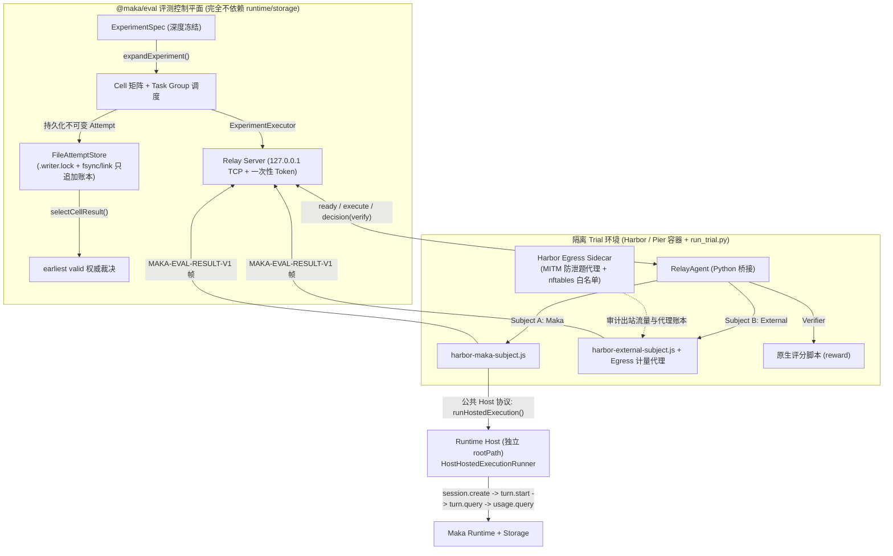
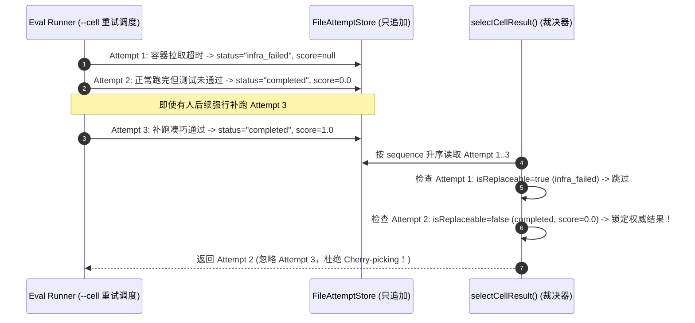

# 评测样本、执行与结果裁决

[返回手册目录](../README.md)

要科学评估两个 Agent 谁更擅长“修改 `config.json` 并保证旧配置不丢失、新模型配置能通过验证”，不能靠人工聊两句“感觉还不错”，也不能在代码库里跑几条带 Mock 的单元测试充数。工程团队需要一套**不可作弊、防污染、与核心运行时彻底隔离、且能横向对比不同竞争对手（Arms）**的自动化基准评测体系（`@maka/eval`）。

本章深入剖析 Maka 评测引擎的四层架构：与核心运行时的公共协议边界、实验矩阵与并发任务组调度模型、Harbor / Pier 容器隔离与防篡改计量协议，以及维护评测公信力的核心裁决铁律——**不可变追加 + `earliest valid`（最早有效观测原则）**。

---

## 1. 概念先行：为什么 Eval 必须站在 Runtime Host 协议之外？

在不少 Agent 框架中，评测代码直接引用核心循环类、共享内存状态甚至直连运行时的 SQLite 数据库。这种紧耦合会摧毁评测数据的客观性：
1. **裁判与运动员边界污染**：核心运行时可能无意间依赖评测脚本注入的环境变量或字段走捷径，而评测产生的海量临时试验状态也会污染开发者的正常 State Root。
2. **无法跨框架公平对比**：如果评测器深度绑定 Maka 内部 API，就无法用完全相同的容器环境、网络封控、超时预算和评分器去横向对比外部竞品（`External Subject`）。

因此，`@maka/eval` 确立了零妥协的**外部观测者边界**：
- `@maka/eval` **绝不构造** `AgentRun`、`RuntimeKernel` 或读取任何内部存储实现，包依赖树上与 `@maka/runtime`、`@maka/storage` 完全隔离；
- 无论是自家的 `Maka Subject` 还是外部竞品 `External Subject`，一律作为**隔离子进程**被运行在容器沙箱内部；
- 当容器需要驱动 Maka 执行任务时，隔离垫片（`harbor-maka-subject.js`）以普通外部客户端身份调用公开的 **`runHostedExecution()`** 客户端接口，通过标准 `Runtime Host` 协议与宿主通信。



---

## 2. 实验模型：Spec 冻结、矩阵展开与三类重复辨析

### 2.1 声明式实验规范 (`ExperimentSpec`)
一份合法实验配置由 `parseExperimentSpec()` 严格手写字段校验（拒绝任何未声明的顶层键，强制 `schemaVersion: 'maka.eval.v1'`），校验后立刻执行深度递归冻结（`deepFreeze`）：

$$\text{Experiment} = \text{benchmark} + \text{executor} + \text{subjects} + \text{tasks} + \text{repetitions} + \text{budget} + \text{verifier}$$

- **`benchmark` & `tasks`**：指定基准版本（Harbor 要求完整的 40/64 位 Git Commit SHA，Pier 校验任务目录绝不逃逸 `tasksRoot`）及任务输入清单。
- **`subjects`**：多个并行对比臂（Arms），每个 Subject 仅声明 `kind`（`'maka'` | `'external'`）、允许注入的环境变量凭证名列表 `credentials` 与专属配置。环境变量在框架中**严格保留给凭证与本机工具链路径**，所有影响行为的语义参数必须冻结在 Spec JSON 中。
- **`budget` & `verifier`**：全实验所有对比臂强制共享同一份预算与验证器配置，防止“A 臂给 10 分钟、B 臂给 3 分钟”的不公平设置。

### 2.2 `Cell = task × repetition × subject` 展开与 Task Group 并发
`expandExperiment(spec)` 将实验声明展开为笛卡尔积样本单元（`ExperimentCell`），每个 Cell 拥有确定性主键：

$$\text{cellId} = \texttt{"\$\{task.id\}::\$\{repetition\}::\$\{subject.id\}"}$$

在调度层，Runner 通过 `groupTaskCells()` 将同一个 `(task.id, repetition)` 下的**所有 Subject 对比臂**归并为一个 **Task Group**（受 `execution.maxConcurrentTaskGroups` 上限控制）。同组内的多臂在同一时刻启动容器并行跑测，从而有效消除上游模型服务时段性限流、网关波动或宿主机负载变化引入的时间漂移（Time Drift）。

> **统计陷阱提醒：配对非保留与存活偏差（Survivorship Bias）**：Task Group 只是并发执行单元，结果选择是在每个 Cell 上独立完成的。如果 A 臂容器长时间运行后因基础设施故障未能产出任何有效 Attempt（被结果映射表丢弃），B 臂在该组内的成绩依然会留存。由于耗时越长的复杂任务越容易遭遇基础设施中断，直接分别对各臂存活下来的 Cell 求平均分会严重偏向耗时短的臂！因此下游统计对比前，**必须按 `task.id` 重新对齐配对并剔除单边缺失样本**。

### 2.3 严格区分：Repetition vs Infra Retry vs Continuation
在生产评测与长程运行体系中，必须把以下三个看似“重跑”的概念在层级与统计口径上彻底切开：

| 机制 | 归属层级 | 触发动因 | 物理载体与对统计结果的意义 |
| :--- | :--- | :--- | :--- |
| **Repetition（实验重复）** | 实验设计层<br>(`ExperimentSpec`) | 对抗大模型采样温度与环境微扰带来的随机性，测量 `pass@k` 或稳定通过率。 | **展开为彼此独立的 `Cell`**（如 `task1::1::maka` 与 `task1::2::maka`），各自独立占有最终成绩，共同构成样本分母。 |
| **Infra Retry（基建重试）** | 评测调度层<br>(`@maka/eval` `--cell`) | 宿主机 Docker 守护进程异常、Egress 审计日志丢失、容器被宿主强制取消等非模型原因（`infra_failed` / `indeterminate`）。 | **在同一个 `Cell` 下追加新 `Attempt`**（递增 `sequence`），仅用于填补无效基础设施故障的空缺，**绝不创造新样本**。 |
| **Continuation（内部续接）** | Runtime Host 内部<br>(`Session` / `Turn`) | Maka 运行时自身在单个任务中途面对进程重启或边界挂起时的恢复续跑能力。 | **完全封装在单次 `Attempt` 内部**，是衡量 Maka 自身工程韧性的一部分，对外部 `@maka/eval` 保持透明。 |

---

## 3. 执行器与被测对象适配：隔离、防泄题与防作弊计量

### 3.1 Harbor / Pier 双框架统一执行机 (`harness-executor.ts`)
`@maka/eval` 通过同一套通用状态机同时适配 **Harbor**（支持远端 Git Benchmark 与 Docker Compose Sidecar）与 **Pier**（支持本地 `tasksRoot` 挂载，禁止声明 `egressProxy` 且严格校验保留日志挂载路径 `/logs/agent`、`/logs/verifier`、`/logs/artifacts` 不被覆盖）。

整个 Trial 生命周期通过 `run_trial.py` 与宿主侧 **127.0.0.1 Loopback TCP 换行 JSON Relay 协议** 精密协同：
1. **启动与握手（`not_started` 前置门控）**：宿主监听随机回环端口并携带 24 字节随机 `relay_token` 拉起子进程。若在 `ready` 到达前退出，按阶段精确归类为 `spawn-failed`、`framework-version-mismatch`（exit 78）、`exit-before-ready`、`invalid-ready` 或 `cancelled`，写入 `preparation-error.json` 且不计为模型失败。
2. **执行隔离（`execute`）**：每个容器内至多运行一次 Subject。宿主仅向容器传递该 Subject 明确声明的凭证；非交互环境强制注入 `DEBIAN_FRONTEND=noninteractive` 与 `TZ=Etc/UTC`，避免包管理器交互卡死被误判为模型超时。
3. **PIPE_BUF 认证结果帧（`MAKA-EVAL-RESULT-V1`）**：Docker 合并的 stdout/stderr 极易出现多进程日志交错。为此 Subject 结束时调用 `writeRelayResult()`，使用宿主一次性下发的 `MAKA_EVAL_RESULT_TOKEN` 在 stdout 写出单行定界帧：
   $$\texttt{MAKA-EVAL-RESULT-V1 <token> <bytes> <sha256> <base64url\_payload>}$$
   载荷严格控制在 **2 KiB** 以内（整体单行远低于 Linux `PIPE_BUF` 原子写入阈值），确保不会被并发日志撕裂。执行器优先采信通过认证且哈希匹配的帧内容，仅当帧完全丢失时才参考退出码与代理恢复账本。
4. **验证现场保护与两阶段优雅清理**：
   - **保留正常退出的后台进程**：Subject 自行退出后，Verifier 评分的对象是容器留下的真实环境（如模型在后台拉起的 Web 服务）。Relay 刻意不在此时清杀进程组（并对 DeepSeek Harness 注入 `DSH_PRESERVE_BACKGROUND_PROCESSES`），避免“人为擦除被测产物”。
   - **超时/取消两阶段围剿**：仅当宿主触发取消或超时时，执行器发送 `decision(verify)` 失败保护并启动清理升级链：**`SIGTERM` 等待（已启动 120s / 未启动 20s）→ `SIGKILL` 等待（5s）→ `unref` 剥离并标记 `cleanup-unconfirmed`**。只要清理未获确认或验证尚未完成即被取消，Outcome 一律降级为 `indeterminate`，防止僵尸容器残留篡改结果。

### 3.2 Maka Subject vs External Subject：同一把尺子的公平保障
两者在 `@maka/eval` 中实现同一套 `SubjectAdapter` 契约，但内部执行链路各自面对不同的公正性挑战：

| 对比维度 | Maka Subject (`maka-subject.ts`) | External Subject (`external-subject.ts`) |
| :--- | :--- | :--- |
| **执行驱动方式** | 通过 `harbor-maka-subject.js` 启动独立 `rootPath`，调用公共协议 `runHostedExecution()`。 | 直接拉起外部 Agent CLI 或内置标准化外包装（`harbor-external-subject.js`）。 |
| **运行轮廓锁定** | 持久化冻结 `headless-coding-v1` Profile（固定系统提示词、剔除产品个性化/记忆/Web 工具，Full Access 下屏蔽沙箱扩展工具）。 | 事前 `prepare()` 对挂载只读工具链目录执行 `verifyToolchainDirectory()` 计算 `checksums.sha256` 清单指纹，`canReuse()` 确保旧结果不跨版本复用。 |
| **计量与成本口径** | `HostHostedExecutionRunner` 依次执行 `session.create` → `turn.start` → `turn.query` → `usage.query` + `runSettlementCoverage`；只要存在 `unreadableRecords`、`pendingRepairs`、`partial` 或 `missing` 用量，直接返回 **`indeterminate`** 拒绝虚报结算！ | 若协议帧丢失（如进程 OOM/被杀），通过 `recoverExternalMetering()` 读取代理写出的 `<profile>.provider-usage.json`（上限 64 KiB、拒绝符号链接，并用 `meteringSecret` 做 HMAC 校验）；若代理已观察到 `admittedRequests > 0` 且进程正常返回但丢帧，直接判为 `failed`（防止自杀逃分），若执行调用本身抛出基建异常则保留已产生费用但维持 `infra_failed`。 |
| **价格公正铁律** | **Eval 自己按统一费率表重新计价**（如 `estimateDeepSeekCost`），Maka 内部上报的 `costUsd` 仅作 `subject-reported-cost` 证据保留，防止因两套价格表漂移制造虚假成本差异。 | 同样由共享 `deriveMetering` 计算完全可比的成本；不完整用量仅保留 Token 下界而不输出误导性费用。 |

### 3.3 防泄题网络围栏与 Egress 审计（Harbor 专属）
为了让 Subject 既能正常使用 `curl` / `pip` / `npm` 完成工程任务，又无法偷窥公开基准答案（如 GitHub 上的 Terminal-Bench 题库或轨迹镜像），Harbor 模式为每个 Cell 注入独立的 MITM Egress Sidecar 代理与 `nftables` 内核命名空间白名单：
- **强制流量路径**：`Agent.run()` 启动前由 Sidecar 写入 `table inet` 规则，仅放行至回环和代理容器 IPv4 的 TCP 流量，直接拒绝（Reject）包括 Docker 内嵌 DNS `127.0.0.11` 与 ICMP 在内的所有其他出站包（故意使用拒绝而非 NAT 重定向，彻底切断继承自准备阶段的旧连接）。
- **权限与命名空间门控**：丢弃 `NET_RAW` / `NET_ADMIN` 防止 `AF_PACKET` 绕过 IP 输出钩子，并在启动 Subject 前核验 `/proc/self/ns/net` 与策略 Sidecar 处于同一网络命名空间。
- **审计证据优先级最高**：验证阶段 `readVerification()` 必查 `egressAudit` 日志存在且非目录、无未分类原始 TCP 逃逸。若审计日志缺失或损坏，即使 Subject 超时或拿到满分，状态一律强转 **`infra_failed`**。

---

## 4. 防作弊裁决铁律：`earliest valid` 与不可变存储

假设某个 Cell 在执行过程中发生了如下波折：
- **Attempt 1**：因为宿主机 Docker 镜像仓库瞬时断网，容器启动失败（`infra_failed`）；
- **Attempt 2**：调度器对该 Cell 自动发起基建重试，模型成功跑完测试并拿到 **0 分**（`completed`，或者模型在容器内超时导致 `subject_failed`）；
- **Attempt 3**：操作员怀疑“是不是这次模型状态不好”，又强行针对该 Cell 补跑了一次，结果这次模型凑巧蒙对了，拿到 **1.0 分**。

**Attempt 3 能替代 Attempt 2 成为最终成绩吗？绝对不能！** 如果评测引擎允许从多次有效尝试中取最高分（`max`）、取最新分（`last`），或者允许人工挑选看起来顺眼的结果，那么基准分数就会因为**挑选偏见（Cherry-picking）**和**“无限重跑直到蒙对（Retry-until-pass）”**而彻底失去科学意义。

### 4.1 不可变只追加存储 (`FileAttemptStore`)
`@maka/eval` 在存储机制上直接杜绝“修改或覆盖既有成绩”的物理可能性：
1. **单写者排他锁**：所有实验执行必须在 `store.runExclusive()` 内持有实验目录下的 `.writer.lock`（以 `O_CREAT | O_EXCL` 即 `'wx'` 模式创建，崩溃残留锁须人工确认无存活写者后再清理，框架绝不自动窃取锁）。
2. **序号递增 + 原子落盘**：每个 Cell 目录以 `sha256(cellId)` 命名，内部只允许按 `000001.json`、`000002.json` 严格连续序号写入。写盘时先以 `'wx'` 打开临时文件、写入换行 JSON 并执行 `fsync()`，关闭后再通过硬链接 `link(temp, final)` 原子发布——**一旦写入，永不修改**。

### 4.2 四态分类与 `earliest valid` 选择器 (`selectCellResult`)
每条 `CellAttempt` 的状态严格落入 `EvalResultStatus` 四态之一：

| `EvalResultStatus` | 语义含义 | `isReplaceableAttempt()` | 典型来源 |
| :--- | :--- | :--- | :--- |
| **`completed`** | Subject 运行并经 Verifier 完整评分结束（无论得分是 `1.0`、`0.5` 还是 `0.0`）。 | **不可替换（永久锁定）** | 正常完成执行且 Verifier 成功打分。 |
| **`subject_failed`** | 基础设施与 Verifier 完好，但 Subject 自身超时、报错退出或产生异常。 | **不可替换（永久锁定）** | `framework_timeout`、非零退出码且无基建故障、代理证实已发出模型调用但丢帧。 |
| **`infra_failed`** | 评估基础设施或验证环损坏，未构成对 Subject 能力的有效观测。 | **可替换** | 容器启动失败、Egress 审计日志缺失、Verifier 返回空 reward、Relay 传输异常。 |
| **`indeterminate`** | 宿主中途取消、容器清理未确认（`cleanup-unconfirmed`）或 Maka 用量未结算完整。 | **可替换** | Host 发送 `SIGINT`/`SIGTERM`、SIGKILL 后仍未退出、`incompleteUsageReason` 命中。 |

`selectCellResult(attempts)` 严格按 `sequence` 从小到大扫描该 Cell 的全部不可变历史记录：
- 跳过所有 `isReplaceableAttempt(attempt) === true`（即 `infra_failed` 与 `indeterminate`）的记录；
- **一旦遇到第一条不可替换记录（哪怕它是 0 分或 `subject_failed`），立刻将其锁定为该 Cell 的唯一权威最终成绩！** 即使文件末尾之后还有人追加了满分的 Attempt 3，也永远不会被采信（注：`runner.ts` 在重跑前也会检查是否已有可复用有效记录，只有 `External Subject` 的工具链指纹发生变动导致 `canReuse()` 返回 `false` 时才允许重跑）。



> **向分布式车队演进（`FLEET.md`）**：在 `@maka/eval` 的多机仿真扩展（`FleetCoordinator` / `FleetWorker`）中，上述原则被进一步升级为两项更精细的区分：**缺失用量不再直接推翻有效评分**（`FleetReport` 将执行、验证、清理与用量证据解耦，只要验证有效且清理确认即可被选为权威结果，避免因纯计费探针丢包而重跑昂贵任务；仅标记 `usageComplete = false`）；同时 `summarizeFleet` 严格把“已选结果的费用”与“包括过期租约/基建重试在内的全局观测费用”分开统计，既防作弊又算清真实算力成本。

---

## 5. 教学伪代码：实验展开、Host 边界执行与 `earliest valid` 裁决

```text
// 1. 实验矩阵展开与 Task Group 并发同启
function runExperimentPipeline(rawSpecJson, attemptStore, executor, subjectAdapters):
    spec = parseExperimentSpec(rawSpecJson) // 严格解码 + deepFreeze 冻结
    cells = expandExperiment(spec)          // 笛卡尔积: task × repetition × subject
    taskGroups = groupByTaskAndRepetition(cells)

    attemptStore.runExclusive(() => {       // 持有 .writer.lock 排他写锁
        runConcurrentPool(taskGroups, spec.execution.maxConcurrentTaskGroups, async (group) => {
            // 同一 (task, repetition) 下的所有对比臂并行同启，控制时间漂移
            await Promise.allSettled(group.map(async (cell) => {
                existingAttempts = await attemptStore.list(cell.id)
                if selectAuthoritativeAttempt(existingAttempts, subjectAdapters[cell.subject.kind], cell) != null:
                    return // 已有权威观测且环境可复用，禁止覆盖或重跑

                evalResult = await runSingleCellAttempt(executor, subjectAdapters[cell.subject.kind], cell)
                await attemptStore.append({
                    cellId: cell.id,
                    sequence: existingAttempts.length + 1,
                    result: evalResult
                })
            }))
        })
    })

// 2. Maka Subject 通过 Runtime Host 公共协议执行（零内部耦合）
function executeMakaSubjectViaHostProtocol(cell, context):
    // 1. 在容器内通过公开客户端连接或拉起隔离 Host
    projection = await runHostedExecution({
        rootPath: isolatedHostRoot(cell.id),
        initialization: { incognito: true, proxyUrl: env.HTTPS_PROXY },
        execution: { session: { profile: "headless-coding-v1", workspace: context.cwd, ... }, content: context.taskInput }
    })
    // Host 内部 HostHostedExecutionRunner 执行顺序：
    //   session.create -> turn.start -> 轮询 turn.query -> usage.query + runSettlementCoverage
    //   若存在 unreadableRecords / pendingRepairs / partial / missing 用量 -> 返回 kind="indeterminate"

    // 2. 输出低于 PIPE_BUF 的 2KiB 签名结果帧防 stdout 交错
    writeRelayResult(oneTimeToken, projection)

// 3. earliest valid 不可变裁决铁律
function selectCellResult(attemptsForCell):
    ordered = sortBySequenceAsc(attemptsForCell)
    for attempt in ordered:
        // 仅允许跳过基础设施损坏或宿主中断未结算记录
        if attempt.result.status in ["infra_failed", "indeterminate"]:
            continue
        // 只要构成对 Subject 能力的真实观测 (completed 含 0 分，或 subject_failed)，立刻锁定！
        return attempt
    return null
```

---

## 6. 对照 Pi：轻量编码基准桩 vs 隔离防作弊容器实验平台

| 评测维度 | Maka 的架构实现 (`@maka/eval`) | Pi 的架构实现 (`packages/evals` & `pi-ai/providers/faux`) | 设计取舍与适用边界 |
| :--- | :--- | :--- | :--- |
| **与内核耦合度** | 完全解耦。Eval 不依赖运行时与存储包，通过容器 Relay + `runHostedExecution()` 公共协议驱动，与外部竞品同台隔离跑测。 | `packages/evals` 直接调用 `createAgentSessionServices()` / `createAgentSessionFromServices()` 在隔离临时工作区中实例运行 `AgentSession`，集成 `vitest-evals` 断言。 | Pi 极其适合快速验证内部编码助手提示词与文档改动（如 `without_docs` vs `with_docs`）；Maka 面向严谨的跨框架/跨模型工业级基准横向评测。 |
| **网络与泄题防护** | Harbor Sidecar 注入每 Cell 独立 MITM 代理 + `nftables` 白名单 + 丢弃 `NET_RAW`/`NET_ADMIN` + `/proc/self/ns/net` 校验，阻断题库与轨迹 URL。 | `applyIsolatedEnvironment` 隔离 `HOME`、`PI_CODING_AGENT_DIR` 与 `PI_EVAL_*` 环境变量，支持独立 Docker 执行器，但不内置 MITM 防泄题审计网关。 | Maka 针对公开榜单（如 Terminal-Bench）做了严格的污染阻断与审计取证；Pi 侧重受控研发测试环境下的低门槛复现。 |
| **用量防篡改与裁决** | 代理侧 HMAC 校验快照防自杀逃费；Host 侧对未结算用量拒绝出分；结果存储不可变且强制 `earliest valid` 防止 Cherry-picking。 | 统计各 Run 的 `UsageSummary` 与模型消耗，并在单元测试层提供 `faux` 确定性模拟供应商，用于零成本精确重放特定工具流分支。 | 两套体系目标不同：Pi 的 `faux` 桩与 `vitest-evals` 擅长工程回归与文档对照；Maka 的 `@maka/eval` 擅长生产级客观基准排行与成本-能力帕累托对比。 |

---

## 7. 延伸阅读

- 了解 `HostHostedExecutionRunner` 如何依赖 `ModelCallAttempt` 账本与 `RunSettlementCoverage` 判定用量是否完整结算，阅读 [06.2 请求计量、上下文诊断与故障排查](observability.md)。
- 了解测试过程中当模型调用超时或遇到限流时，Host 内部的 `StreamWatchdog` 与重试机制如何透明自愈而不增加外部 Attempt，阅读 [06.1 重试、超时与幂等性防护](retry-timeout-idempotency.md)。
- 了解 Maka 与 Pi 在整体架构哲学和场景定位上的宏观取舍，阅读 [07.1 Agent 内核架构宏观对比](../07-comparison/overview.md)。
