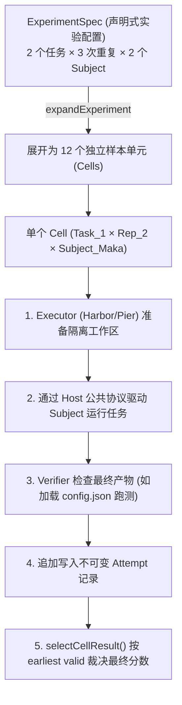

# 评测样本、执行与结果裁决

[返回手册目录](../README.md)

要科学评估两个 Agent 谁更擅长“修改 `config.json` 并保证旧配置不丢失、新模型能正常加载”，不能靠人工随便聊两句感觉谁更好，而需要一套**可重复、防作弊、与核心运行时严格隔离**的自动化基准评测体系（`@maka/eval`）。

本章解析 Maka 评测引擎的实验矩阵模型、外部边界隔离原则，以及防范统计偏见的核心裁决铁律——`earliest valid`（最早有效观测原则）。

---

## 1. 概念先行：为什么 Eval 必须站在 Host 协议之外？

在不少 Agent 项目中，开发者喜欢把评测脚本直接写进核心运行时的单元测试里，或者共享同一套内部数据库接口。这种做法会引发两大问题：
1. **边界污染（既当运动员又当裁判）**：运行时内核可能会为了跑分而针对评测字段做特殊逻辑分支，同时评测生成的大量临时实验记录会污染正常的交互式 State Root。
2. **无法横向公平对比**：如果评测逻辑深度耦合内部 API，就无法用同一把尺子去测竞品 Agent（如对比 Maka 与其他 CLI 工具）。

因此，Maka 确立了清晰的**评测隔离边界**：
- `packages/storage` 与 `packages/runtime` **完全不知道** `Experiment`、`Cell` 或 `Verifier`（评分器）的存在。
- `@maka/eval` 像一个纯粹的外部客户端，通过标准 `Runtime Host` 公共协议驱动被测的 Maka 对象（`Maka Subject`），与驱动外部竞品（`External Subject`）一视同仁。

---

## 2. 实验矩阵展开：Experiment → Cell → Attempt → Result

一份完整的声明式实验配置（`ExperimentSpec`）定义了：**基准测试集（Benchmark）+ 执行器（Executor，如 Harbor / Pier 容器）+ 被测对象（Subjects）+ 任务列表（Tasks）+ 重复次数（Repetitions）+ 验证器（Verifier）**。



### 概念辨析：实验重复 vs 基建重试 vs 内部续接
在多轮评测中，以下三个术语的边界极其重要，绝不能混淆统计口径：

| 机制 | 归属层级 | 发生原因 | 在评测体系中的计算方式 |
| :--- | :--- | :--- | :--- |
| **Repetition（实验重复）** | 实验设计层 | 对抗大模型的采样随机性，评估稳定通过率（如 `pass@k`）。 | **生成不同的 Cell**（例如 `Rep_1`, `Rep_2` 各自独立统计）。 |
| **Infra Retry（基建重试）** | 评测调度层 | 沙箱宿主机挂掉、测试容器拉取超时等环境故障（`infra_failed`）。 | **在同一个 Cell 下追加新 Attempt**，用于替换无效的基础设施故障。 |
| **Continuation（内部续接）** | Runtime Host 内部 | Maka 运行时自身面对进程中断或挂起的恢复行为。 | **属于单次 Attempt 的内部表现**，对外部评测引擎完全透明。 |

---

## 3. 防作弊裁决铁律：`earliest valid`（最早有效观测原则）

假设某个 Cell 第一次运行因为容器宿主机断网失败了（`infra_failed`），调度器自动为该 Cell 补跑了第二次（Attempt 2），最终模型完成了任务并拿到了 1.0 分。此时，如果还有手误多触发的一次 Attempt 3 拿了 0.5 分，该取哪条？

或者另一种情况：Attempt 1 模型自己把代码改挂了（`subject_failed` 或 0 分），操作员觉得“可能只是运气不好”，又手动重跑了一次 Attempt 2 拿了 1.0 分，能把 Attempt 2 算作这个 Cell 的最终成绩吗？

**答案是：绝对不能！** 如果允许从多次有效运行中挑最高分，或者由操作员人工选定偏好的结果，评测数据就会因为“挑选偏见（Cherry-picking）”而彻底失真。

Maka 的结果裁决器（`selectCellResult()`）强制执行 **不可变追加 + `earliest valid` 规则**：
1. Cell 下的每次 Attempt 均为只追加的不可变记录。
2. 裁决器按顺序扫描该 Cell 的 Attempt 列表，跳过所有标记为 `infra_failed`（基础设施自身损坏，未构成有效测试）的记录。
3. **一旦遇到第一条合法完成评估的记录（无论是 `completed` 得 1 分、`completed` 得 0 分，还是 `subject_failed` 模型自身崩溃），立即锁定它作为该 Cell 的最终权威结果**，忽略后续一切重复补跑。

---

## 4. 教学伪代码：实验展开与 `earliest valid` 裁决

```text
// 1. 展开声明式实验矩阵
function expandExperimentToCells(spec):
    cells = []
    for task in spec.tasks:
        for repIndex in 1 .. spec.repetitions:
            for subject in spec.subjects:
                cells.push({
                    cellId: `${task.id}__rep${repIndex}__${subject.id}`,
                    task,
                    repetition: repIndex,
                    subject,
                    // 所有对比臂严格共享同一份预算、执行器和验证器，确保公平
                    budget: spec.budget,
                    verifier: spec.verifier
                })
    return cells

// 2. 裁决单个 Cell 的最终权威结果 (禁止人工挑选或取最大值)
function selectCellResult(attemptsForCell):
    ordered = sortBySequenceNumberAsc(attemptsForCell)
    
    for attempt in ordered:
        // 仅跳过纯基础设施故障 (例如 Docker 守护进程崩溃)
        if attempt.status == "infra_failed":
            continue
            
        // 只要是模型/Subject 真正跑出来的有效观测 (含 0 分和 subject_failed)，
        // 立刻采信为最终权威结果！
        return {
            authoritativeAttemptId: attempt.id,
            score: attempt.score,
            normalizedUsage: attempt.usage,
            attributableCost: attempt.cost,
            durationMs: attempt.durationMs,
            status: attempt.status
        }
        
    return { status: "pending_or_no_valid_attempt" }
```

---

## 5. 对照 Pi：本地脚本评测 vs 隔离容器实验平台

- **Pi 的做法 (`packages/evals` & `suite`)**：Pi 使用 `createTaskPlan()` 展开案例与模型变体，由 `runPiCodingAgent()` 直接为样本构建工作区和会话并执行 Prompt，保存会话记录和结果；同时在代码库测试中提供确定性的 `faux harness` 指定模型回复，用于低成本复现特定软件分支行为。
- **Maka 的做法 (`packages/eval`)**：面向标准化的跨框架基准对比（如 Harbor/Pier 容器执行器集成），强调实验规格的不可变性、多对比臂（A/B Test）严格同环境同预算，并通过 `earliest valid` 规则从制度上保障评估结果的可信度。

---

## 6. 延伸阅读

- 了解 `Maka Subject` 在驱动 `runHostedExecution()` 时如何汇总用量和执行轨迹，阅读 [06.2 请求计量、上下文诊断与故障排查](observability.md)。
- 了解评测过程中模型断线或工具崩溃如何影响 `Attempt` 状态，阅读 [04.1 持久化执行与崩溃恢复](../04-state/durable-execution.md)。
