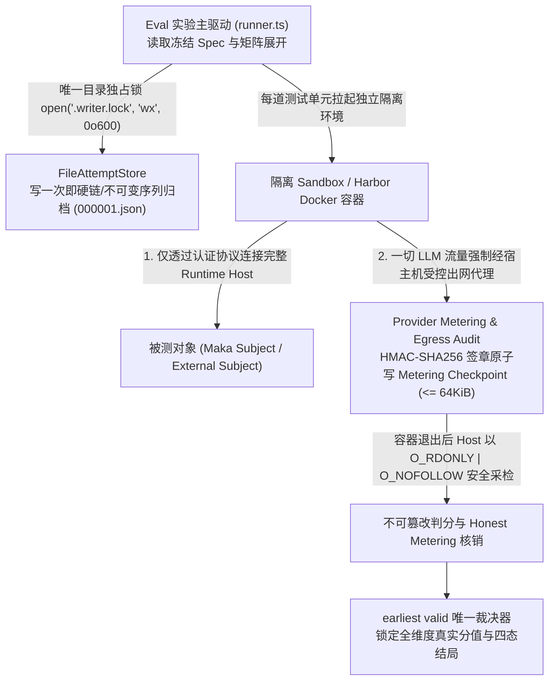

# 隔离容器实验与防作弊裁决：Host 外置协议评测、`earliest valid` 与 Honest Metering

## 1. 为什么在“自己代码库里写个循环跑几条题并 `fs.writeFile` 存分数”算不上工程级基准评测？

搭建评估管线时，绝大多数团队容易做出一套极其脆弱且充满自我欺骗风险的脚本：在主工程里 `import { runAgent }`，循环喂 50 个任务给函数调用，拿到返回值跑正则判断一下就算打分完事。只要把这种脚本推进严肃基础设施迭代和自动化打榜实战，它立刻会在四处漏风：

1. **进程污染与评测不真实**：直接调用内部函数不仅绕过了真实的 `Runtime Host` 接入协议、六阶段冷启、权限边界以及 IPC 推流反压瓶颈（测出一堆“函数直跑全对、真打包上客户端却崩在边界序列化”的假高分），而且宿主自身内存泄漏或子进程残留直接串扰下一道考题！
2. **狡猾或产生幻觉的被测智能体篡改证据（Eval Tampering）**：在具有本地文件系统读写和 `Bash` 执行权限的测试容器里，被测模型完全有可能通过扫描路径找到宿主的评测配置、偷换环境变量里的真实大模型端口代理计数文件、甚至创建一个假冒符号链接骗过计量脚本把费用抹成零！
3. **重跑挑好成绩的隐性刷分偏见（Cherry-picking Retries）**：如果某个评测单元跑了第 1 次失败、第 2 次因为网络波动重试成功、或者并发两个实验进程互相写坏同一个结果文件，事后怎么防止人为筛选最好看的成绩或者发生数据混写？

Maka TypeScript 版在独立子包 **`packages/eval`** 中，构建起了一座严厉隔离的基准实验驱动平台：**将 `packages/eval` 坚决置于 `Runtime Host` 协议外围、冻结实验规格并严格隔离并发存储锁、同时靠 `O_NOFOLLOW` 常规文件检定、HMAC-SHA256 代理计量检查点与铁面 `earliest valid` 裁决守卫**，把防作弊与科学可复现刻进了文件系统的每一次系统调用里。

---

## 2. 边界铁律：Eval 站在 `Runtime Host` 外部，以真实客户端视角施考

观察 `packages/eval/src/` 的完整模块装配拓扑（包括 `maka-subject.ts`、`harbor-maka-subject.ts`、`harness-executor.ts` 与 `provider-admission.ts`），核心架构红线清晰无比：



这一外置架构设计逼迫评估体系彻底还原真实生产路径：
- **不直接引用内部私有函数**：`MakaSubject` 与 `HarborMakaSubject` 就像桌面客户端和 CLI 一样，**完全经由标准化启动命令与经过鉴权的 Runtime Host 通信协议接入被测目标**，顺带把启动序列、压缩触发、沙箱隔离及 MCP 挂载全部端到端卷入考卷范围；
- **出网流量强制过境计量与审计（`egress-audit.ts` & `provider-metering.ts`）**：所有受测主体的上游大模型请求全数经宿主机测可控中转网关代理发送——被测模型在容器里绝对不可能私自发起无审计外连，哪怕它跑在独立子会话或者嵌套了 `Code Mode`，其真实流量损耗也在出网咽喉被逐字节记录在案。

---

## 3. 实验规格冻结、三类重跑区分与防泄题隔离

严肃工程基准决不能把“重试修复网络故障”、“多次采样取稳定性（Pass@k）”和“不小心重复提交”混为一谈。`packages/eval` 对实验模型做出高度概念净化：

1. **Specs 冻结入档案与矩阵展开（`spec.ts` / `experiment.ts`）**：实验启动前即把提示词、目标分支、模型配额、工具沙箱剖面及超时硬线完整冻结，展开成互不干扰的原子测试单元矩阵（Cell Matrix）；
2. **清晰区隔三类重复行为**：严密区分因统计分布所需的 **`Samples`（多次独立样本采样）**、仅当基础设施崩溃后才合法开启的 **基础补测重试** 与严禁污染已有编号的 **增量扩充实验**；
3. **防泄题安全网（Secret & Path Isolation）**：通过独立的受限 `harness-environment.ts` 与 `install-preflight.ts` 环境组装校验，在考题集与标准判分脚本（Verifier）对被测容器保持物理隔离的前提下启动容器运行，避免被测 Agent 顺手读取到测试正确答案文件。

---

## 4. 硬核防篡改存储与防作弊计量：`FileAttemptStore` & `metering-checkpoint.ts`

最值得架构师逐行鉴赏的细节，藏在 `packages/eval/src/attempt-store.ts` 与 `metering-checkpoint.ts` 的零妥协操作系统防护里：

### 4.1 排他文件写锁与不可变顺序编号（`attempt-store.ts`）

```typescript
// 真实实验写互斥防重保护（提炼自 packages/eval/src/attempt-store.ts）
async function runExclusive<T>(storeDir: string, operation: () => Promise<T>): Promise<T> {
  // 以独占创建位 'wx' (O_CREAT | O_EXCL) 建立锁文件：绝不允许两个并行评测 Runner 偷偷写进同一个实验目录！
  const lockHandle = await open(join(storeDir, '.writer.lock'), 'wx', 0o600);
  try {
    return await operation();
  } finally {
    await lockHandle.close();
    await unlink(join(storeDir, '.writer.lock'));
  }
}
```
在排他保护之内，每一个单元的每一次执行尝试均落盘为不可覆写的定长序号账单 **`000001.json`、`000002.json`...（匹配 `/^\d{6}\.json$/`）**，辅以硬链接不可变归档防护，根本无法悄悄涂改既成历史结果。

### 4.2 对抗恶意容器内部篡改：`O_NOFOLLOW`、`chmod(0o644)` 原子更名与 HMAC 签章

在容器外部统计费用的 Proxy 与被测容器之间存在着非对称信任关系（**绝不信任运行着被测 AI 的容器内部磁盘安全**）。查看 `metering-checkpoint.ts` 的代码防御细节简直滴水不漏：
1. **写侧防撕裂与 umask 对抗**：写入计量检查点 JSON 时，先落临时文件 `tmp-${pid}` 并**显式执行 `chmod(0o644)` 再原子 `rename()` 上线**——代码注释专门解释道，宿主机无法控制子容器内设置的默认 `umask`，如果不先强改权限再原子更名，竞争读端可能会瞬间撞上一只刚创建完成却可读权受限的文件；
2. **读侧封杀软链偷天换日（`O_NOFOLLOW`）与体积卡死**：宿主机回收检查点文件时，强制加上底层系统调用标志 **`constants.O_RDONLY | constants.O_NOFOLLOW`**，并用 `handle.stat()` 严格验证确属常规文件（`info.isFile()`）且体量 **`<= 64 KiB`（`METERING_CHECKPOINT_LIMIT_BYTES`）**！如果被测 Agent 试图用假软链接把它替换指向容器里的巨大欺骗文件，读取端当场拒绝解析；
3. **HMAC-SHA256 恒定时间验真（`timingSafeEqual`）**：所有代理统计出账数据附带宿主机私有秘钥签名生成的 64 位十六进制 MAC 校验码，哪怕容器内部把明文文件硬生生改写了一位数字，验证器通过恒定时间比较当场捕获篡改并将计量标志标为不可信状态！

---

## 5. 防作弊裁决铁律：四态结局与 `earliest valid` 锁定

当一次 Cell 的所有尝试跑完结算收官时，结果状态（`EvalResultStatus`）严格划分为截然分明的四个终态，拒绝任何“模糊通过”：
- **`completed`**：被测 Agent 在能力规范内顺利完整结案并接受后续 Verifier 校验；
- **`subject_failed`**：被测对象在自身逻辑或能力策略范围内失败中止（计为真实模型能力扣分，而非跑环境借口）；
- **`infra_failed`**：宿主框架、容器底座或网络代理本身发生客观设施故障（必须严格从有效成绩基线中剔除，防止把云端节点宕机算到某一次 Prompt 架构头上）；
- **`indeterminate`**：超出界定可判范围的不可定结论（同样防止静默伪造零分/满分）。

而裁定最终指标采用的铁律更为冷酷——**`earliest valid`（锁定最早有效成绩）**：对于同一个既定实验单元，一旦存在多次记录，只要最早一条既非 `infra_failed` 也未违反环境前提，最终出账得分与消耗开销就**死死锁死在那最早一份完整有效试跑档案上**。彻底截断任何靠后期微调重试挑拣幸运样本的“实验注水”行为！

---

## 6. 总结

`packages/eval` 让 Maka TypeScript 架构的可靠性工程闭环彻底落地在可证伪、可审计的真实数据之上：
1. **站在真实 Host 协议之外施考**：绝不用跳过接入闸门与序列化的轻量内存测试蒙蔽系统瓶颈；
2. **系统调用级防容器对抗作弊**：`open('.writer.lock', 'wx')` 防止多线程互踏，**`O_RDONLY | O_NOFOLLOW` + HMAC-SHA256 + 64 KiB 封顶** 将可能失控的容器环境物理隔离在账本之外；
3. **诚实计量与 `earliest valid`**：四态分类杜绝混算设施失败和能力失败，`earliest valid` 确保打榜报告永远真材实料、不可回溯修饰。

至此，关于 Maka TypeScript 架构自身的整套剖析（**模块 00 至 模块 06，共 26 篇深度专题**）已全部重铸完成！

在进入最后一部分之前，我们手里恰好还握着一套极佳的对照坐标系：业界另一个极具代表性的极简嵌入式 TypeScript 运行时代表 **Pi（hook 驱动进程内循环架构）**。通过把同样复杂的需求摆在 **Maka Event-Sourced Host 内核** 与 **Pi 极简嵌入式运行时** 这两种哲学截然对立的基础设施模型面前逐一拆解碰撞，我们就能得出超越单一工具之上的通用架构设计定律！接下来进入最后篇章 **07 基础设施范式深度对照**：[状态机、持久化与控制权：Event-Sourced Host 内核 vs 嵌入式 Hook 运行时](../07-comparison/overview.md)。
