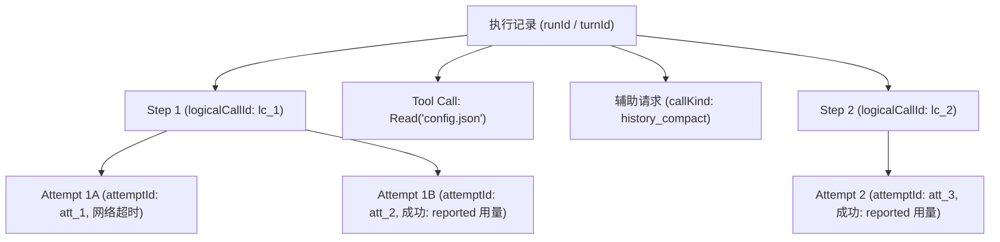

# 请求计量、上下文诊断与故障排查

[返回手册目录](../README.md)

当线上用户反馈“刚才让 Agent 读取配置并排查错误，不仅等了两分钟才出结果，而且 Token 账单异常高”时，工程团队需要能立刻回答三个问题：
1. **钱花在了哪里？** 是主对话步数太多，还是背后频繁触发了历史压缩（`Compaction`）或是网络重试？
2. **上下文为什么爆了？** 是系统提示词太长、引入了过多 MCP 工具声明，还是某次工具读出了巨型日志？
3. **时间卡在了哪里？** 延迟是出在模型供应商排队，还是卡在本地文件沙箱执行？

Maka 通过**身份关联的请求计量、结构化的上下文诊断快照以及全链路追踪投影（Session Trace）**，为 Agent 提供了透明的运行视野。

---

## 1. 概念先行：可观测性的身份关联骨架

在普通后端服务中，一次请求通常对应一次 RPC 调用。但在 Agent 系统中，一次用户任务（`turnId` / `runId`）是一棵包含多层异步调用的执行树。Maka 利用统一的身份 ID 体系将“账本事件”与“网络请求”严丝合缝地串在一起：



- **`logicalCallId`（逻辑调用 ID）**：标识“一次模型推理决策”。无论该步骤因为网络波动重试了多少次，这些重试全部共享同一个 `logicalCallId`。
- **`attemptId`（物理尝试 ID）**：标识每一次真正发向大模型的 HTTP/RPC 请求。每次重试都会生成新的 `attemptId`，独立记录耗时与底层状态。
- **`callKind`（调用类别）**：明确区分“主推理请求（`main`）”与“后台历史压缩摘要请求（`history_compact`）”，使账单按业务维度精准拆解。

---

## 2. 三大观测支柱详解

### 2.1 精确请求计量与置信度口径（`ProviderRequestTracker`）
在发起每次请求前，追踪器（`ProviderRequestTracker.trackStream()`）记下精确的起始时间戳与双层 ID。当流结束或异常中断时，系统将结果、耗时与用量写入 `ModelCallAttempt` 记录。

值得注意的是，网络中断时厂商网关可能根本没机会返回标准 Token 计数。为了不欺骗账单，Maka 给每笔用量打上了明确的**数据口径标签**：
- **`reported`**：模型供应商在完成包中明确返回的权威 Token 计数（100% 精确）。
- **`partial`**：流式传输中途断开，仅记录到断流前已估算或部分回传的消耗。
- **`missing`**：请求在首包到达前即超时或鉴权失败，无计价数据。

### 2.2 上下文诊断面板（`latest_context` & `RequestShape`）
很多开发者面对“上下文突然超限”时束手无策，因为只看最终的 `inputTokens` 总数，根本不知道空间被谁占用了。

Maka 在每次主模型请求原子提交时，同步更新 `latest_context` 诊断快照，并通过 **`RequestShape`（请求形状分析器）** 按四大组成部件统计真实的**序列化字节占比**：
1. **系统提示词（System Prompt）**：基础人设、工作区规范与动态注入的环境提示。
2. **工具声明（Tool Definitions）**：内置工具及动态挂载的成百上千个 MCP 工具 JSON Schema（实践中常常是隐藏的 Token 吞噬大户！）。
3. **对话消息（Messages）**：经过投影与压缩后的用户/助手/工具历史。
4. **其他输入（Other）**：附加参数或特定供应商配置。

通过 `readLatestContextDiagnostics()` 读取这份快照，前端界面可以直观画出上下文水位条，开发者也能一眼揪出导致上下文膨胀的元凶。

### 2.3 全链路执行追踪（`projectSessionTrace`）
当需要排查“为什么刚才那轮操作耗时 45 秒”时，单独看网络日志或单独看聊天记录都是盲人摸象。

Maka 的追踪投影器（`projectSessionTrace()`）在读取侧将两份数据源合二为一：
- 从 **不可变 `RuntimeEvent` 账本** 读取逻辑步骤边界、工具调用时间点以及运行终态；
- 从 **SQLite 计量表** 读取每一次 `ModelCallAttempt` 的首包延迟（TTFT）、总流式耗时与重试等待时间；
- **按执行 ID 与调用 ID 精确对齐**，拼装出一条类似浏览器 DevTools Waterfall（瀑布流）的完整时间轴，等待发生在哪个环节一目了然。

---

## 3. 教学伪代码：请求追踪与上下文形状采集

```text
function trackModelAttempt(tracker, logicalCallId, callKind, requestPayload):
    attemptId = generateUUID()
    startTime = clock.now()

    // 1. 采集本次请求的成分构成 (字节分布，用于定位上下文膨胀)
    shape = analyzeRequestShape({
        systemBytes: byteLength(requestPayload.system),
        toolsBytes: byteLength(requestPayload.tools),
        messagesBytes: byteLength(requestPayload.messages)
    })

    try:
        stream = modelSdk.streamText(requestPayload)
        // ... 消费流并记录首包时间 ttftMs
        finalUsage = await stream.usage
        
        // 2. 原子提交计量记录与最新上下文诊断快照
        await store.commitModelCall({
            logicalCallId,
            attemptId,
            callKind, // e.g. "main" or "history_compact"
            durationMs: clock.now() - startTime,
            usage: { ...finalUsage, completeness: "reported" },
            latestContextSnapshot: (callKind == "main") ? { shape, inputTokens: finalUsage.input } : null
        })
    catch StreamInterruptedError err:
        // 3. 即使断流失败，也必须诚实记录已消耗的耗时与部分用量口径
        await store.commitModelCall({
            logicalCallId,
            attemptId,
            callKind,
            durationMs: clock.now() - startTime,
            usage: { completeness: err.hasPartialUsage ? "partial" : "missing" },
            errorCode: err.code
        })
        throw err
```

---

## 4. 对照 Pi：轻量总量统计 vs 多维结构追踪

- **Pi 的做法**：`coding-agent` 在 `usageTotals` 中汇总会话条目的 Token 与费用消耗，并直接向界面报告当前激活上下文的占用情况；同时利用内存中的事件订阅向应用推送消息与工具起止进度。
- **Maka 的做法**：由于存在多轮自动重试、隐式后台压缩、多端并发以及独立的离线评测引擎，Maka 将计量粒度下沉到 `Attempt` 物理级，强制区分 `reported`/`partial`/`missing` 口径，并提供 `RequestShape` 成分拆解和基于持久账本的 `SessionTrace` 瀑布流投影，满足生产级运维与精准成本归因的要求。

---

## 5. 延伸阅读

- 了解 `latest_context` 原子提交时如何利用时间戳与 `attemptId` 防止乱序覆盖，阅读 [00.4 设计模式与架构权衡](../00-foundations/design-tradeoffs.md)。
- 了解离线评测引擎是如何基于这些计量字段与耗时指标来对比不同 Agent 表现的，阅读 [06.3 评测样本、执行与结果选择](evaluation.md)。
