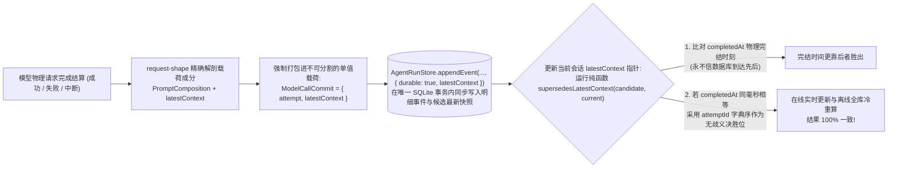

# 单值原子计量与诊断瀑布流：ModelCallCommit、RequestShape 与冷热重建对齐

## 1. 为什么传统系统里的“用量报表和最新上下文诊断”经常和真实账单对不上账？

当一个 Agent 平台开始承载商用计费审计、大窗口体积优化以及跨团队排障时，工程团队很快就会被三个极隐蔽的可观测性谎言折磨得痛不欲生：

1. **缓存字段真假混填（Provenance Blindness）**：有的模型服务商直接在返回体里精准给出了 `cacheReadInputTokens`，而有些兼容网关没给这个字段，于是监控脚本用 `total - input` 顺手推导出一个估算值填进去。结果在账单和效果剖析看板上，“厂商官方权威实测数”与“本地粗糙推导估数”混成同一个字段，完全没法分析真实的 Prompt Cache 命中退化根因！
2. **多参数分离提交与漏传漂移**：在复杂调用环的出口，主状态提交和指标更新如果是两个分开的散落调用（或者需要传五个可选位置参数），只要某一条冷门异常分支（例如压缩调用、子代理回退分支）忘了顺手刷新一把上下文诊断快照，看板上的上下文进度条就会永远定格在一个错误历史时刻。
3. **异步并发反序覆盖（Out-of-Order Commit Overwrite）**：第 1 次超长请求耗时 4 秒、第 2 次短请求只耗时 0.8 秒先跑完写库；如果“最新上下文窗口视角”单纯取数据库最后 `INSERT` 进来的那一行，晚 3 秒到达的老请求就会把新鲜出炉的诊断视图强行倒退覆盖回老黄历！

Maka TypeScript 版利用 **`ProviderRequestTelemetry` 诚实来源标注**、**不可分割的单值载体 `ModelCallCommit`**、**`RequestShape` 结构化字节拆解**以及 **确定性决胜算子 `supersedesLatestContext`**，确保了线上实时热统计与事后冷库全量重算得出分毫不差的统一审计视图。

---

## 2. 诚实口径计量体系：`ProviderRequestTelemetry` 与来源印记

打开 `packages/runtime/src/provider-request-telemetry.ts`，最体现架构洁癖的便是它对每一个与缓存计费强相关的核心 Token 数值额外强绑一枚 **来源元数据（`ProviderRequestCacheValueSource = 'provider' | 'derived'`）**：

| 核心计量维度 | 携带的来源权威标注 | 工程审计价值 |
| :--- | :--- | :--- |
| **`cacheReadInputTokens`** | `cacheReadInputSource: 'provider' \| 'derived'` | 清楚划出“这是供应商回包亲口承认的缓存命中”，还是“本地按协议特性推导”的结果 |
| **`cacheMissInputTokens`** | `cacheMissInputSource: 'provider' \| 'derived'` | 精准定位究竟是未命中缓存，还是统计模型本身在推导缺省值 |
| **`cacheWriteInputTokens`** | `cacheWriteInputSource: 'provider' \| 'derived'` | 透明还原 Anthropic / Responses 等协议下的 Cache Write 写入代价 |
| **调用类型与分类归属** | `ModelCallKind` (主步 / 主动压缩 / 记忆提取 / 标题总结等) | 连同 `HistoryCompactRoute` 一起入库，让企业或个人一眼看穿“到底有多少钱烧在了主业务，又有多少烧在了辅助维护流程里” |

除此之外，连带发起摘要压缩的辅助物理请求（还记得 `ai-sdk-compaction-contract.ts` 中的强调吗？），也坚决要求上游必须直接传入构造完备的现成 Tracker 实例——**绝不允许下层零件自己凑参数现组装**，从构造方式上消除统计分支漏记。

---

## 3. 单值原子包装 `ModelCallCommit` 与确定性决胜排序 `supersedesLatestContext`

为了让“单次请求明细”和“最新上下文诊断体”永不脱节、永不并发倒流，Maka 在存储边界立下两条硬规定：

这一套机制巧妙解决了前文提到的两大致命错位：
1. **单对象类型死防漏传**：由于 `ModelCallCommit<TAttempt>` 在 TypeScript 类型契约里就把 `{ attempt, latestContext }` 焊成唯一入参结构体，任何重构或者适配器只要少组装了 `latestContext` 属性，编译期 `typecheck` 当场报错打回，彻底告别生产静默盲点；
2. **线上、线下跑同一套纯裁判代码**：无论是在高并发流式运行期间动态推新指标，还是事后从头读取 `AgentRunStore` 全库重构历史视图（甚至走 `RuntimeLedgerRepair` 修订版本修复），全都直接调用同一个纯函数 `supersedesLatestContext`。因为永远认准 **`(completedAt, attemptId)`** 二元全序关系，绝不存在延迟晚到几秒的并发回执把更新数据覆写的滑稽现象。

---

## 4. `RequestShape` 成分剖析：为什么这次上下文一下子涨了 4 万 Token？

普通监控只能告诉你“这一步 Input Tokens 用了 128,000”，却无法回答工程师最想骂娘的问题：**“到底是谁吃掉了我的窗口？是 System Prompt 膨胀了、MCP 工具清单塞了 80 个 schema、某条历史输出忘了卸载，还是挂载进了一堆多模态图片？”**

`packages/runtime/src/request-shape.ts`（与 `latest-context-snapshot.ts`、`context-diagnostics.ts`）会在每次真实发出组装前对最终 Payload 做一次确定性的 **字节与 Token 成分解剖（`PromptComposition`）**：
- 将请求体切块分摊至清晰的正交维度：**System 指令基准、注入技能列表（Skills）、活跃 Tool 定义声明清单（Tool Definitions）、历史消息主体、多模态图片资产以及本步最新输入增量**；
- 一旦上下文突然激增触发被动压缩或用户感觉费用突增，开发者无需把几十兆 JSON 原始日志翻个底朝天，直接调取对应的 `ContextBudgetDiagnostic` 快照就能在毫秒内精确锁定罪魁祸首所在的维度成分块。

---

## 5. 全链路瀑布流追踪与复盘视图：`projectSessionTrace` 与 `session-recap`

面向高阶排查与自动化运维审计，可观测体系提供了两把互补的 X 光透视镜：
- **时序对齐瀑布流投影（`projectSessionTrace` / `execution-inspect.ts`）**：把跨接了 **`Host -> RuntimeKernel -> AiSdkTurn (Attempt) -> ToolRuntime (T1/T2) -> Sandbox / Client Capability -> Storage`** 六层架构边界的异步事件流，按照共享 `invocationId` / `stepId` / `operationId` 重新拉直成一幅严密对齐的毫秒级执行瀑布图。哪一步卡在首包 TTFT、哪步被 `AdmissionLimiter` 限流等待、哪步被 `Filesystem Worker` 耗时阻塞，一目了然。
- **高密度会话结构化回顾（`session-recap`）**：将一场包含上百步动作的长程复杂任务提炼出关键转折节点、文件受影响目录总览、工具失败统计与安全封存记录（如 `outcome_unknown`），既可呈现在客户端复盘抽屉里供人类快速审查交接，也能直接作为容器评测报告（Eval Artifacts）的证据基线资产导出。

---

## 6. 总结

Maka TypeScript 版的可观测与诊断架构彻底告别了“多端口径对不齐、坏掉原因靠猜测、延迟计量掺水”的混沌常态：
1. **`ProviderRequestTelemetry` 诚实来源标注**：`provider` 与 `derived` 永久分开审计，保住缓存分析真实性；
2. **`ModelCallCommit` + `supersedesLatestContext`**：用编译期强制绑包加 `(completedAt, attemptId)` 全序裁决，保证热写与冷重建零漂移；
3. **`RequestShape` + `projectSessionTrace`**：既看清每分 Token 花在哪些提示成分上，也看清每一微秒到底耗在哪道跨越沙箱或网络池的栅栏边界上。

有了这套严谨的追踪、防重、恢复与高保真账本，整个 Agent 运行时自身终于经得起最严苛的工程拷问。但这还不够——当我们要把它拉进真实 Docker 容器环境里，对标业界高难度编程和端到端任务基准做大规模对比评测，同时确保被测的狡猾智能体既不能从主机环境变量里偷窥作弊答案、也不能篡改硬盘里的用量计量检查点虚报费用时，评测平台自身该怎样做到比内核还严密可靠？请看本章也是模块 06 的最后一篇：**[隔离容器实验与防作弊裁决：Host 外置协议评测、`earliest valid` 与 Honest Metering](./evaluation.md)**。
