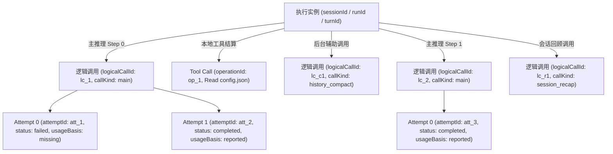
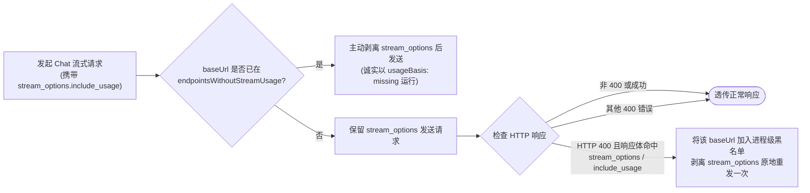
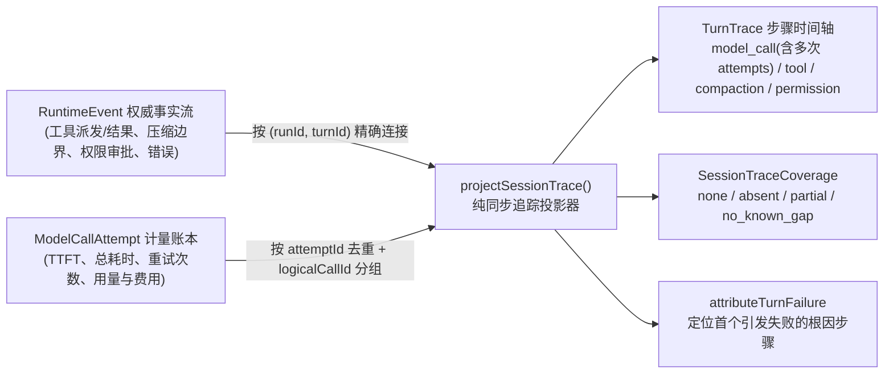

# 请求计量、上下文诊断与故障排查

[返回手册目录](../README.md)

当线上用户反馈“刚才让 Agent 读取 `config.json` 并排查超时问题，不仅等了两分钟才出结果，而且 Token 账单异常高”时，工程团队不能靠翻阅杂乱的文本日志猜测答案，而必须能在毫秒内精确回答三个问题：
1. **钱花在了哪里？** 是主对话步数过多，还是网络超时引发了物理重试，抑或是后台悄悄触发了历史压缩（`history_compact`）、标题生成或记忆提取？
2. **上下文为什么突然爆窗？** 是系统提示词太长、动态挂载了上百个 MCP 工具 Schema，还是历史对话里的工具输出过大？
3. **时间卡在了哪个环节？** 延迟是出在模型供应商首包排队（TTFT）、流式断流重试等待，还是本地沙箱工具执行或权限审批？

Maka 通过**双层身份关联的请求计量（`ProviderRequestTracker`）、单对象原子提交与决胜排序（`ModelCallCommit`）、字节级成分诊断（`RequestShape`）以及全链路瀑布流投影（`projectSessionTrace`）**，构建了一套“绝不虚报、绝不撕裂、可审计复盘”的生产级可观测性体系。

---

## 1. 概念先行：可观测性的身份骨架与多维分类

在常规 Web 服务中，一次请求通常对应一次 RPC 调用。但在 Agent 系统中，一次用户轮次（`turnId` / `runId`）是一棵横跨主推理循环、网络物理重试、工具并发结算以及异步辅助调用的复杂执行树。如果只用 `turnId` 记录耗时或 Token，重试花掉的钱、后台压缩摘要花掉的钱以及不同供应商的缓存命中情况将全部混成一团无法拆解的糊涂账。

Maka 用一套正交的身份坐标将“因果事实账本（`RuntimeEvent`）”与“物理计量账本（`ModelCallAttempt`）”严丝合缝地锚定在一起：



- **`traceId`**：单次 `ProviderRequestTracker` 追踪器实例标识，贯穿单次 `send()` 或辅助调用。
- **`logicalCallId`（逻辑调用 ID）**：标识“一次模型推理决策”。无论某个 Step 因为网关断流或看门狗超时重发了多少次，所有重试全部共享同一个 `logicalCallId` 与 `step` 编号，避免消费端用 `(traceId, step)` 隐式拼键猜错。
- **`attemptId`（物理尝试 ID）**：标识每一次真正发往大模型供应商的 HTTP/WebSocket 请求（同时是账本写入的幂等主键）。每次重试生成全新的 `attemptId`，`attempt` 序号从 `0` 递增，独立计量 `startedAt`、`completedAt`、`latencyMs` 与 `timeToFirstTokenMs`（首包延迟 TTFT）。
- **`requestCompositionId`**：指向本次逻辑调用使用的提示词与工具快照哈希，供 Step 及其所有重试共享对照。
- **`callKind`（12 维调用类别）**：在主循环之外，Agent 基础设施还会在后台运行大量辅助模型调用。Maka 强制对每次调用标注精确业务维度：
  - **主循环推理**：`main`
  - **上下文压缩**：`history_compact`（携带物理路线 `historyCompactRoute`: `'text_summary'` | `'provider_native'`；另有仅保留历史解码兼容的 `semantic_compact`）
  - **后台运维与智能体协作**：`goal_evaluation`、`session_title`、`session_recap`、`session_checkin`、`prompt_suggestion`、`daily_review`、`memory_extraction`、`workhub_intent`、`workhub_recall`

> **工程判断**：当用户面板查询“会话主循环的上下文与缓存效率”时，查询层可以精准过滤 `callKinds: ['main']`；而查询“工作区全部真实账单”时则不限类别汇总全部 `callKind`，彻底解决了辅助摘要与主对话混淆归因的难题。

---

## 2. 请求计量与诚实口径体系 (`ProviderRequestTracker`)

### 2.1 严格提取与绝不填零 (`strictProviderRequestUsage`)
许多模型 SDK 适配器为了接口统一，在供应商未返回 Token 字段时会自动填入 `0`，或者将未知价格算作 `$0.00`。这在生产审计中是极其危险的静默谎言——**“调用真正免费”与“价格表缺失”、“Token 为零”与“网关断流未上报”有着本质区别**。

Maka 的 `ProviderRequestTracker` 通过 `withProviderStreamTracking` / `withProviderGenerateTracking` 包装语言模型，在 `strictProviderRequestUsage` 中贯彻“无原始证据绝不推断”原则：
1. **验明原始字段**：只有当原始负载 `raw` 中存在对应厂商的总量字段（如 OpenAI `prompt_tokens`/`completion_tokens`、Anthropic `input_tokens`/`output_tokens`、Google `promptTokenCount`/`candidatesTokenCount`）时，才采信标准化后的 `inputTokens` 与 `outputTokens`，拒绝继承适配器臆造的 `0`。
2. **分厂商解析缓存明细**：针对 Anthropic（`cache_read_input_tokens`、`cache_creation_input_tokens`，注意其 `input_tokens` 本身就是未命中缓存部分，标记 `cacheMissInputSource: 'provider'`）、OpenAI（`prompt_tokens_details.cached_tokens` / `input_tokens_details`）与 Google（`cachedContentTokenCount`）分别读取原始缓存字段；仅当总量与全部缓存分量都明确存在且分量之和不超过总量时，才允许减法派生 `cacheMissInputTokens`（标记 `source: 'derived'`）。
3. **双正交信心口径**：
   - **`usageBasis`（用量口径）**：
     - `'reported'`：供应商明确上报了完整的 `inputTokens` 与 `outputTokens`；
     - `'partial'`：流式传输中途断开，仅观测到部分 Token 字段（例如只有输入或只有缓存字段）；
     - `'missing'`：首包前超时、鉴权失败或上游不返回用量（强约束：此时所有 Token 字段在结构上必须缺失）。
   - **`costBasis`（计价口径）**：
     - `'priced'`：成功匹配定价表计算出 `costUsd`，同时将当时的 `pricingRevision` 与完整 `pricingRates` 费率快照冻结写入记录，防止日后改价导致历史账单对不上；
     - `'unpriced'`：定价未知时强制省略 `costUsd` 字段，绝不用 `0` 冒充未知价格。

### 2.2 取消与流结算的竞争处理（Provisional Settlement）
流式请求在被用户取消（`abort`）时，可能发生一种微秒级竞态：取消信号已经触发，但底层供应商其实刚刚在响应尾包里返回了真实用量。如果取消监听器直接把 Attempt 永久封死为 `aborted + missing`，这笔真实消耗就会凭空蒸发。

`ProviderRequestTracker` 在 `beginAttempt` 中引入了**暂定写入（Provisional）与最终结算覆写**机制：
- 收到无用量的 `aborted` 时，先以 `provisional` 状态写入一条临时 `ModelCallAttempt` 记录，但**保持 `settled = false`**，同时不移除流末尾的结算回调；
- 若随后流正常或带用量关闭（`finish`），`finalize` 会携带同一把幂等钥匙 **`attemptId`** 再次提交带有完整用量和费用的最终记录；
- `AgentRunStore` 与读侧 `dedupeModelCallAttempts()` 严格按写入顺序对 `attemptId` 去重保留最后一条，从而保证“既不漏掉取消瞬间，也不丢失实际产生的 Token 账单”。

### 2.3 兼容网关的退让机制 (`stream-usage-fallback-fetch`)
为了读取上下文水位，Maka 默认向所有 OpenAI Chat Completions 兼容端发送 `stream_options: { include_usage: true }`。然而部分严格的第三方代理或旧版 `vLLM` 服务会拒绝未知字段，对每条流式请求直接返回 HTTP 400。

`createStreamUsageFallbackFetch(baseFetch, baseUrl)` 在 HTTP 传输层实现了**受控的单次退让机制**：



这一退让刻意保持极度克制：只有明确返回 400 且响应体点名 `stream_options` 或 `include_usage` 时才触发；一旦退让，该节点被记录在进程级 `Set` 中，后续请求不再白白撞墙，同时计量账本诚实标记 `usageBasis: 'missing'`，界面也同步显示“无用量基线”，绝不伪造估算数字替代真实上报。

---

## 3. 单对象原子提交与确定性排序 (`ModelCallCommit`)

### 3.1 为什么“用量”与“最新上下文快照”必须单对象原子提交？
每次主模型请求完成时，系统需要同步更新两份数据：一是用于计费的 `ModelCallAttempt` 账本事件，二是供 `/context` 面板展示的 `latest_context` 诊断快照（记录当前模型最后一次看到的输入 Token 与提示词成分）。

早期架构中容易出现两个致命 Bug：
1. **位置参数静默丢失**：若回调签名把 Attempt 和快照分成两个位置参数传递，JavaScript 运行时会自动丢弃多余参数且 TypeScript 允许窄化回调，导致某一中间层漏传快照而生产环境毫不知情；
2. **异步并发乱序覆盖**：假设用户或子代理触发了重叠轮次，Turn A 的请求在 `t = 10` 完成，Turn B 的请求在 `t = 20` 完成，但 Turn A 的异步队列在 `t = 25` 才落盘。如果按“到达顺序”覆盖 `latest_context`，界面上的上下文水位就会倒退回旧状态，甚至与冷重启重建的结果完全不一致！

Maka 通过两条核心机制彻底消除上述撕裂：

| 保护机制 | 核心实现 | 解决的工程故障 |
| :--- | :--- | :--- |
| **`ModelCallCommit<TAttempt>` 单对象契约** | 将 `{ attempt, latestContext? }` 封装为单一强类型对象，要求全链路透传；存储层在同一 SQLite 写事务内同时插入 `core_agent_run_events` 与更新 `core_agent_run_projections`（key 为 `'latest_context'`）。 | 消除“账本写成功但诊断行未更新”或“诊断行描述了一笔根本没入账请求”的数据分裂；同时非内联子代理 Run 自动跳过更新父会话的 `latest_context`。 |
| **时间戳 + `attemptId` 决胜排序** | `supersedesLatestContext(candidate, incumbent)` 先比较请求真实的 `completedAt`（而非写入到达时间）；若恰好在同一毫秒内并发完成，则以 `attemptId` 字典序作为全局统一决胜依据（Tie-breaker）。 | 无论是热路径的增量更新，还是冷重启后扫描全量账本重建，两边调用完全相同的决胜规则，并发下永远收敛到同一张快照。 |

### 3.2 物化账本与新旧迁移合并 (`ModelCallLedger` & `usage-ledger-merge.ts`)
`core_agent_run_events` 存储了完整的物理调用事实，但按时间窗口聚合全工作区总花费（`usage.query`）时，每次全量扫 JSON 事件树代价过高。因此存储层在 SQLite 中维护了一张轻量物化表 `core_model_call_ledger`：
- **增量高水位追赶**：通过比较 `core_agent_runs.latest_model_call_sequence` 与账本投影已应用的检查点序列，在同一事务内增量物化新增的 `ModelCallAttempt` 列，使聚合查询直接走 SQL `SUM()`。
- **删会话不删账单**：当用户删除历史会话时，虽然会级联删除 `core_agent_runs` 事件流，但故意保留 `core_model_call_ledger` 中的已计费行（因此禁止通过“清空重放”重建该表），防止删除聊天记录导致全时总花费账单凭空缩水。
- **新旧表无损归并（`UsageProvenance`）**：对于架构切换前遗留的冻结旧表 `usage_llm_calls`（缺乏 `usageBasis` 与 `costBasis`），Maka 不做有损强行迁移，而是通过 `mergeUsageSummary` / `mergeUsageBuckets` / `mergeUsageLogs` 在读侧按 `(offset + limit)` 前缀归并两张表，并附上透明的 `UsageProvenance` 元数据（含 `coverage` 覆盖分类、`legacyRecords`、`unreadableRecords` 与 `pendingRepairs`）。

---

## 4. 字节成分诊断 (`RequestShape` & `LatestContext`)

面对上下文超窗，光看总数 `inputTokens = 128,000` 毫无头绪——开发者必须知道究竟是谁吃掉了预算。

### 4.1 语义分桶与 Top-64 工具排行 (`preparedPromptComposition`)
`RequestShape`（`request-shape.ts`）与 `foldPromptComposition`（`prompt-composition.ts`）直接在 AI SDK 模型调用接缝处捕获标准化入参（先通过 `secretFreeParams` 剥离 `headers`/`abortSignal` 并脱敏 OpenAI 压缩密文 `encryptedContent`），并按 Maka 固定的语义前缀顺序将所有载荷折叠为四个字节桶（`PROMPT_COMPOSITION_SEGMENT_KINDS`）：

1. **`system_instructions`**：系统提示词、工作区上下文与运行时指令；
2. **`tool_definitions`**：模型当前可见（`activeTools`）的工具 JSON Schema 定义（注：`canonicalizeToolSet` 将完整工具集 `providerTools` 与当前对模型可见的子集 `activeTools` 严格分离，未按需加载的延迟工具不会序列化到电线上，也不计入这笔字节开销）；
3. **`messages`**：经投影与历史压缩后的对话消息；
4. **`other`**：供应商特定参数（`providerOptions`）。

为了在不丢失精确度的前提下防止成百上千个 MCP 工具撑爆诊断记录自身，折叠器执行以下有界归约规则：
- 使用无损归一化 `normalizePreparedValue`（标记 `BigInt`、`Date`、`Map`、`Set`、二进制视图、`NaN` 与循环引用，深度上限 `64`）后计算精确 UTF-8 字节数；
- 将具名工具按字节数**降序排列**（字节相同按工具名字典序决胜），仅保留前 **`PROMPT_COMPOSITION_MAX_TOOLS = 64`** 个最大工具的明细，超出部分折叠进 `remainingTools: { count, bytes }`，未具名工具归入 `unlabelledToolBytes`，从而保证明细之和严格等于 `tool_definitions` 总字节数；
- **铁律：只存真实字节，绝不在底层契约硬编码 `bytes / 4` 的 Token 估算**。因为对于 Base64 图片或不同语言的编码，`/4` 的偏差极大；只有在展示层向用户渲染近似百分比或估算条时，才明确标注 `≈` 估算符号。

### 4.2 O(1) 暖路径读取与 `ifLedgerRevision` 并发安全修复
`readLatestContextDiagnostics()` 读取会话当前上下文诊断时，走清晰的三态降级路径：
- **暖路径（O(1)）**：直接读取 `core_agent_run_projections` 中 key 为 `'latest_context'` 的单条衍生行：
  - 返回 `null` → 明确已判定“本会话尚无已完成的 `main` 请求”，直接返回 `no_completed_request`，避免每次面板刷新重复扫库；
  - 解码出合规的 `LatestContextSnapshot`（Schema v2）→ 直接返回！由于该快照在主请求提交同一事务内与对应的 `historyCompactBoundary` 一同冻结，绝不会出现“拿着 A 请求的 Token 数配 B 压缩检查点”的错位；
- **冷路径（Ledger Rebuild）**：当投影返回 `undefined`（未初始化）或格式损坏/旧版时，扫描本会话所有内联 Run 的 `model_call_attempt_recorded` 与 `history_compact_checkpoint_recorded` 事件，用同一套 `supersedesLatestContext` 规则选出权威请求及它 `startedAt` 之前最近一次压缩边界，最后调用 `repairEventProjection` 写回缓存，且必须携带快照读取前获取的 **`ifLedgerRevision` 版本锁**——若重建期间账本又有新写入，修补自动放弃，防止陈旧重建覆盖刚刚抵达的最新快照。

---

## 5. 全链路瀑布流追踪与会话回顾 (`projectSessionTrace` & `session-recap`)

### 5.1 双账本对齐投影 (`projectSessionTrace`)
当需要排查“为什么刚才修改 `config.json` 耗时 45 秒却最终失败”时，Maka 的 `projectSessionTrace()` 在内存中作为纯函数（不直接依赖存储 I/O）把两份数据源按 **`(runId, turnId)`** 精确拼接成按时间排序的执行瀑布流（Waterfall）：



投影器内部处理了四项极易被忽视的边界细节：
1. **避免重放幻象重试**：先对 `ModelCallAttempt` 按追加顺序执行 `attemptId` 去重，再按 `logicalCallId` 聚合出 `TraceModelCallStep`，把同一逻辑调用下的每次物理尝试按 `attempt` 序号嵌套展开，清晰区分“首包卡顿”与“多次退避等待”。
2. **工具调用与恢复决策对齐**：将 `function_call` / `toolDispatch` 与对应的 `function_response` 合并为单个 `tool` 时间条（防止同一工具在瀑布图出现“开始”和“结束”两条冗余行），并通过 `operationId` 关联崩溃恢复后的 `toolRecovery` 处置结论。
3. **诚实覆盖度声明（`SessionTraceCoverage`）**：比对 `RuntimeEvent` 中声明的 `runtimeSteps` 与计量账本中的主调用数量，以及 `unreadableRecords`、`oversizedRuns`，将可信度明确标记为 `'none'`、`'absent'`、`'partial'` 或 **`'no_known_gap'`**（注意：永远不宣称 `'complete'`，因为若进程在发出请求后、落盘前崩溃，账本本身无法证明“绝对没有遗漏”）。
4. **首因故障归因（`attributeTurnFailure`）**：如果 Turn 的最终状态不是 `'completed'`，归因器不直接把终端错误事件当成罪魁祸首，而是向前扫描整条时间轴定位**第一个**失败的 `tool`、`model_call` 或 `error` 步骤（例如第一步读文件报错或某步重试耗尽），让排查直指根因。

### 5.2 会话离开回顾 (`session-recap`) 与展示层脱敏 (`display-redaction.ts`)
- **预算受控的会话回顾（`buildSessionRecapMessages`）**：当用户离开一段时间返回会话时，Host 借助独立标识 `callKind: 'session_recap'` 生成一句 25–40 词的进度总结。为了绝不撑爆当前模型上下文且不篡改主历史账本，投影器将可用 Token 预算锁定在 `Math.floor(contextWindow * 0.85) - 4096`，按 Turn 从后往前逆序挑选历史，将工具结果截断至 `600` 字符以内（单轮极端超大时退化为二分查找适配纯文本），并用 `cleanSessionRecapText` 剥除多余前缀与引号后呈现，同时整笔耗时与费用独立记在 `session_recap` 维度下。
- **流式展示层防泄漏（`display-redaction.ts`）**：无论是瀑布流面板还是实时打字机界面，展示前均经过与后端结构化脱敏（`redaction.ts`）互补的 `redactSecrets` 处理（覆盖 Bearer/Basic 认证头、URL userinfo 与查询串秘钥、`x-api-key`、`sk-`/`AIza`/`ghp_`/`xox` 前缀及 40+ 字符高熵串）。针对流式增量输出，`redactStableStreamingSuffix` 与 `redactReversibleStreamingSuffix` 仅保留末尾 `128` 字符可变窗口，既防止长秘钥在吐字一半时意外泄露，又避免每收一个 Token 就对整段万字历史重复跑全量正则。

---

## 6. 教学伪代码：请求追踪、原子提交与冷热路径诊断

```text
// 1. ProviderRequestTracker：跟踪物理尝试并封装单对象原子提交
function trackStreamCall(tracker, step, callKind, modelInput):
    tracker.assertAccountingReady() // 派发前门控，绝不在流结束时才发现无法记账
    logicalCallId = tracker.getOrCreateLogicalCallId(step)
    attemptId = newUUID()
    startedAt = clock.now()
    firstTokenMs = null
    settled = false
    provisionalWritten = false

    // 剥离敏感头并计算 4 桶字节构成 (Top-64 工具 + 剩余汇总)
    composition = preparedPromptComposition(secretFreeParams(modelInput.params))

    function settleAttempt(status, usageRaw, error, finishReason):
        if settled: return
        isProvisional = (status == "aborted" and usageRaw == null)
        if isProvisional and provisionalWritten: return
        if isProvisional: provisionalWritten = true else settled = true

        usage = strictProviderRequestUsage(usageRaw) // 拒绝继承适配器填充的 0
        usageBasis = resolveUsageBasis(usage)       // "reported" | "partial" | "missing"
        cost = usage ? resolveCostSnapshot(usage, modelInput.modelId) : null

        attemptRecord = {
            logicalCallId, attemptId, traceId: tracker.traceId,
            step, attempt: tracker.nextAttemptOrdinal(step),
            callKind, promptComposition: composition,
            startedAt, completedAt: clock.now(), timeToFirstTokenMs: firstTokenMs,
            status, usageBasis,
            costBasis: cost ? "priced" : "unpriced",
            ...(cost ? { costUsd: cost.usd, pricingRates: cost.rates } : {})
        }

        // 仅主对话的已完成请求有权更新会话的 latest_context 快照
        latestContext = (callKind == "main" and status == "completed")
            ? { attemptId, orderedAt: attemptRecord.completedAt, snapshot: buildSnapshot(attemptRecord, modelInput.compactBoundary) }
            : null

        // 单对象原子提交，杜绝账本与诊断行撕裂
        accounting.record({ attempt: attemptRecord, latestContext })

    return wrapStreamWithPullAndCancelHooks(modelInput.doStream(), onFirstOutput = () => {
        firstTokenMs ??= (clock.now() - startedAt)
    }, onFinalize = settleAttempt)

// 2. 存储层原子提交：事务内写账本事件、推进高水位并按时间戳+attemptId决胜更新快照
function sqliteAppendRunEvent(db, sessionId, runId, event, latestContext):
    db.transaction("write", () => {
        anchor = readRunAnchor(db, sessionId, runId)
        insertAgentRunEvent(db, event)
        if event.type == "model_call_attempt_recorded":
            advanceModelCallHighWater(db, sessionId, runId, event.sequence)

        if latestContext != null and anchor.sessionInline:
            incumbent = readProjection(db, sessionId, "latest_context")
            // 仅当 completedAt 更大，或同毫秒下 attemptId 字典序更大时才覆盖
            if supersedesLatestContext(
                { completedAt: latestContext.orderedAt, attemptId: latestContext.attemptId },
                incumbent ? { completedAt: incumbent.completedAt, attemptId: incumbent.attemptId } : null
            ):
                upsertProjection(db, sessionId, "latest_context", latestContext.snapshot)
    })
```

---

## 7. 对照 Pi：轻量汇总与结构化 Span vs 双账本原子审计

| 观测维度 | Maka 的架构实现 | Pi 的架构实现 | 设计取舍与适用边界 |
| :--- | :--- | :--- | :--- |
| **计量粒度与口径** | 物理级 `ModelCallAttempt` 账本，显式分离 `logicalCallId` / `attemptId` / 12 种 `callKind`；强制标注 `reported`/`partial`/`missing` 与 `priced`/`unpriced` 并冻结费率快照。 | `coding-agent` 通过 `usageTotals` 与 `getUsageCostBreakdown()` 对 `SessionEntry`（assistant 消息、usage 条目、摘要/压缩条目）汇总 Token 与费用。 | Maka 满足多端高并发、自动重试及离线计费审计下的严格财务可追溯性；Pi 结构紧凑直接，无需维护独立计量表。 |
| **上下文成分分析** | `RequestShape` 实时测量四大语义部件 UTF-8 字节及 Top-64 工具排行，通过 `ModelCallCommit` 在事务内原子写入 `latest_context` 单一快照。 | 直接依据会话中激活的消息条目与模型窗口计算上下文占用率并汇报给 UI，无持久化字节成分快照。 | Maka 能精确定位究竟是 MCP 工具过多还是 System Prompt 膨胀；Pi 内存零持久化开销，交互反馈极轻。 |
| **全链路追踪形态** | 持久化 `RuntimeEvent` 因果流 + `ModelCallAttempt` 计量流双流归并（`projectSessionTrace`），提供覆盖率警告与首因故障归因。 | 通过 `@earendil-works/pi-telemetry` 提供强类型 Schema 约束的 `TelemetryContext` / `TelemetrySpan` 树（含内存记录器与 Noop 桩）记录运行期 Span。 | Pi 的 `pi-telemetry` 偏向 OpenTelemetry 风格的进程内强类型埋点；Maka 的 Trace 则直接由不可变持久化事件账本事后投影重建，重启或跨端后依然完整可查。 |
| **兼容性与流式脱敏** | 内置 `stream-usage-fallback-fetch` 探测严格网关退让 `stream_options`；展示层内置 `display-redaction` 有界流式秘钥遮蔽。 | 由统一 `pi-ai` 适配层直接屏蔽不同模型协议差异，扩展与 UI 直接消费归一化消息流。 | Maka 对不可控第三方兼容中转代理及企业合规展示做了更多防御性纵深工程。 |

---

## 8. 延伸阅读

- 了解 `ProviderRequestTracker` 记录的每次物理重试是如何由双阶段看门狗与指数退避策略触发的，阅读 [06.1 重试、超时与幂等性防护](retry-timeout-idempotency.md)。
- 了解离线评测引擎是如何读取 `HostHostedExecutionRunner` 汇总的计量数据与未结算覆盖率来裁决实验结果的，阅读 [06.3 评测样本、执行与结果裁决](evaluation.md)。
- 回顾单对象快照 `ModelCallCommit` 在全系统中的设计权衡位置，阅读 [00.4 设计权衡与模式](../00-foundations/design-tradeoffs.md)。
