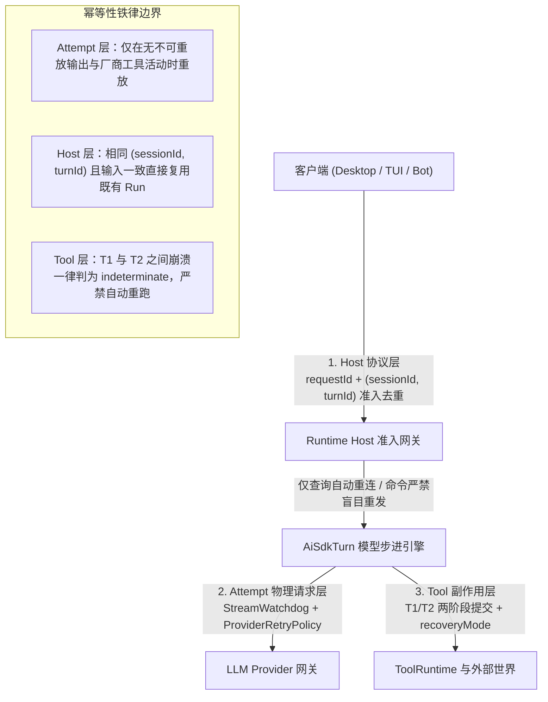
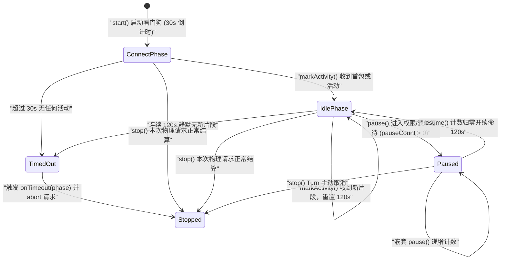
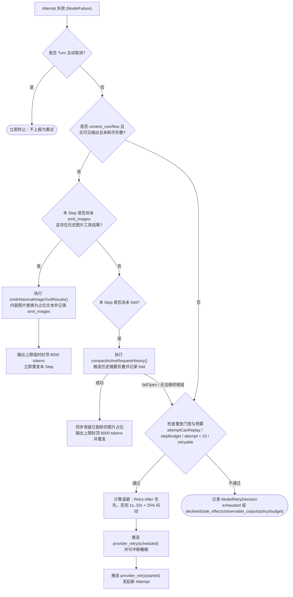
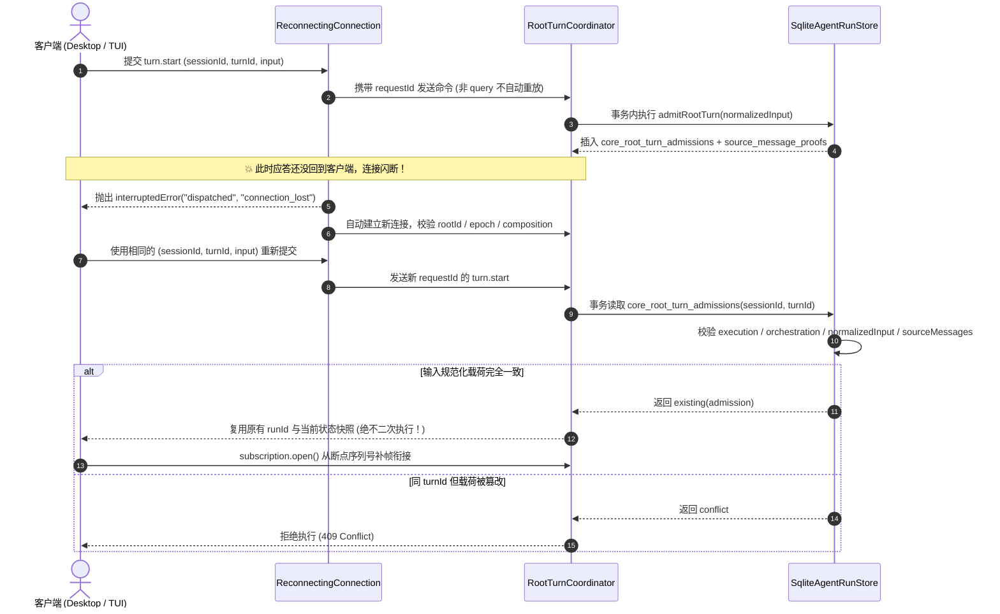

# 重试、超时与幂等性防护

[返回手册目录](../README.md)

回到“读取 `config.json` 并解释超时设置”的贯穿案例。第一步 `Read` 已经安全落盘，第二步 `AiSdkTurn` 正拿着读取结果向大模型请求解释。就在这时，链路可能出现三种截然不同的故障：
1. **模型流式假死或上游限流**：TCP 连接未断开，但模型网关 3 分钟不吐出任何 Token；或者网关直接返回 HTTP 429 与 `Retry-After` 头。
2. **客户端与 Host 之间闪断**：桌面端或 TUI 刚提交 `turn.start`，本地进程间的连接就突然中断，重连后客户端不确定刚才那句话是否已经送达。
3. **工具执行中途进程崩溃**：模型要求执行带外部副作用的工具（如修改远程工单或写入配置），进程恰好在执行外部动作之后、写入本地结果之前断电。

如果系统把这三类故障混为一谈，要么在超时上“一刀切”误杀正常长推理，要么在重连或崩溃恢复时把同一句话或同一笔外部副作用重复执行两次。Maka 在 **Attempt 物理请求层、Host 协议与准入层、Tool T1/T2 持久化层** 构建了三道职责正交、互不替代的可靠性防线。

---

## 1. 概念先行：三层故障模型与幂等边界

Agent 基础设施的可靠性不能依赖单一的重试循环解决。在 Maka 的微内核与托管架构中，重试权限随调用层次逐级收敛——越靠近不可逆外部副作用，重试越受严格约束：



| 防护层级 | 典型故障场景 | 核心组件与机制 | 幂等性保障与止损边界 |
| :--- | :--- | :--- | :--- |
| **1. Attempt 物理请求层**<br>(`AiSdkTurn` / `StreamWatchdog`) | HTTP 429 限流、5xx、网络断流、SSE 静默挂起、上下文/图像溢出 | **双阶段活跃看门狗**（30s 首包 + 120s 活跃）+ **10 次抖动指数退避** + **溢出先删图再压缩** | 共享同一 Step 的 `logicalCallId` 发起新 `Attempt`；一旦出现厂商侧内置工具活动或不可逆重放屏障，立刻封死重试。 |
| **2. Host 协议与准入层**<br>(`Connection` / `Admission`) | 客户端发出 RPC 后连接中断、客户端重连后再次提交同一轮输入 | **`requestId` 应答匹配** + **查询与命令分离重连** + **`(sessionId, turnId)` 事务准入** | 传输层绝不自动重放写命令；存储层验证规范化输入与源消息证明完全匹配后，直接返回已有接纳记录，**绝不二次执行**。 |
| **3. Tool T1/T2 持久层**<br>(`ToolRuntime` / `Storage`) | 工具刚改完外部状态，写入结果事件前 Host 进程崩溃 | **T1 (`prepared`) / T2 (`outcome_committed`) 两阶段提交** + **`canonicalArgsHash` 校验** | 恢复扫描发现只有 T1 缺失 T2 时，强制标为 `indeterminate`（默认策略 `never_auto_retry`），交由模型或人工核查。 |

---

## 2. Attempt 层防线一：双阶段看门狗 (`StreamWatchdog`)

### 2.1 为什么不能使用单一固定请求超时？
大模型流式响应（SSE / WebSocket）的物理耗时具有极强的不确定性：一个简单问答只需 2 秒，而一个复杂架构分析或长代码生成可能稳定持续吐字 4 分钟。如果设置全局 60 秒总超时，正常长推理会在最后关头被强行掐断；如果放宽到 10 分钟，一旦遭遇上游网关“建连后静默假死”，用户就得面对静止的光标干等 10 分钟。

Maka 的 `StreamWatchdog` 将流式请求的生命周期拆分为两个正交阶段，各自绑定独立的超时阈值：

1. **首字节连接阶段（`connect`，默认 `30_000 ms`）**：从物理请求发出开始计时。如果 30 秒内连任何流式模型事件或心跳活动都没有收到，说明请求很可能卡在网关队列、TLS 握手停滞或死锁上游，看门狗立即以 `MODEL_STREAM_TIMEOUT` 中止当前 `AbortController`。
2. **流式活跃阶段（`idle`，默认 `120_000 ms`）**：一旦消费循环收到任意有效流事件，底层适配器回调 `onStreamActivity()`，触发 `watchdog.markActivity()`。看门狗状态随即从 `connect` 切换为 `idle`，并将计时器重置为 120 秒。此后只要模型还在持续输出，哪怕总耗时超过 10 分钟也绝不误杀；唯有流式通道中途突然静默超过 120 秒，看门狗才会判定连接假死并触发中止。

### 2.2 权限等待免疫与超时归属隔离
真实工程中有一个隐蔽的误杀陷阱：**人在回路（HITL）审批等待**。当模型流式推进到需要人类用户确认权限或交互表单（例如执行高危 Shell 命令）时，工具运行时会在等待期间阻塞。如果此时不暂停看门狗，人类思考 2 分钟就会把后端看门狗触发。

因此 `StreamWatchdog` 内置了引用计数式的 **`pause()` / `resume()`** 机制：
- `ToolRuntime` 通过 `getPermissionPauseTarget()` 持有当前 Turn 的看门狗句柄。每次进入权限或用户问答等待前调用 `pause()`，使 `pauseCount` 递增并清除当前定时器；
- 人类确认完毕后调用 `resume()`，当 `pauseCount` 归零时自动调用 `markActivity()` 重新激活 120 秒空闲窗口。

此外，`AiSdkTurn` 严格隔离每个物理请求的超时上下文：每次流式循环结束（无论是正常结算还是异常抛出），都会立即执行 `watchdog.stop()` 并调用 `consumeWatchdogTimeout()` 消费并清空当前超时状态。这样能防止后续存储落盘失败时，错误地把前面已经处理掉的看门狗超时当成根因上报。



---

## 3. Attempt 层防线二：错误分类、退避策略与重放门控

当看门狗掐断请求，或模型 SDK 抛出 HTTP / 流式异常时，`AiSdkTurn` 并不会无脑重发，而是依次经过 **证据标准化分类 → 重试预算与退避决策 → 溢出恢复联动 → 不可重放门控** 四道关卡。

### 3.1 降序证据链错误分类 (`provider-error-classification.ts`)
不同模型供应商与中转网关返回错误的格式极其混乱：AI SDK 请求失败抛出的是 `APICallError`（结构化 JSON 在 `data`、原始响应在 `responseBody`），而流内错误块在不同协议下可能是 `{ type: 'error', error: ... }`、内部错误对象甚至裸字符串。如果直接用正则匹配错误文本，经常会被网关包装文本误导（例如在 429 限流提示里引用了一句“context length”，或者在 401/403 状态码下提示账户余额耗尽）。

Maka 采用**按证据强度严格降序排列**的分类管线 `classifyProviderFacts`：

1. **显式中止与已知传输哨兵**：`RetryError(reason='abort')`、Responses WebSocket 断连码（`OPENAI_RESPONSES_WEBSOCKET_TRANSPORT_ERROR` 等）判为 `abort` 或 `network`；看门狗哨兵码 `MODEL_STREAM_TIMEOUT` 判为 `timeout`。
2. **结构化厂商错误码（最高置信度）**：提取 `data`、`responseBody` 与 `error` 嵌套层中的 `code` / `type`。例如：`gateway_stream_terminated` → `stream_truncated`；`resource-exhausted`（xAI 瞬时容量不足）→ `provider_capacity`；`context_length_exceeded` / `model_context_window_exceeded` / `request_too_large` → **无条件** `context_overflow`；`insufficient_quota` / `insufficient_balance` 等 → `provider_billing`。
3. **HTTP 状态码与语义覆盖**：`402` → `provider_billing`；`429` → `rate_limit`；可信的 Codex 边缘拒绝错误 → `provider_unavailable`（且其内部已耗尽 2/10/30s 重试预算，外层标记 `retryable: false`）；对于 **`401 / 403`**，先检查是否命中额度/套餐耗尽词表（`USAGE_LIMIT_TEXT_PATTERNS`，如 `quota`、`usage limit`、`subscription`），命中则归为 `provider_billing` 而非 `auth`，避免让已登录用户的额度耗尽误导其重新登录；`413` → `context_overflow`。
4. **双层否决式自由文本溢出检测**：先经过 `NON_CONTEXT_OVERFLOW_PATTERNS` 否决列表（包含限流词汇以及 `output` / `completion` / `max_tokens` 输出上限表达），确认未被否决后，再匹配各主流厂商的输入超窗签名（`CONTEXT_OVERFLOW_PATTERNS`）。
5. **通用 5xx / 传输错误 / 4xx / 弱文本启发**：`5xx` 或 `server_error` → `provider_unavailable`；建连或响应体中断传输码（`ECONNRESET`、`ERR_HTTP2_STREAM_ERROR`、`UND_ERR_BODY_TIMEOUT` 等）→ `network`；`408` → `timeout`；其余 `4xx` → `request_rejected`；最后才使用词边界正则兜底。

| 错误分类 (`ModelFailureKind`) | 对应策略 (`ProviderRetryReason`) | 是否允许直接退避重试 | 典型处置路径 |
| :--- | :--- | :--- | :--- |
| `network` / `timeout` / `stream_truncated` | 同名原因 | **是** | 若未触及重放屏障，按退避策略重发新 `Attempt`。 |
| `rate_limit` / `provider_capacity` / `provider_unavailable` | 同名原因 | **是** | 优先遵守服务端 `Retry-After`，否则抖动指数退避重试。 |
| `context_overflow` | `null`（不直接退避） | **否** | 转入响应式溢出恢复：先删历史图片，再失败则触发历史压缩。 |
| `abort` | `null` | **否** | 用户主动取消或宿主停止，立刻终止循环。 |
| `auth` / `provider_billing` / `request_rejected` / `unknown` | `null` | **否** | 确定性认证、计费或参数非法错误，立即暴露真实错误止损。 |

### 3.2 `ProviderRetryPolicy` 与 10 次抖动指数退避
每次可重试故障都会调用 `providerRetryDecision(kind, headers)` 生成纯策略决策，每个 Step 最多允许 **`MAX_PROVIDER_ATTEMPTS_PER_STEP = 10` 次尝试**（含首次请求）：

- **服务端建议延迟优先（`Retry-After`）**：`retryAfterMs(headers)` 优先解析毫秒级响应头 `retry-after-ms`，其次解析标准 `retry-after`（支持秒数与 HTTP 日期时间戳差值），并校验延迟落在 `(0, 2_147_483_647]` 合法定时器区间内。只要服务端给出了明确等待时间，外层直接严格采信，避免无视厂商限流窗口导致被封禁。
- **抖动指数退避（Jittered Exponential Backoff）**：当响应头未指定等待时间时，执行公式：
  $$\text{base} = \min(1000 \times 2^{\max(0, \text{failedAttempt} - 1)},\; 32000)$$
  $$\text{delayMs} = \lceil \text{base} + \text{random}() \times 0.25 \times \text{base} \rceil$$
  退避基数从 `1s → 2s → 4s → 8s → 16s → 32s` 封顶，并额外叠加 `0% ~ 25%` 的正向随机抖动，防止多并发任务在同一秒同时醒来制造“惊群效应”。
- **可感知状态广播**：调度睡眠前发出 `provider_retry(phase: 'scheduled')`（附带 `attempt`、`maxAttempts`、`delayMs`、`reason`），唤醒进入新请求前发出 `provider_retry(phase: 'started')`，并在退避睡眠期间全程监听 `turnAbortController.signal`，用户随时可秒级取消。

### 3.3 不可重放供应商活动门控（Replay Safety Gate）
并不是所有标为 `retryable: true` 的网络断流都能安全重放。试想模型正在使用厂商内置工具（`providerExecuted: true`，例如 OpenAI / Anthropic 服务端托管的 `websearch`）：供应商已经开始向外部搜索引擎发起查询甚至返回了工具事件，此时 SSE 流突然断掉。如果直接重放同一请求，厂商侧的外部搜索就会被重复触发，且这部分工作完全脱离本地 `ToolRuntime` 的 T1/T2 账本管控。

`AiSdkTurn` 在每次物理请求开始时初始化四个**单调只增（Monotonic）**的观测标记（因为 `flushStep()` 会清空临时缓冲，所以必须由单次 Attempt 独立锁定）：
- `attemptSawVisibleContent`：是否已吐出任何正文文本或推理文字；
- `attemptSawToolInput`：是否开始流式输出工具参数；
- `attemptSawToolActivity`：是否出现厂商侧内置工具活动（`tool-input` / `tool-call` / `provider-tool-result` 中 `providerExecuted === true`）；
- `attemptSawReplayBarrier`：是否触及不可逆重放屏障（例如服务端分段 Item 边界 `providerItemBoundary`、携带签名状态的 `thinking-signature` 或上游 `providerOptions` 状态块）。

据此，重试门控严格执行两条布尔判据：
- **`attemptCanReplay = !attemptSawToolActivity && !attemptSawReplayBarrier`**：只要看到厂商侧工具活动或不可逆重放屏障，即使连接意外中断，也**严禁自动重放**，最终写入持久化决策 `ModelRetryDecision = { decision: 'declined', because: 'side_effects' | 'observable_output' }`。
- **`attemptHasNoObservableOutput = !attemptSawVisibleContent && !attemptSawToolActivity && !attemptSawReplayBarrier`**：专门用于约束上下文溢出恢复——只有当被拒绝的请求“完全没有向用户输出任何可见内容且没有副作用”时，才允许在原地重构历史消息并重发。

### 3.4 图像/上下文溢出与重试的联动恢复
当供应商返回 `context_overflow`（如 HTTP 413 或 `context_length_exceeded`）时，原地等待几秒再重发完全无济于事。Maka 将其路由到 `recoverFromOverflowError`（受同一 Step `MAX_PROVIDER_ATTEMPTS_PER_STEP` 总尝试预算约束），按**两级阶梯递进降载**：



1. **第一级轻量化降载（`omitHistoricalImageToolResults`）**：很多时候上下文爆炸并不是对话太长，而是几轮前 `Read` 或截图工具留下的历史内联 Base64 图片（`type: 'file'`, `mediaType: 'image/*'`, `data.type === 'data'`）撑爆了像素 Token 或 HTTP 请求体字节上限。系统从同一解码路径扫描历史 `function_response`，将内联图片替换为提示占位符：`[Image artifact "..." omitted after provider context overflow...]`，并在本 Turn 的 `omittedImageToolResults` 中**永久记忆**这些被剔除的 `toolCallId`，确保后续所有 Step 和压缩重投影都不会把同一张大图重新塞回上下文。
2. **第二级历史折叠（`compactActiveRequestHistory`）**：若没有可剔除的图片，或剔除图片后供应商依然报错超窗，且本 Step 尚未执行过 `fold`，则触发激活请求历史压缩（先生成历史摘要 Checkpoint，再重构 `attemptMessages` 并重新应用 `omittedImageToolResults`），同时将单次恢复请求的 `maxOutputTokens` 保守限制在 `min(modelMax, 8_000)`，防止输出预留反过来挤占输入空间。如果压缩后依然超窗，系统写入诊断便签 `context_overflow_after_compaction` 或 `context_window_suggestion` 后优雅失败。

---

## 4. Host 协议与准入层：断线重连防重发与幂等准入

即使 Attempt 层完美无缺，如果桌面端或 TUI 与 `Runtime Host` 之间的本地 Socket / WebSocket 发生闪断，客户端重连后贸然重发 `turn.start`，依然会把同一轮任务跑两遍。Maka 在传输层与存储层分别设立了严格契约：

### 4.1 传输层的读写严格分离 (`Connection` & `ReconnectingConnection`)
1. **每帧唯一的 `requestId` 与超时滞后帧吸收（`Connection`）**：客户端每发送一笔 RPC 都生成随机 UUID `requestId`，并在 `#pendingRequests` 中登记回调与超时定时器（默认域名请求同时受并发槽位 `CLIENT_MAX_IN_FLIGHT_DOMAIN_REQUESTS` 约束）。当某次等待超时而连接本身尚未断开时，客户端通过 `#retireRequest()` 把它转入 `#retiredRequests` 并向业务层抛出 `dispatched / timeout` 中断异常；若后续网络恢复后 Host 的延迟应答到达，客户端仅用 `#retiredRequests` 匹配并安静释放域名请求槽位，既防止错配污染，又避免误判协议失步导致整条连接断掉。
2. **重连仅自动重试查询（`RuntimeHostReconnectingConnection`）**：连接管理器 `RuntimeHostReconnectLifecycle` 采用独立退避参数（`minMs = 100ms`、`maxMs = 5_000ms`、连续不稳升级上限 `unstableMaxMs = 60_000ms`、稳定连接重置阈值 `stableConnectionMs = 10_000ms`，并附带 `0.8 ~ 1.2` 倍双向抖动）。重连成功后必须严密校验 **`rootId`、`selectedProtocol`、`compositionId`、`compositionRevision`** 四项身份完全一致，任何一项漂移立即抛出永久性重连错误 `RuntimeHostPermanentReconnectError` 拒绝接管。
   最核心的设计铁律在于 `reconnecting-connection.ts` 的操作模式分流：
   - **`mode === 'query'`（如 `turn.query`、`host.status`）与 `subscription.open`**：幂等只读操作，遇到 `connection_lost`（且标记可重试）或服务端 `host_draining` 时，自动等待新连接就绪并无感重试。
   - **`mode !== 'query'`（如 `turn.start`、`turn.stop` 等命令/变更操作）**：**传输层严禁自动重放！** 若连接正在重连中，立即以 `not_dispatched / connection_lost` 拒绝；若发出后断线，直接把中断异常交给业务调用方，由业务层决定是否带着原始 `turnId` 显式重新提交。

### 4.2 存储层的根轮次规范化去重 (`admitRootTurn`)
当客户端重连并带着原始的 `(sessionId, turnId)` 再次发起 `turn.start` 时，真正的幂等裁决发生在 `SqliteAgentRunStore.admitRootTurn()` 的单个 SQLite 写事务与 `RootTurnCoordinator` 的会话准入串行锁内：



`admitRootTurn()` 实现了四重防重与防冲突约束：
1. **输入规范化比对（`normalizeAdmitRootTurnInput` & `rootTurnAdmissionPayloadsEqual`）**：客户端重新提交时，系统不仅比对 `sessionId` 与 `turnId`，还会对消息内容做规范化（`normalizedInput`）、比对 `execution` 描述符、`turnOrchestration`、`skillInvocation`、`authorization` 以及所有 `sourceMessages` 的摘要与内容。完全一致返回 `{ kind: 'existing', admission }`；只要任何字段被篡改，立刻返回 `{ kind: 'conflict', admission }`，防止“借旧 `turnId` 偷塞新指令”。
2. **源消息身份证明索引（`core_root_source_message_proofs`）**：在数据库通过 `(session_id, message_id)` 唯一索引绑定 `turn_id`，防止同一条用户消息 ID 被重复投递到两个不同的 `turnId` 下。
3. **拒绝记录与续接唯一性约束**：如果某个 `(sessionId, turnId)` 曾被记录为 `core_root_turn_start_rejections`，后续再试必须失败；如果是 `safe_boundary_continuation`，还会检查同一 `(sourceTurnId, sourceRunId)` 是否已被其它续接轮次抢先认领。
4. **复用已有 `Run` 状态**：`RootTurnCoordinator` 查到 `existing` 后，若对应的 `runId` 已到达终态快照则直接返回该终态；若仍在运行中则直接恢复或返回当前运行快照，客户端通过 `subscription.open()` 追平增量事件即可。

---

## 5. Tool 层防线：T1/T2 两阶段提交与不可自动重跑底线

当前两道防线确保“请求与 Turn 不会因网络波动被发重”之后，最后一道防线守护最危险的环节——**本地工具与外部副作用之间的进程崩溃**。

正如第 4.1 章 [持久化执行与崩溃恢复](../04-state/durable-execution.md) 所揭示的，SQLite 无法把外部文件系统、Shell 子进程或第三方 HTTP API 纳入同一个 ACID 事务。因此 `ToolRuntime` 与 `SqliteRuntimeStore` 在 `tool-commit-validation.ts` 中确立了严格的 **T1 / T2 双阶段验证契约**：

- **T1（`commitToolPrepared`）**：在任何外部副作用发生之前，通过单事务写入 `function_call` 与无内容的 `toolDispatch` 声明事件，且强制校验两者的 `(sessionId, invocationId, runId, turnId)` 身份一致，并用 `canonicalToolArgsHash(name, args)` 锁定参数摘要，记入状态 `prepared`（流水号后缀 `${operationId}_prepared`）。
- **T2（`commitToolOutcome`）**：在外部工具物理返回或失败后，通过单事务写入携带 `refs.operationId` 与 `refs.toolCallId` 的 `function_response` 事件及模型投影，将状态推进为 `outcome_committed`（流水号后缀 `${operationId}_outcome`）。
- **恢复安全策略（`recoveryMode`）**：工具在 `ToolRuntime` 派发时仅声明 `'never_auto_retry'`（默认）或 `'outcome_unknown'`。当进程在 T1 与 T2 之间意外崩溃时，恢复扫描器绝不允许“假装没执行过”而静默重跑工具——它必须在日志中将其显式定性为 `indeterminate`，让后续恢复流程通过只读检查或人类介入核实外部世界，而绝不把外部 API 幂等性赌在运行时自动重试上（真正的外部 API 幂等必须由工具自身的业务幂等键兜底）。

---

## 6. 教学伪代码：看门狗、溢出恢复、门控重试与 Host 准入

```text
// 1. Attempt 层：双阶段看门狗 + 溢出恢复 + 门控退避重试循环
function executeStepWithResilience(stepCtx, maxAttempts = 10):
    attemptMessages = stepCtx.projectedMessages
    stepShaping = new Set() // 记录本 Step 已消耗的降载阶段: "omit_images" | "fold"

    for attempt in 1 .. maxAttempts:
        watchdog = new StreamWatchdog({ connectTimeoutMs: 30_000, idleTimeoutMs: 120_000 })
        attemptAbort = new AbortController()
        watchdog.onTimeout((info) => {
            watchdogTimeout = info
            attemptAbort.abort(new Error(formatStreamWatchdogError(info), code: "MODEL_STREAM_TIMEOUT"))
        })
        watchdog.start()

        // 单调递增且不可清零的 Attempt 级重放安全观测
        sawVisibleContent = false
        sawToolActivity = false
        sawReplayBarrier = false

        try:
            stream = modelAdapter.startStream({
                messages: attemptMessages,
                onStreamActivity: () => watchdog.markActivity(), // 首包切 120s，后续持续喂狗
                abortSignal: mergeSignals(stepCtx.turnSignal, attemptAbort.signal)
            })
            for await event in stream.events:
                if event.kind in ["text", "thinking"] and event.text.length > 0:
                    sawVisibleContent = true
                if event.providerItemBoundary == true or event.kind == "thinking-signature":
                    sawReplayBarrier = true
                if event.providerExecuted == true:
                    sawToolActivity = true // 厂商内置工具已产生不可观测外部活动
                handleStreamEvent(event)

            watchdog.stop()
            consumeWatchdogTimeout()
            outcome = await stream.outcome
            if outcome.kind == "completed":
                return outcome
            failure = outcome.failure
        catch err:
            watchdog.stop()
            consumeWatchdogTimeout()
            if stepCtx.turnSignal.aborted: throw CancelledError()
            failure = classifyProviderFacts(err)

        // 关卡 A：上下文/图像溢出恢复 (仅在尚未产生可见输出时触发)
        canRecoverOverflow = (failure.kind == "context_overflow")
            and (not sawVisibleContent and not sawToolActivity and not sawReplayBarrier)
            and (attempt < maxAttempts)
        if canRecoverOverflow:
            if not stepShaping.has("omit_images") and hasHistoricalImages():
                attemptMessages = omitHistoricalImageToolResults(attemptMessages)
                stepShaping.add("omit_images")
                overflowMaxOutput = min(modelMaxOutput(), 8_000)
                continue
            if not stepShaping.has("fold"):
                compacted = await compactActiveRequestHistory(attemptMessages)
                if compacted != null:
                    attemptMessages = reapplyOmittedImages(compacted.messages)
                    stepShaping.add("fold")
                    overflowMaxOutput = min(modelMaxOutput(), 8_000)
                    continue

        // 关卡 B：重放安全门控与策略裁决
        if sawToolActivity or sawReplayBarrier:
            throw TerminalError(failure, { decision: "declined", because: sawToolActivity ? "side_effects" : "observable_output" })
        if attempt >= maxAttempts:
            throw TerminalError(failure, { decision: "exhausted", attempts: attempt })
        if not failure.retryable:
            throw TerminalError(failure, { decision: "declined", because: "policy" })

        // 关卡 C：服务端 Retry-After 优先 + 抖动指数退避
        delayMs = failure.retryAfterMs ?? ceil(min(1000 * 2^(attempt - 1), 32_000) * (1 + random() * 0.25))
        emitEvent("provider_retry", { phase: "scheduled", attempt: attempt + 1, maxAttempts, delayMs, reason: failure.kind })
        await interruptibleSleep(delayMs, stepCtx.turnSignal)
        emitEvent("provider_retry", { phase: "started", attempt: attempt + 1 })

// 2. Host 协议与准入层：断线重连分流 + 事务幂等检查
function sendClientOperation(reconnectingConn, operation, input):
    if operation.mode != "query":
        // 变更命令严禁传输层自动重放，断线立刻报错由上层携带同一 turnId 显式重提交
        conn = reconnectingConn.requireCurrentOrThrowNotDispatched()
        return conn.request(newRequestId(), operation, input)
    else:
        // 只读查询在重连后自动重试，且校验 rootId / protocol / composition 未发生漂移
        return retryWhileQueryInterrupted(() => reconnectingConn.waitForCurrent().request(newRequestId(), operation, input))

function admitTurnInTransaction(db, req):
    existing = db.readRootTurnAdmission(req.sessionId, req.turnId)
    if existing != null:
        if payloadsCanonicalEqual(existing, normalizeInput(req)):
            return { kind: "existing", admission: existing } // 幂等返回既有 runId
        return { kind: "conflict" }                          // 同 ID 篡改载荷立即拒绝
    assertNoSourceMessageProofConflict(db, req.sessionId, req.sourceMessages)
    db.insertAdmissionAndProofs(req)
    return { kind: "admitted", admission: req }
```

---

## 7. 对照 Pi：嵌入式两级退避 vs 全栈三层幂等防线

| 对比维度 | Maka 的架构实现 | Pi 的架构实现 | 设计取舍与适用边界 |
| :--- | :--- | :--- | :--- |
| **流式假死监控** | 独立 `StreamWatchdog`（30s 首包 + 120s 活跃重置），支持权限等待时 `pause()` / `resume()` 暂停计时。 | 依赖底层 SDK / `fetch` 超时与流读取异常捕获，无独立分阶段且可被 HITL 暂停的看门狗对象。 | Maka 专为无人值守长任务与远程网关波动设计；Pi 在终端单机交互中由人类实时盯盘。 |
| **模型重试分层与算法** | `AiSdkTurn` 单层统一控制（最多 10 次）；`Retry-After` 优先，否则 `1s..32s` 叠加 `+25%` 抖动；先删图再压缩；具厂商副作用/屏障门控。 | 两级重试机制：底层 `retryProviderRequest`（`pi-ai` 模拟 SDK 0.5s~8s `-25%` 负向抖动并拦截 `>60s` 延迟、`x-should-retry`）；外层 `AgentSession` 通过 `retryAssistantCall` + `RetryPolicy` 退避并执行 `_omitRecoveryAttempt` 上下文删减恢复。 | Pi 将传输重试与会话级恢复清晰拆开给嵌入式调用方组合；Maka 将计费、副作用门控、图像剔除和历史折叠闭环整合在同一 Step 状态机内。 |
| **连接与命令幂等** | `ReconnectingConnection` 仅自动重试 Query；Command 靠 `(sessionId, turnId)` 规范化载荷比对与源消息证明落盘去重。 | `AgentSession` 运行在应用同一进程内存内，无独立远程 Host 进程与跨连接命令重放问题。 | Maka 为多端协同与远端 Daemon 重连付出协议与 SQLite 事务代价；Pi 保持嵌入式零网络层极简。 |
| **工具崩溃与外部副作用** | 全量工具强制经历 T1 (`prepared`) 与 T2 (`outcome_committed`) 原子事务，崩溃窗口一律标为 `indeterminate`。 | 默认模式下重启通过 JSONL 会话重放历史，由人工决定重跑；实验性 `durable` 模式在工具级声明 `ToolTask` checkpoint 策略。 | Maka 对所有工具默认采取最保守的“绝不自动重跑”底线，适合生产级复杂自治代理。 |

---

## 8. 延伸阅读

- 深入理解工具在 T1 与 T2 崩溃窗口内的状态恢复判定与原子续接机制，阅读 [04.1 持久化执行与崩溃恢复](../04-state/durable-execution.md)。
- 了解每次物理重试（Attempt）与主/辅调用如何按统一身份模型落盘计费并关联瀑布流追踪，阅读 [06.2 请求计量、上下文诊断与故障排查](observability.md)。
- 了解当上下文溢出触发历史折叠或图片剔除时，安全前缀与检查点是如何维持不可变账本一致性的，阅读 [02.2 历史压缩与检查点](../02-context/compaction.md)。
