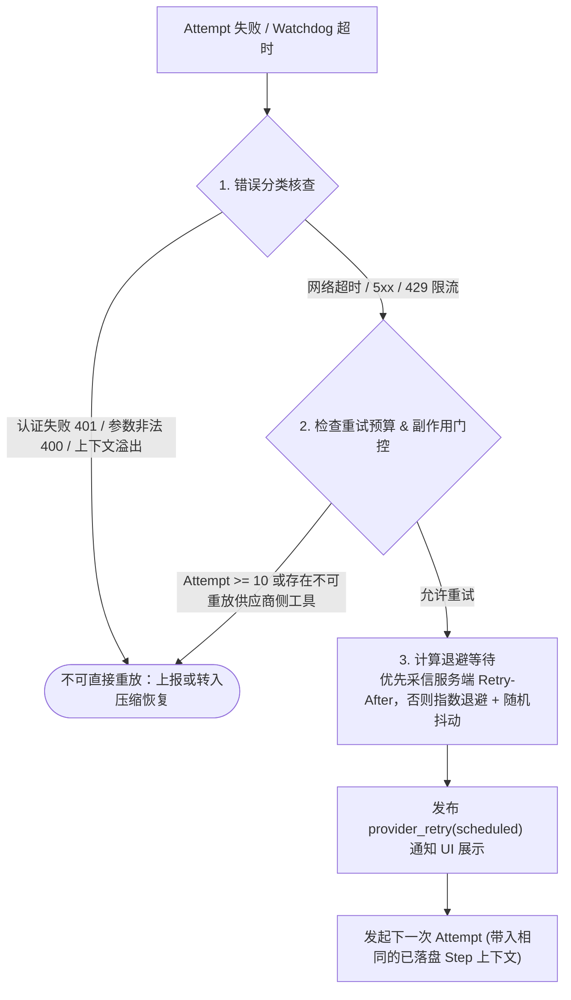

# 重试、超时与幂等性防护

[返回手册目录](../README.md)

回到“读取 `config.json` 并解释超时设置”的例子。第一步 `Read` 已经安全落盘，第二步 `AiSdkTurn` 正拿着读取结果向大模型请求解释。就在这时，网络链路发生了抖动，或者客户端与 Host 之间的连接闪断了。

此时系统面临三个最容易出错的判断：
1. **超时怎么设才合理？** 如果全局设为 30 秒，一份详尽的代码架构长回答刚吐到一半就会被无情掐断；如果设为 10 分钟，遇到网关“假死挂起”，用户就得干等 10 分钟。
2. **模型请求中断了怎么重试？** 重试的时候，会重新执行一遍前面的 `Read` 吗？如果模型刚刚报的是 400 参数错误，重试 10 次有用吗？
3. **客户端断线重连后又发了一遍 `turn.start`，Host 会不会把同一句话再跑一遍、扣两份钱？**

Maka 在**物理请求层、Host 协议层、工具副作用层**分别建立了三道互不替代的防护网，彻底解决可靠性与幂等性难题。

---

## 1. 概念先行：三层故障与各自的幂等边界

| 防护层级 | 典型故障场景 | 核心机制 | 幂等性保障边界 |
| :--- | :--- | :--- | :--- |
| **1. 模型请求层**<br>(`AiSdkTurn` / `Watchdog`) | HTTP 429 限流、502 断流、流式传输静默假死 | **双阶段活跃看门狗** + **带抖动指数退避** | 对同一 Step 发起新 `Attempt`；若已有不可逆的厂商侧工具活动，禁止盲目重放。 |
| **2. Host 协议层**<br>(`Admission` / `Connection`) | 客户端提交 `turn.start` 后断网，重连后再次提交 | **`requestId` 应答匹配** + **`(sessionId, turnId)` 准入去重** | 验证输入规范化摘要一致后，直接返回已有接纳记录并引导追帧，**绝不二次执行**。 |
| **3. 工具副作用层**<br>(`ToolRuntime` / `Storage`) | 工具刚改完外部系统，写结果前进程崩溃 | **T1/T2 两阶段提交** + **业务幂等键** | 运行时严禁自动重跑 `indeterminate` 工具；外部 API 幂等由工具自身业务键兜底。 |

---

## 2. 模型请求层：双阶段看门狗与重试门控

### 2.1 为什么看门狗需要“30 秒首包 + 120 秒活跃”两段超时？
Maka 的 `StreamWatchdog` 摒弃了粗暴的“总请求时长一刀切”做法，而是针对大语言模型流式输出（SSE）的物理特性设定了双阶段阈值：
1. **首字节阶段（默认 30 秒）**：请求发出后，如果超过 30 秒连第一个 Token 或心跳包都没有收到，说明请求很可能卡在了网关排队或死锁节点，立即切断重连。
2. **流式传输阶段（默认 120 秒空闲重置）**：一旦进入流式输出，每当消费循环收到任何一点新片段，就会触发 `onStreamActivity()` **重置 120 秒的空闲计时器**。这意味着只要模型在持续稳定输出，哪怕总耗时达到 5 分钟也不会被误杀；但只要网络突然静默假死超过 120 秒，看门狗立刻触发中止。

### 2.2 什么时候允许重试？什么时候必须立刻止损？
当看门狗掐断请求或底层 SDK 报错时，重试策略（`ProviderRetryPolicy`）按照以下严密流程做出裁决：



- **默认重试预算**：每个 Step 最多尝试 **10 次**（包含首次调用），防止无限重试拖垮系统。
- **退避算法（Jittered Exponential Backoff）**：如果响应头带有厂商明确建议的等待时间（`Retry-After`），优先严格遵守；否则按指数级拉长间隔，并叠加随机抖动（Jitter），避免大量客户端同时重连引发“惊群效应”。
- **界面可感知**：系统会向外推送 `provider_retry(scheduled)` 与 `provider_retry(started)` 事件，让用户界面清晰显示“模型连接波动，正在进行第 2 次重试”，而不是让用户面对卡死的光标猜谜。

---

## 3. Host 协议层：重连去重与输入幂等

网络波动不仅发生在 Host 和大模型之间，也常常发生在客户端（如 CLI/Web）和 Host 之间。

1. **短连接应答匹配（`requestId`）**：客户端发送的每一条 RPC 指令都携带单次请求的 `requestId`，用于在传输层精准匹配请求与响应。
2. **根轮次幂等准入（`turnId`）**：真正防止任务被执行两次的防线在于存储层的准入去重。当客户端发送 `turn.start` 时，Host 在数据库事务内检查 `(sessionId, turnId)`：
   - 如果记录已存在，且前序历史与规范化后的输入内容完全匹配，存储层直接返回之前的那条接纳记录。
   - 客户端在断线重连后，拿到原有的 `runId`，接着通过 `subscription.open()` 拉取最新进度快照即可，完全无感衔接。

---

## 4. 教学伪代码：流式看门狗与模型重试循环

```text
function executeStepWithRetry(stepContext, maxAttempts = 10):
    for attempt in 1 .. maxAttempts:
        watchdog = new StreamWatchdog({
            firstByteTimeoutMs: 30_000,
            idleTimeoutMs: 120_000
        })
        
        attemptSignal = mergeAbortSignals(stepContext.turnSignal, watchdog.signal)
        watchdog.start()

        try:
            stream = modelAdapter.startStream({ ...stepContext, signal: attemptSignal })
            for await event in stream.events:
                watchdog.markActivity() // 每次收到内容即喂狗，重置 120s 空闲计时
                yield event

            outcome = await stream.outcome
            if outcome.kind == "completed":
                return outcome
        catch err:
            // 若是用户主动取消，绝对不重试，直接向上抛出
            if stepContext.turnSignal.aborted:
                throw new CancelledError()

            // 检查策略门控：错误是否可重试？是否有不可重放的厂商内置副作用？
            decision = retryPolicy.evaluate(err, attempt, maxAttempts, stream.hasProviderSideEffects)
            if not decision.shouldRetry:
                throw err

            // 计算退避时间并向前端发出重试通知
            waitMs = decision.serverRetryAfterMs ?? exponentialBackoffWithJitter(attempt)
            emitEvent(providerRetryScheduled(attempt + 1, waitMs, err.code))
            await sleep(waitMs, stepContext.turnSignal)
            emitEvent(providerRetryStarted(attempt + 1))
        finally:
            watchdog.stop()
```

---

## 5. 延伸阅读

- 了解工具执行在 T1 与 T2 之间发生崩溃时，恢复引擎如何保障工具层的幂等底线，阅读 [04.1 持久化执行与崩溃恢复](../04-state/durable-execution.md)。
- 了解重试次数和每次 Attempt 的消耗是如何被精确记录并汇总计费的，阅读 [06.2 请求计量、上下文诊断与故障排查](observability.md)。
