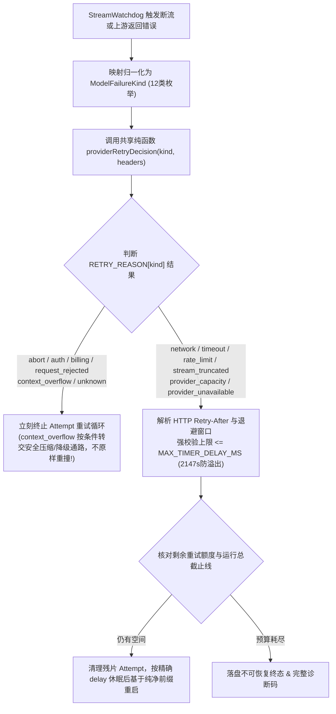

# 三层故障收敛与防重放网关：看门狗、退避门控与宿主幂等准入

## 1. 为什么简单的 `retry(3)` 装饰器在生产 Agent 里往往是帮倒忙？

在传统微服务里遇到 HTTP 错误直接套一个 `for (attempt = 0; attempt < 3; attempt++)` 是标准操作。但在具备真实系统副作用和多层级异步流式交互的 Agent 内核中，这种一刀切的简单重试策略经常直接制造出更大的二次事故：

1. **对着不可恢复错盲目连撞三次墙**：收到供应商返回的账单欠费（`provider_billing`）、凭据被撤（`auth`）、请求体结构拒绝（`request_rejected`）甚至输入文档超限（PDF Rejection）时，盲目原地重试三次不仅毫无疑问 100% 继续失败，还会拉长用户几倍干等延迟并加剧上游 429 封禁惩罚！
2. **忽略 `Retry-After` 响应头硬顶并发**：上游刚刚明确要求退避等待 45 秒，客户端自己拍脑袋每隔 1 秒重试一次，直接导致整个账户池被上游网关彻底拉黑限流。
3. **Host 接口网络闪断引发双倍任务发射**：客户端点一次发送按钮，由于电梯弱网没收到 HTTP 返回就带着同一笔逻辑意愿重连再发一次——如果接入网关不识别幂等键与原始荷载摘要对齐，当场就给用户并发开出两场一模一样的重构回合！
4. **对跨过 `T1` 门禁的写工具做无脑重试**：如前篇所述，这等同于悄悄把一个已经执行的外部操作在毫无察觉的情况下再执行一遍。

Maka TypeScript 版根据故障发生所在的精准高度，构造了一套**正交分层的三层防御网格（Attempt 流式层 + Host 准入网关层 + Tool 两阶段事务层）**，让每一类异常在各自所属层次洁净收敛、互不越位。

---

## 2. 三层故障收敛总览矩阵

| 架构防御层 | 核心防线机制与代表模块 | 决定可恢复边界的核心判据 | 绝不允许的越界重试 |
| :--- | :--- | :--- | :--- |
| **第 1 层：Attempt 传输试错层** | `StreamWatchdog` 双 phase 超时监控 + `providerRetryDecision` 纯策略矩阵 | 仅针对纯物理/瞬时过载类故障（`network`、`timeout`、`rate_limit`、`stream_truncated`、`provider_capacity`、`provider_unavailable`）在未 commit 语义步前丢弃残片并重连 | 严禁对 `auth`、`provider_billing`、`request_rejected` 及非结构化 `context_overflow` 套用盲目传输重试；受 `MAX_TIMER_DELAY_MS` 截断守护 |
| **第 2 层：Host 接入准入层** | 客户端预生成幂等 `turnId` + 消息摘要一致性对比 (`messageContentDigest`) + `RootTurnAdmission` | 相同 `turnId` 带着完全吻合的原始内容重试请求，直接复用既成入库投影与快照安全接回订阅 | 若发现相同的 `turnId` 试图塞入截然不同的改动负载正文，立刻抛 `RuntimeHostedRootConflictError` 当场拒签 |
| **第 3 层：Tool 副作用层** | `Pre-T1` 检查分离 + `T1` (`t1_after_preflight_v1`) 不可逆印记 + 端侧 `admitted` 切点 | 仅在**未跨越 `T1` 或未拿到 `admitted` 通行证之前**的断线故障允许安全重跑重建 | 一旦跨越 `T1` 或 `admitted` 发生崩溃失联，锁死标记 `outcome_unknown (retrySafe: false)`，禁绝任何自动重发 |

---

## 3. Attempt 层防线：双阶段看门狗与 `providerRetryDecision` 统一裁决表

在这一最靠近大模型物理网络接口的层面上，`AiSdkTurn` 与 `provider-retry-policy.ts` 联手把混乱的错误字符串整理成清晰确定的一套规则函数：

留意这句极重要源码设计哲学（源自 `packages/runtime/src/provider-retry-policy.ts`）：
> **One pure policy decision consumed by both Runtime retrying and Host projection.**
> （由同一份纯决策函数同时驱动 Runtime 内部真正的重连休眠，以及 Host 向客户端 UI 投影展现“正在因速率限制第 X 次重试、预计等待几秒”的可观测横幅。）

这就彻底杜绝了“后端实际上早已经放弃重试退出了，或者根本没在等那 30 秒，前端界面却还在拿另一套硬编码规则瞎猜着倒计时欺骗用户”的经典不同步现象；同时针对 JS `setTimeout` 32 位带符号整型上限专门设置了 **`MAX_TIMER_DELAY_MS = 2_147_483_647`** 安全钳位保护——因为一旦上游发了个畸形的超长 `Retry-After` 数值导致 `setTimeout` 整数溢出，Node.js 的默认行为竟然是**直接变成 `delay = 1ms` 疯狂并发 DDoS 上游服务器**！这一个常数钳位直接消灭了一颗隐形系统炸弹。

---

## 4. Host 网关层幂等防重放：`turnId` + 内容摘要防冲突比对

当端到端链路切换到移动热点或桌面热重载重启之际，客户端发出的 `turn.start` RPC 随时可能面临超时丢包并在客户端上重发。如果宿主不做严格的入口去重与负载校对，同样一句话转眼就会被提交进会话里跑两轮！

在 `packages/runtime-host/src/server/root-turn-coordinator.ts` 中，`RootTurnCoordinator` 对每一次 `turn.start` 入站都执行三项防重门禁：
1. **基于客户端预生幂等键 `turnId` 检索历史**：在 `SessionAdmissionGate` 临界区内先查明该 `turnId` 是否曾顺利写入过 `RootTurnAdmission`；
2. **摘要等价比对（`messageContentDigest` / `messageContentsEqual`）**：如果命中同一 `turnId`，立刻核验本次重传携带的消息正文与附件摘要是否与首次入库内容**精确全等**。一旦全等即认定为合法弱网重试，安静返还首次签发的确认切片与当前进度投影句柄，完全不重开后台任务；
3. **冲突负载当场阻断**：倘若同一个 `turnId` 竟企图挂入截然不同的改版 Prompt 正文，立刻报错 **`RuntimeHostedRootConflictError`** 严厉回绝，防止并发端错用幂等 ID 悄悄顶替已受理任务。

---

## 5. 总结

Maka TypeScript 版的可靠性设计拒绝用一套粗糙的通用 `retry` 一竿子捅到底，而是让每一层故障停在它该死去的位置：
1. **Attempt 层**：`StreamWatchdog` 抓出网络假死，`providerRetryDecision` 确保只退避真正具备瞬时恢复价值的 6 类传输错误并用 32-bit 安全钳位守住 `setTimeout`；
2. **Host 接入层**：以 `turnId` + `messageContentDigest` 实现客户端断连零重发的严格幂等入站；
3. **Tool 层**：严控在 `Pre-T1` 安全边界以先，一旦踩过 `T1` 或 `admitted` 即锁停不猜，保证永不拿重复重跑污染真实物理世界。

光防住了重试和越界还不足以应对复杂线上排障——**系统如何在高并发下如实计量每一次请求的精准 Token 成本（绝不拿推导估数冒充服务端原值）？如何保证重放历史得出的上下文诊断体积和在线运行期见到的完全一致？发生诡异异常时又是靠什么全链路工具瞬间穿透排查真相的？** 下一篇直击可观测性与计量审计架构：**[单值原子计量与诊断瀑布流：ModelCallCommit、RequestShape 与冷热重建对齐](./observability.md)**。
