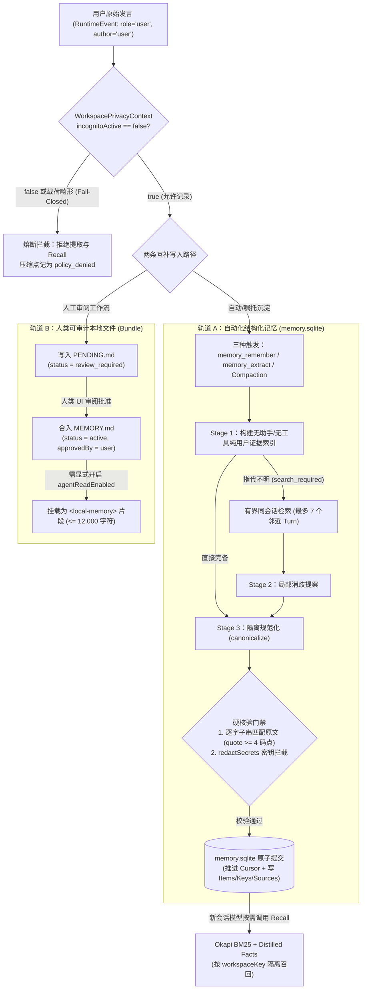

# 记忆存储、提取与检索机制对比

[返回手册目录](../README.md)

想象一名开发者在周一的排错会话中明确交代：**“记住：以后修改超时配置，必须附带回归单元测试，不能只改配置文件。”** 到了周五，这位开发者打开一个全新的会话准备调整另一个服务参数。

在单次会话内部，模型靠上下文投影与历史压缩（Compaction）维持记忆；但只要跨越了会话边界（Session Boundary），新会话的初始对话账本就是一张白纸。如何在不撑爆上下文窗口、不破坏提示词缓存的前提下让 Agent 跨越时间留存高价值约定，同时死守两条生产红线——**绝不让模型把自己的临时幻觉当成永久真理写入记忆**，也**绝不让项目隐私、密钥或无痕模式对话意外持久化**？

本章围绕**长期知识存储、防幻觉提取校验、隐私无痕隔离以及跨会话检索装配**四个维度，深入对比 Maka 与 Pi 的设计路线。

---

## 1. 概念先行：会话历史、工作区规范与长期记忆的三层边界

把所有对话塞进向量数据库并在每次提问前做 Top-K 相似检索，是原型期最常见也最容易翻车的误区。在严肃的工程基础设施中，知识必须按生命周期、信任级别与更新频率拆分为三层：

| 知识层级 | 典型载体 | 信任来源与修改主体 | 生命周期与爆窗治理 |
| :--- | :--- | :--- | :--- |
| **会话内历史（Session Transcript）** | Maka: `RuntimeEvent` 账本<br/>Pi: 树状 JSONL (`SessionManager`) | 单次任务的交互事实流 | 随步数线性增长，通过检查点压缩（Compaction）折叠旧前缀。 |
| **工作区声明文件（Workspace Instructions）** | `AGENTS.md` / `CLAUDE.md` / `GEMINI.md` | 人类开发者通过 Git 显式维护 | 相对静态，会话初始化时按作用域直接注入 System Prompt。 |
| **跨会话长期记忆（Long-Term Memory）** | Maka: `memory.sqlite` + `MEMORY.md`<br/>Pi: 不内置独立记忆库 | 用户明确嘱托或受核验的对话沉淀 | 跨会话持久存在，必须具备作用域隔离、生命周期归档与按需检索边界。 |

如果不区分这三层，系统会立即遭遇三类经典故障：
1. **幻觉自我强化（Hallucination Amplification）**：模型在步骤 2 错误推断“这个接口超时限制是 5 秒”，如果助手的发言也能被当成记忆证据提取入库，下周的新会话就会把这条错误猜测当成铁律执行。
2. **跨工作区与跨模式污染（Scope & Privacy Contamination）**：仓库 A 的部署脚本规则串入仓库 B；或者用户在无痕模式下调试敏感故障的片段，在退出无痕后被补录进了持久化记忆。
3. **上下文爆窗与前缀缓存失效（Prompt Cache Busting）**：每次开机把全部历史记忆硬拼在 System Prompt 头部，既浪费大量 Token，又会导致提示词前缀频繁变动。

---

## 2. Maka 的双轨长期记忆与纵深防御体系

Maka 没有选择“单一向量检索黑盒”，而是围绕`Runtime Host`权威边界构建了**双轨记忆存储**与**四道防幻觉/防泄露门禁**：



### 2.1 轨道 A：`memory.sqlite` 的有界状态机与防幻觉门控

`MemoryExtractionEngine` 是 Maka 中最为精密的状态机之一。它通过三种触发器驱动：`memory_remember` 工具（用户显式嘱托，同步返回已落盘条目）、`memory_extract` 工具（模型判定值得留存，在当前 Turn 终态后异步执行）以及上下文压缩（`compaction` 检查点触发）。

为了保证在长会话与进程崩溃下既不错漏、也不重复提取，状态机依赖四项核心约束：

1. **确定性幂等键与游标推进（Cursor & Coverage Hash）**：
   每次提取基于 `(sessionId, trigger, stableBoundary)` 用 SHA-256 计算确定性 `operationId`，并针对未覆盖的事件区间 `[expectedCursorOrdinal + 1 .. targetBoundaryOrdinal]` 计算 `coverageHash`。提交时在 `memory.sqlite` 的单个 `BEGIN IMMEDIATE` 事务内校验当前游标未发生冲突，同时原子写入 `memory_items`、`memory_item_keys`、`memory_item_sources` 与新游标 `memory_extraction_cursors`。若范围过大超出模型输入预算，引擎调用 `findMemoryRangeSplit()` 按 Turn 边界二分切分前缀优先提交，并把用户显式触发 `remember` 的 Turn 完整保留在末段。
2. **有界预算与单次重试暂存**：
   单次提取最多允许 `MAX_MEMORY_EXTRACTION_MODEL_CALLS = 3` 次模型调用。若遇到供应商超时、Schema 错误或证据核验不通过，失败信息连同 `coverageHash` 写入 `memory_extraction_failures`（`retry_later`），下一次触发时仅允许重试一次该冻结区间；若再次失败则标记为 `discarded` 并强制推进游标，防止一条坏消息永久卡死整条会话的后续记忆提取。
3. **证据域物理封闭（防模型自我引用幻觉）**：
   `projectMemoryExtractionEvidence()` 与 `buildMemoryCompactionSourceContext()` 从机制上将**助手文本、工具调用参数、工具返回输出、思维链（Thinking）以及运行时控制事件完全排除在证据域之外**——只有满足 `!event.partial && event.role === 'user' && event.author === 'user'` 的文本才允许作为记忆依据。即便是在触发局部检索（`searchSameSessionMemoryHistory`，最多取 7 个邻近 Turn）用于解析“按刚才那个方案办”这类省略句时，助手文本也只能作为只读的 `interpretationContext` 辅助理解，**永远不能充当 `evidence` 引文来源**。
4. **逐字引文校验与时间防伪**：
   模型提案后必须经过与原对话完全隔离的第三阶段 `canonicalize`（不挂载任何工具，也不提供原历史），随后由纯确定性校验函数 `admitMemoryProposalItemDetailed()` 实施硬核验：
   - 引文引用的 `sourceRef` 必须存在于本次冻结的证据索引中；
   - 引文 `quote` 经 NFC 规范化并折叠空白后，码点长度至少为 4，且必须通过 `evidenceContainsQuote()` **作为逐字子串（verbatim substring）真实出现在模型可见的用户原文中**；
   - 所有时间戳通过 `minuteTimestamp()` 向下取整到分钟级并校验合法区间边界（`undated | point | interval | open_ended`），杜绝模型捏造精确到毫秒的虚假时间。
5. **密钥硬拦截与安全空提交**：
   `deterministicMemoryPolicyRejection()` 会在入库前和规范化后两次调用 `redactSecrets()` 检测 `content`、`keys` 与 `quote`。如果用户显式调用“记住我的私钥 `sk-...`”，引擎不会报错崩溃，而是原子提交一条 `noOpReason: 'sensitive_information'` 记录推进游标，并向用户清晰返回 `status: 'not_applicable'`。

### 2.2 作用域隔离与按需检索：`Recall` / `RecallMore` / `RecallMaterial`

写入 `memory_items` 的每条记录都受数据库级 `CHECK` 约束强制校验作用域：`scope_type = 'global'` 时 `scope_key` 必须为 `NULL`，而 `scope_type = 'workspace'` 时 `scope_key` 必须非空。当新会话需要调取跨会话知识时，Maka 不在启动时暴力注入全库，而是向模型提供三个只读工具：
- **`Recall`**：一次返回两层数据——来自 `memory.sqlite` 的蒸馏事实（`searchFacts`，仅匹配 `global` 与当前 `workspaceKey`），以及历史可见会话中的相关性片段。
  - **两阶段检索不变量**：存储层可选提供 `listCandidateSessions` 缩小扫描范围，但它只能过估计（超集）而绝不能漏选（遇含 JSON 转义字符如引号、反斜杠或孤立代理对的查询词时直接强制全量扫描）；最终匹配与排名由核心包在 `redactSecrets()` 脱敏后的文本上统一执行。
  - **BM25 与工具结果降权**：采用 Okapi BM25（`K1 = 1.2`，`B = 0.75`），并对来自 `tool_result` 的文本施加 `RECALL_TOOL_RESULT_WEIGHT = 0.5` 的降权系数且最多抽取 `10KB` 文本——这是因为 `grep`/`find` 输出的大量枚举词很容易在 BM25 上虚假压倒真正总结结论的自然语言回复。
  - **防自我回声**：`excludeTurnIds` 自动剔除当前正在运行的 Turn，避免模型搜出自己刚说的话充当佐证；默认每条命中附带同 Turn 前后各 4 条邻近消息（单条上限 `4KB`，单段 `12KB`，总载荷 `96KB`），足以一次回答绝大多数问题。
- **`RecallMore`**：仅当某个片段被截断时按 `session_id + anchor_message_id` 向下扩宽最多 8 条邻近消息（同样剥离隐藏思维链与原始工具参数）。
- **`RecallMaterial`**：当历史片段中提及了过往会话附件（如截图或日志），把源会话的 Artifact 安全拷贝进当前会话供 `Read` 工具读取。

### 2.3 轨道 B：`PENDING.md → MEMORY.md` 人工审批工作流

针对希望“记忆完全透明、可手工编辑备份”的桌面用户，Maka 还提供了独立的文件记忆束（`MemoryBundleCoordinator` + `HostMemoryCoordinator`）：
- 模型提议的新记忆只追加写入工作区根目录的 `PENDING.md`（状态为 `review_required`），不会自动污染对话；
- 只有经过人类开发者在设置队列或行内审批点击批准，`approveLocalMemoryProposalDraft()` 才会生成 `mem-...` 编号将其原子迁移到 `MEMORY.md`（记下 `approvedBy=user` 与 `approvalSurface`）；
- **默认关闭模型自动读取**：`defaultLocalMemorySettings()` 默认 `{ enabled: true, agentReadEnabled: false }`。只有用户显式开启读取且未处于无痕模式时，`HostMemoryCoordinator.readPromptProjection()` 才按 `scope` 过滤掉其他会话的 `session` 私有条目、执行密钥脱敏并截断至 `12,000` 字符，装配进请求的 `<local-memory>` 标签。单文件超过 `128KB` 时自动触发 `safe_mode` 保护并支持通过历史备份恢复。

### 2.4 无痕模式（`incognito`）与静态工作区指令

- **Fail-Closed 无痕校验**：`validateWorkspacePrivacyContext()` 对边界传来的隐私上下文拒绝任何默认猜测——只要不是合法对象或 `incognitoActive` 不是布尔值，立刻判定校验失败并按阻断处理。一旦 `incognitoActive === true`：
  1. `Recall` 直接拒绝检索并返回 `incognito_active`；
  2. `<local-memory>` 停止装配；
  3. **`MemoryExtractionEngine` 将受无痕策略拒绝的压缩点原子写入 `memory_compaction_policy_denials` 并把游标推进至该边界（`skipReason: 'policy_denied'`）**。这一设计极其关键：它确保即使用户明天关掉无痕模式，后天触发压缩时也绝不会把昨天无痕期间的敏感对话“补提取”进记忆库！
- **工作区指令裁剪边界**：Maka 的 `buildWorkspaceInstructionsPromptFragment()` 仅读取用户全局 `~/.maka/{AGENTS,CLAUDE,GEMINI}.md` 与当前 `cwd` 下的同名文件（用 SHA-256 摘要去重同目录下软链或复制的同一内容，单文件上限 `6,000` 字符，总上限 `14,000` 字符），不向外层未知祖先目录扩散。

---

## 3. Pi 的记忆与上下文工程机制

与 Maka 严防死守的数据库提取体系不同，Pi 把长期约定与会话延续建立在**可预测的本地文件约定**和**结构化树状日志压缩**之上。

### 3.1 静态项目规范的祖先链自动发现（`DefaultResourceLoader`）

在 Pi 体系中，要沉淀“修改超时必须附带回归测试”这类团队约定，标准做法是将其直接写入代码仓库的 `AGENTS.md`（或 `CLAUDE.md`）。每次 `createAgentSession()` 初始化资源加载器时，`loadProjectContextFiles()` 按严格顺序装配规范上下文：
1. 首先检查全局配置目录（默认 `~/.pi/agent`）；
2. 随后从当前 `cwd` 出发逐级向文件系统根目录向上攀爬，在每一层目录中按优先级只加载第一个存在的候选文件：`AGENTS.override.md` → `AGENTS.md` → `AGENTS.MD` → `CLAUDE.md` → `CLAUDE.MD`；
3. 按“全局 → 最外层祖先 → …… → 当前 `cwd`”的覆盖顺序排布注入提示词，越贴近当前目录的规则权重越高。

**嵌套 Git Worktree 的重复遮蔽防护（`findShadowedContextFile`）**：当开发者或子智能体在主仓库子目录下创建了嵌套的 Git Worktree（例如 `repo/.worktrees/fix-timeout`）时，如果 Worktree 自己已经检出了一份 `AGENTS.md`，按普通祖先向上遍历就会把 Worktree 的 `AGENTS.md` 和父目录主仓库的 `AGENTS.md` 加载两遍！Pi 通过 `findGitPaths()` 解析 `commonGitDir` 与 `worktreeRoot`，一旦发现当前处于同一个物理仓库的嵌套 Worktree 且自身带有上下文文件，就会精准屏蔽主仓库根目录的那一份副本，消除冗余 Token 消耗。

### 3.2 会话内记忆延续：树状 JSONL 与结构化压缩（`compaction.ts`）

Pi 不另设跨会话 `memory.sqlite`，而是把会话长记忆的保持重心放在**树状分支**与**高质量迭代压缩**上：
- **永不拆散工具配对的切点算法（`findProjectedCutPoint`）**：当估算 Token（优先采用最近一次有效助手响应的真实 `usage` 加上后续增量消息的 `chars/4` 保守估算）超过 `contextWindow - reserveTokens`（默认预留 `16,384` Token，保留最近 `20,000` Token）时触发压缩。查找切点时，`findProjectedCutPoint()` 只允许落在 `user`、`assistant`、`custom`、`bashExecution` 等消息上，**绝对禁止切在 `toolResult` 上**，避免把助手的 `toolCall` 与工具结果拆成两半导致模型接口报错。如果切点恰好落在一个 Turn 中间（`isSplitTurn`），系统会用专门的 `TURN_PREFIX_SUMMARIZATION_PROMPT` 总结该 Turn 前半段，并与更早的历史摘要合并。
- **结构化状态机模板与文件操作账本**：Pi 强制模型输出包含 `## Goal`、`## Constraints & Preferences`、`## Progress`（Done / In Progress / Blocked）、`## Key Decisions`、`## Next Steps`、`## Critical Context` 六大固定栏位的检查点摘要，并随着连续压缩使用增量更新指令合并旧摘要；同时，压缩器从工具调用中确定性地累积 `readFiles` 与 `modifiedFiles` 集合存入 `CompactionEntry.details`，防止模型在重写摘要时遗漏改过哪些文件。
- **长度截断拒签与树形分支摘要**：若生成摘要时遭遇 `stopReason === "length"` 截断，`getSummarizationFailure()` 会直接拒签，绝不把残缺摘要写成检查点；切换到历史树的其他分支时，可用 `generateBranchSummary()` 把被放弃分支的排查结论浓缩挂接到当前节点。

---

## 4. 教学伪代码：防幻觉提取 vs 祖先发现与结构化压缩

```text
// === 1. Maka：只信用户原文的证据校验提取与提交 ===
function extractAndCommitMemory_Maka(sessionId, workspaceKey, snapshot):
    if not readGate(sessionId).allowed: // 检查 incognito / disabled
        if snapshot.trigger == "compaction":
            commitPolicyDeniedSkip(sessionId, snapshot.compactionCheckpointId)
        return unavailable()

    entries = ledger.readSessionEvents(sessionId, afterCursor, boundary)
    // 物理封闭证据域：只保留非局部的纯用户文本事件
    evidenceMap = projectUserOnlyEvidence(entries)

    // Stage 1 & 2: 模型生成提案；若指代不清可调用一次同会话有界检索（仅作解释上下文）
    proposals = modelCall("proposal", evidenceMap)
    if proposals.status == "search_required":
        localizedCtx = searchSameSessionHistory(entries, proposals.search.terms, maxTurns = 7)
        proposals = modelCall("localized", evidenceMap, localizedCtx)

    // Stage 3: 隔离规范化并执行双层确定性校验
    canonical = modelCall("canonicalize", stripConversationAndTools(proposals))
    admittedWrites = []
    for item in canonical.results:
        if containsSecret(item.content, item.keys, item.quote):
            if isExplicitRemember: return commitSensitiveNoOp(sessionId)
            continue
        // 核心防幻觉门禁：引文必须在用户可见原文中逐字出现，且 >= 4 码点
        for cite in item.evidence:
            source = evidenceMap.get(cite.sourceRef)
            assert source != null and codePointLen(cite.quote) >= 4
            assert source.visibleUserText.includes(normalizeNFC(cite.quote))
        admittedWrites.push(buildMemoryWrite(item, workspaceKey, roundToMinute(source.ts)))

    // 单 SQLite 事务内原子推进游标并写库
    sqliteMemoryStore.commitExtraction(sessionId, expectedCursor, boundary, admittedWrites)

// === 2. Pi：祖先上下文发现与安全切点结构化压缩 ===
function loadProjectContextFiles_Pi(cwd, agentDir):
    files = []
    if hasContextFile(agentDir): files.push(readFirstContextFile(agentDir)) // ~/.pi/agent
    shadowedFile = findShadowedContextFileInNestedWorktree(cwd)

    ancestors = []
    dir = cwd
    while true:
        candidate = findFirstMatchingFile(dir, ["AGENTS.override.md", "AGENTS.md", "CLAUDE.md"])
        if candidate != null and candidate.realPath != shadowedFile:
            ancestors.unshift(candidate) // 父目录在前，子目录覆盖在后
        if parent(dir) == dir: break
        dir = parent(dir)
    return [...files, ...ancestors]
```

---

## 5. 多维对比与架构选型建议

| 对比维度 | Maka (`memory.sqlite` + `MEMORY.md` + `Recall`) | Pi (`AGENTS.md` + `SessionManager` + `Compaction`) |
| :--- | :--- | :--- |
| **记忆产生与来源** | 支持对话中自动提取（`remember/extract/compaction`）+ 逐字出处证据校验，以及人工审批流。 | 依赖开发者或 Agent 主动更新 `AGENTS.md` 等项目文件，所见即所得。 |
| **防幻觉机制** | 物理隔离非用户发言 + 强制子串原文核对 + 独立 `canonicalize` 阶段 + `redactSecrets`。 | 人类直接审阅 Git Diff 中的 `AGENTS.md`；压缩时 `readFiles/modifiedFiles` 由代码确定性抽取。 |
| **上下文开销与缓存** | `Recall` 按需调用、不占初始窗口；`<local-memory>` 默认关闭且限制 12KB。 | 启动时全量加载祖先路径的规范文件，直观高效但需团队控制规则文件体积。 |
| **跨项目与隐私隔离** | 数据库 CHECK 强制 `workspace/global` 隔离；`incognitoActive` fail-closed 熔断所有读写与补录。 | 天然随仓库目录隔离；无专门无痕熔断，依靠用户选择是否写入本地文件。 |
| **检索能力** | 原生支持 Okapi BM25（`tool_result` 0.5 降权）联合检索蒸馏事实、历史对话与跨会话附件。 | 通过读取目标会话 JSONL 树或外部 `grep`/`find` 工具按文件检索，无内置跨会话 BM25 索引。 |
| **Git 协作友好度** | `memory.sqlite` 属本地状态根数据；`MEMORY.md` 可读可备份；工作区 `AGENTS.md` 仍与 Git 兼容。 | 极佳。所有团队工程约定都在仓库 `AGENTS.md` 中，直接通过 PR 评审与分支流转。 |

### 工程选型建议

- **团队规范与代码库强绑定、希望零运维开销**：首选 **Pi 模式（`AGENTS.md` 分层约定 + 结构化 Compaction）**。对于软件工程团队而言，将“修改配置必须加单测”写进仓库的 `AGENTS.md`，不仅能被 Pi、Maka、Claude Code 等各类工具共同读取，还能通过 Git PR 让全团队同步获得这项记忆，比任何私有记忆数据库都更可靠。
- **跨项目个人助理、客服/运营机器人或长周期托管平台**：必须引入 **Maka 模式（证据核验提取 + `memory.sqlite` + `Recall` + `incognito`）**。在这类场景中，用户会在自然对话里不断表达跨天、跨项目的碎片化偏好和事实，无法指望用户自己去维护 Markdown 文件；此时，“只认用户原文引文的防幻觉门禁”、“无痕模式防延迟补录”以及“按需 BM25 降噪检索”是保证长期记忆越用越准而非越用越脏的生命线。

---

## 6. 延伸阅读

- 深入了解 Maka 内部如何将不可变账本裁剪与压缩投影为模型输入：[02.1 历史事实与模型输入投影](../02-context/history-and-projection.md)、[02.2 历史压缩与检查点](../02-context/compaction.md)
- 了解 Maka 对密钥脱敏、审批边界与工作区策略的完整治理：[03.4 分层授权与凭据生命周期](../03-tools/permissions-and-secrets.md)
- 回到四大核心维度的宏观全景比较：[07.1 Agent 内核架构宏观对比](overview.md)
