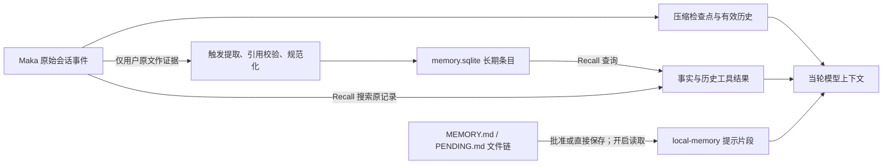

# Maka 与 Pi 的记忆存储、提取与检索机制对比

[手册目录](../README.md) · [总体设计对比](overview.md)

核对日期：2026-10-28。本文只依据当前本地源码和测试，不沿用旧手册的 `15d0…` 基线。

- Maka：`D:/ai/maka`，HEAD `8320cda1a4229b54124efe91d8830d0a89c39a4f`，只读核对。
- Pi：`D:/ai/pi`，HEAD `482c1381a00d8d00bc81697e4a980c593db6803e`；分析包含工作区现有的会话、压缩与投影源码修改，相关结论不完全对应已提交版本。
- 未运行验证：未启动模型，未运行构建、测试、安装或交互验证；引用测试表示存在这些断言，不表示本次执行通过。

两者的主要差异涉及知识维护责任与上下文加载时机。Maka 当前生产装配包含会话知识提取、长期条目存储和按需检索，同时保留独立的文件记忆机制；Pi 默认 coding-agent 主要组合显式上下文文件与当前会话投影。持久化存储与模型上下文加载是相互独立的步骤。

## 1. 状态分类与职责边界

| 状态类别 | 设计职责 | Maka 的实现 | Pi 的实现 |
| --- | --- | --- | --- |
| 会话原始历史 | 保存历史交互与读取记录 | RuntimeEvent 账本及其会话记录投影 | 带父节点 ID 的 session JSONL 条目 |
| 模型工作记忆 | 构造当前请求的有效上下文 | 有效历史投影、压缩检查点和后续事件 | 当前分支、最新 compaction、保留消息及 context_edit |
| 跨会话长期知识 | 支持已提取断言的后续复用 | SQLite 长期条目；独立的 MEMORY.md 文件记忆流程 | 显式维护的 AGENTS 等文件；已核实默认路径未包含统一自动提取库 |
| 执行恢复状态 | 确定进程重启后的执行边界 | 运行账本、检查点、提取游标与回执等 | 会话恢复；独立 durable 包另有任务和文档状态 |

“投影”指从保存的记录中选出或改写本次模型可见内容。投影可以变短而原记录仍在；长期知识则需要独立的准入、作用范围和读取路径。执行检查点即使持久保存，也不因此成为可供新话题检索的知识。

原始记录与模型视图的分离依据：[Maka 检查点的原始／有效摘要边界](https://github.com/suger-m/maka/blob/8320cda1a4229b54124efe91d8830d0a89c39a4f/packages/runtime/src/history-compact-checkpoint.ts#L38)、[Pi 分支和压缩投影](https://github.com/earendil-works/pi/blob/482c1381a00d8d00bc81697e4a980c593db6803e/packages/coding-agent/src/core/session-manager.ts#L476)。

## 2. 分析场景：跨会话项目约定复用

会话 S1 中，智能体读取项目文件，获得“数据库迁移必须附回滚脚本”的约定，并将其纳入会话摘要。随后用户创建会话 S2，执行另一项数据库迁移任务。

该场景包含三个独立条件：项目文件包含约定；S1 的工具结果与摘要包含约定；用户明确陈述该约定或授权保存。前两项不构成第三项的充分条件。

比较维度包括 S2 的资料加载来源、主动检索要求、摘要的知识准入资格，以及项目约定变化后的旧知识处理方式。

## 3. Maka 长期记忆的存储与派生模型

### 生产装配、触发条件与适用范围

当前 Host 打开长期记忆存储，创建提取协调器，并注入会话头、RuntimeEvent、压缩检查点和辅助模型调用接口。查询端使用同一长期存储，形成已接入生产装配的写入与读取路径。

证据：[创建提取协调器](https://github.com/suger-m/maka/blob/8320cda1a4229b54124efe91d8830d0a89c39a4f/packages/runtime-host/src/server/execution-composition.ts#L1393)、[长期存储打开 memory.sqlite](https://github.com/suger-m/maka/blob/8320cda1a4229b54124efe91d8830d0a89c39a4f/packages/storage/src/long-term-memory-store.ts#L68)、[查询端接入](https://github.com/suger-m/maka/blob/8320cda1a4229b54124efe91d8830d0a89c39a4f/packages/runtime-host/src/server/execution-composition.ts#L1019)。

提取包含三类触发条件，其执行时机与等待成本不同：

1. 用户明确要求“记住”时，主模型可调用显式记忆工具；调用没有可任意填写的事实参数，运行时从会话证据中提取，等待保存结果并返回实际保存的内容。
2. 主模型判断存在可保留信息时，可标记附带提取；工具调用阶段仅接受请求，正常回合结束且完成事件被消费后提交后台提取。未标记请求的普通回复不触发该扫描。
3. 自动容量压缩或溢出恢复形成检查点时，可在检查点持久化成功后启动后台提取。手动压缩入口未传入自动记忆边界，不属于该触发路径。

证据：[两种工具的语义与空参数](https://github.com/suger-m/maka/blob/8320cda1a4229b54124efe91d8830d0a89c39a4f/packages/runtime/src/memory-extraction.ts#L290)、[回合完成后的条件派发](https://github.com/suger-m/maka/blob/8320cda1a4229b54124efe91d8830d0a89c39a4f/packages/runtime/src/ai-sdk-turn.ts#L2552)、[先存检查点再派发](https://github.com/suger-m/maka/blob/8320cda1a4229b54124efe91d8830d0a89c39a4f/packages/runtime/src/ai-sdk-compaction.ts#L1201)、[手动入口](https://github.com/suger-m/maka/blob/8320cda1a4229b54124efe91d8830d0a89c39a4f/packages/runtime/src/ai-sdk-backend.ts#L550)。

普通 Host 后端对该能力设置了装配条件：自定义工具集合、子会话和计划模式不使用此装配；headless coding 与 WorkHub 协调配置显式关闭提取。执行阶段还检查记忆开关、隐私模式和会话归档状态。原生 OpenAI Responses 路径存在不支持的分支。

生产装配不意味着所有会话均启用自动提取。适用条件见：[装配条件](https://github.com/suger-m/maka/blob/8320cda1a4229b54124efe91d8830d0a89c39a4f/packages/runtime-host/src/server/execution-model-composition.ts#L458)、[运行配置](https://github.com/suger-m/maka/blob/8320cda1a4229b54124efe91d8830d0a89c39a4f/packages/runtime-host/src/server/hosted-execution-tool-profile.ts#L96)、[执行时门控](https://github.com/suger-m/maka/blob/8320cda1a4229b54124efe91d8830d0a89c39a4f/packages/runtime-host/src/server/memory-extraction-coordinator.ts#L166)、[后端限制](https://github.com/suger-m/maka/blob/8320cda1a4229b54124efe91d8830d0a89c39a4f/packages/runtime/src/ai-sdk-backend.ts#L444)。

### 用户原文证据准入与候选规范化

在上述场景中，工具读取的项目约定不能仅因被摘要复述而成为长期条目。证据投影仅选取稳定的用户原文；助手回复、工具调用、工具结果、思考内容和 Host 代写内容均不属于该证据域。

压缩触发的辅助上下文可以带前一份文字摘要，以及边界内的用户和助手文本；摘要用于理解前文，不能替代可校验的用户引用。提供商的不透明压缩状态也不是记忆证据。

证据：[证据筛选实现](https://github.com/suger-m/maka/blob/8320cda1a4229b54124efe91d8830d0a89c39a4f/packages/runtime/src/memory-extraction-evidence.ts#L95)、[压缩上下文重建](https://github.com/suger-m/maka/blob/8320cda1a4229b54124efe91d8830d0a89c39a4f/packages/runtime/src/memory-extraction.ts#L209)、[排除工具等来源的测试](https://github.com/suger-m/maka/blob/8320cda1a4229b54124efe91d8830d0a89c39a4f/packages/runtime/src/__tests__/memory-extraction.test.ts#L256)。

若用户在 S1 明确陈述该约定并提出记忆请求，则存在合格来源。提取器生成候选后，程序校验引用与用户原文的一致性，再通过隔离的模型阶段将候选规范化为简洁断言，最终重新校验并提交。

对于“记住刚才那个约定”等省略表达，系统允许一次有界的同会话历史搜索以解析指代。助手文本可辅助解释，但最终证据仍须来自用户原文。该机制不提供面向任意外部资料的自动提取保证。

证据：[引用准入](https://github.com/suger-m/maka/blob/8320cda1a4229b54124efe91d8830d0a89c39a4f/packages/runtime/src/memory-extraction-proposal.ts#L307)、[隔离规范化提示](https://github.com/suger-m/maka/blob/8320cda1a4229b54124efe91d8830d0a89c39a4f/packages/runtime/src/memory-extraction-proposal.ts#L200)、[同会话定位分支](https://github.com/suger-m/maka/blob/8320cda1a4229b54124efe91d8830d0a89c39a4f/packages/runtime/src/memory-extraction.ts#L881)。

候选接受与拒绝由程序校验和模型规范化流程决定，不包含人工逐项审批。通过的条目直接写为 active；显式请求返回保存回执，附带提取可在后台完成。

证据：[规范化结果到提交](https://github.com/suger-m/maka/blob/8320cda1a4229b54124efe91d8830d0a89c39a4f/packages/runtime/src/memory-extraction.ts#L1022)、[新条目直接 active](https://github.com/suger-m/maka/blob/8320cda1a4229b54124efe91d8830d0a89c39a4f/packages/storage/src/sqlite-long-term-memory-store.ts#L921)。

### 长期条目、来源引用与提取进度

长期条目位于 Storage Root 下独立的 `memory.sqlite`。条目携带内容、种类、事实／计划等陈述类型、时间、global 或 workspace 范围、检索键，以及来源 Session／Run／Turn／Event 引用；观察时间来自支持它的事件。

workspace 条目的键取自来源会话的 `workspaceRoot`；global 范围由提取和规范化模型选择，提示要求提供跨工作区复用依据。该范围判定包含模型判断，不构成程序对全局适用性的形式化证明。

证据：[数据库位置](https://github.com/suger-m/maka/blob/8320cda1a4229b54124efe91d8830d0a89c39a4f/packages/storage/src/long-term-memory-store.ts#L38)、[条目与来源结构](https://github.com/suger-m/maka/blob/8320cda1a4229b54124efe91d8830d0a89c39a4f/packages/core/src/long-term-memory.ts#L95)、[实际生成范围和来源](https://github.com/suger-m/maka/blob/8320cda1a4229b54124efe91d8830d0a89c39a4f/packages/runtime/src/memory-extraction.ts#L1874)。

同一数据库还保存会话处理游标、操作回执和失败范围，用于恢复提取流程。新条目、游标与回执在同一事务中提交，避免条目写入成功而处理进度未更新所导致的重复处理。

后台提取按会话串行执行，后续触发可尝试恢复未完成范围。每个处理范围至多允许三次模型调用，失败处理可能最终丢弃该范围。该恢复策略具有明确预算，不保证所有合格事实最终入库。

证据：[事务提交](https://github.com/suger-m/maka/blob/8320cda1a4229b54124efe91d8830d0a89c39a4f/packages/storage/src/sqlite-long-term-memory-store.ts#L356)、[提交游标与回执](https://github.com/suger-m/maka/blob/8320cda1a4229b54124efe91d8830d0a89c39a4f/packages/storage/src/sqlite-long-term-memory-store.ts#L436)、[调用预算](https://github.com/suger-m/maka/blob/8320cda1a4229b54124efe91d8830d0a89c39a4f/packages/runtime/src/memory-extraction.ts#L805)、[恢复失败范围](https://github.com/suger-m/maka/blob/8320cda1a4229b54124efe91d8830d0a89c39a4f/packages/runtime/src/memory-extraction.ts#L429)。

自动提取提交逐条创建新条目，不使用存储层 update 接口替换既有知识。项目约定变化后，新旧断言可能并存，因此执行修改前仍需核对当前项目文件。[创建行为](https://github.com/suger-m/maka/blob/8320cda1a4229b54124efe91d8830d0a89c39a4f/packages/storage/src/sqlite-long-term-memory-store.ts#L415)

### 长期条目与历史记录的检索及上下文加载

新会话启动时不加载整个 SQLite 知识库。已核实的读取路径由模型调用 Recall 触发，Host 分别查询长期事实与会话历史，并通过工具输出返回当前上下文。当前查询采用键前缀检索和历史文本匹配，未采用向量语义检索。

长期事实查询取当前调用会话的 workspace，返回 global 加该 workspace 的 active 条目；没有 workspace 时只取 global。事实层不可用会降级为空，不阻断历史检索。

证据：[生产查询适配](https://github.com/suger-m/maka/blob/8320cda1a4229b54124efe91d8830d0a89c39a4f/packages/runtime-host/src/server/execution-composition.ts#L1019)、[键与范围过滤](https://github.com/suger-m/maka/blob/8320cda1a4229b54124efe91d8830d0a89c39a4f/packages/storage/src/sqlite-long-term-memory-store.ts#L1266)、[事实层降级](https://github.com/suger-m/maka/blob/8320cda1a4229b54124efe91d8830d0a89c39a4f/packages/core/src/recall.ts#L1012)。

历史检索范围由 Host 提供的可见会话列表决定，与长期条目的 workspace 过滤规则不同。模型工具可检索归档会话，并排除当前回合，避免将当前输入重复作为独立佐证。

历史检索结果包含会话、消息锚点和邻近对话；长期事实的工具输出仅包含内容、种类与观察时间，不包含数据库中的来源事件引用。因此，存储层来源可追溯不等于模型每次均接收完整引文。

证据：[工具调用与返回投影](https://github.com/suger-m/maka/blob/8320cda1a4229b54124efe91d8830d0a89c39a4f/packages/runtime/src/recall-tools.ts#L114)、[历史会话筛选](https://github.com/suger-m/maka/blob/8320cda1a4229b54124efe91d8830d0a89c39a4f/packages/core/src/recall.ts#L991)、[来源保存结构](https://github.com/suger-m/maka/blob/8320cda1a4229b54124efe91d8830d0a89c39a4f/packages/core/src/long-term-memory.ts#L105)。

即使约定仅存在于 S1 的工具读取记录中，也可能通过历史检索复用，无需先形成长期条目。若工具结果已归档为仅含标识和哈希的记录，则缺少可供文本匹配的正文；检索命中也不证明约定在 S2 执行时仍然有效。[历史文本来源与限制](https://github.com/suger-m/maka/blob/8320cda1a4229b54124efe91d8830d0a89c39a4f/packages/core/src/recall.ts#L160)

### MEMORY.md 文件记忆流程与独立读取控制

Maka 同时保留 Storage Root 下的 `memory/MEMORY.md` 和 `memory/PENDING.md`。文件协调器支持候选提交、人工批准或拒绝，以及直接记录；批准后将待审内容转入正式文件。该审批机制独立于 SQLite 自动提取流程。

正式文件的 active 内容经过筛选、脱敏和长度限制，才可能作为 `local-memory` 提示片段装配进主会话。读取要求 memory enabled、agentReadEnabled 且不处于隐私模式；默认值是 enabled=true、agentReadEnabled=false。

证据：[文件名](https://github.com/suger-m/maka/blob/8320cda1a4229b54124efe91d8830d0a89c39a4f/packages/storage/src/memory-bundle-io.ts#L53)、[提出与审批分支](https://github.com/suger-m/maka/blob/8320cda1a4229b54124efe91d8830d0a89c39a4f/packages/runtime-host/src/server/memory-coordinator.ts#L377)、[读取门控](https://github.com/suger-m/maka/blob/8320cda1a4229b54124efe91d8830d0a89c39a4f/packages/runtime-host/src/server/memory-coordinator.ts#L162)、[注入提示](https://github.com/suger-m/maka/blob/8320cda1a4229b54124efe91d8830d0a89c39a4f/packages/runtime-host/src/server/interactive-run-composer.ts#L837)、[默认开关](https://github.com/suger-m/maka/blob/8320cda1a4229b54124efe91d8830d0a89c39a4f/packages/core/src/runtime-policy.ts#L263)。

文件投影限制 session 条目仅在对应会话可见；文件中的 workspace 标签不等同于 SQLite 按 workspaceRoot 执行的精确过滤。`agentReadEnabled` 在已核实路径中控制文件注入，SQLite 提取与 Recall 不使用相同的读取门控。

关闭文件记忆读取不等于关闭全部长期记忆能力。当前装配分别为两个存储提供依赖；未确认存在自动提取结果写入 MEMORY.md，或文件审批结果同步至 SQLite 的桥接机制。[文件筛选](https://github.com/suger-m/maka/blob/8320cda1a4229b54124efe91d8830d0a89c39a4f/packages/core/src/local-memory.ts#L291)、[提取门控](https://github.com/suger-m/maka/blob/8320cda1a4229b54124efe91d8830d0a89c39a4f/packages/runtime-host/src/server/memory-extraction-coordinator.ts#L179)、[Recall 依赖](https://github.com/suger-m/maka/blob/8320cda1a4229b54124efe91d8830d0a89c39a4f/packages/runtime-host/src/server/execution-composition.ts#L989)

上图分别表示两条独立的长期记忆路径，未包含自动同步关系。压缩检查点与长期知识条目具有不同的存储语义和准入条件。

## 4. Pi 上下文文件与会话投影模型

### 显式上下文文件的发现与加载时机

默认资源加载器先读用户级代理配置目录（agentDir）的上下文文件，再沿当前工作目录（cwd）向上遍历祖先目录，按祖先到当前目录顺序加入内容。每个目录按候选名优先级选一份文件，包括 AGENTS.override.md、AGENTS.md 和 CLAUDE.md；它不是递归扫描所有子目录。

若迁移约定位于当前启动路径覆盖的 AGENTS.md 中，新建进程或默认 SDK 初始化会重新读取文件并将其加入项目上下文。该路径使用当前文件内容，不依赖历史会话中的知识提取。

若约定仅存在于 S1 临时读取的其他文件中，资源加载器不会根据历史读取记录自动发现该文件。已运行的资源加载器保留已读内容，显式 reload 才会重新读取；同一进程内创建新会话不保证文件内容从磁盘刷新。

证据：[文件发现规则](https://github.com/earendil-works/pi/blob/482c1381a00d8d00bc81697e4a980c593db6803e/packages/coding-agent/src/core/resource-loader.ts#L184)、[祖先目录装配](https://github.com/earendil-works/pi/blob/482c1381a00d8d00bc81697e4a980c593db6803e/packages/coding-agent/src/core/resource-loader.ts#L232)、[默认 SDK 加载](https://github.com/earendil-works/pi/blob/482c1381a00d8d00bc81697e4a980c593db6803e/packages/coding-agent/src/core/sdk.ts#L200)、[提示来源](https://github.com/earendil-works/pi/blob/482c1381a00d8d00bc81697e4a980c593db6803e/packages/coding-agent/src/core/agent-session.ts#L1714)、[显式 reload](https://github.com/earendil-works/pi/blob/482c1381a00d8d00bc81697e4a980c593db6803e/packages/coding-agent/src/core/agent-session.ts#L3690)。

### JSONL 历史持久化与分支上下文投影

Pi 会话条目通过 id 和 parentId 形成树。普通追加将记录写入 JSONL；选定末端节点（leaf）后，仅沿其祖先路径生成上下文，同一文件中其他分支的内容不会自动进入当前请求。

压缩追加 summary 和 firstKeptEntryId，不删除被总结的原始条目。本次模型看到最新压缩摘要、保留的近期消息和后续内容；当前工作区还在压缩条目里保存当时有效的 system message，供恢复提示状态。

证据：[记录类型](https://github.com/earendil-works/pi/blob/482c1381a00d8d00bc81697e4a980c593db6803e/packages/coding-agent/src/core/session-manager.ts#L57)、[JSONL 追加](https://github.com/earendil-works/pi/blob/482c1381a00d8d00bc81697e4a980c593db6803e/packages/coding-agent/src/core/session-manager.ts#L1172)、[分支投影](https://github.com/earendil-works/pi/blob/482c1381a00d8d00bc81697e4a980c593db6803e/packages/coding-agent/src/core/session-manager.ts#L390)、[压缩追加](https://github.com/earendil-works/pi/blob/482c1381a00d8d00bc81697e4a980c593db6803e/packages/coding-agent/src/core/session-manager.ts#L1260)。

当前工作区的 context_edit 又允许追加“隐藏某条内容”或“替换某条内容”的记录，投影时对同一目标取最后一次编辑。它改变模型视图而保留原记录，并且只作用于包含这条编辑的分支。

例如，S1 读取的大段文件结果可以在模型视图中被裁剪；恢复会话后仍可重建相同投影，但不会因此生成适用于所有新会话的长期知识。该机制同时承担上下文预算管理和恢复后投影一致性维护。

证据：[投影应用编辑](https://github.com/earendil-works/pi/blob/482c1381a00d8d00bc81697e4a980c593db6803e/packages/coding-agent/src/core/session-manager.ts#L519)、[追加编辑的分支约束](https://github.com/earendil-works/pi/blob/482c1381a00d8d00bc81697e4a980c593db6803e/packages/coding-agent/src/core/session-manager.ts#L1359)、[原记录不变与分支相对性的测试](https://github.com/earendil-works/pi/blob/482c1381a00d8d00bc81697e4a980c593db6803e/packages/coding-agent/test/session-context-edit.test.ts#L36)。

### 摘要与扩展能力的边界

默认 compaction 用于继续当前任务：合并既有摘要与待总结消息，必要时保留拆分回合的前缀说明，并附加文件操作信息。摘要可以包含历史约定，但不提供独立的跨会话检索键、知识审批或失效处理机制。[摘要生成与结果](https://github.com/earendil-works/pi/blob/482c1381a00d8d00bc81697e4a980c593db6803e/packages/coding-agent/src/core/compaction/compaction.ts#L952)

本次核对范围包括默认 SDK／资源装配、内置扩展注册和随附扩展示例；没有发现类似 Maka 的统一自动长期知识提取与检索链。这个结论限定于这些本地路径，不覆盖用户安装的扩展、外部 MCP 服务或整个 Pi 生态。[默认创建](https://github.com/earendil-works/pi/blob/482c1381a00d8d00bc81697e4a980c593db6803e/packages/coding-agent/src/core/sdk.ts#L200)、[内置扩展清单](https://github.com/earendil-works/pi/blob/482c1381a00d8d00bc81697e4a980c593db6803e/packages/coding-agent/src/extensions/index.ts#L7)

随附 custom-compaction 示例确实能接管压缩并调用另一模型，但它返回的是会话压缩结果，需显式加载；这不是默认启用的长期记忆扩展。SDK 上下文文件示例也允许额外注入资料，资料的整理和维护责任仍在调用方。[压缩示例](https://github.com/earendil-works/pi/blob/482c1381a00d8d00bc81697e4a980c593db6803e/packages/coding-agent/examples/extensions/custom-compaction.ts#L1)、[上下文示例](https://github.com/earendil-works/pi/blob/482c1381a00d8d00bc81697e4a980c593db6803e/packages/coding-agent/examples/sdk/07-context-files.ts#L14)

## 5. durable 执行状态与语义知识的职责分离

Pi 的 durable 是另一个包，定义任务以及 Session／Conversation／Task 范围的 JSON 文档，文档可以保留最新状态或可回溯历史。它的上下文派生也区分已保存条目与模型贡献，并处理 head 边界、内容编辑和工具结果配对。

上述能力可作为知识系统的基础，但保存任务阶段的文档主要用于执行恢复。跨会话语义知识仍需另行定义准入、索引、作用域和上下文注入策略。durable 文档、task 或 MemoryStorage 均不直接构成默认语义记忆系统。

证据：[文档语义](https://github.com/earendil-works/pi/blob/482c1381a00d8d00bc81697e4a980c593db6803e/packages/durable/src/types.ts#L41)、[独立上下文派生](https://github.com/earendil-works/pi/blob/482c1381a00d8d00bc81697e4a980c593db6803e/packages/durable/src/harness/context.ts#L129)、[文档事务测试](https://github.com/earendil-works/pi/blob/482c1381a00d8d00bc81697e4a980c593db6803e/packages/durable/test/session-documents.test.ts#L78)、[coding-agent 依赖边界](https://github.com/earendil-works/pi/blob/482c1381a00d8d00bc81697e4a980c593db6803e/packages/coding-agent/package.json#L43)。

## 6. 跨会话复用场景对比

| 既有资料或状态 | Maka 新建普通会话 | Pi 默认初始化路径 |
| --- | --- | --- |
| 仅有项目文件读取记录，工具结果仍可搜索 | 可主动 Recall 历史；不会仅凭工具结果自动入长期库 | 默认不自动检索历史会话；需重新读取来源或显式恢复／带入历史 |
| 约定写在当前加载范围的 AGENTS.md | 本文长期记忆链之外的项目指令来源，应以当前约定为准 | 重新装配资源时读文件并进入项目上下文 |
| 用户明确陈述并要求记住 | 支持的运行路径可提取入库，后续仍需检索命中 | 已核对默认路径未见等价自动知识入库；可显式维护上下文文件 |
| 仅有历史压缩摘要 | 可辅助恢复或解释，但不能独立充当用户知识证据 | 继续对应分支时可见；独立新会话不默认继承 |
| 只保存了任务检查点 | 恢复执行进度，不代表知识已入库 | 同理；独立 durable 的任务状态也不自动跨话题注入 |

知识持久化仅提供可复用记录，不保证项目约定的当前有效性。执行代码修改时，仍需读取当前权威文件以核对规则变化；长期记忆可辅助定位和减少重复说明，但不能替代该校验。

## 7. 架构收益、维护成本与验证边界

Maka 的独立资料层为用户偏好、身份和直接陈述的项目事实提供跨会话复用路径，无需加载全部历史。事件引用、事务游标和回执支持提取来源追踪与流程恢复，同时增加后台派生资料持久化的实现成本。

该机制还引入模型调用费用、后台调度、候选误判、作用域误选和检索漏召回风险。用户原文证据限制降低模型推断被固化为事实的风险，同时限制工具发现的自动提取范围。隔离规范化不构成语义正确性证明；文件与数据库双路径还增加配置和维护复杂度。

Pi 的显式文件模型便于阅读、版本管理和项目规则修订；会话树与投影分离历史记录和当前模型输入。相应代价是知识复用依赖用户或扩展主动维护，新会话可能重复读取资料，且必须明确上下文文件的发现范围和加载时机。

对于少量稳定项目约定，显式文件与受控重载可满足主要需求。跨大量会话积累个人信息，则需要额外设计提取、来源追踪、作用域、纠错和检索。将摘要转换为长期知识属于独立设计选择，会引入新的证据准入与内容失效问题，不是压缩机制的必然结果。

本文结论基于静态装配与实现分析，未验证实际用户配置、数据库内容、模型工具选择、提取准确率或检索命中率。已确认的数据流及适用条件不构成实际会话记忆效果的保证。
