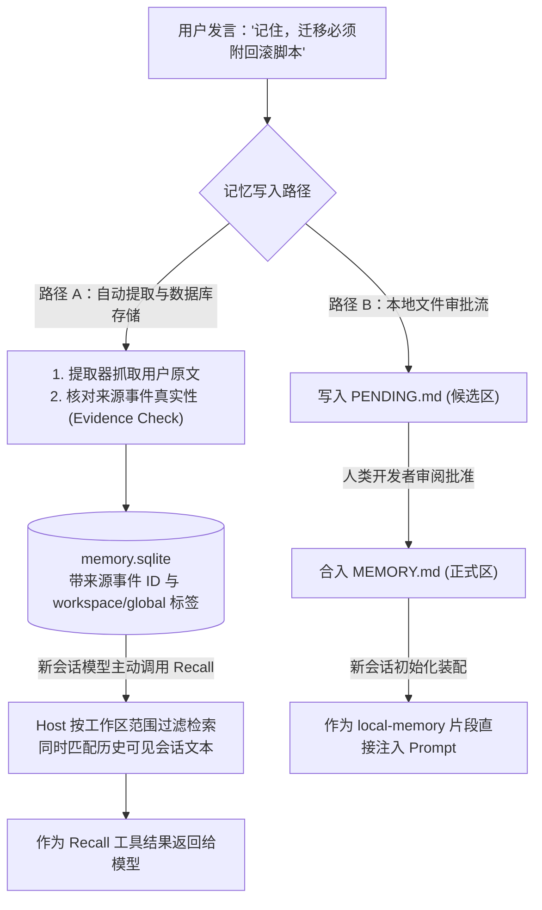

# 记忆存储、提取与检索机制对比

[返回手册目录](../README.md)

想象用户在周一的排错会话中明确交代了一句：**“记住：这个项目的数据库迁移必须附带回滚脚本。”** 到了周五，用户开启了一个全新的会话进行第二次数据库迁移。

在“会话内”，历史消息靠上下文投影与历史压缩（Compaction）来维持；但一旦跨越了会话边界（Session Boundary），新会话的上下文账本是一片空白。如何让 Agent 跨越时间记住团队约定和个人偏好，同时又避免模型“产生幻觉把错误假设当成永久真理”？

本章对比 Maka 与 Pi 在**长期记忆存储、防幻觉提取校验以及跨会话检索注入**上的两条截然不同的技术路线。

---

## 1. 概念先行：长期记忆与会话历史的区别

- **会话历史（Session History）**：记录特定一次任务的交互过程，随任务推进而膨胀，受限于上下文窗口，最终需要压缩或归档。
- **长期记忆（Long-Term Memory）**：提炼出的高价值、跨会话复用的规则、偏好与领域知识，拥有明确的**作用域（Workspace 级 vs Global 全局级）**和独立的生命周期。

---

## 2. Maka 的双轨制长期记忆架构

Maka 没有假设“把所有对话扔进向量库就能解决记忆问题”，而是设计了**“结构化数据库提取（Recall）”**与**“人类可审计文件（`PENDING.md → MEMORY.md`）”**两条互补路径：



### 2.1 路线 A：结构化提取、出处核验与 Recall 检索
1. **防幻觉核心——出处证据核验（Evidence Verification）**：
   如果放任模型在总结记忆时自由发挥，它很容易把一次临时妥协当成永久铁律，或者编造出用户从未说过的要求。因此，Maka 的记忆提取器在生成候选条目后，**必须从当前会话的不可变事件中选出对应的用户原文作为证据，并由校验器核对引用的事件出处真实存在**，通过校验后才允许写入 `memory.sqlite`。
2. **作用域严格隔离**：每条记忆必须标记为 `workspace`（仅限当前项目有效）或 `global`（跨项目通用偏好），防止项目 A 的特殊配置污染项目 B。
3. **按需检索（Recall）**：开启新会话时，系统不会把上千条长期记忆全部硬塞进 System Prompt 浪费 Token，而是赋予模型 `Recall` 工具。当模型遇到数据库迁移任务时，主动调用 Recall，由 Host 统一检索 `memory.sqlite` 和可见会话历史，将精准匹配的结果返回。

### 2.2 路线 B：`PENDING.md → MEMORY.md` 人类审批流
对于追求完全透明、希望用 Git 管理团队记忆的场景，Maka 提供了文件记忆通道：
- 模型提炼出的候选记忆先落入 `PENDING.md` 暂存，**不会自动污染主上下文**；
- 只有经过人类开发者确认并转移到 `MEMORY.md` 后，运行装配器才会将有效内容作为 `local-memory` 片段自动挂载到后续请求的提示词中。

---

## 3. Pi 的记忆与上下文加载机制

Pi 秉持了极简主义与“文件系统即事实”的设计哲学：

- **基于祖先路径的静态发现（`AGENTS.md`）**：在 Pi 中，团队约定（如“数据库迁移必须附回滚脚本”）直接由开发者写入项目根目录或上级目录的 `AGENTS.md` 文件中。
- **自动装配**：每次启动 `coding-agent` 时，资源加载器（`ResourceLoader`）自动从用户全局配置目录以及当前工作目录的祖先路径向上搜索这些上下文文件，合并后直接带入会话初始提示词中。
- **会话内续接**：继续原会话时，Pi 的 `SessionManager` 从本地 JSONL 文件的当前分支及压缩条目中重建历史消息，不额外维护独立的记忆 SQLite 数据库。

---

## 4. 教学伪代码：带证据核验的记忆提取与 Recall 检索

```text
// === 1. 防幻觉记忆提取与提交 ===
function extractAndCommitMemory(sessionId, workspaceId, candidateFact, citedEventId):
    // 1. 证据核验：强制检查模型引用的事件是否真实存在于权威账本中
    sourceEvent = runtimeStore.getEventById(sessionId, citedEventId)
    if sourceEvent == null or not sourceEvent.containsUserStatement():
        throw new EvidenceVerificationError("Cannot commit memory without valid user source event")

    // 2. 写入带溯源凭证的记忆库，按作用域隔离
    memoryStore.upsertEntry({
        id: generateUUID(),
        workspaceId: workspaceId,
        scope: candidateFact.scope, // "workspace" | "global"
        content: candidateFact.normalizedRule,
        sourceEventId: citedEventId,
        createdAt: clock.now()
    })

// === 2. 跨会话按需 Recall 检索 ===
function executeRecallTool(query, currentWorkspaceId):
    // 1. 仅检索当前工作区专属记忆 + 全局通用记忆，严防跨项目污染
    longTermHits = memoryStore.search(query, {
        scopes: [{ type: "workspace", id: currentWorkspaceId }, { type: "global" }]
    })
    
    // 2. 联合检索当前用户可见的会话历史文本
    sessionHistoryHits = sessionTextIndex.search(query, { workspaceId: currentWorkspaceId })

    return formatRecallToolOutput(longTermHits, sessionHistoryHits)
```

---

## 5. 设计权衡对照表

| 对比维度 | Maka (`memory.sqlite` + `MEMORY.md`) | Pi (`AGENTS.md` + `SessionManager`) |
| :--- | :--- | :--- |
| **记忆产生方式** | 支持对话中自动提取 + 出处证据核验，以及人工审批合入 | 依赖团队显式维护 `AGENTS.md` 等项目上下文文件 |
| **上下文开销** | 通过 `Recall` 工具按需召回，不占用初始 Prompt 固定空间 | 初始化时全量加载祖先路径的规则文件，直观但需人工控制文件体积 |
| **工程适用性** | 适合多项目、多用户、需要自动沉淀长周期个性化偏好的托管平台 | 适合代码仓库驱动、团队通过 Git 共享规范的本地开发工具 |

---

## 6. 延伸阅读

- 了解单一会话内部如何处理超长历史的裁剪与摘要，阅读 [02.1 历史事实与模型输入投影](../02-context/history-and-projection.md) 与 [02.2 历史压缩与检查点](../02-context/compaction.md)。
