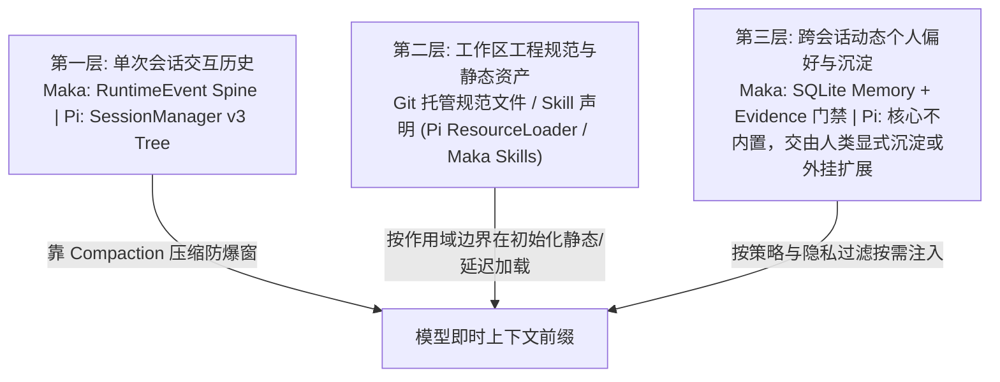

# 证据链账本 vs 文件即规范：两代记忆架构的防幻觉与检索代价

## 1. 长期记忆与工作区知识：两类截然不同的工程权衡

在经过几十次跨周迭代的编码项目中，“Agent 怎样在全新开启的会话中继续遵循老规矩、而不至于靠重读全部过往对话把上下文撑爆”决定了一款助手长期陪伴的可用上限。

面对这个难题，Maka（TypeScript 架构版）与 Pi（`packages/coding-agent`）做出了截然相反的底座设计：
- **Maka 路线**：在数据库层单立一套防幻觉长期记忆体系——通过后台 `memory-extraction` 提取提案、靠 `memory-extraction-evidence` 强制反查对话原文核验依据、结合 `incognito` 隐私隔离及每日回顾（`daily-review`）沉淀出跨会话记忆账本。
- **Pi 路线**：**拒绝在核心框架里内置暗盒式的自动长期记忆数据库与后台提取器**，转而把持续知识收敛到透明可见、受版本控制的**工作区规范文本（Context Files / Prompts / `Skills`）**与按需由扩展插件组合的显式记忆检索之上。

拆解这两条思路的代价曲线，能帮架构师避免在自己的系统里无脑照搬不适合体量的复杂组件。

---

## 2. 知识三层边界：为什么把所有东西塞进“向量库”注定失效？

无论是 Maka 还是 Pi 的架构实践，都在根源上规避了早期 Agent 框架最易掉进的陷阱——把所有零碎会话全倒进同一个混合 Embedding 向量索引，然后每回合靠模糊 Top-K 强行拼接进提示词。在成熟基础设施里，知识必须按**产生者权威**与**变化节奏**清晰分成三块互不越权的领地：

---

## 3. Maka 的纵深账本防线：代价高昂却严格防伪的证据闭环

Maka 选择承担系统级复杂度的代价，内置了全自动长期记忆采集与复盘设施（`packages/runtime/src/memory-extraction*.ts` 与 `packages/storage/src/sqlite-long-term-memory-store.ts`）。为了消除“自动化记忆抽取”极易附带的三大系统毒瘤，它构建了四重防线：

1. **证据原文锚定门禁（`memory-extraction-evidence`）**：很多提取器只要看着一段总结就往库里落盘，结果模型某回合自己胡猜的一句话下周居然变成了官方记忆规则。Maka 强迫提取器输出的每条提案（`memory-extraction-proposal`）必须指明支持它的原文事件引用链，并回库验实确实源自清晰可靠的用户输入或核准过程，脱缰无源的脑补提案一律拦下销毁。
2. **全链路无痕边界冻结（`incognito`）**：一旦会话顶着 `incognito: true` 创建或分叉衍生出任何子协作体，后台记忆抽水与每日回归审查通道（`daily-review-coordinator`）同步物理停机，保证隐私现场滴水不漏。
3. **非阻塞异步延迟整合**：记忆整理和 `daily-review` 全数挪入后台协调器周期错峰运行，绝不卡死正常交互回合。

**Maka 这条路线的真实成本在于**：必须维护额外的存储表结构升级、后台异步任务的并发限流与撤销隔离状态机；并且提取质量一旦遇到语言模糊的对话，依然依赖于提取边界与人工审核清理（这一点也在后续 Rust 版进化中促生了显式的 `Suppressed` 屏蔽态与版本游标）。

---

## 4. Pi 的极简规范哲学：人类审查（Git）即是最高效的记忆过滤器

与 Maka 在库里做复杂核验门禁截然相反，Pi 在 `packages/coding-agent/src/core/resource-loader.ts` 中通过 **`SettingsManager`、`loadPromptTemplates`、`loadSkills` 与工作区目录祖先扫描（Context Files）** 给出了一套极端克制但意外有效的解法：

| 机制比较维度 | Maka 自动化记忆账本 | Pi 文件即规范 + 扩展定制体系 |
| :--- | :--- | :--- |
| **长期规则落地方式** | 对话过程中或每日复盘后由后台模型抽炼写库，前端提供管理审查面板 | **显式文件沉淀**：项目规矩落在 Git 跟踪的项目指令文本与局部 `Skills` 文件夹中，对人脑与仓库历史完全透明 |
| **防幻觉机制** | 依靠 `memory-extraction-evidence` 与存储核验逻辑程序化防御模型编造 | **版本控制和人眼可见即防线**：只有明确由工程师（或经过工程师确认提交的改写）落进仓库磁盘规范文件的条目才在后续生效，彻底消除后台偷写暗账风险 |
| **提示词前缀缓存（Prompt Cache）友好度** | 若每回合动态按语义乱序召回不同片段拼接在提示词头部，极易引发缓存频繁失稳 | 工作区基础上下文与显式声明 Skill 目录在会话周期内高度稳定静态，天然具备极高的 Prefix Cache 命中率 |
| **零隐形后台成本** | 消耗额外后台模型抽取 Token 预算与提取/召回协调延迟 | **零后台静默调用开销**；需要定制专项领域长记忆时，由开发者通过标准扩展（Extension）或外置 MCP 精确挂接引入 |

这揭示了基础设施领域一个常被忽略的真理：**在开发者日常编码工作流中，很多所谓需要“隐式长期记忆”解决的问题，其实本质上适合写入明文可见、可被 `git diff` 审计与协同的 `Skills` 与规范文件；隐式自动内存库真正该承接的，仅是跨项目且频繁演化、难以靠固定文档表达的用户个人习惯偏好。**

---

## 5. 总结

对比两者的长期知识架构，可以得到清晰的工程取舍边界：
- **何时值得像 Maka 一样建造全栈长期记忆系统**？当你的终端产品面向广泛日常助理工作流或连续跨度数月的多端个人工作台，用户期待系统“在你不经意间记住习惯并自动复盘”，这时你就必须不惜投入精力构建起像 Maka 这样的 **`incognito` 隔离 + 证据链防幻觉核验 + 可清理账本**。
- **何时应该学习 Pi 把“长期规范收归文本和扩展”**？当核心场景聚焦在专业工程代码协作、追求可审计性、极低Token底噪与绝对确定性的 Hint 前缀缓存表现时，摒弃暗箱自动记忆提取、依靠清晰的静态上下文发现（`ResourceLoader`）与按需技能加载反而能换来压倒性的清晰度与稳定性。

看过了知识跨越时间长轴的沉淀路径后，接下来我们对比基础设施在横向空间维度的拆分能力：**当任务必须同时派出多名智能体协作时，“共享单 Root、带 Worktree 物理隔离与 Graph 控制面（Maka）”跟“按需派生独立无状态 `pi --mode json` CLI 子进程（Pi 扩展）”之间到底差在哪里？** 下一篇深度对照多智能体协作架构：**[持久 Worktree 协同图 vs 自由无状态派生：多智能体调度一致性的代价分水岭](./subagent-design.md)**。
