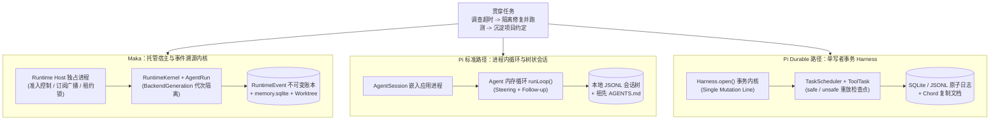
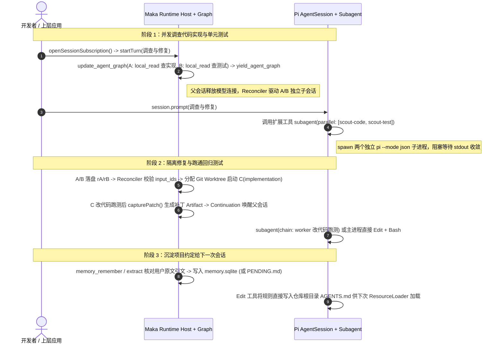
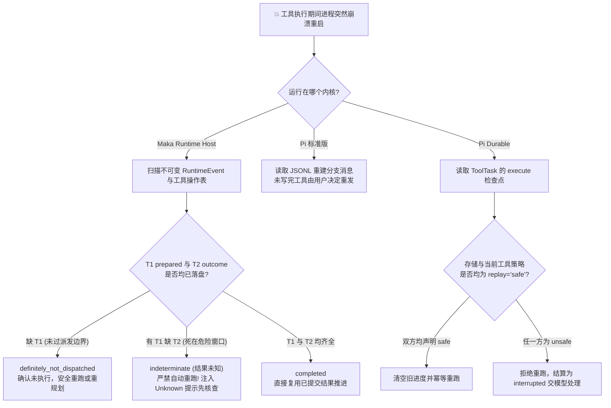
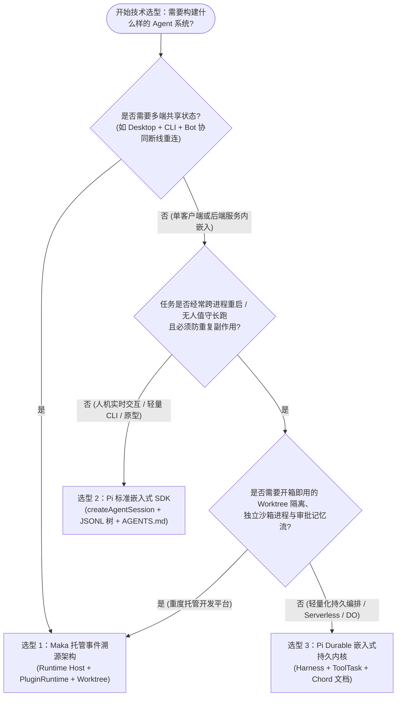

# Agent 内核架构宏观对比：Maka 与 Pi

[返回手册目录](../README.md)

在构建生产级智能体（Agent）系统时，最核心的架构分歧往往不在模型提示词或具体工具实现，而在于**运行时的所有权与状态权威边界**：
- 一条路线追求**极简部署与极速交互循环**，将 Agent 视为嵌入在应用进程内的轻量状态机与本地会话树，并以可插拔的持久 Harness 按需补齐崩溃恢复能力（以 **Pi** 体系为代表）；
- 另一条路线追求**多端同屏共享、强审计溯源与工业级故障安全**，将 Agent 提升为受单一宿主（Runtime Host）管辖的事件溯源微内核，把上下文投影、工具结算、子会话编排与密钥权限全部置于持久控制平面之下（以 **Maka** 为代表）。

为了避免流于表面特性罗列，本章以同一个贯穿工程任务为标尺：

> **贯穿任务**：“修复配置中的请求超时缺陷——先分别查明代码实现与单元测试中的超时逻辑，在隔离环境中实施修复并跑通测试，最后把‘修改超时配置必须附带回归测试’这条项目约定永久沉淀给下一次会话。”

围绕这项任务，下文从**状态建模与循环、长期知识沉淀、子任务组织、崩溃恢复一致性**四个内核维度，对 Maka 与 Pi（涵盖标准 `coding-agent` 与实验性 `durable` 两条路径）展开全景横评，并剖析两套体系在失效模式与演进选型上的工程取舍。

---

## 1. 概念先行：三种内核范式的边界划分

在深入细节之前，必须先厘清两者在系统拓扑上的根本差异。Pi 内部并非铁板一块，而是明确分层为**标准内存交互内核**（`pi-agent-core` + `pi-coding-agent`）与**实验性持久 Harness**（`@earendil-works/pi-durable`）；Maka 则从顶到底贯彻了**单状态根宿主（Single Host Authority per State Root）**架构。



| 架构维度 | Maka（托管事件溯源范式） | Pi 标准态（`agent` + `coding-agent`） | Pi Durable（`@earendil-works/pi-durable`） |
| :--- | :--- | :--- | :--- |
| **进程与状态权威** | **独立 Host 进程独占状态根**：客户端通过 RPC/订阅接入，所有状态变更经 Host 序列化写入。 | **应用进程内内存对象**：`Agent` 持内存状态，`SessionManager` 同步追加写入本地 JSONL。 | **进程内单写入变更线（Mutation Line）**：`SessionImpl` 串行化提交，支持 SQLite/JSONL/DO。 |
| **事实与上下文分离** | **三股数据流严格隔离**：不可变 `RuntimeEvent` 为事实，模型请求每次按需投影并支持有界压缩检查点。 | **JSONL 树即事实与上下文源**：沿当前 `leafId` 回溯路径，通过 `CompactionEntry` 与 `ContextEditEntry` 投影。 | **Immutable Entries + Chord 文档**：`AssistantEntry`/`ToolResultEntry` 与 `LiveDoc`/`InboxDoc` 同事务提交。 |
| **长期知识沉淀** | `memory.sqlite`（证据出处核验 + `Recall`）与 `PENDING.md → MEMORY.md`（人工审批）双轨，加无痕拦截。 | 沿 `cwd` 向根目录遍历加载 `AGENTS.md` / `CLAUDE.md`，直接通过 Git 版本管理项目规范。 | 内核不绑定长期记忆库，由宿主或扩展通过自定义 `Document` / 上下文钩子按需注入。 |
| **子任务组织** | 前台有界 `spawnChildSession` + 声明式 `Agent Graph`（`yield` 挂起与 `GitWorktreeChildExecutor`）。 | 外围扩展 `subagent` 拉起独立 `pi --mode json` CLI 子进程（`single / parallel / chain`）。 | 内置 `Conversation` 树与任务归属权（`ownership`），支持前台阻塞等待或后台 `Anchor + Reporter`。 |
| **崩溃恢复一致性** | T1 落盘意图、T2 落盘结果；窗口内崩溃强制判为 `indeterminate`，严禁盲目重跑。 | 重启后重读 JSONL 分支继续；未结算工具依赖人工重发，核心防线放在边界修复与截断保护。 | `ToolTask` 在执行前落盘 `execute` 检查点；重启后仅双方均声明 `replay: "safe"` 时自动重跑。 |

---

## 2. 贯穿任务端到端对比演练

将抽象机制放回同一条业务时间线，才能看清两种内核的协作节奏：在完成“查明超时实现与测试 -> 隔离修复并跑测 -> 沉淀项目约定”的过程中，Maka 依靠**持久化事件与控制平面调和**推进，Pi 则依靠**进程内回调与树形追加**推进。



从这条全景链路可以看出两者的根本取舍：
- **Maka 的开销换确定性**：每一步跨子会话交接、代码修改和记忆写入都被拆成独立的可审计状态边界；哪怕在“C 正在修改测试文件”的瞬间服务器断电，重启后的 Host 仍能通过账本精确得知 A/B 已完成、C 的 Worktree 租约目录在哪里、以及刚刚执行中的工具是否处在未知窗口。
- **Pi 的零摩擦高效率**：所有编排发生在单一控制流和明确的文件约定中，开发者能够实时看到 `subagent` 子进程的流式日志，用 `edit` 直接修改人类可读的 `AGENTS.md`，没有多余的数据库表、租约校验和异步调和延迟。

---

## 3. 维度一：状态建模与主循环驱动

面对贯穿任务的第一步——用户提交指令“调查配置超时并修复”——两套系统对“一条对话消息如何驱动模型并落盘”采用了截然不同的数据流与缓存治理模型。

### 3.1 Maka：不可变账本、投影分离与代次隔离

Maka 拒绝把“发给大模型的 `messages` 数组”当作系统的主数据库。原因在于生产环境下三个消费者对同一段历史的要求互相冲突：
1. **大模型**受限于上下文窗口，需要截断大工具输出、折叠历史或过滤隐藏字段；
2. **多端 UI（Desktop / TUI / Bot）**需要保留完整流式增量、工具参数与折叠卡片；
3. **审计与崩溃恢复器**需要精确追踪每次物理执行是否真正越过了外部副作用边界。

为此，Maka 将状态拆解为三个层次：
- **长寿命配置与缓存层（`BackendGeneration`）**：`RuntimeKernel` 按配置代次持有 `AiSdkBackend`，维持底层模型连接与激活工具目录稳定，确保多轮对话持续命中供应商的 Prompt Cache；当用户在运行中切换模型时，新请求平滑开启新代次，旧代次等待在途 `Turn` 结清后优雅销毁。
- **短寿命执行隔离层（`AiSdkTurn`）**：每次请求实例化独立的 `AiSdkTurn` 与 `AgentRun`，将 `runId`、`turnId`、`AbortSignal` 与 `ToolRuntime` 状态锁入闭包，彻底杜绝并发或快速重启时的状态串扰。
- **防死循环与步进门控**：`ToolRuntime` 在步进边界维护每步激活工具快照（`ToolGating`，通过 `tool_search` 加载的工具只在下一个 Step 才允许执行），并对字节级完全相同的连续失败调用施加防死循环熔断（`LOOP_GATE_IDENTICAL_THRESHOLD = 3`），防止模型在配置权限报错上无限空转烧钱。

### 3.2 Pi 标准态：内存双重循环与树状 JSONL

Pi 将运行复杂度压缩到极致，把核心循环封装在 `pi-agent-core` 的 `Agent` 与 `runLoop()` 中，把持久化交给 `pi-coding-agent` 的 `SessionManager`：
- **内存互斥与双层循环**：`Agent` 内部用 `activeRun` 独占锁阻止对同一会话的并发重入，提供 `steer()`（插队引导）与 `followUp()`（收尾追问）两个内存队列。`runLoop()` 外层监听 `followUp` 队列，内层循环处理工具调用批次与 `steering` 插队。
- **动态工具增量声明与缓存预热**：在多轮对话中途启用或禁用工具时，Pi 通过 `declareToolChanges()` 计算可执行工具集与已提交转录本的差量，把变更增量记在 `SystemMessage` 的 `toolsAdded` / `toolsRemoved` 上；同时 `CacheWarmer` 在请求前缀未被破坏时自动维持供应商提示词缓存热度。
- **树状追加文件（Tree-Structured JSONL）**：`SessionManager` 把每条记录赋予 `(id, parentId)` 指针，并维护一个当前 `leafId` 游标。用户在探索超时实现时走入死胡同，只需把 `leafId` 回退到某条历史节点就能无损开出新分支（`branch_summary` 可将旧分支结论浓缩带入新分支）。
- **无损编辑投影**：需要清理超长工具输出或丢弃异常失败尝试时，Pi 不修改旧 JSONL 行，而是追加一条 `ContextEditEntry`（`replacement: null` 隐藏或替换内容），由 `buildSessionProjection()` 在构造模型上下文时动态应用。

### 3.3 Pi Durable：单写入线与复制文档状态机

当 Pi 需要脱离终端人工盯防、在服务端或长任务中运行时，Pi Durable 将内存状态全部外部化：
- **单写入变更线（Single Mutation Line）**：所有对对话条目（`Entries`）、任务状态（`Tasks`）、排队请求（`Submissions`）及应用状态文档（`Chord` Replicated Documents）的读写都在 `SessionImpl` 的串行提交队列中以单事务完成，严格保证“外部副作用绝不发生在事务锁内部，未提交的状态绝不对外可见”。
- **驱动模型**：用户消息先进入 `Submissions`（`queued` → `placed` → `done` / `unanswered`），`TaskScheduler` 推进调度后按 Turn 边界切分运行，所有流式进度通过 `LiveDoc` 的增量操作（Delta Op）持久化发布，天然支持任意客户端断线后按版本号追帧。

### 3.4 教学伪代码：推进主循环的核心差异

```text
// === Maka：Host 准入 + 事实账本 + 按需投影 ===
async function executeUserTurn_Maka(sessionId, turnInput):
    // 1. Host 租约核验与会话准入，分配不可变执行身份
    admission = hostKernel.admitTurn(sessionId, turnInput)
    backend = runtimeKernel.acquireGeneration(sessionId, admission.config)
    turn = backend.createIsolatedTurn(admission.runId, admission.turnId)

    while true:
        // 2. 从不可变 RuntimeEvent 账本按最新检查点投影模型上下文
        events = eventStore.readImmutableEvents(sessionId)
        modelMessages = projectProviderContext(events, admission.compactionCheckpoint)

        // 3. 调用模型步进并由 StreamWatchdog 监控静默超时
        stepOutcome = await turn.streamModelStep(modelMessages, backend.activeTools)
        if stepOutcome.toolCalls.isEmpty():
            eventStore.commitTerminalEvent(admission.runId, "completed", stepOutcome.text)
            break

        // 4. 通过 ToolRuntime 两阶段事务结算工具调用并写入事实
        await toolRuntime.settleBatch(stepOutcome.toolCalls, admission.runId, admission.turnId)
    // 客户端订阅通道只消费已提交或流式投射帧，不触碰核心状态

// === Pi 标准态：内存 Agent 循环 + 本地树状 JSONL 追加 ===
async function executeUserTurn_Pi(session, promptText):
    if session.agent.hasActiveRun():
        throw Error("Agent is busy; use steer() or followUp()")

    // 1. 直接将用户消息追加到内存 state.messages 并同步触发事件监听器写入 JSONL 树
    await session.prompt(promptText) // 内部进入 runAgentLoop -> runLoop

function runLoop_Pi(context, config):
    pending = config.getSteeringMessages()
    while true: // 外层循环：检查 followUp
        hasMoreTools = true
        while hasMoreTools or pending.length > 0: // 内层循环：工具调用与 steering
            context.messages.push(...declareToolChanges(context, pending))
            assistantMsg = await streamAssistantResponse(context, config)
            if assistantMsg.toolCalls.length > 0 and assistantMsg.stopReason != "length":
                // 支持 parallel 或 sequential 执行，并由 beforeToolCall/afterToolCall 拦截
                toolResults = await executeToolCalls(context, assistantMsg, config)
                context.messages.push(...toolResults)
                hasMoreTools = not toolResults.terminate
            else:
                hasMoreTools = false
            pending = config.getSteeringMessages()
        followUps = config.getFollowUpMessages()
        if followUps.length == 0: break
        pending = followUps
```

---

## 4. 维度二：长期知识沉淀与跨会话复用

回到贯穿任务的最后一步：**把“修改超时配置必须附带回归测试”永久留给下一次全新会话。** 由于跨会话后原有上下文账本归零，两大框架在此呈现出“托管治理型检索”与“开发者文件约定”的鲜明分野。

### 4.1 Maka：防幻觉证据核验与受控检索

Maka 认为在托管多项目平台中，如果直接让大模型总结对话写入长期记忆，极易发生**幻觉污染**（模型把助手自己的猜测当成事实，或捏造用户没说过的规范）和**隐私泄露**（将 API Key 或无痕模式对话持久化）。因此 Maka 构建了两条严谨的通道：

1. **自动化结构化通道（`memory.sqlite` + `Recall`）**：
   - 当用户明确要求记住（调用 `memory_remember`）或在回合结束、上下文压缩（`compaction`）时触发提取，`MemoryExtractionEngine` 会启动最多 3 次模型调用预算的提取状态机。
   - **铁律一——只信用户原文**：证据投影器物理过滤掉所有助手回复、工具输出和推理内容，仅从非局部（`!partial`）的用户文本中构造证据列表。
   - **铁律二——逐字引文校验**：模型输出的每条候选记忆必须附带 `sourceRef` 与 `quote`，校验器强制核对引文（NFC 规范化后至少 4 个码点）**一字不差地出现在用户原文中**，经过独立隔离的规范化阶段（`canonicalize`）重写，并通过密钥脱敏检查后，才连同作用域标签（`workspace` 或 `global`）及游标 `processedOrdinal` 原子写入 `memory.sqlite`。
   - **按需 Recall 检索**：新会话初始化时不将全库塞入 System Prompt，而是授予模型 `Recall` 工具，使用 Okapi BM25 算法（对噪点较多的 `tool_result` 乘以 `0.5` 降权）联合检索蒸馏事实与同工作区历史会话片段。
2. **透明文件审批通道（`PENDING.md → MEMORY.md`）**：
   - 提炼的候选项先落入 `PENDING.md` 等待人类审阅批准；只有获批转入 `MEMORY.md` 且用户显式打开 `agentReadEnabled` 时，才会装配进请求的 `<local-memory>` 片段。
3. **无痕熔断（`incognito`）**：一旦处于无痕模式，不仅拒绝 `Recall` 查询，还会把压缩覆盖区间原子标记为 `policy_denied`，防止日后退出无痕模式时发生延迟泄露。

### 4.2 Pi：祖先路径约定发现与树内沉淀

Pi 坚持“文件系统即事实（Filesystem as Truth）”的工程哲学，零额外记忆数据库：
- **祖先目录自动发现（`DefaultResourceLoader`）**：每次装配会话时，Pi 从全局 `~/.pi/agent` 出发，再从当前 `cwd` 逐级向根目录攀爬，在每一级目录加载 `AGENTS.override.md`、`AGENTS.md` 或 `CLAUDE.md`。对于嵌套的 Git Worktree，它还会智能检测并跳过被 Worktree 遮蔽的主仓库同名文件，避免规范重复注入。
- **开发者主导沉淀**：在贯穿任务中，要让下一次会话记住“修改超时必须附带回归测试”，最自然的方式就是让 Agent（或开发者）直接用 `edit` 工具将该规则追加到项目根目录的 `AGENTS.md` 中并随代码提交到 Git。团队全员共享同一份清晰可读、可 Code Review 的静态规则文件，代价是需要团队手工控制文件体积并缺乏自动跨会话语义检索能力。

---

## 5. 维度三：子任务组织与并发写隔离

贯穿任务的中间步骤要求**并发查明代码实现与单元测试，再在隔离环境中修改超时逻辑并跑通验证**。这一场景直接考验多智能体协作中的权限边界、目录隔离与产物交接可靠性。

### 5.1 Maka：角色契约、Agent Graph 与 Git Worktree 隔离

Maka 将子智能体设计为带有完整身份与审计边界的一等公民：
- **前台有界委派（`agent_spawn`）**：适合快速查证任务。内置 `local_read`（`permissionMode: 'explore'`，仅开放 `Read/Glob/Grep`，共享只读工作区）与 `web_research`（仅 `WebSearch`）等受限角色，单轮最多并发 5 个子工具调用，返回带 `childSessionId` 与 `runId` 的结构化结果。
- **持久化工作图（`Agent Graph`）**：当依赖呈现“A、B 并行调研 → C 综合修复 → 父会话审阅交付”的 DAG 拓扑时，父助手通过 `update_agent_graph` 提交调度声明后可调用 `yield_agent_graph` 释放模型连接与内存。后台调和器（`reconcileAgentGraphSchedule()`）持续监测图状态，**只有当 `input_ids` 引用的上游产物 `rA`、`rB` 均已安全落盘提交**，才从不可变事件中回读文本（单条封顶 16KB）并以“数据非指令”的隔离信封注入 C 的初始上下文，最终在检查点通过 Continuation 唤醒父会话。
- **`implementation` 角色强制 Worktree 隔离**：修改代码的子任务必须使用 `implementation` 角色。若未配置 `GitWorktreeChildExecutor`，系统会 fail-closed 直接禁用该角色；配置后，工作区分配器会校验源仓工作区洁净度，利用请求指纹生成确定性租约（`subagent_worktree_<hash>`）创建独立 Git Worktree 目录与分支，子任务完成后借助临时索引（不破坏子仓 Index）执行 `capturePatch()` 将全部改动发布为不可变 Patch Artifact 交还父级审查。

### 5.2 Pi：轻量子进程扩展与 Durable 持久子对话

Pi 在标准版与 Durable 版中分别给出了极简与强韧两种解法：
- **标准 CLI 扩展示例（`examples/extensions/subagent`）**：通过 `spawn` 拉起独立的 `pi --mode json -p --no-session` 子进程，读取 Markdown 定义的角色配置（受 `confirmProjectAgents` 项目信任弹窗保护），原生提供 `single`、`parallel`（最大 8 任务、并发上限 4）以及 `chain`（自动替换 `{previous}` 占位符）三种编排原语。由于子进程默认直接运行在调用方传入的 `cwd` 上，若要避免并发写冲突，需要调用方自行指定只读角色或外部目录。
- **Pi Durable 子对话模型**：依托持久存储中的 `Conversation` 树，支持两种原生模式：
  - **前台子对话**：工具以 `replay: "safe"` 和任务归属权（`ownership: { kind: "task", taskId }`）创建 `child conversation`，并附带幂等 `requestId` 提交任务，父工具 Abort 自动级联停止子对话。
  - **后台子对话**：通过无阻塞的 `Anchor` 后台任务作为子对话所有者使其脱离单轮取消边界，并由双阶段持久任务 `Reporter`（`deliver` 阶段等待子对话响应并去重 → `report` 阶段以 `whenBusy: "followUp"` 投递给主对话）驱动异步汇报，跨进程重启仍能无缝送达。

---

## 6. 维度四：崩溃恢复与执行一致性

假设正当系统修改 `config.json` 或执行验证脚本的过程中，宿主机突然断电重启。面对“刚才那步操作到底执行成功没有”这一分布式经典难题，两套架构划定了截然不同的安全水位。



- **Maka 的零妥协底线**：借助 `TOOL_BOUNDARY_PROTOCOL_V1`，Maka 围绕 `operationId` 在物理执行前先提交 T1（`commitToolPrepared`），在拿到结果后提交 T2（`commitToolOutcome`）。只要日志中出现 T1 而缺少 T2，重启后的 `resolveRuntimeRecovery()` 绝不允许猜测“刚才大概没跑成”，而是强制裁定为 `indeterminate`，并由 `RuntimeContinuationPlanner` 通过 `claimContinuation()` 原子抢占唯一续接权（支持最高 64 层谱系校验与 `source_prefix_digest_mismatch` 篡改拦截）后安全恢复，彻底杜绝重复创建工单、重复扣费或二次篡改文件。
- **Pi 标准版的实用主义权衡**：定位为人类开发者面前的交互式终端工具，不引入厚重的两阶段事务协议。但即便如此，它在关键边界上依然极其严谨：例如 `runLoop()` 会拦截因 `stopReason === "length"` 导致的截断工具调用参数而不予执行；`compaction.ts` 会确保切分点绝不割裂成对的 `toolCall` 与 `toolResult`。
- **Pi Durable 的对齐演进**：引入与 Maka 异曲同工的检查点语义。`ToolTask` 在完成 `beforeTool` 钩子与参数校验后、物理调用 `execute()` 前，必须先原子提交 `{ phase: "execute", arguments, replay }` 检查点；重启后只有当检查点保存的策略与代码里当前工具声明的策略**同时为 `"safe"`** 时才自动重跑，默认 `"unsafe"` 工具一律标为 `interrupted` 让模型先查看环境。

### 6.1 教学伪代码：工具崩溃窗口保护对比（Maka T1/T2 vs Pi Durable ToolTask）

```text
// === Maka：ToolRuntime T1/T2 边界与恢复裁决 ===
async function executeTool_Maka(call, tool, runtimeSink):
    // 1. 前置门控（Schema 校验 / Exclusive Step / Loop Gate）失败走 preflight 通道，不过 T1
    // 2. T1：物理执行前单事务提交 function_call + toolDispatch (状态: prepared)
    await runtimeSink.commitToolPrepared({
        operationId: buildToolOperationId(call.invocationId, call.toolCallId),
        recoveryMode: tool.recoveryMode == "outcome_unknown" ? "outcome_unknown" : "never_auto_retry"
    })
    // [危险窗口开始] 物理调用外部系统
    outcome = await tool.impl(call.args)
    // [危险窗口结束] T2：单事务写入原始结果 + 模型投影 (状态: outcome_committed)
    await runtimeSink.commitToolOutcome(call.operationId, outcome)

// === Pi Durable：ToolTask 阶段状态机 ===
ToolTask.phases = {
    call: async (task, runtime) => {
        args = validateAndRunBeforeHooks(task)
        // 记录不可变意图检查点与 replay 策略
        await runtime.commit({
            status: "running",
            checkpoint: { phase: "execute", arguments: args, replay: tool.replay ?? "unsafe" }
        })
        return runToolImplAndSettle(runtime, args)
    },
    execute: async (task, runtime) => { // 仅在崩溃恢复时进入此阶段
        storedReplay = task.state.checkpoint.replay
        currentTool = resolveTool(task.call.name)
        if storedReplay == "safe" and currentTool?.replay == "safe":
            clearProgressSlot(runtime)
            return runToolImplAndSettle(runtime, task.state.checkpoint.arguments)
        // 默认安全底线：禁止盲目重跑，显式回报 interrupted
        await settleInterrupted(runtime, "Tool was interrupted and may have partially run")
    }
}
```

---

## 7. 系统级失效模式对比矩阵

架构决策的价值最终体现在极端故障下的表现。下表对比了两套体系在五类典型生产故障中的防线与代价：

| 故障场景 | Maka 架构的应对机制 | Pi 标准态的应对机制 | Pi Durable 的应对机制 |
| :--- | :--- | :--- | :--- |
| **多客户端并发写同一会话** | `StorageRootLease` 单 Host 租约锁 + 串行准入闸门；多端通过订阅帧同屏镜像。 | 无跨进程写锁，默认单进程独占；`Agent.activeRun` 拒绝进程内并发调用。 | 单一 `SessionImpl` 变更线；`Submissions` 排入队列并在 Turn 边界消费。 |
| **模型流式输出到一半网络静默** | `StreamWatchdog` 检测静默超时并触发受控重试，工具执行期间自动 `pauseTarget` 暂停看门狗。 | `ModelRuntime` 依赖 `httpIdleTimeoutMs` 与 `retryAssistantCall` 指数退避重试。 | Provider 任务内置重试策略并在重试间保存退避定时器状态。 |
| **上下文爆窗或输出被截断** | 压缩生成结构化/供应商检查点，并校验前缀不越界；未通过的截断调用隔离在 Turn 内失败重试。 | `failToolCallsFromTruncatedMessage` 拒跑半残调用；`context_edit` 持久化隐藏溢出尝试。 | 通过 `Compaction` 任务和 `ContextEdit` 在原子提交中替换或省略条目。 |
| **多子代理并发改坏代码** | `implementation` 角色强制绑定 `GitWorktreeChildExecutor`，通过独立 Worktree + Patch 回写隔离。 | 扩展子进程共享或按参数传递 `cwd`，无内置 Worktree 与 Patch 聚合器。 | 可在构建 `ExecutionEnv` 时按 `conversationId` 注入沙箱目录，内核不强绑定 Git。 |
| **进程重启后产生重复外部副作用** | T1→T2 窗口必判 `indeterminate`，结合 `claimContinuation` 原子认领防双活恢复。 | 重启不重跑中断工具，由人工观察终端输出后决定后续指令。 | 仅 `replay === "safe"` 工具自动重放，`unsafe` 工具转为 `interrupted` 交由模型确认。 |

---

## 8. 架构选型决策树与演进路线

没有放之四海而皆准的内核。选择 Maka 还是 Pi（或其 Durable 形态），本质上是在**“基础设施运维成本”**与**“多端持久韧性上限”**之间寻找最佳平衡点：



### 工程演进建议

1. **从 0 到 1 验证工作流与交互式 CLI 工具 → 首选 Pi 标准 SDK**：
   利用 `createAgentSession()` 与内存事件订阅可以在极短时间内装配出一个支持树状分叉、结构化压缩和祖先 `AGENTS.md` 发现的完整编码助手，零守护进程、零 SQLite 运维包袱。
2. **需要跨越重启的后台流水线、边缘 Worker 或自建持久对话 → 切入 Pi Durable**：
   当你发现内存 `Agent` 在进程重启后无法接续异步工具或后台子助手，但又不想引入独立的跨进程 RPC Host 协议时，用 `Harness.open()` 配合 SQLite 或 Cloudflare Durable Objects 即可在单一进程模型下获得原子事务与安全重放能力。
3. **打造企业级多端协同工作台、自动化运营矩阵与评测平台 → 采用 Maka 架构**：
   一旦产品需要同时面向桌面端、CLI、IM Bot 和离线 Eval 评测暴露同一个工作区状态，并要求具备插件热插拔沙箱、外置 ACP 代理接管、Worktree 代码隔离、证据防幻觉记忆库以及 OS 级沙箱边界，Maka 提供的单宿主权威与事件溯源微内核正是为此类系统量身铸造的基石。

---

## 9. 延伸阅读

- 深入对比长期记忆防幻觉提取、工作区隔离与检索机制：[07.2 记忆存储、提取与检索机制对比](memory-design.md)
- 深入对比多智能体派生、工作图调和与 Git Worktree 隔离：[07.3 子智能体执行、调度与生命周期管理对比](subagent-design.md)
- 深入对比多端接入、插件隔离沙箱与产品级集成模式：[07.4 应用集成、扩展架构与执行场景对比](pi-and-maka.md)
- 回顾 Maka 的核心架构取舍与两阶段崩溃恢复原理：[00.4 设计模式与架构权衡](../00-foundations/design-tradeoffs.md)、[04.1 持久化与恢复](../04-state/durable-execution.md)
- 深入理解 Maka 声明式工作图调度器的内部收敛机制：[05.2 任务图与多 Agent 协作](../05-coordination/agent-graph.md)
