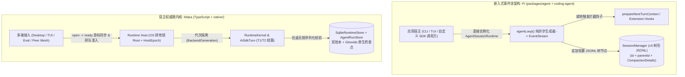

# 状态机、持久化与控制权：Event-Sourced Host 内核 vs 嵌入式 Hook 运行时

## 1. 为什么同样是用 TypeScript 写智能体内核，控制权与持久化边界会演化出两种截然相反的拓扑？

在 Agent 基础设施选型里，用同一种语言（TypeScript + Node.js）造出来的工业级运行时却常常在顶层哲学上分道扬镳：**Maka（TypeScript 架构版）**与 **Pi（`@earendil-works/pi-agent-core` / `@earendil-works/pi-coding-agent`）** 正是这两极范式的典型工程代表。

导致它们分道扬镳的根本原因，不是谁支持更多大模型接口，而是双方各自优先回答了一道截然不同的系统命题：
- **Maka 的核心命题**：当同一个工作区同时连接 Desktop 桌面应用、CLI 终端、自动化后台 Bot 与容器评测器时，如何在**宿主崩溃、断线重连和恶意工具越权**下守住唯一可审计真相？
- **Pi 的核心命题**：如何以极低的心智负担与零中心守护进程约束，让交互循环成为可被开发者自由嵌入任意终端（`@earendil-works/pi-tui`）、脚本或桌面壳子里的极简可组合 SDK？

把这两套机制放在一起解剖，就能看清多一重“中心 Host + 双账本”到底买了什么保险，又交出了什么灵活代价。

---

## 2. 内核中枢对比：可重入 Hook 循环 vs 受管 Event-Sourced Host

### 六大核心结构维度横向拆解

| 对比维度 | Maka（TypeScript 托管微内核版） | Pi（嵌入式 Hook 运行时版） | 本质哲学分水岭 |
| :--- | :--- | :--- | :--- |
| **执行所有权模型** | 单 State Root 唯一 Host 写入权威；客户端仅握持观察订阅与幂等请求键（`turnId`） | 进程内自由实例化 `AgentSession`；由 `AgentSessionRuntime` 围绕 `cwd` 装配服务 | **共享权威中心化** vs **单实例进程自治** |
| **循环驱动形态** | `AiSdkTurn` 外层 Step + 内层 Attempt 双循环 + 双阶段 `StreamWatchdog` + 消费栅栏 `waitUntilConsumed` | `agentLoop()` 推出简洁 `EventStream<AgentEvent, AgentMessage[]>`，按需经由扩展拦截改造 | **强状态机围栏防逃逸** vs **透明组合管道高敏捷** |
| **持久化账本形态** | SQLite 规范事件脊柱（`RuntimeEvent`） + 伴生运营账本（`AgentRunStore`），落库过 `isDeepStrictEqual` 无损验证 | 轻量自包含的 v3 树状 JSONL（`SessionManager`，每行以 `id` / `parentId` 挂接分支节点） | **关系型事务索引检索** vs **纯正直观可携平面树日志** |
| **崩溃窗口治理** | `Pre-T1` 与 `T1` (`t1_after_preflight_v1`) 严切分；越线失联强制密封为 `outcome_unknown`，禁绝盲试 | 依赖当前轮次完成后的 JSONL 追加与外围 `nested-tool-calls` / 上层重连处理，无内建分布式封存状态机 | **把半截副作用显式封箱** vs **轻量即时交互优先** |
| **安全沙箱隔离粒度** | 双路物理隔离：`Bash` 走 Seatbelt/bwrap/Win Launcher，内置文件工具走独立二次收窄 Worker + `fstat` 防 TOCTOU | `projectTrust` 项目信任确认门槛 + 直接内置工具执行及 `bashExecutor` 可替代注入 | **防恶意代码越权破坏系统** vs **信任工作区本地开发者共治** |
| **混合语言原生边界** | 下沉原生 Rust 子系统处理高强度 Git 树（`gitoxide-helper`）、可恢复 P2P 流（`runtime-host-peer`）及 Win 作业隔离 | 纯 TypeScript 主体（配合底层独立 TUI 等辅助套件），构建链路零额外多语言汇编门槛 | **极压榨原生系统与传输极限** vs **全栈单语言极简维护体验** |

---

## 3. 四条机制深处的关键分水岭

### 3.1 状态建模：树状分支（JSONL Tree）vs 双账本确定性投影

Pi 的 `SessionManager` 在文件模型上展现出令人惊艳的优雅：**单文件树状 JSONL (`CURRENT_SESSION_VERSION = 3`)**。每一条消息、一次手动压缩摘要（`createCompactionSummaryMessage`）、乃至切入另一条思考支线后总结回来的岔路归纳（`createBranchSummaryMessage`），全部带有唯一的 `id` 与 `parentId`。用户可以在任意历史节点上一键分叉重新探索，不用迁移重型 SQLite 库就能用文本编辑器看清完整对话拓扑。

而 Maka 选择放弃轻盈的树状文本日志，背上 `SqliteRuntimeStore + AgentRunStore` 双账本的重量级结构，看中的是另一件事——**高并发多视图投影隔离与零丢失操作恢复**。当一个运行实例需要同时撑起前端的只读瀑布流、模型层的稀疏裁剪归约链（`ModelProjectionTransitionLedger`）、计费系统的单值提交（`ModelCallCommit`）以及工具的 `T1/T2` 断点追踪时，单一的交互事件流再也无法在不互相污染的前提下承载这么多种截然不同的更新频率与事务需求。

### 3.2 历史压缩：显式分支切点（`findCutPoint`）vs `#6254` 未知封存跨越

在上下文压缩方面，Pi 提供了极其干净透明的组件函数库（`compaction/` 下的 `shouldCompact`、`estimateProjectedContextTokens`、`findCutPoint` 及分支总结 `collectEntriesForBranchSummary`）：一切切点计算面向直观的 `SessionEntry[]`，并且用诸如 `custom-compaction.ts` 的扩展模式把策略选择权毫无保留地开放给上层开发者。

Maka 则是在多进程与长崩溃的痛苦洗礼中打磨压缩算法：它不仅需要面对常规的 `function_call`/`function_response` 成对护栏，甚至必须专门攻克如 **Issue `#6254`** 这类极端故障——当上任宿主死在半道留下一笔永远等不到结果的 `outcome_unknown` 工具时，压缩前缀识别算法必须校验真实的恢复封存证物，才能确保检查点滚进不被孤儿调用永久钉死。

### 3.3 并发与打断：内存事件流推拉 vs 短锁准入与 `SteeringLease`

当用户发出新的插话纠偏时：
- 在 Pi 中，上层调用 `AgentSession` 的队列注入或中止当前 `AbortSignal`，由同一内存态里的 `agentLoop()` 协同下一次工具循环入口完成拼接。简单、直觉，在单进程 TUI 或桌面应用独占会话的场景下响应极快；
- 在 Maka 中，哪怕插话来自于另一个终端窗口甚至远程移动节点，消息都必须先过 `SessionAdmissionGate` 原子写库，再通过 `DeliveryAckQueue` 签发带排他期租约的 `SteeringLease` 给工作步消费，只有步结算落盘才核销 `ack()`。多出来的这几层抽象纯粹是为了抵御“跨节点竞态”和“掉电丢单”这两类单进程内存模型不需要扛的冲击。

---

## 4. 总结

Maka TypeScript 版与 Pi 在架构哲学上其实不存在抽象意义上的“谁碾压谁”，而是一份精准的**复杂性代价对应表**：
- 当你构建的是**强调极速定制、开发者本地共治、单应用内部嵌入整合**的智能编码助手时，Pi 以极小核心换取最大化组装弹性与树状分支清晰度的路线极具性价比；
- 当你要打造的是**多端常驻共享同一个 State Root、需要跨越设备切网不断流、在沙箱内对抗未知半可信操作、并且要把每一次崩溃和计费审计钉死在账本里**的生产平台时，Maka 的 Event-Sourced Host 微内核几乎交出了一套完整可落地的范本。

下一章我们将下沉到第一项具体对比切面：**同样是要记住用户过去的偏好、注入项目规范且绝不让幻觉与隐私污染新会话，“证据链双账本（Maka）”与“透明文本与工具规范（Pi）”各自付出了怎样的检索代价与约束取舍？** 请看：[证据链账本 vs 文件即规范：两代记忆架构的防幻觉与检索代价](./memory-design.md)。
