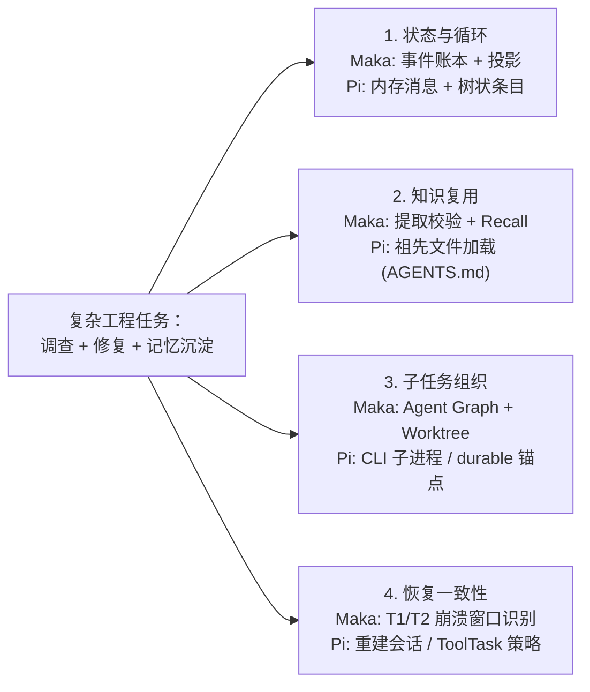

# Maka 与 Pi 的 Agent 内核架构对比

[返回手册目录](../README.md)

在构建 Agent 基础设施时，架构师往往面临两种截然不同的设计哲学：
- **以“单机高效编码交互”为中心的嵌入式内核**（以 **Pi** 为代表）；
- **以“多端协同、强审计与崩溃可恢复”为中心的托管服务内核**（以 **Maka** 为代表）。

为了避免流于表面的特性罗列，本章用同一个贯穿任务——**“修复配置超时，先分别查明代码实现与单元测试，最后把这条项目约定永久留给下一次会话”**——从状态建模、知识复用、子任务组织和执行一致性四个核心维度对两大系统展开全景横评。

---

## 1. 四大核心维度总览对比

| 架构维度 | Maka（托管服务与事件溯源范式） | Pi（轻量嵌入式与会话树范式） | 核心设计取舍 |
| :--- | :--- | :--- | :--- |
| **1. 状态与循环建模** | Host 独占写入权威；`RuntimeEvent` 为唯一事实，每次请求前按需投影构造消息。 | `AgentSession` 装配内存 `Agent`，`runLoop()` 直接操作上下文并在本地追加 JSONL 树条目。 | Maka 牺牲了少量序列化与投影开销，换取了多端同屏同步与无损审计；Pi 启动零延迟，分支探索极其顺滑。 |
| **2. 长期知识复用** | 支持从对话提取带出处的记忆条目存入 `memory.sqlite`（按工作区/全局 Recall），或走 `PENDING.md → MEMORY.md` 审批。 | 初始化时沿祖先目录自动发现并加载 `AGENTS.md` 等静态上下文文件，配合会话树保留分支历史。 | Maka 强调动态提取、出处核验与受控检索；Pi 强调透明的本地文件系统约定，所见即所得。 |
| **3. 子任务组织** | 前台直接派生子会话（`spawnChildSession`），复杂拓扑由 `Agent Graph` 协调并支持 `git worktree` 隔离改动。 | 常规通过扩展（Extension）拉起独立 CLI 子进程（single/parallel/chain）；实验 `durable` 通过 child conversation 与 reporter 投递。 | Maka 将多 Agent 协作内置为持久化的控制平面；Pi 保持核心极简，把多智能体模式解耦到外围扩展层。 |
| **4. 崩溃恢复一致性** | 工具派发前写 T1、返回后写 T2；崩溃窗口内强制标记 `indeterminate`（结果未知），杜绝盲目重跑。 | 默认模式重启后从会话文件重建历史继续对话；实验 `durable` 模式通过 `ToolTask` 的 checkpoint 与重放策略处理。 | Maka 默认在全链路贯彻工业级防重跑底线；Pi 将轻量交互与实验性持久任务明确分层，互不拖累。 |

---

## 2. 沿贯穿任务的执行差异剖析

### 2.1 推进主循环与工具结算
- **Maka**：客户端请求首先穿过 Runtime Host 的准入网关确立身份，Kernel 复用或构建代次后端后开启独立 `AiSdkTurn`。模型决定调用 `Read` 时，`ToolRuntime` 先落盘 T1 准备事实再读磁盘，最后落盘 T2 结果与模型投影，并通过带确认队列同步进入下一步。
- **Pi**：应用直接调用 `createAgentSession()` 组装好的 `Agent` 实例。`session.prompt()` 直接进入 `agent-loop.ts` 的内存循环，通过内存钩子拦截执行工具后，将结果直接推入上下文列表发起下一轮调用。

### 2.2 把项目约定留给下一次会话
- **Maka**：当用户说出“以后修改配置必须跑通验证”，若开启了记忆提取，主模型调用提取工具从用户原文抓取证据、校验出处后写入 `memory.sqlite`（或写入 `PENDING.md` 等待人类批准进入 `MEMORY.md`）。下一次新会话通过 `Recall` 工具按工作区维度检索召回。
- **Pi**：团队约定通常以人类可读的方式直接写入仓库根目录的 `AGENTS.md`。每次新会话启动时，资源加载器（`ResourceLoader`）自动沿当前目录向上扫描并注入这些规范文件，零额外数据库依赖。

---

## 3. 架构选型建议：什么时候该用哪种范式？

- **优先选择 Pi 范式的场景**：
  - 构建单机本地开发者 CLI 工具或 IDE 嵌入式插件；
  - 追求极致的启动速度、极低的内存占用与简单的心智模型；
  - 任务周期较短，用户在旁实时监督交互，偶尔中断由人工直接重来即可。
- **优先选择 Maka 范式的场景**：
  - 需要同时支持桌面端（Electron）、终端（TUI）、Web 面板和后台机器人共享同一个工作区；
  - 需要运行长达数十分钟甚至跨天的复杂编码、构建与多 Agent 协同图任务；
  - 对企业级安全边界（独立文件 Worker、AES 加密托管密钥）、全链路计量审计以及崩溃后严禁重复产生外部副作用有刚性要求。

---

## 4. 专题深入阅读

后续三篇将分别从具体机制层面展开逐项深潜：
- 深入对比长期记忆的提取、防幻觉校验与检索隔离：[07.2 记忆存储、提取与检索机制对比](memory-design.md)
- 深入对比多智能体的派发、Worktree 隔离与产物交接：[07.3 子智能体执行、调度与生命周期管理对比](subagent-design.md)
- 深入对比上层应用如何将两套内核集成进自身产品：[07.4 应用集成与执行场景对比](pi-and-maka.md)
