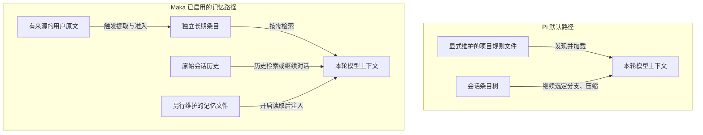

# Maka 与 Pi 的 Agent 内核架构对比

[手册目录](../README.md)

本文从状态建模、知识复用、子任务组织和执行一致性四个方面比较 Maka 与 Pi 的 Agent 内核，重点分析各机制的职责边界、运行行为及设计取舍。

Pi 默认 coding-agent 以可续接、可分支和可压缩的会话历史组织状态，通过工具与扩展增加执行能力。Maka 在会话之外，显式建模执行事实、记忆提取和持久任务关系，为后续推理提供来源引用，并由运行时校验执行进度。

Pi durable 是独立的执行路径，以任务、阶段进度和所有权为核心状态。本文分别讨论 Pi 默认会话与 durable，避免将不同运行时的能力和约束混合比较。

本文的设计分析基于源码结构与实际控制流，不推定项目作者的历史设计动机。统一分析场景如下：

> 在保持公共接口兼容的前提下修复配置超时。子智能体 A 分析实现，B 分析测试，C 综合两项结果提出修改方案；稳定的项目约定需要支持后续会话复用。

源码基线：Maka `8320cda1a4229b54124efe91d8830d0a89c39a4f`；Pi `482c1381a00d8d00bc81697e4a980c593db6803e`，分析包含当时的工作区修改。核对日期：2026-10-28。源码链接指向 GitHub 上的固定提交，未提交的 Pi 修改不在链接目标中。Maka 的记忆和 Graph 分别有运行模式、配置与能力条件，下文描述的是已接入的相应路径，不表示每次运行都启用。

## 1. 状态分类与设计职责

| 状态类别 | 场景示例 | 设计职责 |
| --- | --- | --- |
| 原始历史 | 用户约束、A 的文件读取记录 | 保存可回溯的交互和执行记录 |
| 当前工作记忆 | 当前请求所需的约束、摘要和近期工具结果 | 在上下文预算内维持推理连续性 |
| 长期知识 | 项目约定、已验证的排错经验 | 支持跨会话知识复用 |
| 执行进度 | B 的终态、C 的依赖、修改操作的结算状态 | 为中断恢复和后续调度提供依据 |

会话持久化主要保存原始历史；上下文压缩管理当前工作记忆；跨会话知识需要独立的提取与读取机制；执行恢复则依赖进度和结算证据。这四类状态的存储范围、有效期和消费方式不同，应分别比较。

## 2. 记忆存储与知识复用机制

Pi 默认会话使用对话条目树保存历史。模型上下文沿选定分支生成；达到压缩条件时，追加摘要并保留近期内容。历史分支仍可独立选取，无需覆盖整份会话记录。

Maka 保存执行事件，并根据消费用途生成模型输入。工具原始结果与模型可见表示分别保留；压缩记录包含来源覆盖与有效内容校验信息。有效投影发生变化后，旧摘要可能失效，因此工作上下文的来源和有效性属于运行时检查范围。

两者均支持历史持久化和上下文重建。Pi 通过会话分支确定上下文贡献；Maka 的相关路径还验证历史可重放性和摘要来源一致性。该差异涉及状态模型与校验契约，不能仅归结为 JSONL 与数据库的存储格式差异。

源码依据：[Pi 分支与上下文选取][p-context]、[Maka 摘要来源校验][m-checkpoint]、[Maka 工具结果与模型投影的共同提交][m-tool-commit]。

### 跨会话知识的提取与检索

Pi 默认路径主要使用显式维护的上下文文件，例如 AGENTS.md。文件位于资源发现范围内，并在初始化或重新加载时被读取后，其内容才能进入模型上下文。仅存在于历史对话或工具读取结果中的约定，不会默认成为新会话的公共知识；复用需要上下文文件维护、会话恢复或扩展支持。

Maka 已接入独立的知识提取流程。在受支持且已启用的运行路径中，用户显式记忆请求、模型标记的提取请求和自动压缩边界可触发提取。校验通过的条目写入独立的 `memory.sqlite`，保留来源与作用范围，后续经 Recall 工具检索进入请求上下文。条目持久化不保证新会话自动加载或检索命中。

提取器仅接受用户原文作为知识证据。A 读取的源码规则及父智能体对该规则的摘要，均不足以独立支持长期条目；用户明确陈述的约束可作为候选证据。摘要仅提供解释背景，不替代来源校验。该限制降低模型推断被固化为长期事实的风险，同时限制了工具发现的自动提取覆盖率。

Maka 还提供 `MEMORY.md / PENDING.md` 文件记忆流程，支持候选审批或直接保存，并由独立读取开关控制提示注入。该流程与 SQLite 提取具有不同的准入规则，当前未确认二者存在自动同步。主要设计差异在于知识提取、来源准入、作用范围和检索流程的内核集成程度；Pi 默认路径将更多知识维护责任交由用户或扩展承担。

上图表示资料进入模型上下文的数据流。长期条目与向量索引、执行恢复检查点分别属于不同机制；当前已核实的 Recall 路径采用键前缀检索和历史文本匹配。

源码依据：[Pi 的上下文文件加载][p-project-files]、[Maka 记忆生产装配][m-memory-wiring]、[用户证据准入][m-memory-evidence]、[长期数据库位置][m-memory-store]、[检索结果进入上下文][m-recall]、[独立文件读取门控][m-memory-file]。

长期知识提高跨会话复用能力，同时引入内容过期、提取误判和作用范围错误的风险。来源追踪、写入范围控制和读取时机是相应的一致性要求。完整机制见[记忆存储、提取与检索机制对比](memory-design.md)。

## 3. 子智能体执行模型与生命周期管理

Pi 默认 coding-agent 未预置子智能体。仓库随附的 subagent 扩展示例通过工具启动独立 CLI 进程，传入任务文本，并在执行结束后将结果返回父模型。该示例使用非持久化子会话；A/B 的过程记录由扩展在内存中收集，父模型负责组织传递给 C 的输入。

该设计以一次性工具委派为执行单元，支持并行与串行组合，但不提供持久工作安排和结果依赖。父进程中断后，示例缺少重新认领原批次的持久协议。应用可另行实现此类机制；上述结论仅适用于已核实的随附示例。

Maka 的前台委派以独立、持久的 child Session 保存执行过程，父工具等待其完成，父任务取消向子任务传播。因此，会话持久化与后台执行相互独立。子模型使用显式任务输入和自身历史，不自动继承父会话完整上下文；公共接口兼容等约束需要显式传递。

Maka Graph 持久化工作安排，由协调器取得执行身份并推进 child Session。同一节点可接受多次工作，各次执行分别标识。父模型可让出当前轮次，并在结果可用时被重新唤醒；轮次结束、新工作准入关闭和活动任务停止分别具有独立语义。

在 A/B/C 场景中，父模型先安排 A 和 B，取得已提交结果的记录 ID，再将两项结果选为 C 的输入。运行时按引用读取带来源的结论文本，减少父模型重复转述。C 接收受长度限制的结论与来源，不接收 A/B 的完整历史；截断和摘要仍可能损失细节。

该设计将持久工作及其来源关系纳入运行时状态，代价是增加节点、工作版本、认领和结果关系的存储与校验成本。当前默认路径未装配全部 map/join 策略；工作安排由模型逐步提交，运行时负责校验和执行。

| 比较路径 | 子任务状态模型 | A/B→C 的依赖管理职责 |
| --- | --- | --- |
| Pi 随附 CLI 扩展示例 | 本次工具调用中的独立进程和返回结果 | 父模型或扩展保留结果、拼接后续任务 |
| Maka Graph | 稳定 child Session、分次执行和持久工作安排 | 运行时保存安排与输入引用，父模型选择下一步及结果 |
| Pi durable 示例 | 独立 child conversation、归属任务和阶段进度 | 应用定义 supervisor／reporter，调度器处理等待、取消和恢复 |

Pi durable 提供持久任务与会话所有权模型。子会话可归属于前台工具任务，也可由后台任务和报告任务推进；所有权决定取消传播范围、空闲判定和结果投递方式。该运行时提供基础机制，后台示例本身不定义完整的 A/B→C 业务依赖图。

上下文隔离与工作目录隔离是独立维度。Maka 的只读子角色可共用工作目录；implementation 路径使用独立 Git worktree，要求源工作树无未提交变更，并以补丁产物回传，不自动合并父目录。Pi CLI 示例默认使用父 cwd；durable 允许应用配置不同执行环境，但创建 child conversation 不会自动分配隔离目录。

上下文独立不能排除并行写入同一文件的冲突。worktree 降低共享工作目录造成的冲突风险，同时增加基线管理、目录分配、资源清理和补丁整合成本。

源码依据：[Pi 扩展示例的进程委派][p-subagent]、[Maka 前台 child Session][m-child-session]、[Maka Graph 工作推进][m-work-graph]、[Maka 按来源交接结论][m-handoff]、[Pi durable 后台归属与报告][p-child-background]、[Maka worktree 分配约束][m-worktree]。完整取消、重启和输入边界见[子智能体执行、调度与生命周期管理对比](subagent-design.md)。

## 4. 工具副作用与执行恢复约束

设 C 已修改配置，但进程在工具结果持久化前退出。后续模型上下文缺少结果，无法证明该修改尚未发生；直接重试可能重复请求或覆盖文件。

Pi 默认通用循环将工具作为当前推理轮次中的能力调用，并在获得结果后继续执行。工具 hook 可增加检查与策略；通用循环本身不要求所有工具实现持久派发和结果提交协议。

Maka 接入持久 commit sink 的路径在执行前保存派发事实，在执行后保存结果及其模型可见表示。恢复过程据此区分未派发、已派发但结果未知、已有结果三种状态。结果未知的通用工具不会默认重新执行。

执行证据因此成为续接准入条件。即使历史消息能够形成合法的模型输入，存在未结算工具时，运行时仍可能拒绝自动 continuation。模型输入的可构造性不构成执行续接安全性的充分条件。

Pi durable 使用显式工具重放契约处理同类问题：执行前提交意图；恢复时，仅当持久策略与当前工具策略均为 safe，才允许重新执行，否则结算为中断结果。safe 表示工具承担的安全契约，不构成远端副作用安全性的自动证明。

保守处理未知结果会限制自动恢复范围；允许安全重放则要求工具作者正确声明并实现安全性。两类策略均无法通过本地数据库事务自动撤销已发生的外部副作用。

源码依据：[Pi 默认工具执行][p-tools]、[Maka 派发与结果提交][m-tool-commit]、[Maka 未决工具阻止续接][m-continuation]、[Pi durable 的恢复策略][p-tool-replay]。

## 5. 内核职责划分与架构取舍

Pi 默认路径将通用推理循环与会话策略分离。循环处理模型响应和工具调用；会话层管理当前分支、上下文编辑、压缩与扩展。应用可独立替换相应策略，无需整体采用持久任务模型。

Maka 的相关机制通过执行身份与事实引用关联：工具结算生成执行记录，后续模型输入由记录投影，任务图引用已提交输入，长期记忆另行执行提取与发布准入。修改相关机制时，需要维护这些记录之间的身份、版本和来源一致性。

上述设计增加执行状态、版本与恢复逻辑的维护成本，同时增强执行过程、下游输入来源和未完成工作的可检查性。记录已提交不代表结论正确；子任务推理结果、最终答案和产物仍需独立验证。

Pi durable 将工作建模为具有等待关系、所有权和阶段进度的持久任务。它与 Maka 均处理持久执行进度，但任务 checkpoint 与执行事实账本具有不同的数据模型和恢复契约。

源码依据：[Pi 会话投影与请求上下文][p-request-context]、[Maka 工具提交][m-tool-commit]；记忆与子工作证据分别见[记忆设计](memory-design.md)和[子智能体设计](subagent-design.md)。

## 6. 场景约束与行为差异

| 场景条件 | 关键设计约束 |
| --- | --- |
| 同一项目启动新会话 | 历史加载方式、长期知识提取状态及读取作用范围 |
| A 已完成，B 仍在运行 | C 的输入依赖是否具有可查询身份和已提交结果 |
| 父模型当前轮次结束 | 子任务所有权、后续推进责任及终止条件 |
| 多个子任务并行修改文件 | 工作目录隔离策略与写入冲突处理 |
| 文件修改后进程崩溃 | 重试安全性与下游执行准入的证据要求 |

两者均支持模型自主拆解任务和程序控制流程。任务图不要求开发者预先定义完整 DAG，工具委派也支持并行执行。架构差异主要体现为计划、知识、依赖和执行结果的持久化范围，以及相应的身份、作用域和生命周期管理职责。

## 延伸阅读

- [记忆存储、提取与检索机制对比](memory-design.md)：区分会话历史、当前上下文、跨会话知识与恢复状态。
- [子智能体执行、调度与生命周期管理对比](subagent-design.md)：比较工具调用、独立会话和持久工作节点。
- [端到端执行链路](../01-runtime/request-to-response.md)：定位各机制的具体实现。
- [执行恢复专题](../04-state/durable-execution.md)：该专题仍以文首旧基线为准，当前核心行为的源码入口见下方。

[p-tools]: https://github.com/earendil-works/pi/blob/482c1381a00d8d00bc81697e4a980c593db6803e/packages/agent/src/agent-loop.ts#L821
[p-context]: https://github.com/earendil-works/pi/blob/482c1381a00d8d00bc81697e4a980c593db6803e/packages/coding-agent/src/core/session-manager.ts#L476
[p-project-files]: https://github.com/earendil-works/pi/blob/482c1381a00d8d00bc81697e4a980c593db6803e/packages/coding-agent/src/core/resource-loader.ts#L232
[p-request-context]: https://github.com/earendil-works/pi/blob/482c1381a00d8d00bc81697e4a980c593db6803e/packages/coding-agent/src/core/agent-session.ts#L788
[m-tool-commit]: https://github.com/suger-m/maka/blob/8320cda1a4229b54124efe91d8830d0a89c39a4f/packages/runtime/src/tool-runtime.ts#L1960
[m-checkpoint]: https://github.com/suger-m/maka/blob/8320cda1a4229b54124efe91d8830d0a89c39a4f/packages/runtime/src/history-compact-checkpoint.ts#L715
[m-continuation]: https://github.com/suger-m/maka/blob/8320cda1a4229b54124efe91d8830d0a89c39a4f/packages/runtime/src/continuation-replay.ts#L142
[p-tool-replay]: https://github.com/earendil-works/pi/blob/482c1381a00d8d00bc81697e4a980c593db6803e/packages/durable/src/harness/tool.ts#L178
[m-memory-wiring]: https://github.com/suger-m/maka/blob/8320cda1a4229b54124efe91d8830d0a89c39a4f/packages/runtime-host/src/server/execution-composition.ts#L1393
[m-memory-evidence]: https://github.com/suger-m/maka/blob/8320cda1a4229b54124efe91d8830d0a89c39a4f/packages/runtime/src/memory-extraction-evidence.ts#L95
[m-memory-store]: https://github.com/suger-m/maka/blob/8320cda1a4229b54124efe91d8830d0a89c39a4f/packages/storage/src/long-term-memory-store.ts#L38
[m-recall]: https://github.com/suger-m/maka/blob/8320cda1a4229b54124efe91d8830d0a89c39a4f/packages/runtime/src/recall-tools.ts#L114
[m-memory-file]: https://github.com/suger-m/maka/blob/8320cda1a4229b54124efe91d8830d0a89c39a4f/packages/runtime-host/src/server/memory-coordinator.ts#L162
[p-subagent]: https://github.com/earendil-works/pi/blob/482c1381a00d8d00bc81697e4a980c593db6803e/packages/coding-agent/examples/extensions/subagent/index.ts#L270
[m-child-session]: https://github.com/suger-m/maka/blob/8320cda1a4229b54124efe91d8830d0a89c39a4f/packages/runtime/src/session-manager.ts#L3448
[m-work-graph]: https://github.com/suger-m/maka/blob/8320cda1a4229b54124efe91d8830d0a89c39a4f/packages/runtime/src/stream-graph-schedule-reconcile.ts#L183
[m-handoff]: https://github.com/suger-m/maka/blob/8320cda1a4229b54124efe91d8830d0a89c39a4f/packages/runtime/src/stream-graph-handoff.ts#L24
[p-child-background]: https://github.com/earendil-works/pi/blob/482c1381a00d8d00bc81697e4a980c593db6803e/packages/durable/test/examples/23-subagent-background.ts#L61
[m-worktree]: https://github.com/suger-m/maka/blob/8320cda1a4229b54124efe91d8830d0a89c39a4f/packages/storage/src/git-worktree-child-executor.ts#L247
