# 应用集成与执行场景对比

[返回手册目录](../README.md)

假设你的产品团队正在开发一款开发工具，现在要在界面上添加一个**“读取 `config.json` 并解释配置”**的智能按钮。用户点击按钮后，系统需要驱动大模型、安全执行本地文件读取，并实时流式展示结果。

无论是集成 **Maka** 还是集成 **Pi**，都能漂亮地完成这个功能。但两套系统为上层应用提供了截然不同的**集成界面（Integration Surface）**与进程部署模型。本章通过对比它们的应用集成模式，帮助开发者根据自己的产品形态做出正确的架构选型。

---

## 1. 概念先行：托管服务接入 vs 进程内 SDK 嵌入

```mermaid
flowchart TB
    subgraph MakaArch["范式 A：Maka 托管服务接入 (Client-Server)"]
        AppM["你的应用 (Desktop / Web / CLI)"] -->|RPC / WebSocket 订阅与指令| Host["Runtime Host 独立进程<br/>(准入、代次、沙箱、SQLite 存储)"]
        Host --> KernelM["SessionManager → RuntimeKernel → AiSdkTurn"]
    end

    subgraph PiArch["范式 B：Pi 进程内 SDK 嵌入 (In-Process Library)"]
        AppP["你的应用进程 (Node.js / CLI)"] -->|直接函数调用| SessionP["AgentSession (createAgentSession)"]
        SessionP --> AgentP["Agent (内存循环 runLoop + streamFn)"]
    end

    subgraph PiDurArch["范式 C：Pi Durable 任务调度接入"]
        AppD["你的应用进程"] -->|打开存储与调度器| Harness["Durable Harness<br/>(ToolTask + Checkpoint + 依赖调度)"]
    end
```



### 1.1 接入 Maka：面向“多端共享与隔离”的客户端接入
在 Maka 体系下，你的产品界面（无论是 Electron 渲染进程、终端 TUI 还是自动化脚本）并不直接包含模型循环代码，而是作为 **Host Client** 接入：
1. **启动与连接**：拉起或连接到归属于目标工作区 State Root 的 `Runtime Host`。
2. **先订阅后触发**：打开会话的连续性订阅（`subscription.open`），再发送 `turn.start` 指令。
3. **接收统一投影**：界面层只负责监听 Host 推来的标准化增量帧并渲染。
- **核心优势**：如果你之后突然决定“再做一个 Web 端控制台”或者“加一个后台机器人接入同一个项目”，前端不需要重写任何引擎逻辑，直接连上同一个 Host 即可实现多端同屏同步。

### 1.2 接入 Pi：面向“轻量与极致灵活”的 SDK 嵌入
在 Pi 体系下，`coding-agent` 作为一个标准的内存库（Library）直接运行在你的应用进程内部：
1. **装配会话**：调用 `createAgentSession()`，在代码里直接配置工作目录（`cwd`）、内置或自定义工具列表、系统提示以及模型传输函数 `streamFn`。
2. **监听与触发**：在内存中订阅 `Agent` 的事件流，调用 `session.prompt("读取 config.json 并解释")` 启动 `runLoop()`。
3. **细粒度事件流**：应用直接感知低层的工具批次结束与 `turn_end` 等内存事件，从当前会话分支准备后续消息。
- **核心优势**：零进程间通信（IPC）开销、部署极其简单（单一脚本即可分发）、开发者可以通过内存钩子极其自由地魔改每一步的行为。

### 1.3 接入 Pi Durable：持久任务编排场景
如果应用需要跨重启的后台长任务调度，但又不想引入庞大的多端 Host 协议，可以接入 Pi 的实验性 `durable` Harness：应用在初始化时打开存储与任务调度器，并将工具封装为携带重放策略的 `ToolTask`，由 Harness 自动依据检查点与任务依赖推进。

---

## 2. 教学伪代码：同一按钮的两种接入写法

以下代码直观展示了在一个应用组件中实现“点击按钮，读 `config.json` 并解释”时的接入差异：

```text
// === 方式 A：接入 Maka Runtime Host (异步指令 + 游标订阅) ===
async function onClickExplainConfig_Maka(hostClient, sessionId):
    // 1. 建立带断线自愈的订阅流
    subscription = await hostClient.openSubscription(sessionId)
    
    // 2. 发送执行指令 (Host 负责持久化与排队，立刻返回 runId)
    { runId } = await hostClient.dispatch("turn.start", {
        sessionId,
        turnId: generateUUID(),
        text: "读取 config.json 并解释超时设置"
    })

    // 3. 消费广播帧渲染 UI (即使此刻关闭页面，后台 Host 仍会安全执行完毕)
    for await frame in subscription.frames():
        if frame.type == "session_delta":
            ui.appendText(frame.delta)
        else if frame.type == "terminal_projection":
            ui.markDone()
            break

// === 方式 B：接入 Pi SDK (进程内直接装配与驱动) ===
async function onClickExplainConfig_Pi(workspaceDir, modelConfig):
    // 1. 直接在当前进程组装会话、工具和模型连接
    session = await createAgentSession({
        cwd: workspaceDir,
        model: modelConfig,
        tools: [readTool, writeTool, bashTool]
    })

    // 2. 注册内存监听器渲染 UI
    const unsubscribe = session.subscribe((event) => {
        if event.type == "text_delta":
            ui.appendText(event.text)
        else if event.type == "turn_end":
            ui.markDone()
    })

    // 3. 直接触发内存 Agent 循环并等待完成
    try:
        await session.prompt("读取 config.json 并解释超时设置")
    finally:
        unsubscribe()
```

---

## 3. 应用选型决策表

| 决策维度 | 选择 Maka 架构 | 选择 Pi 架构 |
| :--- | :--- | :--- |
| **产品形态** | 桌面应用（Electron）+ CLI/TUI 协同、多端 Web 工作台、服务端托管 Agent 平台 | 单机 CLI 工具、轻量桌面插件、单次自动化脚本、高度定制化的实验原型 |
| **进程与部署** | 需要维护独立常驻的 `Runtime Host` 进程与 State Root 租约锁 | 零独立进程，随主程序一起打包分发，开箱即用 |
| **断线与长任务** | 客户端关闭或网络断开不影响后台执行，重连后自动快照追帧恢复 | 随宿主进程生死（除非显式接入独立存储的 `durable` Harness） |
| **安全与隔离** | 要求严格的多主体鉴权、独立文件 Worker 子进程、OS 级沙箱与加密托管密钥 | 依赖操作系统当前进程权限、项目信任开关与内存钩子拦截 |

---

## 4. 延伸阅读

- 回顾 Maka 的完整系统分层与核心设计理念，阅读 [00.1 整体架构](../00-foundations/architecture.md)。
- 了解两套系统在四大核心能力上的宏观横评，阅读 [07.1 Agent 内核架构宏观对比](overview.md)。
