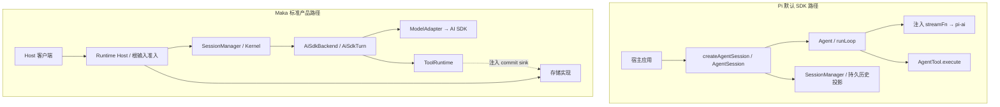
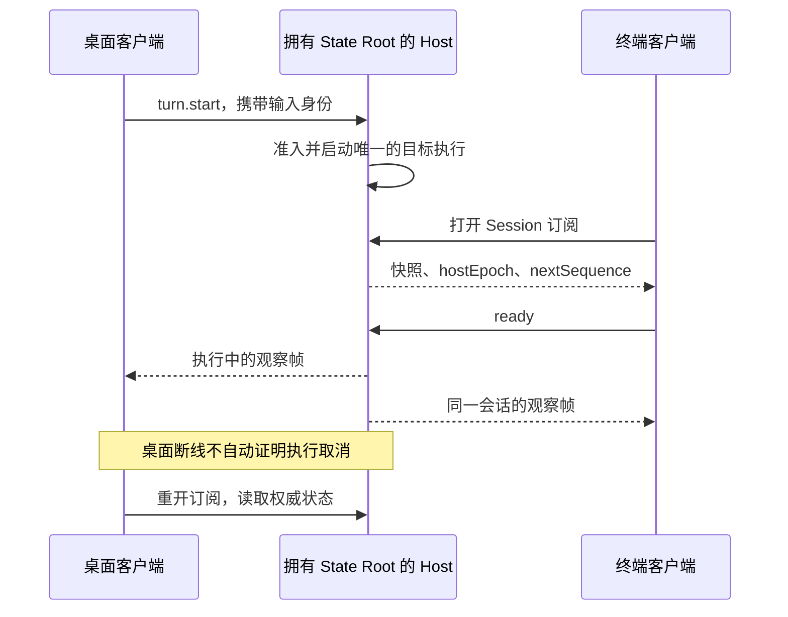

# Maka 与 Pi 的应用集成与执行场景对比

[手册目录](../README.md)

记忆、子智能体和执行恢复的架构分析见[Agent 内核架构对比](overview.md)。本文补充服务入口与应用装配的场景分析，源码范围以文首基线为准。

本文基于统一任务比较组件调用关系、状态存储位置和应用集成职责，不作功能数量或性能优劣评估。
Maka 依据提交 `15d0a0dd19d39e2bc09ae35940e432c636982315`；Pi 依据提交 `482c1381a00d8d00bc81697e4a980c593db6803e`，并保留原有工作区修改。

## 1. 比较对象的澄清：定位差异

Pi 的 `coding-agent` 本身就可以被开发者调用：SDK 创建 `AgentSession`，应用调用 `session.prompt()`、订阅事件、配置工具和扩展。
Maka 同样提供可组合的 runtime 接口；其标准产品入口通过 Runtime Host 组装会话、执行、存储与客户端协议。

两者均支持嵌入式调用，主要差异在于接口所提供的职责范围和默认执行约束。
源码入口：[Pi createAgentSession](https://github.com/earendil-works/pi/blob/482c1381a00d8d00bc81697e4a980c593db6803e/packages/coding-agent/src/core/sdk.ts#L191)、[Maka Host composition](https://github.com/apache/maka/blob/15d0a0dd19d39e2bc09ae35940e432c636982315/packages/runtime-host/src/server/execution-composition.ts#L364)。

Pi 的相关接口分为以下三类：

| 接入入口 | 主要能力 | 集成边界 |
| --- | --- | --- |
| Pi `agent` | 消息状态、模型／工具循环、事件和注入钩子 | 不因创建 Agent 就拥有 coding-agent 的会话存储、资源加载和压缩策略 |
| Pi `coding-agent` | 已组装的编码会话、默认工具、历史、扩展、模型配置等 | 标准 SDK 对象在调用进程内；远程服务的部署、访问控制由实际接入方式决定 |
| Pi `durable` | 持久会话、任务、文档、调度及恢复规则 | 是另一条执行路径；不是默认 AgentSession 自动使用的底层 |
| Maka 标准 Host 路径 | 多入口共同使用的执行服务、运行事实、准入、观察和恢复接线 | 存在平台、后端和组件装配条件；不能把独立接口当成默认已启用功能 |

Pi durable 的生产依赖包含 pi-ai、Chord 等，不含 pi-agent-core；coding-agent 的默认组装显式创建 `Agent`。
这说明两条执行路径不能表示为 `coding-agent → durable → agent`。
证据：[durable manifest](https://github.com/earendil-works/pi/blob/482c1381a00d8d00bc81697e4a980c593db6803e/packages/durable/package.json#L146)、[coding-agent SDK](https://github.com/earendil-works/pi/blob/482c1381a00d8d00bc81697e4a980c593db6803e/packages/coding-agent/src/core/sdk.ts#L411)。

## 2. 编码会话的嵌入式集成

分析场景为读取 `config.json` 并生成解释。两种实现使用不同的应用装配入口。



图表示职责与调用，而非完整包依赖。Maka runtime 的生产依赖不直接包含 storage；实现由 Host 注入。
包级证据和公开导出边界见[仓库与依赖图](../00-foundations/repository-map.md)。

两条路径的共同部分是：

1. 把工具 schema 交给模型。
2. 接收模型生成的工具调用意图。
3. 校验并执行本地工具。
4. 将工具结果纳入后续模型输入。
5. 模型根据结果输出回答。

差异体现在这些步骤的周围环节。例如 Maka Host 路径首先建立根输入身份，工具运行时将 T1/T2（工具执行前后两次事实提交）提交到注入的事实存储；
Pi 默认路径由 AgentSession 组合会话持久化和通用 Agent 循环，不应将其与 durable 的工具恢复协议混为一谈。

Pi 的 `createAgentSession()` 负责编码会话所需的资源装配。多客户端观察同一执行时，还需评估 Host、订阅与执行所有权等机制。上述差异属于集成职责划分，不构成性能结论。

### Turn 计数差异的原因

```text
输入：“读 config.json，再解释”

Maka：逻辑 Turn T
  模型 step 1 → Read → 工具结果
  模型 step 2 → 文本解释

Pi 默认 Agent：一次 prompt 运行
  低层 turn 1 → assistant 工具调用 + toolResult → turn_end
  低层 turn 2 → assistant 解释 → turn_end → agent_end
```

这不是某个项目多调用了一次模型，而是术语边界不同。物理请求失败重试还会增加 attempt，不应将 attempt 直接视为 Turn。
对照 [Pi 事件序列](https://github.com/earendil-works/pi/blob/482c1381a00d8d00bc81697e4a980c593db6803e/packages/agent/README.md#event-flow)与 [Maka 模型循环](../01-runtime/model-step.md)。

## 3. 多客户端会话观察与执行所有权

该场景的核心约束是执行推进权限和客户端状态一致性。

Maka 标准路径中，两个客户端连接同一 Host：



该路径包含三类相互独立的保证：

- State Root OS 锁：防止两个 Host 同时成为同一根的写入者。
- Session 准入：协调这个 Host 内针对同一 Session 的执行请求。
- 观察协议：用快照、代际和连续序号检查客户端状态是否衔接。

Pi 的 `Agent.activeRun` 处理一个对象中的运行生命周期；它不等于跨进程 State Root 所有权。
`Agent.subscribe()` 也不是带 `hostEpoch` 的断线重连协议。
Pi 仓库另有 RPC 和 Chord 等入口，但应以实际装配判断其保证，不能将一个库的能力自动归于默认 SDK。
证据：[Pi Agent 生命周期](https://github.com/earendil-works/pi/blob/482c1381a00d8d00bc81697e4a980c593db6803e/packages/agent/src/agent.ts#L507)、[Chord](https://github.com/earendil-works/pi/blob/482c1381a00d8d00bc81697e4a980c593db6803e/packages/chord/README.md)、[Maka 所有权与同步](../04-state/host-ownership-and-sync.md)。

该场景应比较共享服务的生命周期、执行所有权和重连协议。事件回调仅提供观察入口，不构成上述保证的充分条件。

## 4. 文件修改中断后的恢复边界

固定失败点：工具刚写完配置，程序尚未保存完整工具结果即崩溃。
恢复后缺少结果记录，可能表示写入尚未发生，也可能表示写入已发生但结果未提交。
仅重读聊天历史，不能区分这两种情况。

| 比较对象 | 状态恢复依据 | 自动重试约束 |
| --- | --- | --- |
| Pi 默认 coding-agent | 会话条目与当前分支的模型上下文 | “能够重新打开对话”不证明未决外部操作安全 |
| Pi durable | 持久任务／工具记录、当前注册的 replay 策略、恢复状态 | unsafe 工具不能因为没有结果就任意再次执行 |
| Maka Host + runtime commit sink | T1 调用／dispatch 事实、T2 结果／投影、恢复判定及 continuation 身份 | T1 存在而 T2 不确定时，不能默认宣称没执行或再执行一次 |

Maka 的正常本地工具顺序是：

```text
参数与准入检查
→ T1：准备派发的持久事实
→ 实际外部动作
→ T2：结果和模型可见投影的持久事实
→ 发布结算结果
```

T1/T2 是运行事实的提交边界，不是覆盖文件系统、网络服务和数据库的同一个事务。
Maka 新工具协议保留 `outcome_unknown` 等不确定状态，不提供“看到 T1 就无条件重做”的策略。
Pi durable 的恢复测试则显式区分 safe/unsafe，且需要持久策略和当前注册策略共同支持安全重放。
证据：[Maka 恢复实现详解](../04-state/durable-execution.md)、[Pi durable 恢复测试](https://github.com/earendil-works/pi/blob/482c1381a00d8d00bc81697e4a980c593db6803e/packages/durable/test/harness-tools-recovery.test.ts#L109)。

恢复过程不重建原 Promise 或调用栈，而是读取已提交事实，确认可信结果并决定是否建立后继执行。
至于业务动作能否重做，还取决于动作自身的幂等键、外部查询能力和授权；框架无法仅凭一段错误文本证明这些条件。

## 5. 长历史上下文与模型切换

历史持久化范围与模型请求输入范围需要分别定义。

Pi 默认会话保存带父子关系的条目，当前分支经过 projection、context edit 和 compaction 形成模型上下文。
Maka 保存 RuntimeEvent 事实，工具结果可带冻结的 `modelProjection`，有效历史还需应用压缩 transition，再形成兼容目标模型的 replay 输入。
两条路径均通过投影生成请求历史，不直接发送全部持久记录。

| 比较维度 | Pi 默认 coding-agent | Maka 本手册路径 |
| --- | --- | --- |
| 压缩对原始历史的影响 | compaction 条目定义新的上下文边界，不删除整个会话树 | checkpoint／transition 改变模型投影，不删除事实账本 |
| 请求上下文来源 | 会话层安装请求准备策略，向 Agent 提供规范消息 | Turn 通过 reader 重读事实并构造有效历史／replay plan |
| 工具结果的模型表示 | 工具 content 与 details 等字段具有不同用途 | 原始结果与持久 `modelProjection` 明确区分 |
| 模型切换兼容性 | provider 转换及会话策略需匹配新模型 | 需检查 backend generation、配置版本及 reasoning/provider state 兼容性 |
| 摘要对副作用的证明能力 | 不提供副作用完成证明 | 不提供副作用完成证明 |

具体算法以[历史与投影](../02-context/history-and-projection.md)、[压缩](../02-context/compaction.md)为准；
Pi 当前工作区的入口可从 [buildSessionProjections 所在实现](https://github.com/earendil-works/pi/blob/482c1381a00d8d00bc81697e4a980c593db6803e/packages/coding-agent/src/core/session-manager.ts)继续追溯。
不能由摘要中“已修改文件”的表述，推导磁盘现状与工具结算已经得到验证。

Maka 模型切换通过带 `expectedRevision` 的 Host 配置更新执行，运行资源转换检查 Session 是否静止并处置旧 backend；
详情见[模型配置与代际](../01-runtime/provider-configuration.md)。
Pi 默认会话层同样提供模型配置入口；不应绕开会话层的约束，以底层对象可写字段代表完整产品操作。

## 6. 子任务拆分与结果汇总

多智能体协作包含子执行创建、任务关系保存、调度准入和汇总终态判定。仅创建多个 Agent 对象不提供完整的协作协议。

Maka 的 Agent Graph 保存 operator、activation、工作依赖和交接信息；当前 Host 的默认策略装配需要逐项核对。
源码中存在 readiness policy 类型，不表示当前 Host 已安装所有自动推进策略。
Pi 默认 coding-agent 可以通过扩展组织子 Agent；durable 则提供独立的任务调度与持久运行路径。
比较应基于任务状态、生命周期和调度职责，而非自定义函数调用能力。

例如 A 读取前端代码，B 读取后端代码，C 等待两者后给出修改计划：

1. 调用 A、B 只是启动动作。
2. 需要记录 C 依赖的是哪两项产物，不能只等两个 UI 提示结束。
3. A 中断后，必须区分恢复 A 的已有执行与另外创建一个 A。
4. C 已被领取后，旧调度器不能凭过期版本再领取一次。

Maka 的 claim、revision fencing 和 handoff 详见[任务图](../05-coordination/agent-graph.md)；
Pi durable 的独立入口见 [Harness.open](https://github.com/earendil-works/pi/blob/482c1381a00d8d00bc81697e4a980c593db6803e/packages/durable/src/harness/harness.ts#L488)。
此处不将任何一个自动等同于通用工作流引擎，更不将“具备任务关系”推导为完整跨机器调度保证。

## 7. 集成需求与接口选型

下表依据职责边界列出集成入口，不涉及性能或可靠性排名。

| 集成需求 | 主要入口 | 必需核对项 |
| --- | --- | --- |
| 在现有 Node 应用里加入现成编码会话 | Pi `createAgentSession` | 工具、扩展、会话目录和应用生命周期 |
| 自定义消息与工具循环策略 | Pi `agent` | 需由应用组合的产品策略 |
| 可恢复任务与文档执行 | Pi `durable` | replay 策略、存储所有权、调度与执行环境 |
| 多客户端共享执行服务 | Maka Runtime Host | root 所有权、连接授权、准入和订阅 |
| 工具结算与历史重建 | Maka ToolRuntime + commit sink | 已提交事实与结果未知的操作 |
| 工具系统访问限制 | 两边具体沙箱／环境入口 | 默认启用状态、工具覆盖范围与平台能力 |

系统访问限制需要按执行路径和平台能力评估。Maka 的受限 Windows 文件 worker、Pi 的可选 sandbox 示例与远程 env 具有不同的覆盖范围。参见[平台沙箱限制](../03-tools/sandbox.md)。

## 相关专题

- [整体架构](../00-foundations/architecture.md)：首先理解 Maka 各层为何分开。
- [完整调用链](../01-runtime/request-to-response.md)：将上述对照落实到逐个真实函数。
- [Pi coding-agent 与 agent 关系](../../coding-agent-agent-relationship.md)：深入默认 Pi 接线，不混入 durable。
- [设计权衡](../00-foundations/design-tradeoffs.md)：分析事实、投影、接口注入和失败关闭的收益与代价。
