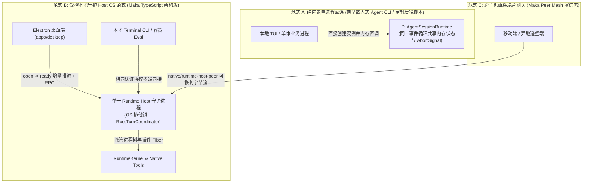

# 从桌面应用嵌入边界拆解产品化代价：全双工投影、UI 订阅与进程集成范式

## 1. 为什么在讨论 Agent 运行时优劣前，必须先问“这个架构最终套在什么产品外壳上”？

许多技术博客喜欢脱离最终运行形态空谈“A 框架比 B 框架架构更高级”。但在真实基础设施工程里，决定系统究竟长成什么模样的最大推手，往往不是底层大模型的调用算法，而是**产品的集成拓扑模型**：
- 如果产品的 UI 仅仅是一个用户自己站在本地终端前敲入指令的独立进程窗口（甚至是一个直接由后端脚本拉起的内部流水线），强行塞进一整套含 OS 写锁、跨端协议帧封装和 `HostEpoch` 追帧机的分布式宿主架构，纯属灾难性的过度设计；
- 反过来，如果产品要做成常驻系统后台运行、允许 Electron 桌面窗口与终端 CLI **同时连接并实时盯着同一个忙碌工作区直播画面的协同工具箱**，单进程的直接内存回调模式哪怕写得再漂亮，多窗口接入那一秒就会因为锁冲突和事件丢失原形毕露。

本章用最具体的一个前端动作——**“用户在桌面界面里点击修改某条设置，或点击发送启动一次复杂工具推理”**——横切解剖 Maka（独立受管 Host CS 范式）与 Pi（进程内嵌 SDK 范式）在应用集成边界上的全貌代价。

---

## 2. 三种真实应用集成拓扑全景

---

## 3. 从前端按钮到后台响应：代码集成边界直面对比

把下面这段极具代表性的“启动按钮并发起实时增量上屏”的伪代码并排对比，两代设计的心智与接口分工立刻纤毫毕现：

| 集成生命周期阶段 | Pi 式嵌入式集成边界（`AgentSession` / SDK 调用方视角） | Maka 式 Host 协议边界（`Desktop / CLI Client` 视角） |
| :--- | :--- | :--- |
| **1. 启动与装配入口** | 业务脚本在当前进程通过 `CreateAgentSessionRuntimeFactory` 针对 `cwd` 直接建造服务对象并加载 `ResourceLoader` | 宿主机独立完成六阶段有序激活；Electron 渲染进程严格遭 `check:renderer-architecture` 禁止引入任何后端存储逻辑，只向 Host 建链 |
| **2. 订阅建立与历史水合** | 直接同步读取 `SessionManager` 构建树状历史渲染 UI，监听本地 `EventStream` 事件发射回调 | 先发起 `subscription.open` 取回受字节限制的 `CanonicalSessionProjection` 与高水位游标，合入状态后再发 `subscription.ready` 开闸接增量帧 |
| **3. 发信执行与并发保障** | 直接调用 `session.prompt(text)` 或注入内部消息队列，依靠本地调用栈返回控制权 | 预生成幂等 `turnId` 并挂接局部消息队列 -> 调用 `turn.start` 立刻拿回确认快照 -> 由后台 `drainTurn` 按 `(hostEpoch, sequence)` 异步喂流 |
| **4. 断连重启与页面刷新** | 页面崩溃或本地进程重启等同于当前进行中的轮次随风消散；新进程读取硬盘既有完整闭合 JSONL 节点接着聊天 | **桌面 UI 窗口哪怕彻底关掉重启或者刷新页面**：后端 Run 纹丝不动继续执行；新版窗口重连后通过游标对比与 `assistantBacklog` 无缝追平正在吐字的流！ |
| **5. 第三方能力安全边界** | 基于明确的 `projectTrustContext` 信任检查放行，内部扩展示例和 Hook 拥有对 `AgentSession` 的直观编排访问权 | 插件纳入带副作用树回收的 `Fiber` 组合平台；而浏览器/前端如需代宿主干活必须跨过受限反向经纪人 `accepted → admitted` 授权门禁 |

---

## 4. 架构选型决策清单：什么样的团队该站在哪一边？

读完跨越两套系统 30 多个章节的源码级剖析后，当你需要为自己所在的研发团队拍板下一代 AI 平台底座时，这份冷静的工程检查单比任何口号都管用：

### 什么时候应当坚决选择 **Pi 式嵌入式单进程微循环**？
- 你的核心交互场景是**单人单窗口的交互式 CLI 终端、无状态的单次自动化 CI 脚本工作流、或者高度垂直封闭的内部后端微服务 Worker**；
- 团队人数精悍，不想维护独立的 `Runtime Host` 生命周期、OS 排他文件锁、复杂的跨进程序列化验证（`isDeepStrictEqual`）与多层异步队列租赁机；
- 你最看重的是**极致的上下文扩展定制敏捷度**（直接写几个 Hook、切一条分支摘要、配一个轻量子进程工具半天上线跑通），而完全可以通过外围容器生命周期或者简单整轮重放来处理极低频的机器崩盘。

### 什么时候必须毫不犹豫采用 **Maka 式 Event-Sourced Host 架构**？
- 你的目标产品是**Electron 桌面生产力客户端与 CLI 终端共存、或者带有常驻后台自动化巡检 / 多端协同 / 移动端遥控（Peer Mesh）的多入口系统**；
- 你的助手拥有**直接大刀阔斧修改本地工作区仓库代码、操作浏览器桌面乃至调用外部计费系统的强破坏性工具权限**，哪怕千分之一的概率断电重跑都不允许出现“在黑暗中盲目执行两次写操作”或“损坏用户工程 Git 现场”；
- 你必须交付**企业级安全可审计防线与不可注水的评测基准体系**：要做到 API Key 从不入环境变量、MCP 工具绝不暗渡陈仓改参数、而且有本事防住容器内被测 AI 试图伪造计数检查点。

### 以及，什么时候该直接对标最新的 **Maka Rust 微内核架构**？
- 如果上述 Host 高可靠性诉求完全成立，但你同时希望彻底卸载掉常驻高内存 Node/V8 宿主包袱、要在 Windows 主力工作站实现零 UAC 弹窗的原生沙箱隔离（**Windows MXC**）、追求用纯函数 `Reconciler + Obligation Frontier` 把跨重启状态竞态在编译期彻底关死，并且希望桌面端与终端共用一套 **NSH UI**——请移步参考配套出版的姐妹手册 **[Maka Agent 基础设施教程（Rust 微内核版）](../../maka-rust-agent-infra/README.md)** 与两代系统演进全景对照 **[从 TypeScript 混合体到 Rust 微内核](../../maka-rust-agent-infra/06-operations/rust-vs-ts-evolution.md)**。

---

## 5. 全书结语

设计 Agent 基础设施的过程，本质上是在大模型充满随机创造力的非确定性输出外围，一点一滴筑起确定性的工程护栏：
- 让**身份与事件不可逆**，从而把脆弱的易逝进程内存转化为可重放历史账本；
- 让**工具切点与权限收窄清晰显形**，从而把“可能出事”的灰色地带压缩到最少且诚实可判的 `outcome_unknown`；
- 让**宿主所有权与客户端界面边界干净切割**，使高并发协同、安全沙箱与端侧交互各司其职而不互噬稳定性。

无论你最终采用哪一门语言、哪一种封装体，真正支撑起下一代智能应用稳健长跑的，永远是这些藏在表层 Prompt 与花哨界面背后的静默金属结构。

*全书完。返回 [TypeScript 架构版总目录与学习路线](../README.md)。*
