# 应用集成与执行场景对比

[返回手册目录](../README.md)

假设你的工程团队正在开发一款开发工具产品（可能是桌面 IDE、命令行工具或团队协作 Web 工作台），现在需要在界面上添加一个智能动作按钮：**“读取 `config.json` 并解释超时设置”**。

虽然 Maka 和 Pi 都能完美完成模型请求、工具调用与历史流式输出，但它们面向宿主应用暴露了**三种截然不同的集成界面（Integration Surface）**与进程部署拓扑：
1. **Maka 托管协议接入（Runtime Host Client-Server + Plugin Composition）**
2. **Pi 进程内 SDK 嵌入（`createAgentSession()` In-Process Library）**
3. **Pi Durable 任务调度接入（`Harness.open()` Persistent Scheduler）**

本章对比这三种真实接入范式在初始化装配、事件消费、热更新扩展以及崩溃生命周期上的本质差异，帮助架构师做出精准的技术选型。

---

## 1. 概念先行：三种应用集成拓扑全景

```mermaid
flowchart TB
    subgraph MakaArch["范式 A：Maka 托管服务与组合架构 (Client-Server + Plugins)"]
        AppM["产品外壳 (Desktop / TUI / CLI / Bot / Eval)"] -->|"RPC 指令 + open→ready 游标订阅"| HostM["Runtime Host 独立进程<br/>(RootOwner 独占锁 / Admission / PluginKernel)"]
        HostM --> KernelM["SessionManager → RuntimeKernel → AiSdkTurn / PluginExecutorBackend"]
    end

    subgraph PiSdkArch["范式 B：Pi 进程内 SDK 嵌入 (In-Process Library)"]
        AppP["应用主进程 (Node.js / CLI)"] -->|"createAgentSession() 直接装配"| SessionP["AgentSession (管理会话树与压缩)"]
        SessionP --> AgentP["Agent (内存 runLoop + streamFn + 内存监听器)"]
    end

    subgraph PiDurArch["范式 C：Pi Durable 持久任务接入 (Task Scheduler)"]
        AppD["宿主服务进程"] -->|"Harness.open(storage, options)"| HarnessD["Durable Harness<br/>(TaskScheduler + Submissions + Checkpoint)"]
        HarnessD -->|"调度 ToolTask / Chord 同步"| StorageD["SQLite / MemoryStorage"]
    end
```



---

## 2. 范式对比：从按钮点击到界面渲染

### 2.1 接入 Maka：面向多端协作的 Host 客户端模式
在 Maka 中，产品界面（如 Electron 渲染层、CLI 驱动或外部 `@maka/eval` 测试器）并不在自己进程内直接跑模型循环，而是作为受认证的客户端连接 Runtime Host：
1. **装配在 Host 侧集中完成**：Host 启动时调用 `createExecutionRuntimeHostComposition()` 打开会话存储、操作账本和事件库，绑定 `BackendRegistry`（包括内置的 `AiSdkBackend` 以及通过 `PluginExecutorBackend` 挂载的第三方 ACP 插件）并恢复历史模块，客户端完全无需操心底层数据库连接与凭据读取。
2. **先开订阅、再发指令**：客户端（如 CLI 的 `preparePrompt()`）先针对目标会话开启连续性订阅（`open → ready`），获取当前快照与 `(hostEpoch, seq)` 位点，然后再发送 `turn.start`。
3. **跨端天然同屏**：Host 随后在后台异步抽水推动 `SessionManager → RuntimeKernel → AiSdkTurn` 完成模型两步读取和解释。在此期间，哪怕用户在旁边同时打开桌面端和终端，两者都会通过各自独立的订阅游标实时收到一致的 `session_delta` 与 `session_event`。
4. **插件组合扩展**：第三方团队可以通过 `MakaCompositionLoader` 向全局 `profile`、界面 `desktopUi` 或单会话 `session:<id>` 注入隔离在 Fiber 生命周期内的插件包，并支持带原子回滚的热更新。

### 2.2 接入 Pi `coding-agent`：极简进程内 SDK 嵌入
Pi 默认的 `coding-agent` 遵循了经典库（Library）嵌入哲学，把一切核心抽象收拢在同一个 JS/TS 进程内：
1. **一步装配会话**：应用调用 `createAgentSession()`，在进程内直接读取 `SessionManager` 历史与资源（`AGENTS.md` / 扩展），构造出单一 `Agent` 实例并注入模型传输函数 `streamFn` 与工具集。
2. **内存事件订阅与触发**：应用调用 `session.subscribe()` 注册内存回调监听低层事件（如 `text_delta`、`tool_execution_start`、`turn_end` 等），随后直接 `await session.prompt("读取 config.json 并解释")` 驱动 `Agent.runLoop()`。
3. **自由且透明**：一次工具读取批次与最终生成回答分别对应低层连续的 `turn_end` 事件。没有任何跨进程 RPC 序列化与文件锁开销，启动速度达到毫秒级，扩展（Extension）也能直接在内存里以钩子方式干预每一步。

### 2.3 接入 Pi `durable`：面向强恢复与远端观察的 Harness 模式
当开发者既喜欢 Pi 的简洁抽象，又需要“进程重启后未竟工具任务不丢失”的持久化保障时，可以切换到 Pi 的实验性 `durable` 模块：
1. **打开调度内核**：应用构造存储（如 SQLite）与注册表后，调用 `Harness.open(storage, options, context)` 启动 `HarnessImpl`，内部在构造期即挂载 `TaskScheduler`、`Submissions` 与 `TaskGraphView`，并在打开时通过 `openTasks()` 将上次意外中断时处于 `running` 状态的任务统一收拢重整为 `pending`，等待 `resume()` 恢复推进。
2. **显式任务策略（`ToolTask`）**：工具不再只是裸函数，而是结合了持久化参数和重放策略（如 `replay: "safe"` 或多阶段 checkpoint）的 `ToolTask`；如果需要跨进程/远端界面观察进度，Pi 生态配套的 `Chord` 组件提供快照与增量状态同步。

---

## 3. 教学伪代码：同一个按钮的三种集成代码形态

以下代码直观对比了在宿主应用代码中集成“点击按钮，读 `config.json` 并解释”时的开发心智与控制流差异：

```text
// === 形态 A：接入 Maka Runtime Host (托管协议 + 断线无损追帧) ===
async function handleButtonClick_Maka(hostClient, sessionId):
    // 1. 先打开带 epoch/seq 校验的订阅流，拿到基准快照
    sub = await hostClient.openContinuitySubscription(sessionId)
    ui.hydrateFromSnapshot(sub.snapshot)

    // 2. 提交执行命令，Host 准入落盘后立即返回 runId；此时哪怕关闭 UI 后台依然会跑完
    ack = await hostClient.dispatch("turn.start", {
        sessionId,
        turnId: generateUUID(),
        input: "读取 config.json 并解释超时设置"
    })

    // 3. 持续渲染跨进程推来的流式增量，发现断帧自动通过快照自愈
    for await frame in sub.frames():
        if frame.type == "session_delta":
            ui.appendStreamText(frame.delta)
        else if frame.type == "session_event" and frame.event.type == "complete":
            ui.markIdle()
            break

// === 形态 B：接入 Pi coding-agent SDK (进程内直接调用) ===
async function handleButtonClick_PiSdk(workspaceDir, modelConfig):
    // 1. 直接在应用内存里组装 AgentSession、历史与流式函数
    session = await createAgentSession({
        cwd: workspaceDir,
        model: modelConfig,
        tools: builtinTools
    })

    // 2. 注册内存监听器渲染实时流
    unsubscribe = session.subscribe((event) => {
        if event.type == "message_update":
            ui.renderDelta(event.delta)
        else if event.type == "agent_end":
            ui.markIdle()
    })

    // 3. 启动内存循环 (进程若在此时退出，内存中未落盘的循环即刻终止)
    try:
        await session.prompt("读取 config.json 并解释超时设置")
    finally:
        unsubscribe()

// === 形态 C：接入 Pi Durable Harness (持久化任务调度) ===
async function handleButtonClick_PiDurable(sqliteStorage, models, registry, ctx):
    // 1. 打开 Harness 并把遗留运行任务重整为可调度态，随后唤醒调度器
    harness = await Harness.open(sqliteStorage, { models, registry }, ctx)
    await harness.openTasks(ctx)
    harness.resume()

    // 2. 获取或创建持久会话句柄，提交带幂等 requestId 的输入
    conv = await harness.root(ctx, { agent: { model: modelConfig } })
    submission = await conv.submit({
        type: "input",
        content: "读取 config.json 并解释超时设置",
        requestId: "btn_explain_config_01"
    }, ctx)

    // 3. 通过 watchEvents 订阅并等待该提交的持久结果结算
    settled = await submission.wait(ctx)
    ui.renderFinalAnswer(settled)
```

---

## 4. 产品选型决策矩阵

| 架构决策维度 | 选择 Maka 托管架构 | 选择 Pi `coding-agent` SDK | 选择 Pi `durable` Harness |
| :--- | :--- | :--- | :--- |
| **产品核心定位** | 多端协同工作台（Desktop + TUI + Bot + Web 共享同一 State Root）、企业级沙箱与严格审计平台 | 本地单机开发者 CLI、编辑器嵌入式助手、轻量脚本与快速原型实验 | 需要将任务级检查点恢复能力嵌入自定义服务端或长周期调度引擎 |
| **进程与部署复杂度** | 较高（需管理 Runtime Host 生命周期、OS 文件锁、Socket/IPC 通道与独立 Worker 子进程） | **极低**（单一进程零 IPC 依赖，随主程序开箱即用） | 中等（无独立 Host 进程守护协议，但需注入 SQLite 存储与调度器生命周期管理） |
| **多客户端与断连韧性** | **原生支持**（客户端闪退或换设备连接不影响后台任务，凭 `(hostEpoch, seq)` 无损追帧） | 不原生支持（循环强绑定于当前运行进程生命周期） | 结合 `Chord` 远程同步后支持断线观察与重连恢复 |
| **安全与隔离深度** | **工业级纵深防御**（独立 File Worker + T0/T1 CAS + AES 临时注入密钥 + Origin 三元组审批） | 轻量级（项目信任开关 + `AuthStorage` + 扩展钩子拦截） | 由上层宿主通过 `HarnessOptions.env` 按需构建自定义隔离边界 |
| **扩展热更新** | 支持 Fiber 级隔离组合树与事务回滚热重载 | 启动时静态加载扩展模块，重启生效 | 通过 `createRegistry()` 注册可序列化与可重放的 `Extension` / `ToolTask` |

---

## 5. 延伸阅读

- 回顾 Maka 的四层系统全貌与 Host Composition 启动机制，阅读 [00.1 整体架构](../00-foundations/architecture.md)。
- 深入对比 Maka 与 Pi 在四大核心机制上的宏观设计取舍，阅读 [07.1 Agent 内核架构对比](overview.md)。
- 深入对比两套系统在长期记忆防幻觉与文件约定上的差异，阅读 [07.2 记忆存储与提取对比](memory-design.md)。
- 深入对比两套系统在子智能体并发隔离与调度上的演进，阅读 [07.3 子智能体与隔离对比](subagent-design.md)。
