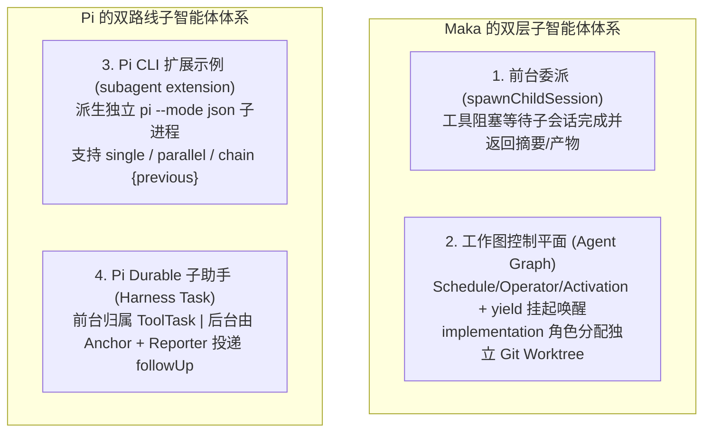

# 子智能体执行、调度与生命周期管理对比

[返回手册目录](../README.md)

设想这样一个多智能体协作任务：父助手需要彻底查清项目中 `timeout` 配置的默认值是否一致。它规划出三个子任务：**让 A 调查实现代码、让 B 调查单元测试（两者独立并行），等 A 与 B 双双完成后，再让 C 综合两份结论核对并给出修复补丁。**

哪怕在这个看似标准的“Map-Reduce”协作场景里，基础设施也必须正面解决四个极具挑战性的系统问题：
1. **所有权与取消传播**：如果用户在半路按下停止键，已经派发出去的子任务是立刻跟着中止，还是在后台变成本体失联的“孤儿代理”？
2. **文件写入冲突**：如果不仅要查文件，还要让多个子助手同时修改代码并跑单测，它们共用同一个 Git 目录一定会互相覆写文件。怎么隔离？
3. **父助手挂起与状态恢复**：当 A 和 B 需要执行几分钟时，父助手是卡死阻塞等返回，还是让出执行权等待唤醒？万一等待期间整个进程重启了，子任务的结果怎么准确交回父助手？
4. **产物引用与防重跑**：C 启动时，如何确保自己读到的是 A 和 B **已经通过持久化检验的完整结论**，而不是内存里的半截输出？

本章深入对比 **Maka（前台委派 + `Agent Graph` 控制平面 + Git Worktree 隔离）** 与 **Pi（`subagent` CLI 扩展示例 + 实验性 `durable` 前后台子助手）** 在这四大问题上的不同解题思路。

---

## 1. 四种主流子智能体范式全景



---

## 2. Maka 的设计路径：子会话、Worktree 与工作图

在 Maka 中，不存在一个脱离标准运行时的“轻量小函数子代理”。**每一个子智能体（Subagent）本质上都是一次完整的子会话（Child Session）或图激活（Activation）**，复用同一套 `RuntimeKernel`、权限边界、沙箱和 `RuntimeEvent` 账本。

### 2.1 前台直接委派（`spawnChildSession`）
当父助手需要做一个独立、一次性且等待时间可控的调查（例如“去查一下某配置文件的源码实现”）时，可以直接调用子任务工具：
- `spawnChildSession()` 创建独立的子会话，写入父子血缘关系（`parentSessionId`）和子配置，启动标准执行；
- 父工具同步等待子运行结清，直接获取子会话总结文本、关联 `sessionId / runId` 与产物引用；
- 父助手拿到 A 和 B 的结论后，可以直接在上下文里将其拼接成新指令发给 C。

### 2.2 `Agent Graph` 控制平面（`update_agent_graph` & `yield_agent_graph`）
当拓扑关系变得复杂（如多阶段 DAG、跨分钟/跨重启编排），Maka 启用了持久化的 `Agent Graph` 协调机制：
1. **节点与身份解耦**：父助手使用 `agent_list` 查询预设角色定义，通过 `update_agent_graph` 写入调度计划（`Schedule`）。Host 侧的 `AgentGraphCoordinator` 为每个持续角色（`Operator`）绑定一个独立的子会话，每次实际分派则生成带专属 `activationId` 与 `runId` 的物理执行。
2. **让出并检查点唤醒（`yield_agent_graph`）**：父助手无需挂着模型连接空等！提交完图计划后，它可以调用 `yield_agent_graph` 主动让出当前物理轮次。当图调和器（`reconcileAgentGraphSchedule`）观测到 A 和 B 都已到达可接续的检查点时，Host 自动唤醒父会话接续下一步！
3. **已提交产物强校验（`input_ids`）**：A 和 B 完成后各自沉淀不可变的 `resultRecordId`（`rA`、`rB`）。父助手调用 `agent_output` 获取这两个 ID 并填入 C 的 `input_ids` 后，**调和器必须验证 `rA` 与 `rB` 都已经进入持久化投影记录**，才通过标准 `handoff` 装入机制注入 C 的上下文，确保上游结论绝不丢失或错位。最终 C 产出 `rC` 后，父助手调用 `finish` 选定结果并正式关闭 Schedule。

### 2.3 `implementation` 角色的确定性 Git Worktree 隔离
对于**只读调研角色**（如 A 读实现、B 查测试），Maka 允许它们安全共享同一个只读工作区，实现零额外磁盘复制；但一旦涉及**并发写代码的 `implementation` 角色**，Maka 的 `GitWorktreeChildExecutor` 会介入隔离：
- **确定性租约防重**：Worktree 租约 ID（`subagent_worktree_<32位hex>`）、租约分支与挂载目录完全由参数确定性计算，且借助按仓库串行化的 `repositoryTails` 锁和 `inFlight` 去重保护。因此**崩溃重试时会无缝接回原 Worktree**，绝不会在磁盘上炸出一堆重复工作树！
- **跨运行留存与补丁交付**：子运行到达终态后，Host 刻意保留该 Worktree 目录以便后续 `follow-up` 或会话恢复；交付给父助手的是提取出的标准化 **Patch 补丁产物（Artifact）**，由父助手或人类审阅后统一合入主仓。

---

## 3. Pi 的设计路径：自由的 CLI 扩展 vs 持久化 Anchor/Reporter

Pi 针对不同使用场景，给出了两条极其鲜明且值得学习的子智能体设计：

### 3.1 常规 `coding-agent`：`subagent` 扩展示例
在 Pi 的扩展生态中，实现多智能体协作无需修改任何底层核心代码，仅靠一个插件脚本即可做到：
- **CLI 子进程池**：插件直接 `spawn` 启动配置了 `--mode json -p --no-session` 的独立 `pi` CLI 子进程（若 Agent 定义有专属系统提示词，则写为临时文件通过 `--append-system-prompt` 传入），在父进程内逐行解析 JSON `message_end` 事件并累计 Token 费用与调用次数；
- **三大简洁编排模式**：
  - `single`：执行单个子任务并返回最终文本；
  - `parallel`：并发拉起同一批子任务并汇总各自结果与用量；
  - `chain`：串行流水线执行，自动将下一条指令中的 `{previous}` 占位符替换为上一环子进程输出的文本结果。
- **目录传入**：直接将调用方指定的 `cwd` 传递给子进程，轻量敏捷，几乎没有框架耦合。

### 3.2 实验性 `durable` 路径：Task 归属、Anchor 与 Reporter 模式
在需要跨进程重启不丢失状态的 `packages/durable` 架构中，Pi 展示了两种极具启发性的持久编排模型：
1. **前台归属模式（`22-subagent-foreground`）**：
   - 主对话工具 `subagent` 标记为 `replay: "safe"`。执行时先在事务中检查 `tx.scanConversations({ ownerTaskId: api.taskId })`，若重启前已建好子会话则直接复用，否则以 `{ ownership: { kind: "task", taskId: api.taskId } }` 创建归属当前工具任务的 `child conversation`（并移除其 `Subagent` 扩展防止无限套娃递归）；
   - 使用确定性请求键 `requestId: "subagent:" + api.taskId` 提交任务并等待。父工具被中止时，归属关系会自动级联取消子会话。
2. **后台常驻与汇报模式（`23-subagent-background`）**：
   - 后台子智能体必须比主助手的当前轮次活得更久！因此 Pi 把子会话的所有权挂在了一个立刻结束的后台任务 **Anchor（锚点）** 上——这样主助手按 `Esc` 中断当前回答或等待空闲时，不会误杀后台跑着的子助手，而只有显式 `abort({ background: true })` 才会穿透清除所有后台锚点；
   - 通过 `Subagents` 持久化文档记录各子助手的会话 ID 与已汇报答案列表（`reported: EntryId[]`），并由独立的阶段式持久任务 **`Reporter`**（分为 `deliver` 和 `report` 两个持久化 Checkpoint 阶段，带去重 `requestId`）负责向子助手投递 `steer / followUp` 消息、等待结果并在收尾阶段以 `followUp` 消息自动向主会话汇报！

---

## 4. 全方位多维对比

| 对比维度 | Maka (`spawnChildSession` / `Agent Graph`) | Pi (`subagent` 扩展) | Pi (`durable` 前后台子助手) |
| :--- | :--- | :--- | :--- |
| **执行载体** | 完整子会话（Child Session）与 Activation，复用标准 Host 准入、沙箱与事件账本。 | 独立 CLI 子进程（`pi --mode json -p --no-session`）。 | 持久化的 `child conversation`，由 `Harness` 调度器统一驱动。 |
| **工作区与写隔离** | 只读共享工作区；`implementation` 角色按确定性租约分配独立 **Git Worktree**，交付 Patch 补丁。 | 直接将显式指定的 `cwd` 传给子进程，由扩展或用户约定目录隔离。 | 由宿主应用在 `HarnessOptions.env` 中按会话自定义隔离环境。 |
| **等待与取消边界** | 前台阻塞等待；Graph 支持 `yield_agent_graph` 释放当前执行并在检查点自动唤醒。 | 父工具通过 Promise 等待子进程退出；传入 `AbortSignal` 直接中止子进程。 | 前台归属 `ToolTask` 随叫随停；后台归属 **Anchor** 免疫主轮次 `Esc` 取消。 |
| **产物传递与防重** | 通过已落盘的 `resultRecordId`（`input_ids`）经投影校验后装入下游上下文。 | 内存中收集文本结果；`chain` 模式通过 `{previous}` 占位符拼接。 | 借助确定性 `requestId` 与 `Reporter` 两阶段 checkpoint（`deliver / report`）防重投递。 |

---

## 5. 教学伪代码：Worktree 隔离与产物交接核心契约

```text
// === 1. Maka 确定性 Worktree 租约与角色隔离 ===
async function provisionChildWorkspace(parentCwd, role, leaseId):
    if role == "readonly":
        // 只读调研角色 (如 A 读源码, B 查测试) 零拷贝共享工作区
        return { cwd: parentCwd, mode: "readonly_shared" }

    // 实施写代码角色 (implementation)：在同一仓库锁下确定性创建/复用 Git Worktree
    return await withRepoLock(parentCwd, async () => {
        // 租约 ID 与路径确定性对应：崩溃重试时可直接复用已存在的 Worktree，不重复副作用
        worktreeDir = join(storageRoot, "subagent-worktrees", hashSuffix(leaseId))
        if exists(worktreeDir):
            return { cwd: worktreeDir, leaseId, mode: "worktree_reused" }

        await gitExec(["worktree", "add", "--detach", worktreeDir, "HEAD"], cwd: parentCwd)
        return { cwd: worktreeDir, leaseId, mode: "worktree_created" }
    })

// === 2. Pi Durable 后台 Anchor + Reporter 投递模式 ===
function scheduleBackgroundSubagentMessage(harness, mainConvId, subagentName, msg):
    // 1. 若尚未创建子会话，先以立刻终结的 Anchor 后台任务作为 Owner 创建 (免疫 Esc 误杀)
    anchorTaskId = harness.startBackgroundTask(AnchorTask)
    subConvId = harness.createConversation({ ownership: { kind: "anchor", taskId: anchorTaskId } })

    // 2. 启动两阶段持久化的 Reporter 任务 (deliver -> report)
    reporterId = generateReporterId()
    harness.startBackgroundTask(ReporterTask, {
        phase1_deliver: async () => {
            // 带幂等 requestId 向子助手发消息并等待其回答 (崩溃重启会拿回同一次投递)
            answer = await subConvId.submit({ type: "input", content: msg, requestId: "sub:" + reporterId }).wait()
            saveCheckpoint("report", extractText(answer))
        },
        phase2_report: async (reportText) => {
            // 以 followUp 形式将结果投递回主对话队列；同样带 requestId 防重
            await mainConvId.submit({ type: "input", content: reportText, whenBusy: "followUp", requestId: "rep:" + reporterId })
        }
    })
```

---

## 6. 延伸阅读

- 深入了解 Maka 调度计划与 `WorkHub` 多端工作台的协同细节，阅读 [05.2 任务图与 WorkHub 协同](../05-coordination/agent-graph.md)。
- 了解并发启动多个子任务时 `AdmissionLimiter` 如何防止过载，阅读 [05.1 输入队列与背压准入](../05-coordination/queues-and-admission.md)。
- 了解系统在四大能力维度的整体选型对比，阅读 [07.1 Agent 内核架构对比](overview.md)。
