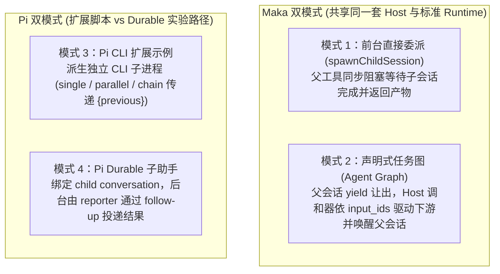

# 子智能体执行、调度与生命周期管理对比

[返回手册目录](../README.md)

当任务需要同时调查多个子系统并协调修改代码时（例如：让子智能体 A 检查超时配置的实现代码，让子智能体 B 检查测试文件，最后让子智能体 C 综合两份结论并写出修复补丁），多智能体协作立刻会遇到四个工程难题：
1. **身份与审计**：子任务跑了一堆工具，消耗的 Token 算在谁身上？
2. **文件写入冲突**：如果 A 和 C 同时在同一个 Git 目录下修改文件，工作区瞬间就会被写乱！
3. **父子等待与挂起**：子任务要跑 5 分钟，父助手是干占着网络连接死等，还是优雅让出等待唤醒？
4. **产物交接可靠性**：C 如何确保自己拿到的是 A 和 B **已经完整结算**后的权威结论？

本章全面对比 Maka 与 Pi 在子智能体派生、工作区隔离、调度编排及结果交接上的四大工程模式。

---

## 1. 四大子智能体组织模式全景

### 1.1 Maka 模式一：前台委派（`spawnChildSession`）
当父助手只需要临时查一段资料时，可以直接调用子任务工具。`spawnChildSession()` 会创建一个带有父子血缘关系的独立 `Child Session` 并启动运行，父工具阻塞等待它结束后，直接把摘要、子会话/运行 ID 以及产物带回当前对话，简单直观。

### 1.2 Maka 模式二：工作图控制平面（`Agent Graph`）
面对复杂的 DAG 依赖（A 与 B 并行，C 依赖 A 和 B），父助手通过 `update_agent_graph` 提交调度蓝图，并可调用 `yield_agent_graph` 暂时挂起自己：
- **严格产物凭证交接**：A 和 B 完成后各自生成不可变的 `resultRecordId`；父助手（或图规则）将其填入 C 的 `input_ids`；Host 调和器确认两条产物已安全入库后，才回读并装入 C 的初始上下文。
- **异步唤醒**：图推进到预设检查点后，Host 自动通过 Continuation 唤醒父会话，由父助手审阅 `rC` 后调用 `finish` 关闭图计划。

### 1.3 Pi 模式三：Subagent CLI 扩展示例
Pi 的标准编码助手通过灵活的插件扩展实现多 Agent：
- 父助手将任务文本下发给独立的 Pi CLI 子进程，通过读取子进程标准输出中的 JSON 事件流收集最终文本。
- 支持三种编排原语：`single`（单任务）、`parallel`（并行批次汇总）以及 `chain`（串行链式传递，用上一环节的结果自动替换下一环节指令中的 `{previous}` 占位符）。

### 1.4 Pi 模式四：Durable 前后台子助手
在 Pi 的实验性 `durable` 架构中，子助手的会话关系由持久化的 Harness 管理：
- **前台模式**：将 `child conversation` 直接归属给当前 `ToolTask`，提交请求并阻塞等其返回。
- **后台模式**：将 `child conversation` 绑定在后台锚点（Anchor）上，由专门的 `reporter` 任务负责跟踪子助手进度；一旦子助手完成，由 `reporter` 自动向父会话投递一条 `follow-up` 消息汇报结果。

---

## 2. 关键工程问题：并发写代码怎么避免冲突？（Worktree 隔离）

在多个子助手同时工作的场景中，**工作区目录隔离**是保证代码不被写坏的生命线。Maka 与 Pi 在此采取了不同粒度的处理：

- **Maka 的按角色差异化隔离**：
  - 对于**只读角色**（如负责查实现、查测试的 A 和 B），允许它们共享同一个只读工作区目录，零磁盘复制开销。
  - 对于**代码实施角色（`implementation`）**，工作区执行器会动态为该子任务分配一个独立的 **Git Worktree** 隔离目录！子助手在自己的 Worktree 里尽情修改和测试，完成后通过执行器将改动提取并发布为标准的**补丁产物（Patch Artifact）**，交由父助手或人类审核合入。
- **Pi 的做法**：
  - CLI 扩展示例直接将调用方选定的 `cwd`（工作目录）传给子进程；而在 `durable` 模式下，由上层宿主应用在创建会话时按需注入执行环境（如独立目录或沙箱容器）。

---

## 3. 多维对比总结表

| 对比维度 | Maka (`spawnChildSession` / `Agent Graph`) | Pi (`subagent` 扩展 / `durable` 示例) |
| :--- | :--- | :--- |
| **执行载体与隔离** | 每个子助手均是完整的 `Child Session`，独立 Run ID 与全套权限审计账本。 | 扩展示例为轻量 CLI 子进程；`durable` 为持久化的 `child conversation`。 |
| **写代码冲突防护** | 原生支持按 `implementation` 角色分配独立 **Git Worktree**，以 Patch 产物交付。 | 由调用方或宿主应用自行指定 `cwd` 或容器环境隔离。 |
| **父子等待与挂起** | 支持 `yield_agent_graph` 释放父会话内存与模型连接，由 Host 到达检查点后自动唤醒。 | 扩展示例直接阻塞等待子进程退出；`durable` 后台模式借助 `reporter` 投递 `follow-up`。 |
| **产物交接契约** | 强引用已提交的 `resultRecordId` (`input_ids`)，调和器校验落盘后装入下游上下文。 | 扩展示例收集文本并替换 `{previous}` 占位符；`durable` 通过存储记录结果。 |

---

## 4. 延伸阅读

- 深入了解 Maka 工作图内部调和器与唤醒检查点的详细原理，阅读 [05.2 任务图与多 Agent 协作](../05-coordination/agent-graph.md)。
- 深入了解多子任务并发执行时的背压配额限制，阅读 [05.1 输入队列与执行准入](../05-coordination/queues-and-admission.md)。
