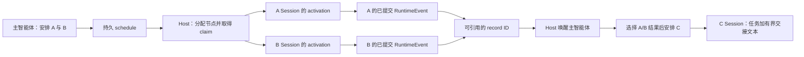
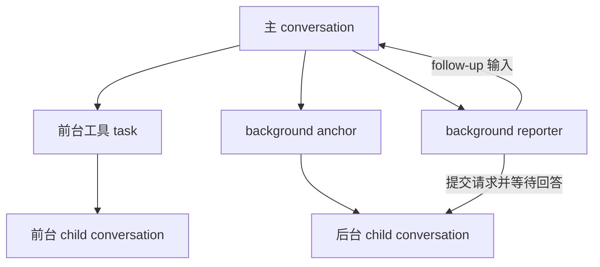

# Maka 与 Pi 的子智能体执行、调度与生命周期管理对比

[手册目录](../README.md) · [总体设计对比](overview.md)

核对日期：2026-10-28。Maka 本地 HEAD：`8320cda1a4229b54124efe91d8830d0a89c39a4f`；Pi 本地 HEAD：`482c1381a00d8d00bc81697e4a980c593db6803e`。
本文读取当前本地源码与测试，不以旧手册基线代替实现；Pi 按保留用户现有改动的工作树读取。
仅做静态源码核对，未运行行为验证（模型、构建、测试）或安装；下文“测试覆盖”指读到的断言，不表示本次运行通过。

本文比较子智能体的执行身份、生命周期所有权、终止条件和结果传递模型。
Maka 使用 Host 管理的独立 Session 承载子智能体，Graph 在此基础上提供持久调度。
Pi 默认 coding-agent 不预置子智能体；可选 CLI 示例提供一次性进程委派，独立 durable 包则提供可持久化的会话与任务归属机制。
持久化与取消语义需分别核对，不能以默认路径概括整个仓库的能力。

## 1. 分析场景与执行模型分类

分析场景为解析器修改验证：A 分析实现，B 分析测试，C 在两项结果可用后核对差异。
比较维度包括 A/B 的执行独立性、C 的输入版本与来源，以及主智能体当前轮次结束后的调度责任。
下文将该场景映射到已核实的执行路径；该场景用于设计分析，不对应仓库中完全同名的三智能体端到端测试。

| 执行路径 | 子任务状态模型 | 生命周期所有权 | C 的输入形式 |
| --- | --- | --- | --- |
| Maka 前台委派 | 独立、落盘的 child Session 与首次运行 | 父工具调用等待；Runtime/Host 执行与取消 | 主智能体显式放入 C 任务的结论或产物引用 |
| Maka Graph | 稳定 operator Session，分次 activation | Host 的图协调器、持久 schedule 与 claim | 被选择的 committed record 对应的有界结论与来源 |
| Pi 默认 coding-agent | 默认工具集中没有子智能体对象 | 未预置这套委派生命周期 | 需加载扩展或由宿主另行实现 |
| Pi subagent 扩展示例 | 每次调用新建 CLI 子进程、内存会话 | 扩展中的等待与 AbortSignal | 工具结果文本；chain 只替换上一阶段输出 |
| Pi durable 示例 | 同一 Session 存储内的独立 child conversation、归属任务 | Harness 调度器与任务归属边界 | 前台工具读出的回答，或后台 reporter 提交的新输入 |

表中各路径的依据分别在下文；“独立会话”只说明历史和身份边界，不自动意味着独立工作目录或进程。

## 2. Maka 前台委派：持久会话与父任务约束

主智能体可将实现分析和测试分析分别委派给两个只读子智能体。
工具等待 child Session 执行结束，再向父智能体返回状态、摘要、会话与运行身份及产物 ID。
每项委派具有独立的会话身份和历史，不是在父模型上下文中替换角色提示。
证据：[前台工具等待子会话并投影结果](../../../../maka/packages/runtime/src/subagent-tools.ts#L234)、[创建与运行 child Session](../../../../maka/packages/runtime/src/session-manager.ts#L3448)。

创建阶段复制工作位置、项目关联、模型选择和子智能体能力快照；配置 preset 时可覆盖模型路由。
父子关系保存在 child header，首次运行写入子会话自身历史，父 Run 不作为其上下文祖先。
子会话使用显式任务文本，默认不包含父会话已讨论的解析器约束；必要约束须由主智能体写入任务输入。
后续使用同一 child Session 时，可继续读取其自身历史，不重新继承父会话内容。
证据：[创建字段与首次输入](../../../../maka/packages/runtime/src/session-manager.ts#L3486)、[无父历史的断言](../../../../maka/packages/runtime/src/__tests__/session-manager.test.ts#L3103)、[子会话重开测试](../../../../maka/packages/runtime/src/__tests__/session-manager.test.ts#L3762)。

A/B 的调查过程保存在各自会话中，父智能体主要接收摘要和显式产物。
该设计降低调查过程对父上下文预算的占用，但要求结果交接提供充分证据。若 A 仅返回结论而不提供依据，C 将缺少复核材料。
前台返回值不自动建立 A/B→C 数据依赖，后续委派仍需显式传递输入。

持久身份不改变前台委派的父任务约束。创建要求对应父 Run 仍有效，创建后再次检查取消信号和父状态。
调用的取消信号会停止 child；停止父 Session 会遍历其 foreground 子会话，单独停止 A 则不会连带停止 B 或父会话。
父轮次正常结束与父任务取消具有不同的终止语义。
证据：[创建前后检查及取消传播](../../../../maka/packages/runtime/src/session-manager.ts#L3581)、[父停止遍历](../../../../maka/packages/runtime/src/session-manager.ts#L4127)、[取消范围测试](../../../../maka/packages/runtime/src/__tests__/session-manager.test.ts#L4077)。

## 3. Maka Graph：持久调度与执行协调

Graph 支持将长耗时子任务的推进责任与主智能体当前轮次分离。
主智能体提交工作安排，Host 据此协调执行；主智能体负责观察状态、决定后续安排和选择结果。
当前生产装配已连接 SessionManager、RuntimeEvent 存储、图控制存储和 supervisor wake，形成完整的运行时接入路径。
证据：[Host 运行装配](../../../../maka/packages/runtime-host/src/server/execution-composition.ts#L1967)、[Host 启动恢复](../../../../maka/packages/runtime-host/src/server/execution-composition.ts#L3877)。

在分析场景中，主智能体先提交 A、B 两项无上游输入的工作；Runtime 分配两个 child Session，并将其绑定为 operator。
operator 是稳定的工作节点；activation 是这个节点执行某一项工作时的一次运行，用具体 Turn/Run 身份区分。
若后续需要 A 分析另一分支，可向原 operator 提交新工作并保留其会话历史；同一 child Session 上不同 claim 的执行按顺序调度。
证据：[节点预留身份](../../../../maka/packages/runtime/src/session-manager.ts#L2751)、[会话内串行派发](../../../../maka/packages/runtime/src/session-manager.ts#L3044)、[同节点多 activation 测试](../../../../maka/packages/runtime/src/__tests__/stream-graph-projection.test.ts#L661)。

schedule 表示持久工作安排，claim 表示对具体执行身份的持久认领。
协调器读取安排、节点和已提交记录，检查输入是否齐备，再在对应 schedule revision 下认领并准入执行。
若停止操作已更新安排，旧 revision 不再具备启动权限；已认领的同一工作复用原执行身份。
该协议处理工作安排持久化与实际启动之间的重启、取消和并发修改窗口。
证据：[安排到派发](../../../../maka/packages/runtime/src/stream-graph-schedule-reconcile.ts#L183)、[SQLite revision 与认领边界](../../../../maka/packages/storage/src/sqlite-session-metadata-store.ts#L3189)、[认领原子性测试](../../../../maka/packages/storage/src/__tests__/agent-graph-intent-claims.test.ts#L36)。

当前通用 readiness 观察路径使用 `policies: Object.freeze([])`；执行推进由 supervisor schedule 协调路径承担。
该路径根据工作安排构造 intent、分配节点并认领运行。
因此，本场景采用主智能体分阶段提交安排、Runtime 校验输入并执行的模型，不构成默认装配任意 map/join 策略的数据流引擎。
证据：[空 policies 的当前位置](../../../../maka/packages/runtime/src/stream-graph-coordinator.ts#L838)、[实际协调入口](../../../../maka/packages/runtime/src/stream-graph-coordinator.ts#L1031)、[supervisor intent 构造](../../../../maka/packages/runtime/src/stream-graph-schedule-reconcile.ts#L1035)。

### 结果引用与下游输入构造

A/B 的文本增量可以显示进度，但 `partial` 事件不会成为 committed record，即图可正式引用的已提交事实。
主智能体读取各 child 的已提交结果及 record ID，选取两项记录作为 C 的输入后提交工作。
该路径不共享三者的完整会话历史，也不要求父智能体预先重述两项结论。
证据：[记录只引用已提交事件](../../../../maka/packages/runtime/src/stream-graph-projection.ts#L112)、[模型侧结果交接约定](../../../../maka/packages/runtime/src/graph-mode.ts#L35)、[Host 场景读取结果 ID](../../../../maka/packages/runtime-host/src/__tests__/fixtures/agent-graph-provider-scenario.ts#L147)。

结果交接包含两层数据：图存储保留来源引用；构造 C 的任务文本时，从不可变 RuntimeEvent 中读取对应结论。
每份结论默认最多 16 KiB，合计最多 48 KiB，并附带来源事件、会话、运行身份和截断标记。
C 的输入由核对要求、A/B 的受限结论和来源信息组成，不直接复制 A/B 的完整历史。
证据：[交接取数与限制](../../../../maka/packages/runtime/src/stream-graph-handoff.ts#L24)、[任务文本渲染](../../../../maka/packages/runtime/src/stream-graph-handoff.ts#L149)、[正文与截断测试](../../../../maka/packages/runtime/src/__tests__/stream-graph-handoff.test.ts#L32)。

该设计支持来源追踪并减少父模型重复转述，C 可根据差异重新读取源文件核查。
代价是摘要和截断仍可能丢失关键条件；record 可追踪并不证明 A/B 的结论正确，输出格式约定也不代替正确性校验。
选定输入不存在时，工作延后执行；引用存在但源事件无法解析时，交接失败，不生成替代结论。
证据：[缺失输入检查](../../../../maka/packages/runtime/src/stream-graph-schedule-reconcile.ts#L662)、[来源缺失测试](../../../../maka/packages/runtime/src/__tests__/stream-graph-handoff.test.ts#L125)。

### 轮次结束、任务图关闭与执行取消

主智能体可通过 yield 正常结束当前 supervisor turn，已安排的图工作继续执行；Host 在持久检查点重新唤醒 supervisor。
该机制允许 A/B 尚未结束时释放当前主智能体轮次；测试要求唤醒发生在原 supervisor turn 返回之后。
证据：[yield 的前置条件](../../../../maka/packages/runtime/src/stream-graph-supervisor-tools.ts#L612)、[后端处理 yield](../../../../maka/packages/runtime/src/ai-sdk-turn.ts#L2800)、[唤醒时序断言](../../../../maka/packages/runtime/src/__tests__/stream-graph-coordinator.test.ts#L454)。

C 完成后，主智能体选择已提交结果并执行 finish，关闭本图后续新工作的准入，但不广播取消。
协调路径仍允许观察或恢复已有 claim；需要停止过时任务时，另有针对 work/activation 的停止控制。
停止整个图会暂停驱动并停止已知节点，保留安排；后续 supervisor 更新可再次唤醒同一图。
其中由图监督停止的节点可接受下一次 claim，用户直接停止的 child Session 则会拒绝新工作。
证据：[finish 校验](../../../../maka/packages/runtime/src/stream-graph-supervisor-tools.ts#L593)、[关闭后保留已有 claim](../../../../maka/packages/runtime/src/stream-graph-schedule-reconcile.ts#L379)、[图停止](../../../../maka/packages/runtime/src/stream-graph-coordinator.ts#L865)、[两类停止的测试](../../../../maka/packages/runtime/src/__tests__/session-manager.test.ts#L2504)。

## 4. Pi 默认路径与 CLI 扩展委派模型

Pi 默认 coding-agent 的初始工具是 read、bash、edit、write，内建工具集合中也没有 subagent。
本文比较的 CLI 子智能体来自可选扩展示例，其行为不属于默认 Agent 的内置保证。默认工具配置也不代表 Pi 其他包的持久调度能力。
证据：[默认选择](../../../packages/coding-agent/src/core/settings-manager.ts#L85)、[内建集合](../../../packages/coding-agent/src/core/tools/index.ts#L95)、[扩展注册](../../../packages/coding-agent/examples/extensions/subagent/index.ts#L469)。

加载该示例后，A/B 各自启动一个 CLI 子进程。角色配置来自发现到的 agent Markdown，任务作为明确文本传给新进程。
模型配置可继承父侧选择，角色文件会追加到子进程的系统提示词；父会话聊天没有被序列化给子进程。
启动参数包含 `--mode json -p --no-session`；CLI 将最后一个开关落实为内存 SessionManager，因此该子会话不会保存为可续接的会话文件。
证据：[角色读取](../../../packages/coding-agent/examples/extensions/subagent/agents.ts#L76)、[启动参数与任务](../../../packages/coding-agent/examples/extensions/subagent/index.ts#L270)、[内存会话选择](../../../packages/coding-agent/src/main.ts#L358)。

父扩展读取 JSON 事件流，在内存中累计消息与用量，将最终文本作为工具结果返回父模型，并在 details 中保留完整过程。
parallel 模式最多接受八项任务、同时运行四项；它等待整批并汇集每项成功或失败的输出。
在本场景中，可先通过 parallel 执行 A/B，待父模型接收两项结果后，再向 C 提交核对任务与结论。
证据：[事件收集](../../../packages/coding-agent/examples/extensions/subagent/index.ts#L351)、[并行汇总](../../../packages/coding-agent/examples/extensions/subagent/index.ts#L602)。

chain 提供串行结果交接：下一项任务中的 `{previous}` 替换为上一阶段的最终输出，阶段失败会中断后续执行。
该机制不自动表达 A/B 独立完成后向 C 汇集两项结果的依赖。直接串联 A→B→C 时，C 仅自动接收 B 的输出；A 的材料需要由 B 显式传递。
该示例面向有限批次的进程委派，复杂依赖的结果保留和编排由父智能体或扩展实现承担。
证据：[chain 的替换与失败分支](../../../packages/coding-agent/examples/extensions/subagent/index.ts#L548)。

取消工具时，扩展通过传入的 AbortSignal 向子进程发送终止信号；新一次委派会新建进程，没有持久 work/claim 身份用于恢复旧批次。
源码没有为父进程突然消失建立持久接管协议，因此不能据此承诺崩溃后继续收集结果，也不能泛化为所有平台上的进程树清理保证。
本次读到的相关回归测试验证项目 agent 的信任确认，不足以证明 chain、parallel 或异常退出的端到端行为。
证据：[取消实现](../../../packages/coding-agent/examples/extensions/subagent/index.ts#L408)、[项目信任测试范围](../../../packages/coding-agent/test/suite/regressions/8261-subagent-project-trust.test.ts#L68)。

## 5. Pi durable 的持久任务与会话所有权模型

独立 durable 包在一个 Session 存储中组织多个 conversation，各 conversation 保留独立记录；任务可拥有子任务或 child conversation。
新建 task-owned conversation 会复制拥有者所在会话的 agent 配置，包括 cwd；这里的“复制配置”不等于 fork 父历史。
fork 是另一条显式路径。前后台子智能体示例使用的是新建 child conversation，并移除子侧的委派扩展以约束继续分派。
证据：[新建与 fork 的区别](../../../packages/durable/src/session/transaction.ts#L282)、[配置复制](../../../packages/durable/src/harness/agent.ts#L174)、[前台示例](../../../packages/durable/test/examples/22-subagent-foreground.ts#L48)。

前台示例把 child conversation 归属给当前工具任务，并等待提交结果，再读取其 AssistantEntry 回答返回父侧。
父取消沿归属关系到达子工作；即使工具主体已返回，仍有普通子工作时，拥有者的完成也会被保留，等待子工作结束。
该设计形成结构化生命周期：工具调用作为前台入口，实际执行状态由持久任务与会话关系承载，不依赖单次 JavaScript 调用栈。
证据：[前台输入与回答](../../../packages/durable/test/examples/22-subagent-foreground.ts#L48)、[完成等待子树](../../../packages/durable/test/harness-ownership.test.ts#L198)、[父取消子运行](../../../packages/durable/test/harness-ownership.test.ts#L1112)。

后台示例将命名子会话归属到 background anchor 任务，并使用独立 reporter 任务投递请求与结果。
主智能体可在后台工作完成前返回响应；普通 abort 和 idle 等待不跨越后台边界，显式包含 background 的 abort 才会取消该范围。
单独 stop 子智能体会取消当前工作及排队输入，但保留会话以接受后续 send。
证据：[anchor 与 reporter](../../../packages/durable/test/examples/23-subagent-background.ts#L61)、[后台创建及 stop](../../../packages/durable/test/examples/23-subagent-background.ts#L175)、[内核取消范围](../../../packages/durable/src/harness/scheduler.ts#L574)。

图中的拥有关系决定取消范围；reporter 到子会话的箭头是消息投递，并非再次取得它的所有权。
reporter 保存 deliver/report 阶段，回答 ID 被记录为已报告，再以稳定请求 ID 向父会话提交 follow-up。
后台结果作为父会话的新输入提交，可能触发后续响应，不修改此前已返回的工具结果。
示例也明确：报告若在 Esc 时已经排队可能被撤回，Esc 之后才到达的报告则可开启新一轮。
证据：[报告阶段与交付语义](../../../packages/durable/test/examples/23-subagent-background.ts#L80)。

在 A/B/C 场景中，可为 A/B 保留独立命名会话，并在父侧汇集结果后启动 C；自动等待二者需要应用另行定义 supervisor task。
内核已有等待任务结果和保存 checkpoint 的机制，child-tasks 示例展示了等待多个自有任务及失败时停止兄弟任务。
后台子智能体示例本身未定义 A/B→C 依赖图，业务编排仍由应用实现。
证据：[多子任务等待示例](../../../packages/durable/test/examples/24-child-tasks.ts#L66)、[等待关系与环检查](../../../packages/durable/src/harness/scheduler.ts#L1841)。

## 6. 重复执行、会话恢复与工作目录隔离

轮次结束与宿主进程退出具有不同语义。Maka Host 正常关闭时中止图驱动并停止节点，重开后依据持久安排与账本恢复；停机期间不推进执行。
Pi durable 的 Harness 关闭会停止并等待当前调用，但不写任务终局；重开时将存活的 running 任务转为 pending，保留 checkpoint，待恢复调度后继续。
两条路径均不提供宿主进程退出后的持续模型执行保证；意外崩溃后的处理受已提交边界约束。
证据：[Maka 关闭与恢复](../../../../maka/packages/runtime/src/stream-graph-coordinator.ts#L942)、[Pi 关闭语义](../../../packages/durable/src/harness/harness.ts#L368)、[Pi 重开处理](../../../packages/durable/src/harness/scheduler.ts#L348)。

Maka 前台以父 Run、工具调用等身份识别同次 spawn，内容漂移会被拒绝；Graph 则将同一 intent 绑定到同一目标 Turn/Run。
已有运行将被观察或依据账本恢复，不直接重复调用后端。丢失执行现场的旧运行可能被判定为 `app_restarted` 失败；持久身份不提供模型生成状态的无缝恢复。
证据：[前台去重测试](../../../../maka/packages/runtime/src/__tests__/session-manager.test.ts#L3452)、[Graph 去重测试](../../../../maka/packages/runtime/src/__tests__/session-manager.test.ts#L1929)、[重启失败边界](../../../../maka/packages/runtime/src/__tests__/session-manager.test.ts#L3876)。

Pi durable 的前台示例声明安全重放：重新进入工具时按 owner task 找回 child，并用稳定请求 ID 找回原提交。
SQLite 测试验证重复工具执行复用相同 child 且仅保留一份用户输入；后台测试验证 supervisor 重启后不重复投递。
后台管理工具声明不安全重放，因为重复 stop 可能终止后续启动的工作。恢复能力依赖明确设计的任务阶段与身份，而非通用的工具自动重试。
证据：[前台与后台恢复测试](../../../packages/durable/test/harness-ownership.test.ts#L1256)、[后台工具的重放选择](../../../packages/durable/test/examples/23-subagent-background.ts#L146)。

checkpoint 不保证外部副作用恰好发生一次。已有测试在重启前后分别调用同一外部请求，依靠服务端接受相同请求键实现效果去重。
前台示例 22 使用 MemoryStorage，本身不跨进程保存；后台示例 23 使用 SQLite，重开相同存储并重新安装任务定义才有恢复基础。
任务阶段缺少可用定义时保持等待。durable 的存储无关接口与具体宿主提供的运行保障需分别评估。
证据：[重复调用与单次效果断言](../../../packages/durable/test/harness-tasks-recovery.test.ts#L112)、[后台 SQLite 宿主](../../../packages/durable/test/examples/23-subagent-background.ts#L259)、[缺失定义测试](../../../packages/durable/test/harness-tasks-recovery.test.ts#L429)。

新建父会话不自动继承既有任务网络。Maka 图按 root Session 与 epoch 定位，历史选定结果仅通过校验后的引用进入同一 root 的后续 epoch，不复用旧控制状态。
Pi 后台示例将命名关系保存在父 conversation 的文档中，fork 规则为 initial，新 fork 不继承旧子智能体映射；CLI 示例则为每次委派创建新进程。
上述规则维持会话边界，跨会话执行续接需要显式交接协议。
证据：[Maka 跨 epoch 的来源校验测试](../../../../maka/packages/runtime/src/__tests__/stream-graph-coordinator.test.ts#L98)、[Pi 映射及 fork 规则](../../../packages/durable/test/examples/23-subagent-background.ts#L46)。

工作目录隔离独立于会话隔离。Maka 的 local-read/web-research 契约为 same_workspace，implementation 契约为 worktree；当前 Host 已装配 Git worktree 执行器。
后者初次分配要求源 Git 工作树无未提交变更，子运行结束后保留其工作树，并发布相对基线的 `workspace.patch` 产物；这条回传路径没有自动合并父目录。
该机制降低并行修改的共享目录冲突风险，但增加工作树分配、清理、干净基线和补丁整合成本，且不自动包含父目录未提交的修改。
证据：[能力契约](../../../../maka/packages/runtime/src/agent-catalog.ts#L145)、[当前 Host 装配](../../../../maka/packages/runtime-host/src/server/execution-composition.ts#L658)、[Git 分配条件](../../../../maka/packages/storage/src/git-worktree-child-executor.ts#L247)、[补丁发布](../../../../maka/packages/runtime-host/src/server/execution-artifacts.ts#L121)。

Pi CLI 示例默认使用父 cwd，显式 cwd 只改变位置，并不会创建 worktree；多个可写子进程因此仍可能修改同一文件。
Pi durable 子会话也没有自动目录隔离，cwd 由配置复制，执行环境由宿主提供；独立示例展示了按 conversation 分配目录，但需要应用明确装配。
证据：[CLI cwd](../../../packages/coding-agent/examples/extensions/subagent/index.ts#L344)、[durable 环境解析](../../../packages/durable/src/harness/harness.ts#L255)、[按会话分配目录示例](../../../packages/durable/test/examples/29-sandbox-per-conversation.ts#L48)。

各路径具有不同的职责划分：Maka 将会话、调度、来源交接和部分目录隔离集成到 Host；Pi CLI 示例提供有限批次委派；Pi durable 提供可恢复任务与所有权基础，由应用定义后台边界、结果协议和依赖关系。
本文未评估模型协作质量、吞吐和资源消耗，也未验证本地平台上的取消与恢复行为。上述分析不构成对完整扩展生态或生产可靠性的评估。
