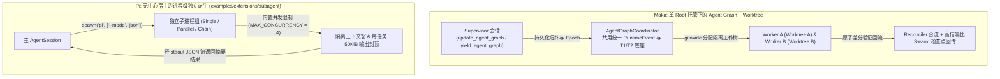

# 持久 Worktree 协同图 vs 自由无状态派生：多智能体调度一致性的代价分水岭

## 1. 多智能体协同设计的终极试金石：并发写冲突与崩溃断联

哪怕只看最经典的“查代码 + 改两处独立模块 + 跑回归测试汇总”三人并发任务，任何宣称支持 Multi-Agent 的基础设施都会瞬间遭遇四项极其硬核的物理挑战：
1. **并发写入踩踏**：两个编码子智能体如果共享同一工作目录路径同时改代码并跑测试，必然导致文件系统相互覆写破损；
2. **宿主断线与级联取消**：主会话点击停止或者网络断连重启时，已派出去在系统后台跑了五分钟的子智能体是跟着有序撤退收尾，还是沦为到处偷跑、无人认领的孤儿僵尸进程？
3. **父代理挂起时的费用与注意力浪费**：如果父协调者在子任务运行期间死卡着异步等待甚至每秒轮询追问进度，或者把下游一万字杂乱排查过程原样吞进自身上下文里，协调者三步之内就会认知退化甚至爆窗；
4. **交付物结构化可靠性**：下一棒接力的汇总代理，怎么保证自己收到的是前序成员经过核验落定的稳定结论，而非半截流输出碎片？

面对这同一套题面，**Maka TypeScript 版（持久化的 `Agent Graph` 控制平面 + Git Worktree 物理隔离）** 与 **Pi（`examples/extensions/subagent` 演示扩展体现的无状态独立 CLI 进程派生模式）** 给出了两条定位明晰、分工互补的设计路线。

---

## 2. 两条核心协作路线架构对照

### 多维调度特性深度比较

| 系统能力维度 | Maka 路线（`Agent Graph` + `Swarm` + `Worktree`） | Pi 路线（`subagent` CLI 独立派生扩展） |
| :--- | :--- | :--- |
| **执行载体与存储** | **全部同源共生**：每个子代理本质就是一条正式入库的 Child Session / Activation，享有完整的 SQLite 规范事件、沙箱策略和 T1/T2 结算边界 | **Unix 式独立进程隔离**：为单次委派拉起彻底无状态的独立 `pi --mode json` OS 子进程，任务结束进程即销毁，主会话不背负持久关系表负担 |
| **并发工作流拓扑** | 显式宣言并持久演进的 DAG 有向图（`AgentGraphTopology`）；支持协调者调用 `yield_agent_graph` 释放流后靠下游事件精准苏醒（`agent-graph-supervisor-wake`） | 直观轻量三模式直接编排：`Single` 单派、`Parallel`（最多 8 任务、4 并发池限流）及基于 `{previous}` 占位接力的流水线 **`Chain`** |
| **多分支代码写冲突隔离** | 联合 `gitoxide-helper` 按可写成员角色硬切物理独立的 **Git Worktree**，并在收敛期由 Reconciler 显式检验冲突合并 | 原生子进程共享工作目录基座，在文件局部并发改动时依靠扩展作者配合 `withFileMutationQueue` 或分批读多写少串行编排约束秩序 |
| **宿主崩溃重启生存率** | **原生断点接续**：图结构与子进度持久固化在 State Root 内，宿主崩溃重开六阶段唤醒后全拓扑图和未决子代理照常恢复挂载 | **进程寿命同生死**：派生子进程仅受单次工具调用期生命周期束缚（超时或主进程断开即随信号一同终结，轻快而不牵扯复杂重连状态表） |
| **输出反灌防爆** | 内置 `ToolResultArchive` 卸载、Swarm 提炼报告（`projectAgentSwarmResult`）与 WorkHub 三表面跨端监视面 | 通过明确 **`PER_TASK_OUTPUT_CAP = 50 * 1024`**（50 KiB 输出硬顶）截取纯净最终响应透传给主进程，避免子任务过程啰嗦溢出主上下文 |

---

## 3. 核心取舍根源：为什么“是否持久化协同图”决定了整个架构重量？

看透这两者的分界线，只需盯住两个工程前提：

1. **为什么 Pi 把子智能体做成“按扩展拆出的独立 `pi --mode json` CLI 工具”？**
   - 在嵌入式编程 SDK 的定位下，如果往核心 Loop 硬塞进工作流引擎、跨进程 DAG 状态机和分布式锁表，那么 Pi 最核心的优势——“纯内存异步流极其轻巧、人人都看得懂也随时可定制”——就会当场毁于一旦；
   - 让子智能体变成一门优雅封装在扩展插件里的“OS 子进程级 Map-Reduce 调用”，不仅天然获得独立的上下文窗（用完即抛），还能靠简洁的 `Chain ({previous})` 与 `MAX_CONCURRENCY = 4` 在几十行内搞定常见复杂并发调研与单路链式审校，甚至在崩溃清理上彻底干净（进程死即释放一切内存，绝无僵死状态残存）。

2. **为什么 Maka 敢啃“持久化图拓扑 + Git Worktree 集成合并”这块最硬的骨头？**
   - 一旦把目标瞄准在**多智能体并发动手大规模修改工程代码**、以及**允许主控界面与桌面端随时挂起或关机后再重连观察子代理进展（WorkHub 三表面看板）**，短命一次性 CLI 子进程就不够用了——主协调者如果不能优雅让渡（`yield_agent_graph`），跨分钟等待就会死占资源；如果子代理不各自持有独立的 Git Worktree，四名 AI 工程师只要一齐改代码就会把源码盘面直接踩穿！
   - 为此，Maka 毫不吝啬地动用了全仓库最高级的基础设施武器库（`Workspace Version Authority`、`gitoxide-helper` 与 `RootTurnCoordinator`）来为每一次并发协同保驾护航。

---

## 4. 总结

多智能体系统架构师面对并发任务时，应当依据**是否涉及大规模并行文件修改与跨重启恢复**这两道分水岭来做选择：
- 如果核心工作负载属于 **只读并发检索、独立多维度分析与线形审改接力（Single / Parallel / Chain）**，以独立的轻量子进程或隔离会话配合严格输出容量封顶（如 50 KiB）是开发维护成本最低、隔离性极高的首选方案；
- 一旦迈入 **并行改写同一仓库源码、需要人工透过全局面板随时单步插入接管、并要求系统断电后能恢复接手各分支成果** 的大型自治作业，则必须如 Maka 般引入显式图控制平面、控制权让渡唤醒以及 Worktree 物理写隔离。

走完底层循环、长期记忆与多体协同之后，还剩最后一公里决定产品成败的工程边界：**当把这些能力封装进具体的 Electron 桌面软件、CLI 工具或者第三方服务后台里时，界面层到底如何向运行时开火、接收帧渲染并控制进程生命周期？** 下一篇全系列终章为你拆解两种架构在真实应用集成面的终极对比：[从桌面应用嵌入边界拆解产品化代价：全双工投影、UI 订阅与进程集成范式](./pi-and-maka.md)。
