# Maka 核心领域词汇表 (Glossary)

本词汇表定义 Maka Agent 基础设施中的核心概念、术语及其职责边界。理解这些术语是阅读后续章节和理解系统架构的前提。

---

## 1. 执行生命周期与身份体系

| 概念 | 英文名称 | 作用层级 | 典型生命周期 | 核心职责 |
| :--- | :--- | :--- | :--- | :--- |
| **会话** | Session | 业务交互层 | 长期存在（跨越多次输入与重启） | 聚合所有与当前任务相关的历史记录、配置变更与上下文边界。 |
| **后端代次** | Backend Generation | 资源持有层 | 一组配置生效期间（可跨多个 Run） | 管理模型适配器、提示词缓存和已激活工具的生命周期，支持热更新。 |
| **执行记录** | Run (`AgentRun`) | 调度与审计层 | 一次完整的逻辑执行（从准入到终态） | 记录一次请求的执行身份（`runId`）、输入凭证、终态状态与关联事件。 |
| **逻辑轮次** | Turn (`AiSdkTurn`) | 执行循环层 | 一次模型与工具交互（从触发到停止） | 驱动 Agent 循环、管理流式消费、超时看门狗及本地工具环境。 |
| **模型步骤** | Model Step | 决策步进层 | 一次模型决策 + 随后的工具结算 | 外层循环的计数单位；模型返回文本或工具调用意图，完成一次结算。 |
| **请求尝试** | Provider Attempt | 物理网络层 | 一次底层的 HTTP / RPC 请求 | 为完成一个 Step 发起的网络调用；网络超时或抖动时的重试属于 Attempt 级。 |

### 概念辨析：Turn vs Run vs Step vs Attempt

```mermaid
flowchart TD
    subgraph Session["Session (用户持续对话/工作区)"]
        subgraph Generation["Backend Generation (当前模型与工具配置版本)"]
            subgraph Run["Run (执行生命周期: runId)"]
                subgraph Turn["Turn (逻辑轮次: AiSdkTurn)"]
                    subgraph Step1["Step 1 (读配置决策与工具执行)"]
                        A1["Attempt 1 (网络超时失败)"] -.->|重试| A2["Attempt 2 (成功返回 Read 调用)"]
                        T1["本地结算: execute Read('config.json')"]
                    end
                    subgraph Step2["Step 2 (解释配置内容并总结)"]
                        A3["Attempt 1 (成功生成解释文本)"]
                    end
                end
            end
        end
    end
    Step1 --> Step2
```

- **为什么不把所有事情都叫“Turn”？**
  如果用户发了一条消息：“读配置并解释”，模型先调工具读文件，再解释文本。这在 Maka 中是**一个 Turn，经历两个 Step**。如果第 1 个 Step 请求模型时网络闪断重试了一次，那该 Step 经历了**两个 Attempt**。分清这些层级，才能正确设置重试策略和用量配额。

---

## 2. 事实、事件与投影

### RuntimeEvent（运行事实事件）
系统运行过程中物理发生的不可变事件，是系统的**唯一事实源（Single Source of Truth）**。每条事件都打上全局唯一的 `id`、`ts`（时间戳）、`sessionId`、`turnId`、`runId`。
- 常见事件类型：`user_input`（用户输入）、`text_delta`（文本片段）、`tool_call`（工具调用意图）、`tool_result`（工具执行结果）、`complete`（终态通知）。

### Event Sourcing（事件溯源）
一种架构模式：不直接通过 `UPDATE` 修改数据库里的会话状态，而是将系统发生的所有动作作为只追加（Append-Only）的事实日志保存。任何当前状态都可以通过重放或扫描事件日志无损计算出来。

### Projection（投影）
从不可变的 `RuntimeEvent` 事实流中，针对不同场景计算出的特定视图（View）：
- **模型历史投影（Model Projection）**：为大模型准备的消息序列（过滤掉内部控制事件，实施敏感信息脱敏和历史压缩）。
- **界面展示投影（UI Projection）**：将细粒度的 Delta 事件聚合成用户可读的聊天气泡和工具卡片。
- **恢复判定投影（Recovery Projection）**：进程重启时扫描未完成事件，判定哪些工具尚未结算、是否需要触发接续。

### Compaction & Checkpoint（历史压缩与检查点）
- **Compaction（压缩）**：当会话历史超出模型的上下文窗口（Context Window）或产生过多 Token 费用时，由后台总结旧消息并截断的操作。
- **Checkpoint（检查点）**：压缩完成后写入的一条权威事件，记录了压缩所覆盖的历史边界范围及摘要内容。后续模型请求可直接以该检查点为基准前缀。

---

## 3. 宿主权威与多端同步

### State Root（状态根）
由一个文件目录或 SQLite 数据库所圈定的持久化运行状态的存储范围。一个工作区（Workspace）通常对应一个独立的 State Root。

### Runtime Host（运行宿主）
对某个 State Root 持有**单一写入权威（Single Writer Authority）**的中心常驻进程。无论外部接入的是 Desktop、CLI、TUI 还是外部机器人，所有命令必须发往 Runtime Host 进行统一调度与准入，杜绝多进程并发写入同一个数据库。

### Lease（租约）
Runtime Host 在启动时向 State Root 获取的排他性排它锁。只有持有有效租约的 Host 才有资格向该状态根写入事件。若另一个进程尝试接管，必须先确认旧 Host 已安全注销或租约已过期。

### Multi-Client Subscription（多端订阅广播）
客户端通过统一 RPC/WebSocket 连接向 Host 订阅会话事件。Host 采用背压机制将执行事实按游标（Cursor）推给各个客户端，支持多端同屏实时查看 Agent 执行进度。

---

## 4. 工具与环境隔离

### ToolRuntime（工具运行时）
负责工具全生命周期管理的执行内核：包括工具声明的 Schema 校验、权限拦截核验、执行器分发以及执行结果的原子结算。

### Settle（工具结算）
将底层工具的物理执行结果（标准输出、返回值或抛出的异常）转换为合法的 `RuntimeEvent`，并与当初触发该工具的模型调用（`toolCallId`）强绑定的过程。

### WorkspaceExecutor（工作区执行器）
真正执行外壳命令、读写文件或运行脚本的底层后端。支持本地进程后端（直接在当前操作系统执行）和沙箱隔离后端。

### Sandbox & ExecutionBoundary（沙箱与执行边界）
- **Sandbox（沙箱）**：通过容器（Docker/Podman）、轻量虚拟机（MicroVM）或操作系统机制（Landlock/AppContainer）对命令执行施加的文件系统重定向、网络阻断和进程树隔离。
- **ExecutionBoundary（执行边界）**：定义某个工具允许访问的目录白名单、环境变量注入规则及资源配额限制。

### MCP（Model Context Protocol）
一种开放的工具扩展标准协议。Maka 支持作为 MCP Client 连接本地或远端的 MCP Server，动态拉取工具定义并代理执行。

### Client Capabilities（客户端能力代理）
某些操作（如“在前端控制 Chrome 浏览器翻页”或“弹窗要求用户输入密码”）必须在具体的客户端机器或 UI 线程上运行。Maka 通过反向能力调用协议，由 Host 向已连接的客户端发起能力请求，并将结果结算回主运行时。

---

## 5. 状态恢复与持久性

### Continuation（执行接续）
当 Agent 在执行中途遭遇异常中断（如宿主崩溃、网络闪断或重启），系统在重新启动后，根据已持久化的不可变事件日志分析当前现场，以新的物理执行（Invocation）平滑接续未竟任务的机制。

### Unknown Tool Outcome（工具结果未知）
**系统韧性设计的核心概念**。当工具已经发出执行指令（如“向第三方发送支付请求”），但在收到返回值之前进程断电。此时系统**绝对不能**假定“工具未执行”而贸然重试，必须显式将其标记为“结果未知”，并交由恢复逻辑或人工确认。

### Atomicity Window（原子性窗口）
从模型生成工具调用，到工具执行完毕，再到工具结果写入数据库之间的时序窗口。在该窗口内发生的任何系统崩溃，都必须有明确的幂等校验与回滚策略。

---

## 6. 输入队列与多智能体编排

### Root Admission（根执行准入）
当客户端提交输入时，Host 负责对输入进行请求去重（Idempotency Check）、并发锁检查及凭证校验，确认可以执行后分配 `turnId` 并进入队列的过程。

### Steering（运行时引导）vs Follow-up（排队后继）

| 维度 | Steering（运行时引导） | Follow-up（排队后继） |
| :--- | :--- | :--- |
| **用户意图** | “不对，不要改这个文件，改另外一个！” | “顺便把刚才修改的文件也提交到 Git。” |
| **生效时机** | **当前 Turn 的步进边界立刻注入** | **等当前完整 Turn 全部结束后再开始** |
| **处理方式** | 在当前模型步进完成后排空并合并入下一 Step 上下文 | 在输入队列中等待当前执行结清后作为新 Turn 准入 |
| **并发关系** | 调整正在进行的任务轨迹 | 开启一个全新的后继任务 |

### Agent Graph（Agent 协作工作图）
用于编排多 Agent 协作的拓扑结构。将大型复杂任务拆解为由多个 Operator 构成的有向无环图（DAG），每个节点的工作均通过标准的 Session 与 Runtime 执行，支持节点间的数据流传递与级联取消。
