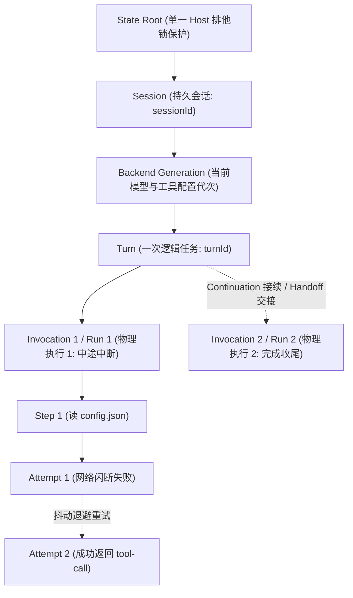

# Maka 核心领域词汇表 (Glossary)

本词汇表定义 Maka Agent 基础设施（TypeScript 架构 + 原生 Rust 加速引擎）中的核心概念、术语及其边界。理解这些术语之间的精准分工，是阅读各专题章节的基础。

---

## 1. 执行范围与身份体系

| 术语 | 英文名称 | 作用层级 | 生命周期与核心职责 |
| :--- | :--- | :--- | :--- |
| **状态根** | State Root | 存储与权威边界 | 由唯一一个存活的 Runtime Host 持有操作系统排他锁（`acquireStateRootLock`）管理的持久化目录范围，可包含多个工作区。 |
| **运行宿主** | Runtime Host | 托管服务权威层 | 负责连接认证、根准入、客户端能力协调、多端订阅广播与系统调度的常驻权威进程。 |
| **会话** | Session | 业务交互容器 | 由 `sessionId` 标识的持续工作范围，组织多次逻辑轮次、配置边界（`ExecutionBoundary`）与上下文历史。 |
| **后端代次** | Backend Generation | 资源配置代号 | `RuntimeKernel` 为当前模型连接与配置版本分配的隔离批次。支持跨输入复用与平滑热切换，防止旧代次残留请求越权使用新后端。 |
| **逻辑轮次** | Turn | 逻辑工作单元 | 由一次用户输入或受权触发开启的一整件事（`turnId`）。可跨越多步模型推理，也可经 Handoff 交给后继执行继续。 |
| **执行实例** | Invocation | 物理运行边界 | 一次有明确开篇事件（`invocation_opened`）和终态边界的物理执行（`invocationId`）。普通路径 1 个 Turn 对应 1 个 Invocation；接续或交接时 1 个 Turn 可跨越多个 Invocation。 |
| **运行记录** | Run (`AgentRun`) | 生命周期与账本 | 与本次执行实例关联的控制对象与计量作用域（`runId`），负责在后端尚未建好或中途报错时仍兜底记录输入事实与终态。 |
| **模型步骤** | Model Step | 决策步进单位 | 逻辑轮次内的一次“模型决策 + 本批本地工具结算”。`maxSteps` 预算仅消耗成功结算的 Step。 |
| **请求尝试** | Provider Attempt | 物理网络请求 | 为完成一个 Step 而实际发出的物理模型请求（`attemptId`）。网络波动或看门狗掐断后的重试属于 Attempt 级。 |

### 核心概念层级关系图

---

## 2. 事实、上下文投影与归档迁移

- **RuntimeEvent（运行事实事件）**：系统物理发生过的客观不可变记录（如用户输入、调用意图、派发准备、工具结果、终态），带有 `sessionId`、`turnId`、`runId`、`invocationId` 与来源追溯 `refs`。是系统的**唯一事实源（Single Source of Truth）**。
- **AgentRunEvent（操作计量账本）**：按 `runId` 聚合的操作审计与计量记录，关联模型请求耗时、Token 用量与 `ModelCallCommit` 快照。
- **ModelProjection（模型历史投影）**：通过 `ModelProjectionTransitionLedger` 归约算出的、专供下次模型请求使用的精简消息视图（不篡改原始事件事实）。
- **ToolResultArchive（工具大结果归档）**：将超长工具输出（如几兆构建日志）卸载为 `maka://runtime/...` 不可变资源，供模型通过 `read-page` 按页懒读，避免撑爆上下文。
- **History Compaction Checkpoint（历史压缩检查点）**：保存安全前缀摘要（或 Codex 原生压缩状态）、覆盖终点以及**双重防伪哈希**（原始事件摘要 + 有效投影摘要）的权威事件。
- **Session Bundle（会话迁移包）**：将完整会话的事件历史、检查点与附件打包成规范目录树与 USTAR tar 归档的可移植格式，支持跨环境导出及外部（Claude/Codex/Cursor/OpenCode）会话导入。

---

## 3. 工具、Code Mode 与操作系统沙箱

- **ToolRuntime（工具执行内核）**：负责构建三重参数快照（`executionArgs` / `permissionArgs` / `persistedArgs`）、校验权限、执行 T1/T2 两阶段持久化提交并生成双视图输出。
- **Code Mode（代码模式）**：模型通过 `exec` 提交脚本批量编排工具调用（如 `tools.Read()`）。子调用依然统一走 `ToolRuntime.settleToolCall()`，携带 `parentCallId` 形成嵌套调用树。
- **Client Capability（客户端能力代理）**：驻留在浏览器或前端的扩展能力（`hostAdmission: 'client_capability'`），必须经历客户端上报真实 `origin`（`accepted`）与 Host 审批落盘 T1 后放行（`admitted`）的两阶段握手。
- **PTY Stack（虚拟终端栈）**：通过 `pty-screen-collector` 在内存解析 ANSI 转义序列并渲染虚拟终端屏幕网格，解决模型直接读取裸字节流乱码的问题。
- **ExecutionBoundary（执行边界）**：定义会话的文件与网络权限策略（`explore` / `ask` / `bypass`）及乐观版本号 `revision`，支持运行中申请动态扩张审批。
- **Filesystem Worker（受限文件子进程）**：`managed` 模式下专门处理 `Read/Write/Edit` 的隔离进程，经 `deriveWorkerProfile()` 二次收窄至单文件最小权限，并锁定文件物理身份防止 TOCTOU 替换攻击。
- **Gitoxide Helper（原生 Rust Git 数据面）**：通过短生命周期 Rust 子进程与 `refs/maka/accepted`、`MustNotExist` CAS 校验工作区不可变树与 candidate receipt，避免慢速命令行调用与并发脏写。

---

## 4. 恢复、准入、协作与网络

- **T1 / T2 两阶段提交**：以 `(invocationId, toolCallId)` 生成 `operationId`：工具执行前写入 `commitToolPrepared`（T1），执行后写入 `commitToolOutcome`（T2）。
- **Unknown Tool Outcome（`indeterminate` 工具结果未知）**：进程在 T1 之后、T2 之前崩溃时，恢复解析器（`resolveRuntimeRecovery`）显式做出的裁决——**绝不假装未执行而自动重跑**，必须交由模型或人类先核实。
- **Continuation（执行续接）**：崩溃后由 `claimContinuation()` 原子认领源执行边界，在单事务中开启继承相同 `turnId` 的新 Invocation 推进未竟任务。
- **Steering vs Follow-up**：
  - **Steering（`current_turn`）**：运行中引导，通过投递租约 `leaseId` 在当前 Turn 的下一个 Step 边界立刻生效，未核销则自动置顶顺延。
  - **Follow-up（`next_turn`）**：排队后继，等待当前 Turn 彻底收尾后按顺序开启新 Turn。
- **Agent Graph（任务工作图）**：通过声明式 `Schedule`、持久子会话角色 `Operator` 与单次执行 `Activation` 编排 DAG 多智能体协作；支持 `yield_agent_graph` 挂起唤醒、`input_ids` 落盘产物引用以及 `implementation` 角色专属 Git Worktree 补丁隔离。
- **Goal & EventWait（持久目标与事件等待）**：支持设定独立预算的长周期 Goal，并通过 `EventWait` 挂起等待外部事件信号唤醒，彻底消灭无意义的 LLM 空转轮询。
- **Peer Mesh（跨主机对等网络）**：由 `native/runtime-host-peer`（Rust libp2p / WebRTC Direct）驱动的私有成员路由层，提供 `ResumablePeerStream` 断线字节流续传，但不合并两端 Host 的 State Root 写入权威。
