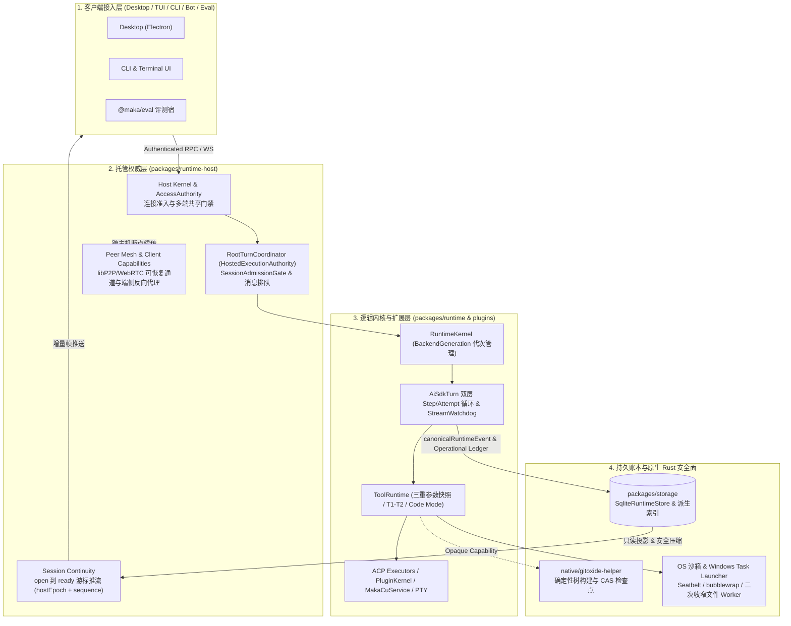

# Maka Agent 基础设施教程（TypeScript 架构版）

> 🔀 **姊妹篇对照**：如果你正在关注 Maka 团队最新的纯 Rust 微内核重构架构（`Reconciler`、`RootStore`、`CaptureArena`、`Windows MXC`、`Rooms`、时间胶囊兼容性验证等），请前往 **[Maka Agent 基础设施教程（Rust 微内核版）](../maka-rust-agent-infra/README.md)**。

本文档系列面向设计高可靠 Agent 基础设施的研发工程师与架构师，系统拆解 **Maka（TypeScript Monorepo + 原生 Rust 数据与安全边界）** 如何在多端共享工作区、进程崩溃与长工具链负载下建立可审计的执行内核。

当同一个工作区同时暴露给 Electron 桌面端、CLI 终端、自动化 Bot 与 Docker 评测器时，“把 `streamText()` 套进内存循环”的脚本原型会在三个维度彻底失效：**多客户端直连引发写入脑裂、工具落盘窗口断电造成副作用失控、巨量工具输出与多模态加载撑爆模型窗口与进程内存**。Maka 给出的工程回答是以单一 State Root 权威与双账本事件溯源为核心的混合分层运行时。

---

## 1. 全景架构：四层权威划分与原生加速边界

Maka TypeScript 版采用 **受控 Host 权威层 + 可插拔 Runtime Core + 双账本持久化存储 + 原生 Rust 数据/隔离引擎** 的四层分层结构：

---

## 2. 十大核心工程亮点速览

| 核心基础设施设计 | 解决的关键系统难题 | 核心实现要点 | 对应章节 |
| :--- | :--- | :--- | :--- |
| **单一 Root 权威与六阶段恢复** | 多入口直连写库引发状态撕裂、冷启动恢复未完就接单 | OS 排他租约锁死 State Root，`Host Composition` 固定拓扑按六阶段有序恢复并在停机时严格逆序收尾 | [00.1](00-foundations/architecture.md)、[04.3](04-state/host-ownership-and-sync.md) |
| **损失零容忍的事件双账本** | 业务状态与审计指标混存导致字段漂移或序列化失真 | `encodeCanonicalRuntimeEvent` 验证深度往返无损序列化；身份血缘归 `RuntimeEvent` 脊柱，计量与决策归 `AgentRunStore` | [00.2](00-foundations/domain-model.md)、[04.1](04-state/durable-execution.md) |
| **`subscribe → ready` 与代次隔离** | 断线重连丢帧、模型热切或冷启动与运行态竞争覆盖 | 订阅未完成历史补齐不开闸放流（`hostEpoch + sequence`）；`RuntimeKernel` 用单调 `BackendGeneration` 屏蔽过时写入 | [01.1](01-runtime/request-to-response.md)、[01.2](01-runtime/session-lifecycle.md) |
| **Responses WebSocket 增量窄门** | 多轮长工具链每次全量发历史拉高首包延迟与成本 | 仅在无拦截覆盖、未冷却且严格消息前缀匹配时复用 WS 发后缀 Delta；异变自动降级 HTTP 并伴 5 分钟冷却 | [01.4](01-runtime/provider-configuration.md) |
| **归约投影与 `#6254` 压缩收敛** | 孤儿封存调用卡死历史压缩、PDF 遭拒后被悄悄丢弃盲试 | `ModelProjectionTransitionLedger` 增量归约、`maka://` 归档与分页懒读；识别 `outcome_unknown` 终态封存推进检查点 | [02.1](02-context/history-and-projection.md)、[02.2](02-context/compaction.md) |
| **双路 OS 沙箱与 TOCTOU 防护** | 只封堵 Bash 出网却漏掉内置文件工具、软链接时间窗置换 | 文件工具走独立 Worker 子进程并叠加会话/操作双重收窄；写入前锁定 `(dev, ino)` 物理节点身份防替换 | [03.2](03-tools/sandbox.md) |
| **T1/T2 提交与 `accepted → admitted`** | 工具与端侧能力刚跨过副作用切点时断线，恢复无法判生死 | 预检后先落 `t1_after_preflight_v1`，越界崩盘由 `resolveRuntimeRecovery` 封存为 `outcome_unknown` 禁绝重跑 | [03.1](03-tools/tool-runtime.md)、[04.1](04-state/durable-execution.md) |
| **Managed Secret 信封与五层防线** | 长寿命 OAuth 令牌静态进库或被工具子进程与日志意外带出 | 运行前动态换取瞬时凭据、密钥物理隔离于 `SecretStore`，并按工具作用域封套精准注入子进程环境 | [03.5](03-tools/permissions-and-secrets.md) |
| **Gitoxide 数据面与可恢复 Peer Mesh** | JS 调 `git` CLI 开销大且非原子；移动终端切网丢失 Host 长流 | 短命 Rust `gitoxide-helper` 基于 CAS 引用原子推进工作区树；`runtime-host-peer` 借 ACK 与序列偏移无缝续传 | [04.2](04-state/gitoxide-and-workspace-versioning.md)、[04.3](04-state/host-ownership-and-sync.md) |
| **Worktree 协同图与防作弊 Eval** | 多智能体并发修改互相覆写；评测容器外泄作弊与漏计子消耗 | Swarm/Agent Graph 为成员隔离独立 Git Worktree 并由 Reconciler 汇合；`earliest valid` 锁定不可变评测账本 | [05.2](05-coordination/agent-graph.md)、[06.3](06-operations/evaluation.md) |

---

## 3. 全书章节目录（共 32 篇）

### 模块 00：架构基石与领域契约
- **00.1** [四层隔离与单 Host 权威：多端并发下的物理写入收拢架构](00-foundations/architecture.md)
- **00.2** [六层执行身份与双账本重构：如何做到跨崩溃无损历史还原？](00-foundations/domain-model.md)
- **00.3** [TypeScript Monorepo 控制边界与 Rust 原生数据面混合拓扑](00-foundations/repository-map.md)
- **00.4** [架构取舍与演进边界：混合 TypeScript Runtime 的代价平衡清单](00-foundations/design-tradeoffs.md)

### 模块 01：运行时内核与模型协议
- **01.1** [订阅优先与控制解耦：断连不丢帧的端到端信令流水线](01-runtime/request-to-response.md)
- **01.2** [并发代次与停止围栏：RuntimeKernel 如何隔离热切换与冷启动竞态？](01-runtime/session-lifecycle.md)
- **01.3** [AiSdkTurn 双层循环：流式看门狗、步间 Steering 与工具结算栅栏](01-runtime/model-step.md)
- **01.4** [四元配置解耦与 WS 增量传输：OAuth 动态注权、并发 CAS 与 5 分钟冷却退避](01-runtime/provider-configuration.md)
- **01.5** [Fiber 插件微内核与 ACP 异构桥梁：能力托管、Skill 验签与生命周期隔离](01-runtime/plugin-and-acp-runtime.md)

### 模块 02：上下文投影、安全压缩与长期记忆
- **02.1** [三账本投影归约与资源卸载：从 ModelProjectionTransitionLedger 到 Read-Page](02-context/history-and-projection.md)
- **02.2** [安全压缩切点与双哈希防伪：#6254 未知封存收敛与多模态溢退](02-context/compaction.md)
- **02.3** [证据锚定记忆与 USTAR 便携迁移：incognito 无痕边界及异构历史导入](02-context/memory-and-session-portability.md)

### 模块 03：工具执行、OS 沙箱与安全纵深
- **03.1** [ToolRuntime 结算内核：三重参数快照、T1/T2 提交与 Code Mode 嵌套调用树](03-tools/tool-runtime.md)
- **03.2** [操作系统双路沙箱与 Worker 隔离：Bash 受限出网、文件二次收窄与 TOCTOU 防护](03-tools/sandbox.md)
- **03.3** [原生桌面视觉与 PTY 虚拟屏：MakaCuService 帧契约、坐标门控与进程树收尸](03-tools/computer-use-and-pty.md)
- **03.4** [MCP 加密防漂移与端侧两阶段准入：accepted 到 admitted 的权威切分](03-tools/mcp-and-client-capabilities.md)
- **03.5** [五层纵深防线与 Managed Secret 信封：零凭据泄漏的作用域动态注入](03-tools/permissions-and-secrets.md)

### 模块 04：持久执行、原生 Git 数据面与多端同步
- **04.1** [P0–P4 崩溃窗口治理与原子续接：T1/T2 密封、`outcome_unknown` 与账本自愈](04-state/durable-execution.md)
- **04.2** [Gitoxide 原生数据面与乐观锁：OAuth/Capability 分离与确定性 Worktree 演进](04-state/gitoxide-and-workspace-versioning.md)
- **04.3** [State Root 排他租约、六阶段冷启与 Peer Mesh 可恢复字节流](04-state/host-ownership-and-sync.md)

### 模块 05：排队准入、图协同与长程自治
- **05.1** [短时准入闸门与双阶段 Steering：Lease 交付结算、Follow-up 折叠与背压](05-coordination/queues-and-admission.md)
- **05.2** [Agent Graph 调度平面与 Swarm：角色 Worktree 隔离、Yield 收敛与 WorkHub 投影](05-coordination/agent-graph.md)
- **05.3** [持久 Goal、Plan Mode 与 EventWait 挂起：彻底消灭长周期轮询空转](05-coordination/goals-plans-and-event-waits.md)

### 模块 06：可靠性、可观测与 容器评测
- **06.1** [三层故障收敛与防重放网关：看门狗、退避门控与宿主幂等准入](06-operations/retry-timeout-idempotency.md)
- **06.2** [单值原子计量与诊断瀑布流：ModelCallCommit、RequestShape 与冷热重建对齐](06-operations/observability.md)
- **06.3** [隔离容器实验与防作弊裁决：Host 外置协议评测、`earliest valid` 与 Honest Metering](06-operations/evaluation.md)

### 模块 07：基础设施范式深度对照
- **07.1** [状态机、持久化与控制权：Event-Sourced Host 内核 vs 嵌入式 Hook 运行时](07-comparison/overview.md)
- **07.2** [证据链账本 vs 文件即规范：两代记忆架构的防幻觉与检索代价](07-comparison/memory-design.md)
- **07.3** [持久 Worktree 协同图 vs 自由无状态派生：多智能体调度一致性的代价分水岭](07-comparison/subagent-design.md)
- **07.4** [从桌面应用嵌入边界拆解产品化代价：全双工投影、UI 订阅与进程集成范式](07-comparison/pi-and-maka.md)

### 辅助参考
- [核心领域词汇表](GLOSSARY.md)

---

## 4. 按工程目标推荐阅读路线

- **快速构建可靠的模型与工具执行闭环**：[00.1](00-foundations/architecture.md) → [00.2](00-foundations/domain-model.md) → [01.1](01-runtime/request-to-response.md) → [01.3](01-runtime/model-step.md) → [03.1](03-tools/tool-runtime.md)。
- **攻克崩溃恢复、数据丢失与多客户端一致性**：[01.2](01-runtime/session-lifecycle.md) → [04.1](04-state/durable-execution.md) → [04.3](04-state/host-ownership-and-sync.md) → [05.1](05-coordination/queues-and-admission.md) → [06.1](06-operations/retry-timeout-idempotency.md)。
- **解决长上下文失控、沙箱越权与并发协同**：[02.1](02-context/history-and-projection.md) → [02.2](02-context/compaction.md) → [03.2](03-tools/sandbox.md) → [03.5](03-tools/permissions-and-secrets.md) → [05.2](05-coordination/agent-graph.md)。
- **横向对比架构选型与演化方向**：阅读全套 [07 范式对照](07-comparison/overview.md) 后，继续阅读 [Rust 微内核演进全解](../maka-rust-agent-infra/06-operations/rust-vs-ts-evolution.md)。
