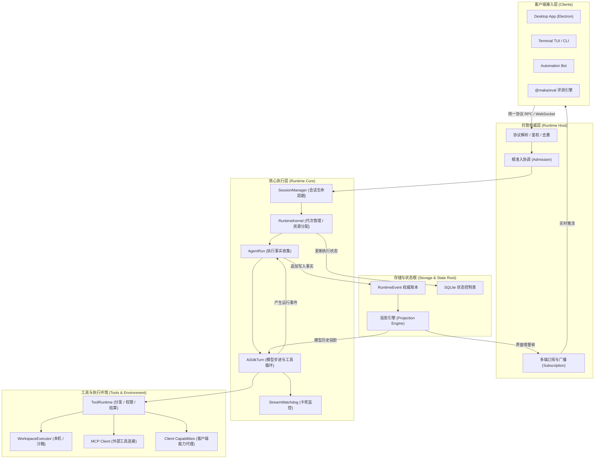
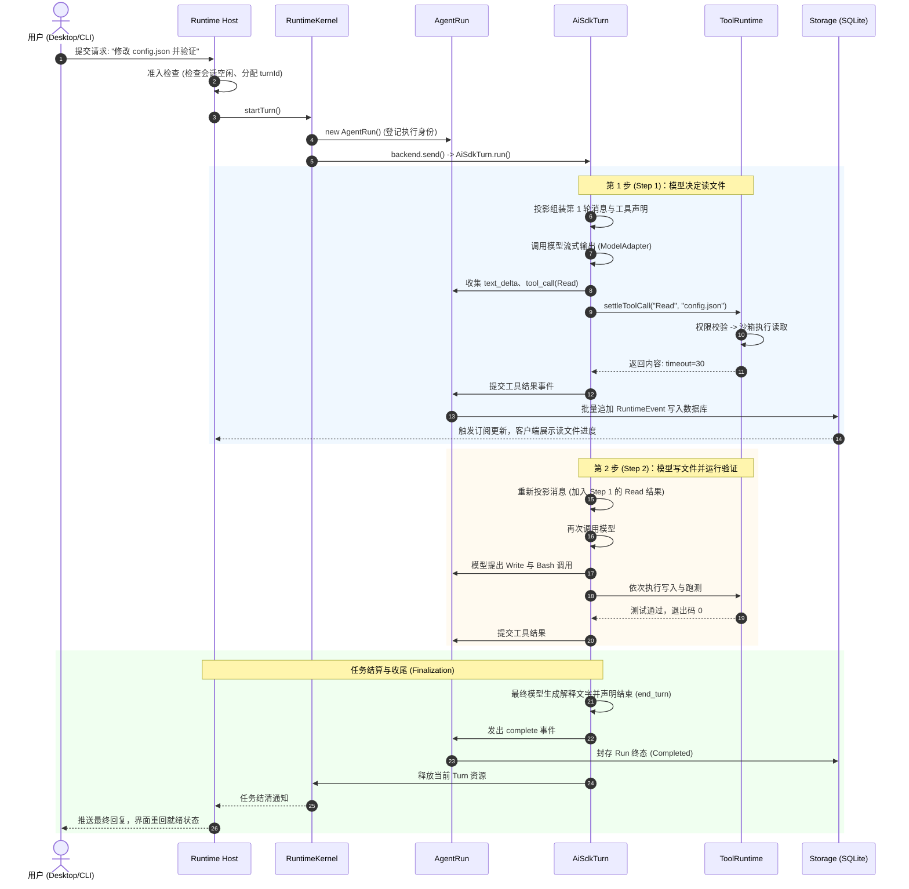
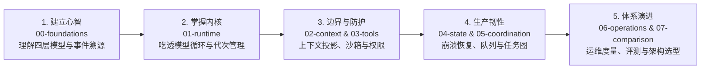

# Maka Agent 基础设施教程

本教程面向设计与实现智能体（Agent）系统的开发者与架构师，系统性拆解工业级多端 Agent 基础设施——Maka 的核心架构、设计哲学与关键机制。通过本手册，读者将理解一个同时服务于桌面端（Desktop）、终端（TUI/CLI）、自动化机器人（Bot）及离线评测（Eval）的 Agent 基础设施是如何构建的，并掌握其面对进程崩溃、并发冲突、权限边界与复杂工具调用时的解决之道。

---

## 1. 为什么需要 Agent 基础设施？

在简单的原型开发中，调用模型只需一行 `streamText({ prompt, tools })`。但当 Agent 走向真实的工程环境时，开发者必须面对一系列系统级挑战：

1. **多端并发与接入冲突**：用户在桌面端发起了“重构代码”任务，同时在终端打开该项目查看进度。如果两端各自启动一个模型运行时并直连本地数据库，极易引发文件写入冲突、状态覆写和死锁。
2. **进程中断与执行恢复**：模型正在执行耗时数分钟的构建脚本时，用户误关终端或进程被操作系统杀死。重启后，系统能否知道脚本是否已经跑完？哪些外部修改已经生效？该从哪里接着跑？
3. **模型输入与系统事实的混淆**：为了控制 Token 消耗，历史消息经常需要裁剪或压缩。但如果将裁剪后的历史当成系统唯一留存的事实，审计追踪、故障复盘以及精确的状态恢复将彻底无法实现。
4. **工具副作用与幂等难题**：模型请求调用了“创建远程工单”或“扣除账户配额”，随后网络连接中断。在不知道远程操作是否实际成功的情况下，盲目重试会导致严重后果。

**Agent 基础设施的职责，就是为模型提供可预测、可审计、抗崩溃且隔离安全的运行时外壳。** Maka 正是围绕这些生产问题设计的一套完备的 Agent 基础设施。

---

## 2. Maka 全景架构与数据流向

Maka 采用了**单一状态根宿主（Single Host Authority per State Root）**与**事件溯源（Event Sourcing）**的系统设计：

### 三股核心数据流

在 Maka 的架构中，数据被严格划分为三股互不混淆的流：

1. **命令流（Commands）**：客户端发出的操作请求（如发起会话、提交输入、发送取消信号）。必须经由 Host 准入核验，不能直接操作底层状态。
2. **事实流（Facts / Events）**：系统运行中真正发生的物理事实（用户实际输入了什么、模型提出了哪些调用、工具执行产生了什么 stdout、错误码是什么）。一旦通过事务写入 `RuntimeEvent` 账本，便不可篡改。
3. **投影流（Projections）**：根据不同消费者的需求，从权威事实流衍生出的计算视图：
   - **模型上下文投影**：滤除敏感字段、实施历史压缩后，拼装为大模型接受的 `messages` 数组。
   - **客户端展示投影**：将内部细粒度流（如中间思考过程、工具参数增量）组装为人性化的聊天气泡与进度条。
   - **恢复判定投影**：进程重启时扫描未完成的 Run，判定需要续接（Continuation）的位置。

---

## 3. 一项任务中的机制协作：端到端图解

以一个经典的工程任务为例：**“读取 `config.json`，将 `request_timeout` 改为 60，并运行测试验证”**。

整个执行过程展现了 Maka 基础设施的几项核心保障：
- **原子结算**：工具执行结果与模型消息严格按 `toolCallId` 配对，并作为原子事务入库。
- **看门狗（Watchdog）守护**：模型流式传输过程中若发生静默网络挂起，Turn 内置的看门狗会在超时后自动切断并触发受控重试。
- **解耦的展示与持久化**：客户端在屏幕上看到的打字机动画只是订阅投影，即使断网重连，从数据库拉取投影即可完美恢复现场。

---

## 4. 章节目录与学习路线

本手册共分为 8 个核心模块，循序渐进地剖析 Maka 的全貌：

| 模块 | 章节 | 核心问题 | 核心学习目标 |
| :--- | :--- | :--- | :--- |
| **00 架构基石** | [00.1 整体架构](00-foundations/architecture.md) | Maka 的四层模型与系统边界 | 理解客户端、Host、Runtime 与 Storage 的职责分离与交互契约 |
| | [00.2 仓库与依赖地图](00-foundations/repository-map.md) | 代码组织与模块分工 | 掌握 Monorepo 目录结构、公共抽象包与私有实现包的引用规则 |
| | [00.3 领域对象模型](00-foundations/domain-model.md) | 核心概念与身份标识 | 彻底厘清 Session、Generation、Run、Turn、Step、Attempt 的多层级关系 |
| | [00.4 设计权衡与模式](00-foundations/design-tradeoffs.md) | 架构为什么这么选？ | 理解单 Host 写入、事件驱动、分层看门狗等 9 大关键工程决策与代价 |
| **01 运行时内核** | [01.1 从请求到响应](01-runtime/request-to-response.md) | 一条输入如何流转全系统？ | 端到端追踪一条输入从 Host 准入、模型调用到事件回传的完整代码路径 |
| | [01.2 会话与对象生命周期](01-runtime/session-lifecycle.md) | 内存对象何时创建何时销毁？ | 剖析 Generation 资源代次、并发安全构建、优雅停机与资源泄漏防护 |
| | [01.3 模型步进与循环](01-runtime/model-step.md) | Agent Loop 是如何运转的？ | 掌握 `AiSdkTurn` 的步进算法、流式收集、本地工具结算与循环退出裁决 |
| | [01.4 模型与供应商配置注入](01-runtime/provider-configuration.md) | 如何隔离和切换多模型？ | 理解动态配置装配、多 Provider 适配器、提示词缓存优化与连接复用 |
| **02 上下文与记忆** | [02.1 历史事实与模型输入投影](02-context/history-and-projection.md) | 审计日志如何变成 Prompt？ | 深入事件账本向模型消息转换的规则，理解状态与展示的投影分离 |
| | [02.2 历史压缩与检查点](02-context/compaction.md) | 上下文爆窗了怎么办？ | 掌握安全前缀识别、上下文截断摘要、验证恢复与摘要检查点生成算法 |
| **03 工具与安全沙箱** | [03.1 工具执行内核](03-tools/tool-runtime.md) | 工具是如何被调用和管理的？ | 学习参数 Schema 校验、异步执行分发、并发执行控制与未知结果处理 |
| | [03.2 MCP 与客户端能力代理](03-tools/mcp-and-client-capabilities.md) | 外部工具与本地端能力如何接入？ | 剖析 Model Context Protocol 协议集成与前端能力（如浏览器）反向代理 |
| | [03.3 执行环境与操作系统沙箱](03-tools/sandbox.md) | 如何防止恶意外壳命令逃逸？ | 理解进程树隔离、文件系统重定向、平台沙箱驱动与配额约束 |
| | [03.4 分层授权与凭据生命周期](03-tools/permissions-and-secrets.md) | 敏感密钥如何安全透传？ | 学习人机确认门控（HITL）、安全密钥隔离注入与凭据使用审计 |
| **04 状态与恢复** | [04.1 持久化执行与崩溃恢复](04-state/durable-execution.md) | 进程断电后如何恢复？ | 识别工具崩溃危险窗口，掌握 Continuation 续接算法与状态反序列化 |
| | [04.2 Host 所有权与多端同步](04-state/host-ownership-and-sync.md) | 多客户端如何共享同一状态？ | 深入 State Root 租约机制、单写入者保障、断线重连补帧与状态同步 |
| **05 调度与编排** | [05.1 输入队列与执行准入](05-coordination/queues-and-admission.md) | 连续发消息如何排队？ | 区分 Steering（运行时引导）与 Follow-up（排队后继）的消费边界与背压 |
| | [05.2 任务图与多 Agent 协作](05-coordination/agent-graph.md) | 复杂任务如何拆分子代理？ | 掌握父子会话拓扑、DAG 依赖调度、产物跨会话交接与级联取消 |
| **06 运维与评估** | [06.1 重试、超时与幂等](06-operations/retry-timeout-idempotency.md) | 网络抖动时怎么自愈？ | 建立物理请求重试、模型轮次重试与外部操作幂等性的三层防护网 |
| | [06.2 可观测性与追踪](06-operations/observability.md) | 怎么知道哪里卡住了、花了多少钱？ | 理解分布式追踪 Trace、Token 消耗统计、延迟排查与系统事件日志 |
| | [06.3 评测体系与结果裁决](06-operations/evaluation.md) | 怎么科学评价 Agent 能力？ | 学习 `@maka/eval` 的 Experiment/Cell/Attempt 模型与客观基准校验 |
| **07 架构对照** | [07.1 Agent 内核架构宏观对比](07-comparison/overview.md) | Maka vs Pi 怎么选？ | 从状态建模、知识复用、子任务组织、执行一致性四个维度深度横评 |
| | [07.2 记忆设计对比](07-comparison/memory-design.md) | 短期上下文与长期记忆差异 | 对比两套系统在记忆提取、持久化向量检索与工作区事实治理的异同 |
| | [07.3 子智能体机制对比](07-comparison/subagent-design.md) | 多智能体实现的两种范式 | 对比轻量派生（Fork）模式与结构化任务图（Agent Graph）模式的优劣 |
| | [07.4 场景与集成模式对比](07-comparison/pi-and-maka.md) | 嵌入式库 vs 独立服务框架 | 分析单体嵌入型 Agent（如 Pi）与托管服务型 Agent（如 Maka）的适用场景 |

---

## 5. 核心架构对照：Maka 与 Pi

为了帮助已有 Agent 开发经验的读者快速建立心智模型，下表给出了 Maka 与经典参考系统 Pi 的设计选型对比：

| 架构维度 | Maka 的设计选择 | Pi 的设计选择 | 设计动因与权衡 |
| :--- | :--- | :--- | :--- |
| **系统核心形态** | **托管服务架构 (Runtime Host)** 多端共享单一 Host 权威进程 | **嵌入式库架构 (AgentSession)** 直接在应用进程中实例化 Agent | Maka 偏向多界面协同、统一状态管控与重度持久化；Pi 偏向极简启动、轻量嵌入与进程独占。 |
| **状态权威** | **事件溯源 (Event Sourcing)** 只追加写入不可变的 `RuntimeEvent` | **状态机模型 (Stateful Object)** 在内存会话对象中维护当前状态 | Maka 具备天然的回放、跨端补帧和无损审计能力；Pi 内存占用更低，小规模场景下更直接。 |
| **并发与代次** | **Backend Generation 代次管理** 按版本持有后端，换配置平滑过渡 | **单 Agent 串行锁** 通过 `activeRun` 标记拒绝重入 | Maka 支持运行中平滑热切模型配置并复用空闲后端；Pi 逻辑极度精炼，易于单机调试。 |
| **多智能体编排** | **Agent Graph 控制平面** 父子会话拓扑，通过标准 Runtime 调度 | **派生子任务 (Fork / Tool)** 通过特化工具在子上下文中运行 | Maka 将子 Agent 视作具备完整审计能力的一等公民；Pi 专注于编码主流程的轻量任务下发。 |
| **崩溃恢复保障** | **原子提交窗口 + Continuation** 识别工具未知状态，显式接续 | **实验性 Durable 检查点** 基于 SQLite 保存任务执行状态 | Maka 严格区分外部副作用与本地事务，杜绝幻象恢复；Pi 提供灵活的嵌入式持久执行方案。 |

---

## 6. 建议阅读路径

无论你是从零开始构建 Agent 基础设施，还是重构已有框架，建议按以下顺序阅读：

1. **第一阶段：建立概念心智**
   - 必读：[00.1 整体架构](00-foundations/architecture.md)、[00.3 领域模型](00-foundations/domain-model.md)、[GLOSSARY.md](GLOSSARY.md)
   - 目标：明确 Session、Turn、Run 的边界，理解为什么必须坚持“单一写入权威”。
2. **第二阶段：打通主干执行链路**
   - 必读：[01.1 从请求到响应](01-runtime/request-to-response.md)、[01.3 模型单步与循环](01-runtime/model-step.md)
   - 目标：掌握模型流、看门狗、工具结算与事件回传的精确控制流。
3. **第三阶段：攻坚生产级难点**
   - 必读：[02.1 事实与投影](02-context/history-and-projection.md)、[03.1 工具内核](03-tools/tool-runtime.md)、[04.1 持久化与恢复](04-state/durable-execution.md)
   - 目标：搞清楚历史压缩如何做、工具崩溃窗口如何判定、断网断电后如何恢复。
4. **第四阶段：进阶编排与技术选型**
   - 选读：[05.2 任务图](05-coordination/agent-graph.md)、[06.1 重试与超时](06-operations/retry-timeout-idempotency.md)、[07.1 架构横评](07-comparison/overview.md)
   - 目标：为企业自研 Agent 平台进行高可用设计与选型决策。
