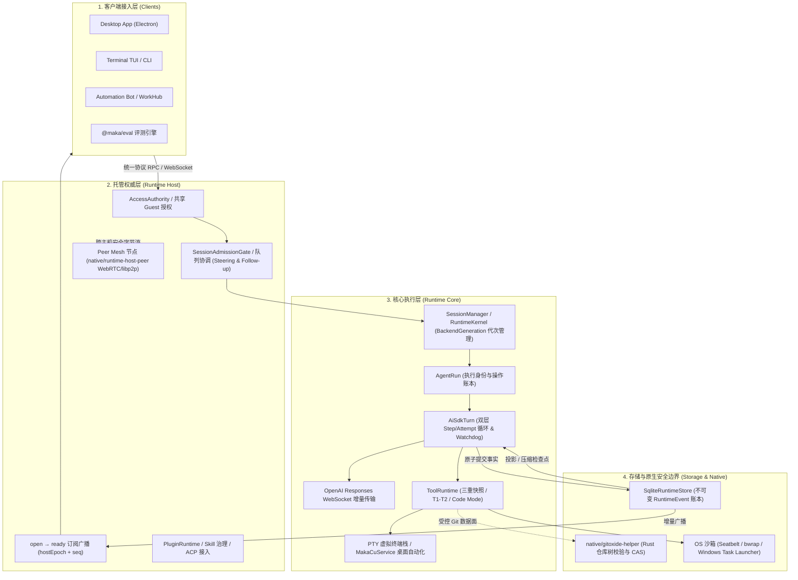
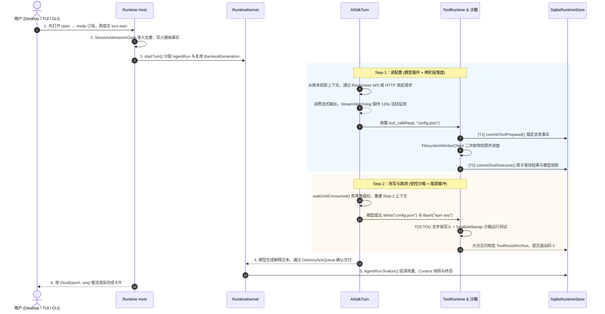
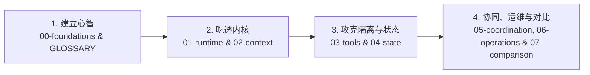

# Maka Agent 基础设施教程（TypeScript 架构版）

本教程面向设计与实现智能体（Agent）基础设施的开发者与架构师，系统性拆解 **Maka（TypeScript Monorepo + 原生 Rust 加速引擎架构）** 的核心设计与工程实践。

在简单的原型开发中，调用模型只需一行 `streamText()`。但当 Agent 走向真实的工程环境时，开发者必须面对多端并发冲突、进程中断恢复、上下文爆窗、沙箱越权、跨进程同步与防作弊评测等一系列系统级挑战。本手册以“概念先行 + 设计权衡 + 图解与伪代码 + 对照实现”的方式，深入剖析 Maka 如何解决这些核心难题。

---

## 1. 为什么需要工业级 Agent 基础设施？

当同一个工作区同时被桌面应用（Electron Desktop）、终端界面（TUI/CLI）、自动化机器人（Bot）以及离线评测引擎（Eval）访问时，“把调用逻辑塞进 UI 回调里”的做法会瞬间崩溃：

1. **多端并发与状态脑裂**：如果桌面端和终端各自实例化模型循环并直连 SQLite，两边的修改和后台任务会互相覆写，导致上下文撕裂与文件损坏。
2. **崩溃窗口与外部副作用迷雾**：工具修改本地 `config.json` 或向外部系统发完请求后，进程在写数据库前断电。重启后若直接假定“没执行”而重跑，会造成不可逆的重复副作用。
3. **长工具链的上下文与传输瓶颈**：几十轮工具调用产生数兆输出，直接塞入上下文会瞬间撑爆窗口；每次都重传全量历史会消耗海量带宽与延迟。
4. **越权访问与代码逃逸**：只给 `Bash` 加沙箱却让内置文件工具在主进程直接调 `fs` API，会留下路径穿越后门；同时，原生桌面自动化（Computer Use）与互动式终端（PTY）需要独立的进程树与屏幕缓冲控制。

**Agent 基础设施的本质，就是为大语言模型构建一个可审计、抗崩溃、隔离安全且支持多端协同的运行时外壳。**

---

## 2. Maka 全景架构与原生加速边界

Maka 在本架构版中采用了 **TypeScript 分层微内核（Runtime Host + Runtime Kernel + Storage）** 与 **原生 Rust 加速子系统（`native/`）** 协同的混合架构：

### 核心工程亮点速览

在深入具体章节前，下表概括了 Maka 源码中最具工程价值的核心机制与设计亮点：

| 核心机制 | 解决的关键难题 | 实现原理要点 | 对应章节 |
| :--- | :--- | :--- | :--- |
| **单一 Host 权威与六阶段启动** | 多客户端直连导致的脑裂与未恢复先接客 | OS 排他锁锁定 State Root，严格按 `state → resources → executions → domains → schedulers → ready` 顺序恢复就绪。 | [00.1](00-foundations/architecture.md)、[04.3](04-state/host-ownership-and-sync.md) |
| **Responses WebSocket 增量传输** | 长工具链每步重传全量历史导致的高延迟与带宽浪费 | Turn 级复用 WebSocket 仅发送严格前缀对齐后的后缀 Delta，任何不匹配自动安全降级为全量 HTTP（带 5 分钟冷却）。 | [01.4](01-runtime/provider-configuration.md) |
| **`PluginRuntime` 与 ACP 外部接入** | 第三方扩展与外部 Agent（如 Antigravity）如何安全复用内核 | 通过隔离服务端口受控暴露 FS/Shell/LLM 能力；外部执行器实现统一 `AgentBackend` 接口无缝接入。 | [01.5](01-runtime/plugin-and-acp-runtime.md) |
| **`ToolResultArchive` 与上下文卸载** | 几兆工具输出既不能丢弃审计，又不能撑爆模型上下文 | 原始大输出卸载为 `maka://` 不可变资源，结合 `read-page` 分页懒读与 `ModelProjectionTransitionLedger` 归约。 | [02.1](02-context/history-and-projection.md) |
| **安全压缩与多模态溢退** | 历史切点劈断工具配对、封存调用卡死压缩及 PDF 静默丢失 | 尾部保护 + 当前输入锚点 + 双哈希防伪 + 封存未知调用推进；严禁无结构化信号时偷偷删掉 PDF 盲目重试。 | [02.2](02-context/compaction.md) |
| **证据核验记忆与会话打包迁移** | 长期记忆幻觉污染与跨工具历史无法迁移 | 记忆提取强制核对用户原文出处、`incognito` 无痕继承、USTAR 规范树打包以及无损导入 Claude/Codex/Cursor 会话。 | [02.3](02-context/memory-and-session-portability.md) |
| **Code Mode 嵌套执行树** | 模型批量调用工具引发大量网络往返 | `exec` 脚本通过内嵌代理调用 `tools.*`，依然完整走 `ToolRuntime.settleToolCall()` 与 T1/T2 持久化并绑定 `parentCallId`。 | [03.1](03-tools/tool-runtime.md) |
| **PTY 虚拟屏与 `MakaCuService`** | 交互式终端 ANSI 乱码与桌面键鼠控制失控 | `pty-screen-collector` 在内存渲染终端屏幕网格供模型读取；原生独立子进程管理桌面自动化与帧状态。 | [03.3](03-tools/computer-use-and-pty.md) |
| **双路沙箱与 `deriveWorkerProfile`** | 只限制 `Bash` 却放任 `Write` 主进程直写引发软链接逃逸 | 内置文件工具走独立受限文件 Worker 子进程，按单次操作二次收窄权限并锁定文件身份防 TOCTOU 替换。 | [03.4](03-tools/sandbox.md) |
| **原生 Rust `gitoxide-helper`** | JS 进程调用 `git` CLI 慢且难以保证多步树操作原子性 | 短生命周期 Rust Helper 基于 `refs/maka/accepted` 与 `MustNotExist` CAS 提交不可变 candidate receipt。 | [04.2](04-state/gitoxide-and-workspace-versioning.md) |
| **原生 Rust `runtime-host-peer`** | 移动设备切换 Wi-Fi 导致连接远端 Host 中断丢数据 | 基于 libp2p / WebRTC Direct 的 `ResumablePeerStream` 字节流偏移量与 ACK 恢复，配合三类签名成员事实。 | [04.3](04-state/host-ownership-and-sync.md) |
| **持久 Goal 与 `EventWait` 挂起** | 长周期目标靠模型空转轮询工具白烧大量 Token | `EventWait` 让运行优雅挂起等待外部事件唤醒，`GoalCloseFence` 守护目标完结与预算门控。 | [05.3](05-coordination/goals-plans-and-event-waits.md) |

---

## 3. 一项任务中的机制协作：端到端图解

以一个经典工程任务为例：**“读取 `config.json`，将 `request_timeout` 修改为 60，并运行测试验证”**。

---

## 4. 全书章节目录与学习路线（共 32 篇）

| 模块 | 章节 | 核心问题 | 核心学习目标 |
| :--- | :--- | :--- | :--- |
| **00 架构基石** | [00.1 整体架构](00-foundations/architecture.md) | 四层职责与启动边界如何划分？ | 理解客户端、Runtime Host、Runtime Kernel 与 Storage 的分层契约及 Host Composition |
| | [00.2 仓库与依赖地图](00-foundations/repository-map.md) | Monorepo 与原生加速层如何协作？ | 掌握 TS 工作区依赖反转拓扑、`exports` 映射及 `native/` Rust Helper 边界 |
| | [00.3 领域对象模型](00-foundations/domain-model.md) | 六层执行身份与事件账本如何关联？ | 厘清 Session、Turn、Invocation、Run、Step、Attempt、`RuntimeEvent` 与状态重建 |
| | [00.4 设计权衡与模式](00-foundations/design-tradeoffs.md) | 架构决策背后的代价是什么？ | 深入剖析 10 大关键工程权衡：`ModelCallCommit`、代次隔离、`Unknown Outcome` 等 |
| **01 运行时内核** | [01.1 从请求到响应](01-runtime/request-to-response.md) | 一条输入如何流转全系统？ | 追踪“先订阅后发包”、`RootTurnCoordinator` 后台抽水与 `DeliveryAckQueue` 背压确认 |
| | [01.2 会话与执行生命周期](01-runtime/session-lifecycle.md) | 内存对象何时创建、复用与销毁？ | 吃透 `BackendGeneration` 代次切换、冷启动合并、`assertRunCanDispatch` 与 `settled` 等待 |
| | [01.3 模型步进与循环](01-runtime/model-step.md) | Agent 循环如何驱动与自愈？ | 掌握双层循环、`StreamWatchdog`、`ai-sdk-tool-repair` 修复、截断保护与退出裁决 |
| | [01.4 模型配置与增量传输](01-runtime/provider-configuration.md) | 凭据注入与 WS 增量如何工作？ | 理解 `RuntimePolicy`、OAuth 绑定、乐观锁切换与 **Responses WebSocket 增量传输** |
| | [01.5 插件运行时与 ACP 接入](01-runtime/plugin-and-acp-runtime.md) | 第三方插件与外部 Agent 如何接入？ | 深入 `PluginRuntime / PluginKernel` 隔离服务端口、Skill 治理回执与 ACP 外部执行器 |
| **02 上下文与记忆** | [02.1 历史投影与大结果归档](02-context/history-and-projection.md) | 事实账本如何无损转为模型输入？ | 掌握投影账本归约、重放修复、**`ToolResultArchive` 归档分页与 `Context Offload`** |
| | [02.2 历史压缩与媒体恢复](02-context/compaction.md) | 爆窗与多模态异常如何安全处理？ | 深入安全切点、双哈希校验、Codex 原生压缩、`#6254` 封存调用推进与图像/PDF 恢复边界 |
| | [02.3 长期记忆与会话迁移](02-context/memory-and-session-portability.md) | 知识如何跨会话沉淀与跨工具迁移？ | 深入证据核验记忆、`incognito` 无痕、**USTAR 会话包**与 **Claude/Codex/Cursor 导入** |
| **03 工具与安全沙箱** | [03.1 工具内核与 Code Mode](03-tools/tool-runtime.md) | 工具调用如何校验与嵌套执行？ | 掌握三重快照、T1/T2 窗口、双视图输出、`bash-tail-buffer` 与 **`exec` Code Mode 树** |
| | [03.2 MCP 与客户端能力代理](03-tools/mcp-and-client-capabilities.md) | 外部 MCP 与浏览器能力如何接入？ | 深入 `McpClientManager` 指纹校验与 `accepted → admitted` 客户端能力两阶段握手 |
| | [03.3 桌面自动化与 PTY 终端](03-tools/computer-use-and-pty.md) | GUI 控制与交互式终端如何运作？ | 剖析 **`MakaCuService`** 帧状态管理、**`pty-stack` 虚拟屏缓冲**与进程树连根终止 |
| | [03.4 操作系统级双路沙箱](03-tools/sandbox.md) | 命令与文件工具如何防越权逃逸？ | 深入 `Bash` 沙箱、受限文件 Worker 二次收窄、TOCTOU 锁与 Seatbelt / bwrap / Windows 边界 |
| | [03.5 分层授权与凭据生命期](03-tools/permissions-and-secrets.md) | 共享访问与敏感密钥如何隔离？ | 掌握五层纵深防御、`session_guest` 授权、Origin 门控与 **`AES-256-GCM` 临时密钥注入** |
| **04 状态与恢复** | [04.1 持久化与崩溃恢复](04-state/durable-execution.md) | 崩溃窗口内的不确定性如何化解？ | 深入 `SqliteRuntimeStore` T1/T2 事务、`resolveRuntimeRecovery`、`claimContinuation` 与账本修复 |
| | [04.2 Gitoxide 与工作区版本](04-state/gitoxide-and-workspace-versioning.md) | 如何用 Rust 守护工作区树状态？ | 揭秘 **`native/gitoxide-helper`** 数据面、`refs/maka/accepted` CAS 与工作区版本防覆写 |
| | [04.3 Host 所有权与 Peer Mesh](04-state/host-ownership-and-sync.md) | 单写入者锁与跨设备传输如何实现？ | 深入 `RootOwner`、追帧协议，以及 **Rust `runtime-host-peer` WebRTC/libp2p 字节流续传** |
| **05 调度与协同** | [05.1 输入队列与背压准入](05-coordination/queues-and-admission.md) | 并发消息与子任务配额如何控制？ | 吃透 `SessionAdmissionGate`、**`Steering` 投递租约 `leaseId`**、`Follow-up` 与 `AdmissionLimiter` |
| | [05.2 任务图与 WorkHub 协同](05-coordination/agent-graph.md) | 多 Agent 如何按依赖图与工作台协同？ | 深入 `Agent Graph`（`yield` 唤醒与 `input_ids`）、`Swarm` 模式及 **`WorkHub` 会话协作** |
| | [05.3 持久 Goal、Plan 与事件等待](05-coordination/goals-plans-and-event-waits.md) | 超长周期目标如何不靠轮询实现自驱？ | 深入 **Goal 评估与关闭围栏**、`Plan Mode`、**`EventWait` 事件驱动唤醒**与统一定时调度 |
| **06 运维与评估** | [06.1 重试、超时与幂等](06-operations/retry-timeout-idempotency.md) | 三层网络与重连故障如何自愈？ | 掌握双阶段看门狗、10 次抖动退避、溢出联动重试及 Host 幂等去重 |
| | [06.2 可观测性与调试追踪](06-operations/observability.md) | 如何精准归因耗时、上下文与成本？ | 深入 `ProviderRequestTracker`、`RequestShape` 成分拆解、`projectSessionTrace` 与 `recap` |
| | [06.3 评测引擎与结果裁决](06-operations/evaluation.md) | 如何客观公平地评测 Agent？ | 掌握 `@maka/eval` 实验矩阵、Harbor/Pier 执行器与 **`earliest valid` 反作弊裁决铁律** |
| **07 架构对照** | [07.1 Agent 内核架构对比](07-comparison/overview.md) | Maka vs Pi 核心设计哲学差异 | 从状态、记忆、多 Agent 与一致性四大维度深度横评并给出选型决策树 |
| | [07.2 记忆存储与提取对比](07-comparison/memory-design.md) | 动态证据提取 vs 静态文件系统约定 | 对比 Maka 证据核验/`incognito` 与 Pi `AGENTS.md` / JSONL 会话树 |
| | [07.3 子智能体与隔离对比](07-comparison/subagent-design.md) | 控制平面图编排 vs 轻量进程派生 | 对比 `Agent Graph` + Git Worktree 补丁与 Pi CLI 扩展及 Durable 前后台助手 |
| | [07.4 应用集成与扩展对比](07-comparison/pi-and-maka.md) | 托管服务集成 vs 进程内 SDK 嵌入 | 对比 Host 客户端接入 / `PluginRuntime` 与 Pi `AgentSession` / `Durable Harness` |

---

## 5. 推荐阅读路径

1. **第一阶段（建筑蓝图）**：阅读 [词汇表](GLOSSARY.md) 与 `00-foundations`，理解 Host 权威、六层执行身份与事件溯源的核心思想。
2. **第二阶段（核心链路）**：精读 `01-runtime` 与 `02-context`，掌握模型循环、Responses WS 增量、大结果归档分页以及安全压缩恢复。
3. **第三阶段（工程深水区）**：研读 `03-tools` 与 `04-state`，重点吸收 Code Mode 嵌套调用、PTY 虚拟屏、双路沙箱、Rust Gitoxide 数据面以及 Peer Mesh 字节流恢复。
4. **第四阶段（编排与选型）**：学习 `05-coordination`、`06-operations` 与 `07-comparison`，掌握 Goal/EventWait 零轮询编排、Eval 公平裁决以及 Maka 与 Pi 的精准选型判断。
