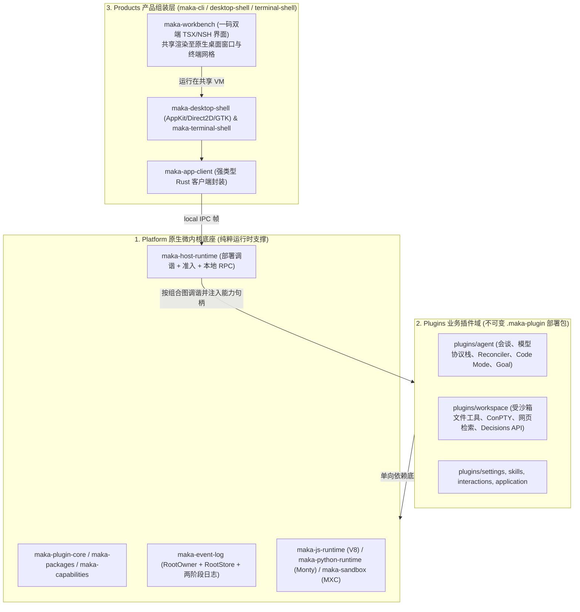
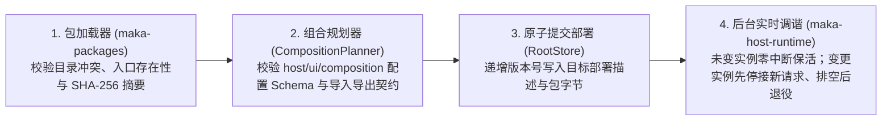

# 三层微内核架构与插件组合引擎

当一个 Agent 基础设施需要同时作为纯终端 CLI、原生图形桌面应用（macOS AppKit / Windows Direct2D / Linux GTK）、编辑器 ACP 服务端以及多插件可扩展平台交付时，旧有的“Electron + Node.js 单体进程”会暴露出三重硬伤：**界面代码被迫写两套、插件与核心运行时相互紧耦合、以及跨进程启动慢且内存占用高**。

Maka Rust 版通过彻底的微内核重构给出了全新的答案：**`Platform`（微内核底座）+ `Plugins`（业务插件域）+ `Products`（产品组装与一码双端工作台）**。本章解析这三层体系如何通过内容寻址插件包、声明式组合规划器、State Root 单写者队列以及 NSH 一码双端渲染引擎协同工作。

---

## 1. 为什么必须物理划分 `Platform`、`Plugins` 与 `Products`？

在传统应用中，开发者往往把“数据库读写”“模型请求循环”“沙箱逻辑”和“桌面界面控制”放在同一个庞大的运行时工程里。一旦想要新增一个沙箱驱动，或者让用户在不重新编译主程序的前提下安装一个新工具插件，整个架构就会牵一发而动全身。

Maka Rust 版确立了严格的**三层边界隔离**：



| 层级 | 核心定位 | 代表产物 / Crate | 职责红线 |
| :--- | :--- | :--- | :--- |
| **`Platform`** | 无业务偏见的微内核底座 | `maka-event-log`、`maka-host-runtime`、`maka-sandbox`、`maka-js-runtime` | 不包含任何与特定“Agent 提示词、工具或业务模型”绑定的逻辑；核心生命周期 Crate 甚至**不依赖 V8 或 Agent 引擎**，便于编译轻量系统辅助工具。 |
| **`Plugins`** | 可部署的业务领域单元 | `plugins/agent`、`plugins/workspace`、`plugins/skills`、`plugins/settings` | 每个叶子通过 `package.ts` 声明为 `host`、`ui` 或 `composition` 插件包；领域数据直接通过 SQL migration 挂载到 `RootStore` 上，不单独拆库。 |
| **`Products`** | 原生壳层与默认基线打包 | `products/maka/bundle`、`cli`、`desktop-shell`、`terminal-shell`、`workbench` | 注册编译进二进制的原生 Rust `HostService` 工厂，打包默认组合基线，驱动桌面原生窗口与终端工作台。 |

---

## 2. 声明式插件组合（Composition）与平滑热更新

在 Maka 中，**“安装插件”与“激活生效”是两件完全分离的事**。安装动作仅仅是将经过校验的 `.maka-plugin` 字节流写入本地不可变仓库；插件是否运行、拥有哪些权限、与谁绑定，完全由声明式的**组合图（Composition Graph）**决定。

### 2.1 四步收敛管线


1. **不可变内容寻址包**：`maka-packages` 加载 `.maka-plugin` 归档时，严格校验路径合法性（杜绝大小写碰撞和文件/目录重名冲突），确认 `maka.extension.json` 声明的 JS/UI 入口文件确实存在，并计算全包内容的 SHA-256 摘要作为身份。
2. **契约规划与配置校验**：规划器解析 `usePackage` 类型（`"host"`、`"ui"` 或 `"composition"`），通过 JSON Schema 校验每个实例的参数与能力绑定候选。
3. **热更新优雅排空（Zero-Downtime Reconciliation）**：更新部署组合时，`maka-host-runtime` 绝不会粗暴地重启整个 Host 进程：
   - **未变更的服务实例**保持在内存中持续运行，原有连接与状态句柄毫发无损；
   - **变更或移除的实例**先关闭新请求准入（Stop Accepting），等待所有已接纳的在途调用与物理资源清理全部结清后，才安全退役并拉起新版本实例。

### 2.2 基线与覆盖分离：`base.package + overrides`
默认发行的产品包通过 `base.package` 锁定官方基线组合，而用户在设置面板修改的工具列表或配置参数，全部作为增量 **`overrides`** 保存在独立字段中：
- `configurationFields` 支持精确到对象属性路径的局部修改（省略 `value` 代表删除字段，显式 `null` 则保留为 JSON `null`）；
- 所有持久化状态归属于 `(Root, deployment, instance)` 三元组。因此当用户升级 `maka` 到下一个版本替换基线包时，**用户的个性化定制完整保留，既有会话和插件状态命名空间完全不用迁移**！

---

## 3. 一码双端：`NSH` 共享工作台与热重载状态移交

在旧版架构中，桌面端基于 Electron Web 技术栈，而终端 TUI 往往需要另外写一套 Ink 或原生字符渲染代码，导致两个端的功能体验和交互逻辑长期割裂。

Maka Rust 版引入了统一渲染内核 **NSH（`third-party/nsh`）**，彻底实现了**桌面窗口与终端的一码双端同构**：
- **同一份 TSX 工作台源码**：`products/maka/workbench`（`app/App.tsx`）编写的界面逻辑运行在 NSH 工作台虚拟机（VM）中。
- **双端原生宿主渲染**：`maka-desktop-shell` 直接将其渲染为 macOS AppKit、Windows Direct2D、Linux GTK 的流畅原生桌面窗口（彻底告别笨重的 Chromium/Electron 进程）；而 `maka-terminal-shell` 则将同一棵 UI 渲染树输出到终端字符网格与终端像素协议中！
- **UI 扩展契约与热重载移交（`prepareReload()`）**：可信 UI 模块通过 `activate(context)` 贡献应用根节点（`root`）、带类型契约的嵌入式视图（`UiRuntime.renderView`）、面板、命令或工具卡片。其中 `context.services` 与 `context.operations` 自动绑定该实例声明的后端服务与两阶段操作账本。当开发或升级触发工作台热重载时，模块只需实现 `prepareReload()` 返回 JSON 状态快照，同一 `(instance, packageId)` 的新实例会通过 `context.restored` 无缝接管现场，底层 Host 连接与在途操作账本纹丝不动！

---

## 4. 不可变包校验与优雅热重载调谐状态机

下面的伪代码收拢了 `maka-packages` 在安装期的零信任归档校验，以及 `maka-host-runtime` 在运行时变更组合图时的零停机平滑排空协议：

```text
// === 1. 不可变插件包校验与摘要固定 (maka-packages) ===
function loadAndVerifyPackage(archiveFiles):
    assert not archiveFiles.isEmpty(), "Package cannot be empty"
    seenLowerPaths = new Set()

    for path in archiveFiles.keys():
        validateSafeRelativePath(path)
        assert seenLowerPaths.insert(path.toLowerCase()), "Case-colliding paths forbidden"

    manifest = parseJson(archiveFiles.get("maka.extension.json"))
    manifest.validateSchema()

    // 校验声明的 Host JS / UI 入口模块必须真实存在于归档中
    for entryModule in manifest.declaredEntryModules():
        assert archiveFiles.containsKey(entryModule), "Missing entry module: " + entryModule

    // 计算确定性内容摘要，固定不可变身份
    digest = sha256OfSortedEntries(archiveFiles)
    return new ImmutablePackage(manifest, archiveFiles, digest)

// === 2. Host 组合热更新与优雅排空调谐 (maka-host-runtime) ===
async function reconcileDeployment(liveInstances, targetDeployment):
    // 1. 计算差异：未变实例保持运行，保留既有绑定与内存态
    diff = diffDeployment(liveInstances, targetDeployment)

    // 2. 对变更或移除的旧实例：先停接新请求，等待在途 CallerIntent 与物理清理全部结清
    for oldInstance in diff.toRetire:
        oldInstance.stopAcceptingNewCalls()
        await oldInstance.drainInFlightCallsAndCleanup()
        await oldInstance.shutdown()

    // 3. 启动新增或升级后的实例，注入声明的能力句柄与持久化命名空间 (Root, deployment, instance)
    for spec in diff.toStart:
        caps = buildScopedCapabilities(spec.imports, spec.packageDigest)
        newInstance = await startServiceInstance(spec, caps)
        liveInstances.register(spec.instanceId, newInstance)
```

---

## 5. 总结

Maka Rust 版的三层微内核架构确立了清晰的物理与组合边界：**`Platform`** 做极简零 V8 微内核支持、`Plugins` 做严格内容寻址的可热插拔领域包、`Products` 用一套 NSH TSX 源码同时驱动桌面原生窗口与高性能终端。

接下来我们将进一步下钻进仓库的编译期物理边界：60 多个 Cargo Crate 如何在保证底层零循环、零 V8 污染的同时，还能凭借 `maka-schema` 实现向 TypeScript 工作台及第三方插件 SDK 的单一真相契约导出？请看下一篇：[Cargo Workspace 依赖拓扑与 Schema 代码生成](repository-map.md)。
