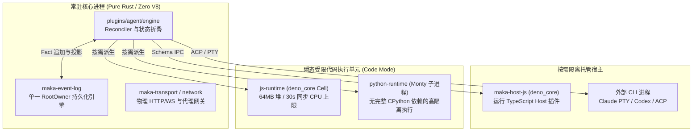

# 架构取舍与演化哲学：为什么重铸为 Rust 微内核？

## 1. 为什么从一套成熟的 TypeScript 平台彻底转向 Rust 微内核？

在软件工程史上，很少有团队会在前代系统（TypeScript + Node.js / Electron 架构）已经拥有完整插件体系、会话引擎与生产工具链的情况下，毅然另起炉灶用 Rust 重铸底座。做出这种选择的代价极其高昂，绝不是为了追求语言风潮，而是为了打破前代架构在**资源边界、故障恢复确定性、本地 OS 安全控制面以及宿主与运行时耦合并发**上的四道物理天花板。

在深入每一个子系统前，我们有必要先把这套 Rust 微内核最核心的“得与失（Trade-offs）”摆在台面上：它放弃了什么便利，又用这些复杂度换取了什么不可替代的能力？

---

## 2. 六大核心架构取舍矩阵

| 取舍维度 | 传统方案 / 前代 TS 架构的做法 | Maka Rust 微内核的方案 | 换取的核心收益 | 必须承担的代价与复杂度 |
| :--- | :--- | :--- | :--- | :--- |
| **核心引擎与 JS 运行时解耦** | 宿主、Agent 主循环与 UI 共享同一个 V8 进程 | Core Engine 纯 Rust 零 V8；仅在运行 JS 插件或 Code Mode 时按需拉起隔离 `deno_core` | 宿主空闲内存与冷启动开销骤降；模型流式循环完全不受 JS GC 停顿或插件死循环影响 | 跨 Rust/V8 边界必须设计严格的 WIT/Schema 桥接与异步消息队列 |
| **执行控制权模型** | 内存 `while` 循环驱动回合 + 本地钩子 | 状态机与副作用彻底分离：`RunView` 纯折叠 + Reconciler 意图派发 + Event-Log 持久化租约 | 宿主可在任意毫秒崩溃重启并无缝续接；天然消除事件顺序竞态 | 状态跃迁必须显式建模（`DriverClaim`、`PendingPublication`），代码体量显著增加 |
| **多语言代码沙箱持久化** | 尝试做内存快照（Heap Snapshot）或全量脚本重放 | **拒绝进程镜像与重放**：只持久化可序列化值与已加载工具注册表（`SessionDraft`） | 跨平台 100% 确定性；升级 Runtime 版本不会因二进制快照失效而损坏历史会话 | 非纯数据对象（如闭包、Socket 句柄）无法跨 Turn 驻留内存 |
| **本地安全隔离策略** | 依赖 Docker 容器、固定全局用户或事后权限提示 | 平台原生一等原语：Windows MXC + Linux `bubblewrap`/netns + macOS Seatbelt | 零特权弹窗、零 UAC 安装前置条件、极低启动延迟与精确路径遮罩 | 必须为三大 OS 分别维护底层系统调用适配，且坚持 Fail-Closed 永不静默降级 |
| **前后端状态投影与 UI** | 终端与桌面端各写一套 UI 逻辑，或强绑定 Electron/Chromium | 自研声明式原生 UI 协议 **NSH（TSX -> Desktop/Terminal）** | Desktop（AppKit/Direct2D/GTK）与 Terminal 共享同一套 TSX 工作台业务代码 | 无法直接复用庞大的现成 Web/React 生态库，组件体系需精简克制 |
| **Schema 演进与兼容性** | 手工维护接口文档，数据库按版本硬编码迁移脚本 | `maka-schema` 单向导出 TS/SDK 契约；不可变 `migrations.lock.json` SHA-384 锁校验 | 编译期即可卡死插件协议漂移；历史冷库升级可在 CI 中做时间胶囊重放验证 | 开发者修改任何持久化 Schema 都必须伴随不可逆的迁移校验流程，禁止事后偷改旧脚本 |

---

## 3. 深度剖析四个关键设计决策

### 3.1 决策一：为什么绝不在 Core Runtime 中常驻全局 V8，也不把系统绑死在单一脚本沙箱里？

前代系统的痛点在于：Agent 运行时自身就是跑在 Node.js 里的，这意味着即使只是等待大模型 SSE 流、读写 SQLite Event-Log 或管理后台定时器，整个进程也背负着完整的 JS 事件循环、堆内存与插件模块图。一旦某个扩展插件发生内存泄漏或微任务风暴，整个宿主协调器就会跟着雪崩。

Rust 微内核将这件事彻底切分成了三层物理边界：

这一刀切下去的代价是显著的：Rust 核心与 `maka-host-js` 中的 TypeScript 插件之间无法直接共享内存对象引用，一切能力调用都要经过显式的序列化（`OperationRequest` / `OperationReply`）与权限审批。但也正因如此，**任何插件崩溃或超时都最多只摧毁它所属的 Isolate 或子进程，绝对碰不到核心 Event-Log 与其它活跃 Session 的一毫一厘**。

### 3.2 决策二：为什么 Code Mode 拒绝做 VM 堆快照（Heap Snapshot）与指令重放？

当 AI Agent 在工具中调用一段 JS 或 Python 代码并希望“下个回合接着用刚才算出来的变量”，工程师脑海里通常会浮现两条捷径：
1. **Heap Snapshot**：在回合结束时直接把整个 V8 Isolate 内存或进程页 dump 到磁盘，下次再反序列化回来。
2. **Script Replay**：记录之前运行过的每一段代码，每次重启沙箱时把所有历史脚本从头重跑一遍恢复变量。

Maka Rust 内核果断拒绝了这两种看起来很“黑科技”的做法。在 `platform/code-runtime` 与 `platform/session-state` 的协作模型下，代码单元的持久化状态被严格收敛为 **`SessionDraft`（仅包含显式导出的可序列化键值对 `values` 以及动态加载工具清单 `loaded_tools`）**。

为什么这么选？
- **Heap Snapshot 的陷阱**：V8 或 Python 解释器的内存快照与引擎二进制补丁版本强绑定。一旦宿主升级了哪怕一个小版本的 `deno_core`，所有用户在磁盘上暂停的长程任务快照都会集体失效。
- **Script Replay 的灾难点**：AI 生成的脚本里往往包含文件修改、时间戳读取甚至网络重试。重放历史脚本极易酿成“在不知不觉中把删库或发邮件操作又跑了一遍”的致命副作用。
- **确定性数据契约的优雅**：虽然这意味着闭包函数或未导出的局部变量无法自动续命，但作为补偿，运行时能够在毫秒级内重建一个干净的 V8 或 Monty 上下文并注入精确状态，彻底消除任何不可重放的历史副作用。

### 3.3 决策三：为什么坚持 Fail-Closed（闭环失败）而非自动降级（Fallback）安全策略？

本地执行 Agent 最容易妥协的地方往往在沙箱兼容性上。比如发现当前 Windows 环境未开启沙箱驱动、或者 Linux 内核未启用非特权命名空间时，很多工具会选择打印一行黄色 `WARN: sandbox unavailable, running directly on host`，然后放任 Agent 裸奔执行终端命令。

`platform/sandbox` 对此采取了零容忍态度：**Fail-Closed（默认安全失败）**。
- 在 Windows 上，优先走原生 **Microsoft MXC**，实现零 UAC 弹窗、零本地账户污染；只有当用户的策略配置超出了 MXC 自身边界时，才允许显式回退至“低权限进程 + WFP 防火墙 + Job 作业对象”这一套同样严格受控的次级组合；若连底层边界都无法建立，直接拒绝启动，绝不放任裸执行。
- 当代理出口遇到策略外域名或恶意 HTTP 跳转时，`platform/network` 直接在宿主侧校验目标 `(host, port)` 并物理掐断连接，同时明确禁止在代理侧混入脆弱的脚本嗅探与自动豁免。

这一原则短期内确实会提高某些极端环境下的用户报错率，但它建立了一个无可争议的安全底线：**只要命令在 Maka 里成功跑起来了，它的文件与网络边界就必然正在被物理强约束**。

### 3.4 决策四：为什么将状态演化提升为与功能同等重要的“一等架构约束”？

Agent 应用有一个很现实的矛盾：AI 运行状态比普通 Web 应用更依赖本地持久账本（一跑就是几小时的会话记录、代码库检查点、外部操作收据和记忆证据），而基础设施代码几乎每周都在重构迭代。

如果只关注新版本跑得通，老用户一升级就会面对“旧账本解析 Panic”或“隐藏的语义偏移”。因此 `AGENTS.md` 把 **Persisted State & Upgrade Compatibility（持久化状态与升级兼容性）** 定为硬性工程基线：
1. **不可变锁定清单（`migrations.lock.json`）**：覆盖 `event-log`、`agent/state`、`settings/store`、`cli/deployment` 四大持久存储，用 SHA-384 摘要锁死所有历史迁移脚本与逻辑；任何试图“偷偷改写历史迁移文件”的行为在构建阶段就会失败。
2. **事务内数据重整（`Migration::with_data` inside `SAVEPOINT`）**：严禁只改表结构不管老数据内容，一切复杂旧记录清洗必须在事务安全保存点内原地完成。
3. **事实与派生索引物理分离**：只有原始 `Fact` 是神圣不可侵犯的；诸如 FTS 全文搜索或召回（Recall）辅助索引全部定义为可丢弃、可随时由事实重放恢复的派生投影，大幅降低了跨大版本演化时的脆弱耦合。

---

## 4. 两条路线该如何对话：TS 版与 Rust 版的定位关系

理解这些取舍之后，我们就更容易定位“TypeScript 经典版”与“Rust 微内核版”在工程教学与实战上的互补价值：

- **TypeScript 版（`maka-agent-infra`）** 胜在“逻辑高内聚、代码即文档”：从流式循环 `AiSdkTurn` 到事件投影与插件体系，全栈用统一的异步语言打通，非常适合用来快速吃透通用 Agent Runtime 的交互骨架、流控闭环与工具协议语义。
- **Rust 微内核版（`maka-rust-agent-infra`）** 则把视角推向了“系统级可靠性工程”：当你开始关心 **进程崩溃恢复的数学一致性（Reconciler + Obligation Frontier）、跨零拷贝大账本处理（CaptureArena）、操作系统内核级沙箱与无特权网络隔离、以及微内核驱动外置 CLI（Claude/Codex/ACP）时的统一主权边界** 时，这套 Rust 架构给出了目前业内极具参考价值的答案。

---

## 5. 总结

Maka Rust 微内核并非对前代功能的简单翻译，而是一次从“脚本宿主”向“操作系统级自治运行时”的范式迁移：通过剥离常驻 JS 运行时保住确定性，通过拒绝状态快照换取跨版本健壮性，通过强化领域类型与不可变账本把最难测试的并发崩溃竞态关进编译期与事务边界之内。

至此，`00-foundations` 基础篇已全部完结。接下来我们将直接进入这套微内核最核心的心脏部位——**01 运行时与驱动编排篇**：[Reconciler 与 Obligation Frontier：如何用纯意图驱动消除运行时竞态？](../01-runtime/reconciler-and-obligation-frontier.md)。
