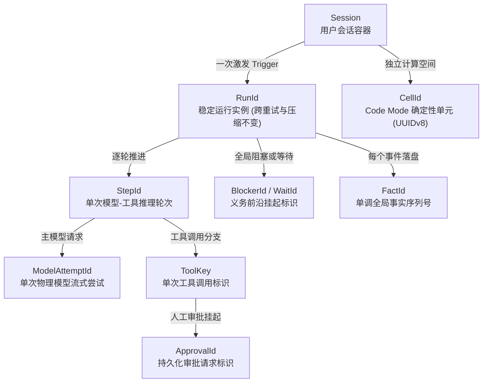
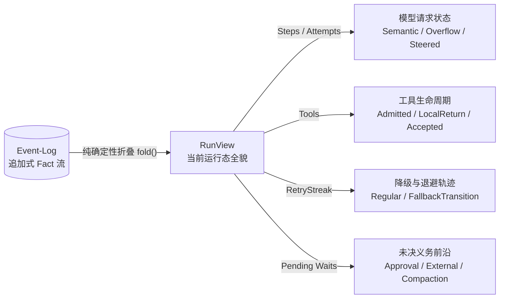
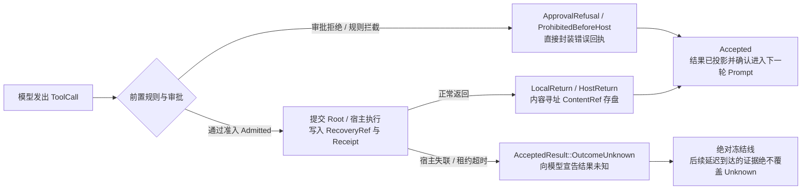

# 领域模型：`RunId`、`Fact`、`RunView` 与操作语义

## 1. 为什么 Agent 需要“不可篡改的领域词汇表”？

在原型期的 Agent 脚本里，开发者习惯用一个大而全的 `SessionState` JSON 对象承载所有运行时信息：消息列表直接 `push`，工具状态原地修改 `status = "done"`，上下文压缩直接覆盖历史数组，超时重试直接改写重试计数。这种“可变状态快照（Mutable Snapshot）”模型在单步短对话里运行良好，一旦进入长程后台执行、宿主崩溃重启、子会话接力或并发审批流，就会暴露出三个系统性难题：

1. **身份混叠（Identity Aliasing）**：一次对话重连或分支（Fork）后，旧回合的执行片段与新回合共用同一个可变容器，无法区分某条结果究竟归属于哪一次尝试。
2. **结果丢失与幻影重放（Phantom Replay）**：宿主在工具返回后、写入对话历史前崩溃，重启后既找不到当时的原始输出，也不敢盲目重跑具有副作用的写操作。
3. **语义污染（Semantic Contamination）**：为了让 LLM 继续工作而强行截断、摘要或注入的提示文本，如果与真实发生过的历史事实混存在同一个数组里，模型与审计系统就再也无法分辨“真正执行过什么”和“后来重投影成什么”。

Maka Rust 微内核放弃了“原地修改状态对象”的思路，转而围绕 `maka-agent-facts` 与 `maka-agent-state` 构建了一套严格单向推进的领域模型：**一切客观发生的动作追加为不可变 `Fact`（事实），一切瞬时运行态通过纯确定性折叠函数投影为 `RunView`（运行视图），一切外部副作用通过操作凭据（`OperationRequest` / `RecoveryRef` / `RecordedOutcome`）按内容寻址回收**。

---

## 2. 领域身份体系：强类型 Newtype 与确定性 UUIDv8

在 Rust 领域边界中，ID 不是裸露的 `String`，而是一组编译期互不兼容的强类型包装（Newtype），从根源上杜绝“把 StepId 传给 ToolKey”或“拿 SessionId 冒充 RunId”的整类低级错误。

### 2.1 分层标识符谱系



### 2.2 为什么 `RunId` 必须跨接力、重启与压缩保持稳定？

传统 Runtime 常常将“一次进程内循环”或“一次连续上下文窗口”等同于一个运行实例；一旦触发上下文压缩（Compaction）或检查点交接（Checkpoint Handoff），就会换一个新的运行 ID。这会导致一个致命后果：**前端订阅面板、目标计费器（Goal Meter）和父会话回调（Room `@mention`）无法在跨压缩边界时持续追踪同一笔任务的生命周期**。

在 Maka Rust 微内核中，`RunId` 代表从用户或系统激发（`Trigger`）开始，直至该任务最终收敛到终态（`Terminal`）的**完整逻辑周期**。无论期间经历多少次宿主演进重启、多少轮主动上下文压缩（`ContextCompact`），甚至经历基于 Git 检查点的接力（`CheckpointHandoff`），其外显的 `RunId` 始终稳定不变；真正变化的是内部的 `StepId`、`ModelAttemptId` 与被压实的历史基线（Watermark）。

### 2.3 `CellId` 的确定性命名空间推导

Code Mode（V8 / Monty 沙箱单元）同样拥有严谨的身份规则。`CellId` 并非随机生成的 UUIDv4，而是分别通过 `CellId::for_agent(...)` 与 `CellId::for_external(...)` 基于所属主体身份（例如会话作用域与单元键）推导出**确定性的 UUIDv8**。

这种确定性设计带来的直接工程红利是：
- **幂等重连**：进程重启后，驱动无需额外查一张“会话到随机沙箱 ID”的脆弱映射表，仅凭会话域坐标就能推算出唯一对应的 `CellId`。
- **天然隔离**：内部 Agent 单元（`for_agent`）与外部受管调用（`for_external`）在命名空间密码学层面上彻底正交，绝无碰撞可能。

| 领域标识符 | 作用域与生命周期 | 生成方式与关键语义 |
| :--- | :--- | :--- |
| **`RunId`** | 单次任务完整生命周期 | 跨进程崩溃、跨模型重连、跨上下文压缩保持绝对稳定 |
| **`StepId`** | 单轮推理与工具集结算 | 每个 Step 包含一次 `ModelAttempt`（含退避重试）及对应 `Tool` 结算 |
| **`ModelAttemptId`** | 单次物理 LLM 网络请求 | 网络抖动重试或上下文溢出恢复时会递增生成新 Attempt |
| **`FactId`** | 全局 Event-Log 追加序号 | 不可逆的事实游标，用于 `Read` 水位线（Watermark）与幂等发布校验 |
| **`ApprovalId` / `WaitId`** | 人工交互与异步挂起凭证 | 与外部世界交互的“未履行承诺”，关闭前 Run 不得进入完成态 |
| **`CellId`** | 代码执行沙箱作用域 | 通过 `for_agent` / `for_external` 确定的 UUIDv8，跨重启可重新推导 |

---

## 3. 运行起源（`RunOrigin`）与激发源（`Trigger`）

一个 `Run` 从哪里来、为何而起，必须在创建首条 `Fact` 时作为不可变元数据写死，而不是靠后期日志推断。Maka 将这两个正交维度拆分为 `RunOrigin` 与 `Trigger`：

- **`RunOrigin`（身份谱系）**：
  - `Local`：原生在当前宿主 Event-Log 中新建的运行。
  - `Imported`：从历史或外部会话归档导入（Session Import）的运行，保留来源审计边界。
  - `Forked`：从既有会话或运行检查点分叉出的平行探索分支。

- **`Trigger`（激发原因）**：
  - `Message`：由用户显式消息或房间（Room）`@mention` 注入激发。
  - `Schedule`：由系统后台调度器定时唤醒。
  - `Goal`：由长程目标（Goal）引擎驱动的新一轮推进迭代。
  - `Continuation`：针对输出受限（Output Limit）或特定恢复策略发起的自动续跑。
  - `CheckpointHandoff`：接手外部工作区检查点后开启的新执行体。
  - `ContextCompact`：由主动摘要压缩触发的专门维护轮次。
  - `HistorySource`：用于重放或还原历史视图的来源标记。

将 `Origin` 与 `Trigger` 显式枚举化的意义在于：**调度器（Reconciler）可以根据 `Trigger` 类型自动应用截然不同的预算、工具权限天花板与 UI 展示策略**。例如，`ContextCompact` 轮次只需极简的工具白名单与独立的预算槽位，而 `Goal` 触发的运行则会自动挂载 `Meter`（用量计量器）与目标停止条件检查。

---

## 4. 核心事实与 `RunView` 折叠模型

`plugins/agent/facts` 定义了“写入磁盘的客观历史”，而 `plugins/agent/state` 则负责将这一长串线性的 `Fact` 流，通过纯函数折叠（Fold）为内存中可直接用于决策的结构化切片 `RunView`。



### 4.1 `Attempt` 状态的精细刻画与 `compactable_overflow()`

一次模型请求失败，在粗糙系统里只是一句 `error: string`。但在 Maka Rust 版里，`Attempt` 在 `RunView` 中携带了精确的阶段与语义标签：

- **语义落地判定（`semantic` / `has_tools`）**：模型响应是否已经产生可进入规范日志的语义内容或工具调用意图。
- **中途打断（`interrupted`）**：是否被用户 Steering、取消信号或网络断流截断。
- **特定恢复意图（`recovery: Option<AttemptRecovery>`）**：明确区分“可降级上下文溢出（`ContextOverflow`）”与普通网络超时。

`Attempt::compactable_overflow()` 展示了一个极高水准的边界判定规则：只有当某次尝试满足 `interrupted.is_some() && !semantic && !has_tools && matches!(recovery, ContextOverflow)` 时，才认定它是“纯上下文溢出且未向规范日志提交任何有效语义输出”。压缩器（Compaction）便可以放心地将这次失败尝试彻底剔除出投影基线，确保后续重放（Replay）绝不会把一段残缺废话重新喂给模型。

### 4.2 Steering 打断的显式闭环：`ModelClosure::steered()`

当用户在模型正在思考或流式输出时发出新的纠正指令（Steering），内核不会粗暴地直接 `kill` 任务后假装刚才那次请求从未发生，而是写入一个标准的闭合记录 `ModelClosure`：
- 将计费与状态结果记为 `Outcome::Aborted`。
- 将诊断标识固定为 `"Model request superseded by steering"`。

当 Reconciler 折叠 `RunView` 并调用 `closure.steered()` 发现这一精确语义时，就能优雅地放行下一条 Steering 消息直接入列重算，而不是把它误判为“需要退避重试的 API 故障”。

### 4.3 `RetryStreak` 三态机：避免“主备切换时的伪连续失败”

在多模型或备用通道（Fallback）架构中，如果主模型连续失败 2 次后触发自动切换，备用模型在刚切过去的瞬间又遇到一次偶发网络抖动，传统计数器会误判为“累计失败 3 次，直接终止 Run”。

`maka-agent-state` 引入了三态的 `RetryStreak`：
1. **`Regular`**：常规同一后端下的连续失败计数。
2. **`FallbackTransitionPending`**：已判定需要切换备用后端，切换动作尚未落地。
3. **`AfterFallbackTransition`**：刚刚完成备用后端切换。当新后端首战尝试获得干净起点时，可剥离旧后端积累的疲劳惩罚，使真正有价值的 Fallback 机会不被历史计数误杀。

---

## 5. 工具调用状态机与“永不覆写的 Unknown 铁律”

如果说模型请求只是一进一出的流，那么工具调用（`Tool`）就是充满异步断裂点的险恶地形。`fold.rs` 为每一个 `ToolKey` 维护了多阶段字段，完整追踪它从模型吐出意图到彻底被模型“消化”的全过程：



### 5.1 工具在 `RunView` 中的七重证据槽位

1. **`decision` & `approval_refusal`**：记录策略引擎对本次调用的判定（直接放行、禁止还是挂起等待 `ApprovalId`），以及拒绝时的明确交互结局。
2. **`prohibited_before_host`**：若在未触达 Host 前就已被策略或输出上限（例如截断的工具调用参数）否决，直接短路沉淀为 `ToolRejection`。
3. **`original: Option<RecoveryRef>` & `receipt: Option<Receipt>`**：一旦工具进入“物理提交/两阶段操作”轨道，先持久化不可变的恢复凭证，再追踪宿主回执。
4. **`local_returned` / `host_returned` / `provider_result`**：清晰区分该结果究竟来自本地插件执行、宿主跨边界调度，还是大模型服务商原生代执行工具（Provider-executed Tool）。其中本地与宿主返回体通过 `ContentRef`（字节长度 + 摘要）脱离主事实流存储，防止巨型终端输出撑爆状态折叠性能。
5. **`accepted: Option<ToolAcceptance>`**：整个状态机最关键的终点印记——**不仅执行完了，而且已经成功向模型上下文提交并被模型接收**。

### 5.2 为什么 `outcome_unknown_accepted()` 是一条铁律？

假设一个长耗时脚本工具在宿主崩溃重启时失去了租约（Lease），内核按照容错规则在等待窗口到期后判定其结果不可知，于是构造了一个 `AcceptedResult::OutcomeUnknown` 的工具响应注入上下文，让模型基于“该命令可能已执行也可能未执行，请先检查现状”继续推理。

过了一会儿，某个迟到的后台进程恢复通信并补交了一份真实的执行输出（Late Evidence）。系统应当用这份新输出去悄悄替换刚才的历史记录吗？**绝对不行！**

Maka 在 `Tool::outcome_unknown_accepted()` 中立下不可动摇的协议约束：**只要模型已经被告知了 `OutcomeUnknown` 且进入后续推理，任何迟到的执行结果证据永远不得替换既成历史**。原因很简单——模型此后的整个决策树都建立在“上次结果未知”这一认知前提上；如果在历史账本里把“未知”偷偷篡改成“成功”，日志重放时模型看到的上下文与它当初做决策时看到的上下文就会发生时间线分裂，直接摧毁确定性与可审计性。

---

## 6. 外部操作与内容寻址回收：`RecordedOperationResult`

当 Agent 调用一个通过 `maka-plugin-core` 注册的宿主或插件能力时，操作往往具有真实的外部副作用（创建文件、调外部 API、执行容器命令）。内核与 Event-Log 之间通过 `RecordedOperationResult` 建立了一套既抗膨胀又防篡改的内容寻址契约：

```rust
// 教学化提炼自 plugins/agent/facts/src/operation.rs
enum RecordedOperationResult {
    Success { value: JsonValue },                    // 轻量成功结果内联存储
    Failure { diagnostic: String },                  // 轻量失败诊断内联存储
    Referenced { content: ContentRef, is_error: bool } // 大体积结果仅保留摘要指针
}
```

这套结构配合 `same_result()` 与 `same_outcome()` 解决了一个棘手的恢复验证问题：**如果操作在 Root 侧已经完成并写入了 `ContentRef` 大对象存储，当 Agent 引擎崩溃后通过 `RecoveryRef` 拿着原始操作回复来对账时，即使一个是 `Referenced` 摘要指针、另一个是内联还原后的完整 `Success`/`Failure`，系统也能在序列化后通过 `bytes.len() == content.bytes && content_digest(bytes) == content.digest` 完成零歧义的等价性校验**。

只有先确认“成功还是失败一致（`is_error()`）”且“内容摘要与字节数精确吻合”，系统才会放行跳过重复执行并恢复现场；一旦发现有任何不一致，宁可阻断并报告异常，也绝不悄悄吞掉半吊子副作用。

---

## 7. 总结：领域不变量的工程闭环

回看 Maka Rust 版的整套领域模型，你会发现它几乎把传统 Agent 架构中最隐蔽的“口头约定”全部提升为了类型与协议级别的不变量：

1. **ID 不混用**：`RunId`、`StepId`、`ModelAttemptId`、`ToolKey`、`CellId` 编译期正交；其中 `RunId` 贯穿整个任务周期，`CellId` 由作用域确定性推导。
2. **真相不覆盖**：`Fact` 只追加不篡改，运行视图完全由 `fold()` 确定性算出；溢出废物片段可通过 `compactable_overflow()` 安全剔除，而一旦向模型宣布 `OutcomeUnknown`，时间线便永久锁定。
3. **副作用可对齐**：外部操作结果借由 `RecoveryRef` 与 `ContentRef` 内容摘要完成两阶段对账，既有极致的账本轻量度，又不失严格幂等性。

下一篇我们将把视角拉高到架构全局：剖析 Maka Rust 微内核在零 V8 核心、OS 原生沙箱、协议直连与前向兼容性背后，究竟做出了哪些硬核的取舍与代价交换——[架构取舍与演化哲学](./design-tradeoffs.md)。
