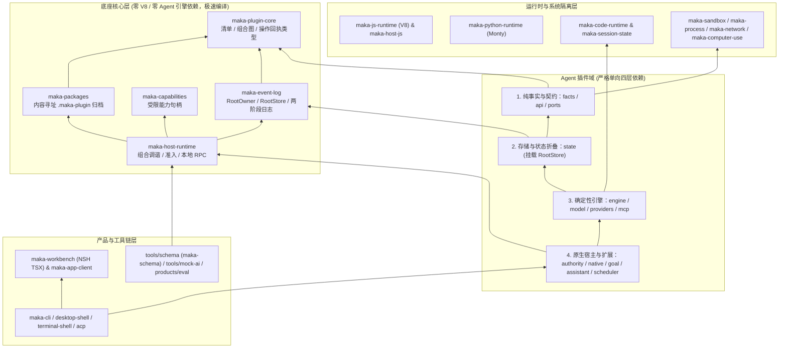
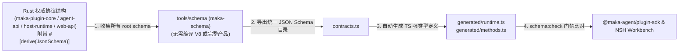

# Cargo Workspace 依赖拓扑与 Schema 代码生成

[返回手册目录](../README.md)

当一个用 Rust 编写的平台同时囊括了嵌入式 V8 引擎（`deno_core`）、SQLite 存储底座、操作系统沙箱（MXC/Seatbelt/`bubblewrap`）、桌面辅助进程、模型网络协议栈以及客户端工作台时，如果不严格规范模块间的编译边界，哪怕只是改动了一个前端展示字段，也可能触发全量重编 V8、拖慢整个研发循环，甚至引发隐蔽的循环依赖。

Maka Rust 版通过**清晰的 Workspace 目录划分、领域内单向 Crate 分层，以及脱离重型依赖的 `maka-schema` 契约代码生成机制**，在庞大的 60+ Crate 工程中维持了极佳的编译隔离度与边界纯粹性。

---

## 1. 概念先行：部署包（Package）与编译单元（Crate）分离

阅读 Maka Rust 源码时，首先要分清两个容易混淆的边界：
- **插件部署包（`package.ts`）**：是面向运行时和热部署的**逻辑组装单元**，声明自己是 `host`、`ui` 还是 `composition` 包，携带配置 Schema 与服务导入导出契约。
- **Cargo Crate（`Cargo.toml`）**：是面向 Rust 编译器的**物理编译单元**。两者不必强求一一对应——**对于逻辑极其复杂的 Agent 领域，内部沿单向依赖拆成十余个细分 Crate；而对于一组体积轻巧的相关插件，则可以共享同一个原生实现 Crate。**

---

## 2. 60+ Crate 全景分层拓扑图

### 为什么底座核心层拒绝依赖 V8 和 Agent 引擎？
注意图中最底层标出的核心生命周期 Crate（`plugin-core`、`packages`、`capabilities`、`event-log`、`host-runtime`）：它们**彻底零依赖 `deno_core`（V8）或 `maka-agent-engine`**。
这带来了巨大的工程红利：
1. **毫秒级辅助二进制编译**：诸如 `maka-schema`（契约生成器）、独立的沙箱验证程序（如 `windows_mxc.exe` 验收器）以及轻量级 Host 工具，无需把上百兆的 V8 静态库编进二进制就能独立编译运行。
2. **绝不产生向上回环**：底层存储与调度底座永远不可能偷偷耦合上层某个具体 Agent 工具或提示词格式。

---

## 3. Agent 领域内部的严格四层单向依赖

作为全库最复杂的核心域，`plugins/agent/` 内部被精细切分为四层单向 Crate，确保“客观事实”、“确定性折叠”、“决策状态机”与“物理副作用执行”各司其职：

| 层次 | 包含 Crates | 核心职责与允许依赖边界 |
| :--- | :--- | :--- |
| **第一层：纯事实与契约** | `maka-agent-facts`、`maka-agent-api`、`maka-agent-ports` | 定义不可变持久化事实结构、对外 RPC 与 `schemars` 工具契约、抽象执行接口。**不持有任何运行时句柄、数据库连接或 async executor。** |
| **第二层：存储与状态折叠** | `maka-agent-state` | 在共享的 `RootStore` 上注册不可变 SQL 迁移，执行原子事实追加，并在同一写事务内将事实确定性折叠成 `RunView`、历史快照、Recall 索引与用法统计。 |
| **第三层：决策引擎与协议** | `maka-agent-engine`、`maka-model`、`maka-providers`、`maka-provider-protocol`、`maka-mcp`、`maka-tools` | 实现唯一的确定性调谐器 `reconcile::next_action`、85% 前瞻摘要、`CaptureArena`、纯 Rust 模型协议栈及 `rmcp` 客户端。**完全不接触底层 Host 锁或进程句柄，可通过纯内存/模拟端口极速单测。** |
| **第四层：原生宿主与能力集成** | `maka-agent-authority`、`maka-agent-native`、`maka-goal`、`maka-assistant`、`maka-scheduler`、`maka-agent-acp-executor` | 持有活跃实例租约与单驱动声明 `DriverClaim`，将 `RunSpec` 与工作区权限求交集，绑定物理沙箱与外部 CLI 驱动并调度就绪任务。 |

---

## 4. `maka-schema`：跨语言 TypeScript SDK 契约的唯一权威

既然服务端、Agent 内核和 Host 全部是 Rust，而 UI 工作台（`maka-workbench`）和第三方 JS 插件（`@maka-agent/plugin-sdk`）依然使用 TypeScript 编写，如何杜绝“Rust 改了一个枚举字段名，TypeScript 那边还在读旧字段导致线上静默反序列化失败”？

Maka 专门构建了 **`maka-schema`（位于 `tools/schema`）** 作为跨语言单一契约生成引擎：

- **单一真相来源**：Rust 端所有跨进程或跨 VM 边界传递的结构体均强制标记 `#[serde(deny_unknown_fields)]` 与 `#[derive(schemars::JsonSchema)]`。
- **CI 强制门禁**：修改任何 Rust 协议结构后，开发者运行 `npm --workspace @maka-agent/plugin-sdk run schema:generate` 自动刷新 TS 类型；CI 流程运行 `schema:check`，一旦发现生成文件与 Rust Schema 目录存在哪怕一个字节的漂移，构建立刻失败阻断合并。

---

## 5. 目录导航速查表

| 顶层目录 | 物理定位 | 核心构成 |
| :--- | :--- | :--- |
| **`platform/`** | 通用底座 Crates | `event-log`、`host-runtime`、`plugin-core`、`packages`、`capabilities`、`js-runtime`、`python-runtime`、`code-runtime`、`session-state`、`sandbox`、`process`、`network`、`computer-use`、`transport`、`presentation`、`i18n`、`ui-support`、`background-health` |
| **`plugins/`** | 业务领域插件 | `agent/`（18 个分层 Crates）、`workspace/`（文件/进程/Web/Decisions API/Computer）、`settings/`、`skills/`、`interactions/`、`application/`、`shared/` |
| **`products/`** | 可执行交付物 | `maka/`（`cli`、`desktop-shell`、`terminal-shell`、`workbench`、`bundle`、`acp`、`client`、`native`、`updater`、`wsl-bridge`）、`eval/` |
| **`tools/`** | 研发与测试工具 | `schema/`（SDK 生成）、`mock-ai/`（Rust 协议模拟服务器）、`ui-build/`、`i18n-build/` |
| **`third-party/`** | 锁定源码的原生依赖 | `nsh`（双端渲染底座）、`gix-discover`/`gix-index`、`sqlx-sqlite`、`deno-node-sqlite`、`playwright`、`reqwest` 等 |
| **`packages/`** | 对外发布的 JS 包 | `plugin-sdk/`（由 `maka-schema` 自动生成的插件开发 SDK） |

---

## 6. 延伸阅读

- 深入理解第一层 `maka-agent-facts` 与第二层 `maka-agent-state` 如何协作折叠状态，阅读 [00.3 领域事实与状态折叠](domain-model.md)。
- 了解 `plugins/agent/engine` 如何基于这些分层构建统一的 Reconciler 循环，阅读 [01.1 统一 Reconciler 与义务前沿](../01-runtime/reconciler-and-obligation-frontier.md)。
- 了解第三方开发者如何利用 `@maka-agent/plugin-sdk` 编写可热重载的插件与 UI 扩展，阅读 [01.4 V8 HostService 与 NSH UI 插件](../01-runtime/host-plugins-and-ui-runtime.md)。
