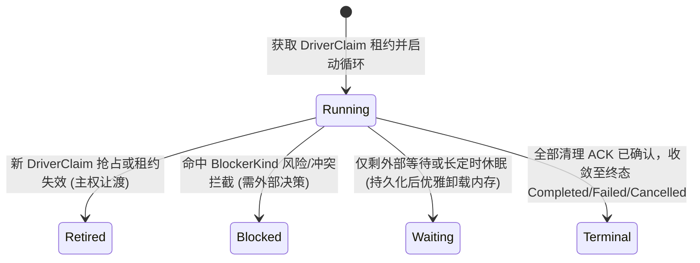
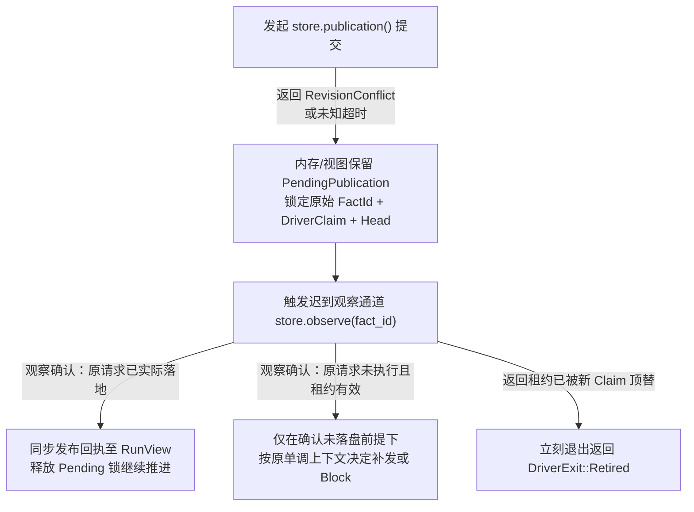

# Driver 生命周期与执行准入：双阶段占锁与跨重启发布对账

## 1. 纯调谐器之后，谁来真正脏手脏脚地干活？

在上一篇里我们看到，Reconciler 是一台纯内存、零副作用的“战略大脑”，它只负责从 `RunView` 和 `Live` 计算出一个冷冰冰的 `Action` 枚举值。但现实世界是充满摩擦和意外的：
- 数据库同一时刻可能被上一个刚崩掉的 Worker 残留实例锁着，或者两个负载均衡节点同时想拉起同一个 `RunId`；
- 当 `Action` 决定发起一次模型调用，或把一个外部任务（External Task）结果发布给模型时，万一在“刚刚发出去”到“确认落盘 Event-Log”之间的几毫秒里宿主机断电了怎么办？

在 `plugins/agent/engine` 中，承担这一重任的组件就是 **`Driver`**。它一头对接 `maka-event-log` 与持久化状态库，另一头调度真正的异步执行任务（Model Stream、Host Operations、Code Cell、External CLI），并围绕 **`DriverClaim`（驱动主权租约）**、**`PendingPublication`（悬空发布对账）** 和 **策略准入（Admission）** 构建起了防双写、防丢单、防陈旧的物理执行护城河。

---

## 2. Driver 的主循环与四大退出终态（`DriverExit`）

在分布式或多线程嵌入式宿主中，一个 Run 并不总是靠单个循环从头跑到尾就能结束。如果 Run 需要暂停等待人类点击一个耗时半小时的审批弹窗（`WaitReason::Approval`），或者正在等待后台定时的退避窗口，把一个庞大的异步状态机和缓冲对象永久常驻在内存里，是对内存与连接池的巨大浪费。

`driver.rs` 为此明确定义了 `DriverExit` 的四大合法撤离姿态：



这四态区分极其精准地治理了“何时该释放内存”：
- **`Retired`（主动退位）**：检测到当前进程持有的 `DriverClaim` 已非数据库最新版本（例如被新接入的宿主实例接管），立即停止向 Event-Log 写新事件并安静退出，彻底避免脑裂双写。
- **`Waiting`（休眠退场）**：当 Obligation Frontier 上只剩长期等待（例如等待子 Run、人工审批或漫长的 Retry 冷却）时，Driver 可以安全退出内存释放所有句柄；待唤醒条件触发时，宿主只需从磁盘重新 `fold()` 出 `RunView` 即可无缝拉起一个新的 Driver 接班。
- **`Blocked`（风险冻结）**：遇到不可自动消解的风控拦截、外部发布冲突或无法确认安全恢复的 Code Cell 时停机留现场，等待系统策略层注入 `BlockerDecision` 后唤醒。
- **`Terminal`（彻底终结）**：只有在 `reconcile::next()` 确认物理清理 ACK 全数落定后才会返回，标志着本次 Run 正式画上句号。

---

## 3. 执行主权防线：`DriverClaim` 与事件写入校验

如何确保在宿主重启、多客户端重连或网络超时重试时，绝对不会出现“前任僵尸 Driver 慢了一拍，往 Event-Log 里追加了一条过时状态，把现任 Driver 盖掉”的问题？

答案是持久化租约 **`DriverClaim`** 配合严格的单调头校验（`Head` / `Revision`）：

```rust
// 教学化提炼自 plugins/agent/engine/src/driver.rs 与 execution 契约
struct PendingPublication {
    id: ExternalPublicationId,
    fact_id: FactId,       // 保留最初拟写入发布声明时的原始 FactId
    claim: DriverClaim,    // 发起本次发布时持有的执行主权租约
    head: LogHead,         // 发布前的 Event-Log 水位头指针
}
```

每次 Driver 试图向宿主或 Event-Log 写入任何具状态推进效力的事实时，底层存储必须校验：**传入的 `DriverClaim` 是否仍等于当前主库记录的有效持有者，且预期的 `Head` 未发生分叉冲突**。一旦检测到 `RevisionConflict` 或 `ClaimSuperseded`，写入立即被原子拒绝，当前 Driver 顺势自我判定进入 `DriverExit::Retired`——既保住了账本纯净度，又省去了繁琐的跨进程分布式互斥锁维护。

---

## 4. `PendingPublication`：悬空发布状态的双通道对账机制

`driver.rs` 中最精妙的容错细节之一，莫过于对 **`PendingPublication`**（待决发布）的跨故障对账。

设想以下情景：外部任务（如 Codex CLI 或 ACP 代理）已经干完活产生了一组发布项，Driver 决定调用 `store.publication(...)` 把这批变更正式确认发布（Publication）。就在此时，网络卡顿或局部超时导致 Driver 无法直接判断这次 `store.publication` 调用究竟在存储/外部侧成功落地了没有。

如果简单放弃并重试一次发布，或者直接假设失败，都会造成状态分裂。因此 Driver 保留了包含原始 `FactId`、`DriverClaim` 和当时日志游标 `Head` 的 `PendingPublication` 结构，并在重连或下一轮巡检中按以下流程调谐对账：



保留“最初拟发出动作时的 `FactId`”是整套对账设计的灵魂所在：**观察接口 `store.observe` 查的不是一个模糊的业务关键词，而是那笔唯一单调的原始意图凭证**。因此无论中间经历多少次超时、丢包或队列阻塞，对账系统都不会张冠李戴，把前朝旧账误当成今朝新果。

---

## 5. 执行准入（Admission）：把政策锁死在消息入队的那一刻

Agent 系统在长跑过程中，经常遇到“任务排队等待时，用户在设置页面把默认模型改掉了，或者把允许的工具模式切换成了只读”的情况。如果运行时在执行每一步时都直接去读全局最新配置，就会导致同一个 Run 上半场按规则 A 思考、下半场突然用规则 B 结算，甚至破坏模型提示缓存前缀，埋下严重越权隐患。

在 `plugins/agent/native/src/model.rs` 中，Maka 通过 **`AcceptedModel`（已接纳模型契约）** 将准入策略与动态凭据做了手术刀般的切分：

| 维度 | 冻结时机（Immutable at Admission） | 运行时解析时机（Dynamic per Request） |
| :--- | :--- | :--- |
| **策略边界字段** | `model_binding`、`service_tier`、`thinking_level`、`tool_mode`（工具模式）、`code_language`（JS/Python）、`editing_tools`（允许的编辑工具子集） | 绝不随消息排队后全局配置变动而中途篡改 |
| **路由不变式** | `ExecutionRoute { adapter, protocol, base_url }` | 用于校验后续动态解析出的账号通道是否悄悄偏离了原批准协议栈 |
| **认证与动态观测** | 仅记录公开的模型元信息基线 `public_model` | **不冻结秘钥与活体句柄**：每次物理发起请求前动态通过 `AuthResolver` 读取账号级最新有效 Token 与限流观察 |

这一划分（“策略随消息冻结，凭据随请求现取”）同时解决了两个看起来互相矛盾的痛点：
1. **策略安全性**：用户在排队期间修改设置只会影响**新发送的消息**，正在跑的既定任务绝不会被中途篡改工具权限或编程环境；更不会在 `AcceptedModel` 里持久化敏感明文凭据。
2. **认证高可用**：如果长任务跑了 40 分钟，期间 OAuth Access Token 过期并由刷新器在后台换成了新 Token，动态解析通道依然能 seamless 获取最新凭据让请求顺利续命，而不用因为准入快照里的旧 Token 过期而整单报废。

---

## 6. 多阶段退避与策略重试判定（`Retry` & `RetryStreak`）

在 `Driver` 驱动物理层请求失败后，能否重试、什么时候重试，并不是靠局部 `for i in 0..3` 循环决定，而是完整写回 `Fact` 并经由 `RunView` 表达为 **`Retry { phase: RetryTransportPhase, due_at: UnixMillis, diagnostic }`** 与 **`RetryStreak`**：

- **传输阶段精细区隔（`RetryTransportPhase`）**：区分“连接建立前失败（还未发出语义消耗）”、“流式首包前失败”、“传输半途断流”。
- **计时与唤醒协作**：一旦命中可恢复错误并算出 `due_at`，Engine 写入带到期时间的 `WaitReason::Retry`；Driver 可以选择短暂等待到期，或者在跨级长退避时先退位（`Waiting`）交由定时器到点再重装唤醒。
- **跨通道切换不连坐（`RetryStreak::FallbackTransitionPending` / `AfterFallbackTransition`）**：当主渠道连挂后自动切至备用供应商时，利用三态追踪隔离主渠道残留的失败连续度，防止主渠道的锅直接扣在刚刚上线热身的备胎模型头上。

---

## 7. 总结

`Driver` 层的工程价值在于它教会了我们一个重要原则：**在可靠系统里，“启动执行”和“确认执行结束”一样昂贵**。
- 通过 **`DriverExit` 四态退出**，长等待任务与主权切换不再造成内存死挂或脑裂；
- 通过 **`DriverClaim` + `PendingPublication`**，即便在存储提交与确认回执之间撕裂崩溃，引擎也能顺着原始 `FactId` 完成确定性追账；
- 通过 **`AcceptedModel` 准入冻结与路由不变式校验**，策略稳定性和动态 OAuth 秘钥刷新得以各司其职、互不污染。

当我们通过 Driver 的准入检查、真正握紧了 `DriverClaim` 后，接下来就要直接面对大模型流式传输网关的复杂协议世界。下一章深入剖析 `maka-model` 如何统一驯服各大主流模型的流式协议、WebSocket 增量状态与流清理观测——[模型协议栈与流式网关](./model-protocol-and-streaming.md)。
