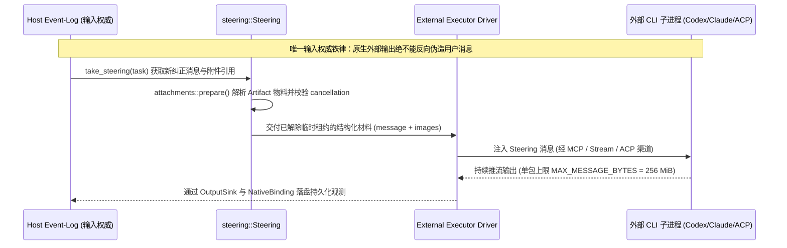

# 外部 CLI 执行器统一桥接：Codex、Claude 与 ACP 代理控制面

## 1. 为什么 Agent 平台不能指望“所有任务都由自己内置模型循环包办”？

无论一个微内核自己的内置大模型循环设计得多精妙，真实工程环境里永远存在大量高度特化的外部原生 Agent 执行器（External CLI Executors）：例如 OpenAI **Codex CLI**、Anthropic **Claude Code** 以及遵从标准 **ACP（Agent Client Protocol）** 的独立编码代理。它们各自针对特定模型做过深度提示词打磨、自带高优化文件编辑工具链、或绑定专属企业订阅通道。

但直接用 `spawn("claude")` 把子进程丢出去裸跑会迅速引发一连串灾难：
1. **指令覆写导致能力退化**：如果外部包装层粗暴覆盖掉原生 CLI 的系统提示词（System Prompt），Codex 或 Claude 原生精调的工具调用与推理习惯会立刻崩塌。
2. **输入多头写入失控**：用户既在宿主 UI 里发起纠正（Steering），原生进程底层又在自行吐出日志，究竟谁是输入权威？
3. **跨重启与挂起失联**：如果外部代理正在运行一个 10 分钟的重构，期间客户端崩溃或断开连接，重启后应该重发一次 Prompt 把刚改到一半的代码再改一遍，还是能精确重连原线程与文件流水位？

Maka Rust 微内核在 `plugins/agent/native/src/executor/external/` 与 `plugins/agent/acp-executor/` 中给出了一套教科书级的“外部代理受管桥接架构”：**尊重原生大脑的内部提示主权，死守宿主 Event-Log 的输入与工具边界主权，用 `TaskOwner`、`NativeBinding` 与摘要增量同步构建起既开放又绝对受控的控制面**。

---

## 2. 四位一体的外部执行器矩阵（`NativeTask`）

查看 `plugins/agent/native/src/executor/external.rs` 可知，微内核将不同形态的外部 CLI 按其底层物理通信协议收归统一的 `NativeTask` 观测凭据：

| 目标执行器 | 通信协议与承载形式 | `NativeTask` 持久观测坐标 | 关键工程策略 |
| :--- | :--- | :--- | :--- |
| **Codex CLI** | `app-server` 常驻守护与代理管道 (`daemon start` + `proxy`) | `thread`, `turn` | 复用官方 `app-server` 守护进程建立结构化双工 JSON-RPC 管道，直接跟踪原生线程与回合 ID |
| **Claude Code** | PTY 伪终端 (`Claude` / `ClaudePty`) 与流式协议 (`ClaudeStream`) | `session`, `transcript`, `offset`, `prompt`, `images` / `input` | 依据转录文件偏移量（`transcript` + `offset`）与输入锚点精准接续，无需重跑已完成的半程输出 |
| **Antigravity ACP** | 标准 `agent-client-protocol` v1 / v2 (v5 契约 `AGY_ACP_VERSION = 5`) | `session`, `prompt_id` | 在 `acp-executor/engine` 中以 `Journal` + `Projection` 状态机驱动协议握手、版本防漂移与沙箱隔离校验 |

---

## 3. 原生指令主权保留与 Digest 增量同步

整合外部原生 Agent 最核心的一条架构原则是：**保留外部执行器的原生系统提示词与核心人设，Maka 只通过受控通道注入宿主环境规范**。

为了实现这一目标，外部执行器桥接层采用了一套极克制的注入与同步机制：
- **专用注入边界标签**：Maka 通过 `<maka_system_instructions>` 标签块向外部会话传递宿主环境必需的上下文（例如工作区约定、可用 `maka-agent-mcp` 协同能力、行为守则），而**不替代原生系统提示主干**。
- **基于摘要（Digest）的零冗余增量重同步**：在多轮对话或长时间运行的同一条外部 Thread 中，桥接器会缓存上一次下发指令区块的内容哈希摘要。只要用户的宿主规则或环境摘要未发生真实变更，后续回合**绝不重复堆砌大段相同指令**，从而完美保护原生 CLI 模型端极为宝贵的 Prompt Cache（提示词缓存命中率）并节省大量输入 Token。

---

## 4. 协议层深潜：Codex 代理与 ACP V1/V2 防退化校验

### 4.1 Codex 的托管守护代理（`proxy_resolved`）

与简单拉起一次性命令不同，Maka 对 Codex 的对接（`external/codex.rs`）采用的是双步受控管道启动流：
1. **拉起并探测守护进程**：在绑定隔离 `cwd` 上下文下执行 `codex app-server daemon start`，由 `maka_process` 在超时（`SETUP_TIMEOUT = 300s`）和取消令牌约束内完成状态观测与排空。若进程不支持 `daemon/proxy` 模式则直接失败拒绝执行（Fail-Closed），不回落至不可观测的黑盒交互模式。
2. **挂接结构化 `app-server proxy`**：建立起 `Pipe` 通信通道后，通过内部 `Custody` 状态管理、`journal::ProtocolSession` 与 `mcp::Bridge` 进行全双工结构化控制。

### 4.2 `acp-executor` 的严格版本与隔离守卫

而在独立抽取的协议执行引擎 `plugins/agent/acp-executor/engine/src/driver.rs` 中，ACP 通信更展现出令人印象深刻的防御性设计：
- **协议版本单调锁定**：`connect()` 握手读取 `Event::Initialized(peer)` 后区分 `Peer::V1` 与 `Peer::V2`；如果 `Journal` 日志里已经记录过 `v2_defaults`（该会话曾按 v2 协议演进），而本次重连时远端却试图降级回 v1，引擎当场报错 **`"agent changed the session protocol version"`** 阻断执行，防止协议降级导致工具授权参数悄然失效。
- **物理私有工作区强校验**：在正式下发任何 ACP 任务前，驱动器强制索取实际 `scope` 并回调宿主 `private_paths(scope)` 获取真实隔离的 `working_directory`；若环境无法保证进程级工作区隔离，直接映射为 `executor::Error::IsolationUnavailable` 拒绝跑单。

---

## 5. 输入主权与大附件隔离流控

这张交互图里隐藏着四项极度务实的系统保护工程：

1. **单向输入主权（`steering.rs`）**：`steering.rs` 的模块声明清晰指出：**“持久化 Host 队列是唯一的输入权威；原生执行侧写回的任何输出永远不能创造用户消息”**。用户在界面发出的 Steering 消息必须经过 `inputs.take_steering()` 出队，并经 `attachments::prepare` 按会话作用域准备真实图像/附件物料并安全完成 `materials.handoff()` 移交，整个过程全程用 `CancellationToken` 双重守护。
2. **256 MiB 原生报文安全上限**：考虑到单次发送 20 张 5 MiB 级高分辨率图片做 Base64 编码后体量即可达到约 134 MiB，`external/runtime.rs` 将单个原生流消息缓冲上限精准锚定在 **`MAX_MESSAGE_BYTES = 256 * 1024 * 1024`（256 MiB）**——既完全放行重载多模态开发场景，又对畸形或失控的无终止流死死卡住了内存防线，绝不 OOM 拖垮宿主。
3. **重连绝不盲目重提交（`NativeBinding`）**：`external.rs` 为每一次外部提交在 `RootSettlementOwner` 处留存 **`NativeBinding`**（记录 `adapter_version`、`command_basis`、隔离资源描述符 `Descriptor`、进程快照凭证 `SnapshotProof` 以及对应的 `NativeTask` 观测地址）。即使宿主当机重连导致某次确认回执丢失，规则也很冷酷：**“失败或丢失的确认回执，绝不是让你把刚才那段 Prompt 重新提交给外部 CLI 再跑一遍的借口”**——驱动器只会顺着已有 `NativeTask` 坐标（例如 Codex 的 `thread + turn` 或 Claude 的 `transcript + offset`）回去查状态，杜绝二次变更代码库的风险。
4. **`TaskOwner` 与精细退场清理（`Observation`）**：外部进程由 `maka_process::isolated::TaskOwner` 严密看管。`Observation::classify` 利用 `tokio::select! { biased; ... }` 并行监控三路信号：MCP 桥接发来的逻辑主动完结信号（`bridge.finish_turn()`）、宿主发来的显式停止指令（`stop_requested()`）以及进程归档淘汰信号（`observation_retired`），并在 `INTERRUPT_TIMEOUT = 30s` 边界内确保底层子进程树连根安全卸载。

---

## 6. 总结

Maka 面对 Codex、Claude Code 和 ACP 代理的整合思路极具现实启发性：**不重复造别人已经打磨好的垂直提示轮子，而是做它们的“操作系统控制面与持久账本”**。
- 它用 **`<maka_system_instructions>` 摘要增量同步** 保留原生执行器的灵魂与缓存效率；
- 它用 **`Steering` 队列主权 + `NativeBinding` 持久化观测地址** 解决多端抢输入与重连防重跑；
- 它用 **`TaskOwner` 进程隔离 + 256 MiB 消息封顶 + 协议版本防降级校验** 把不受控的三方 CLI 进程彻底驯化为可审计、可随时打断、断电可恢复的标准运行组件。

至此，`01-runtime` 核心运行时与协议栈（5 篇）已全部就位。接下来我们将进入 Agent 大脑的记忆载体与原料生产线——**02 上下文与记忆架构篇**，第一站看一看 Rust 微内核如何用零拷贝竞技场（Arena）和确定性状态投影榨干长上下文场景下的最后一滴性能：[CaptureArena 与上下文确定性投影](../02-context/capture-arena-and-projection.md)。
