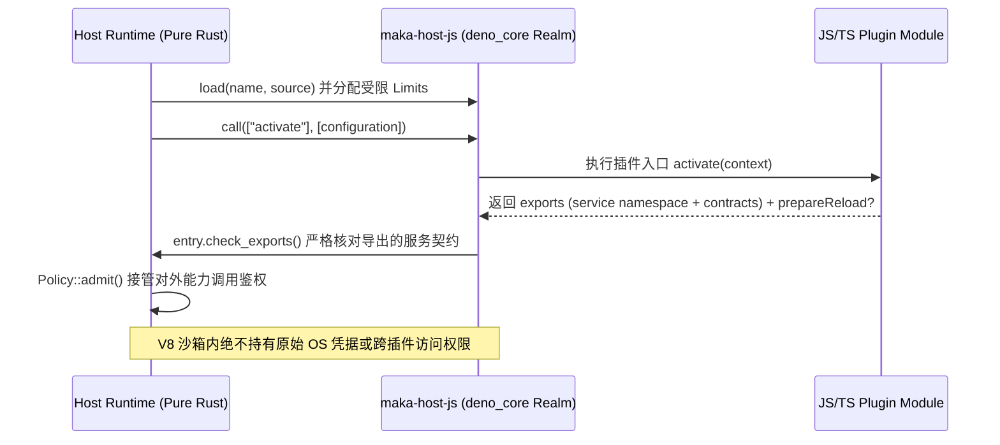
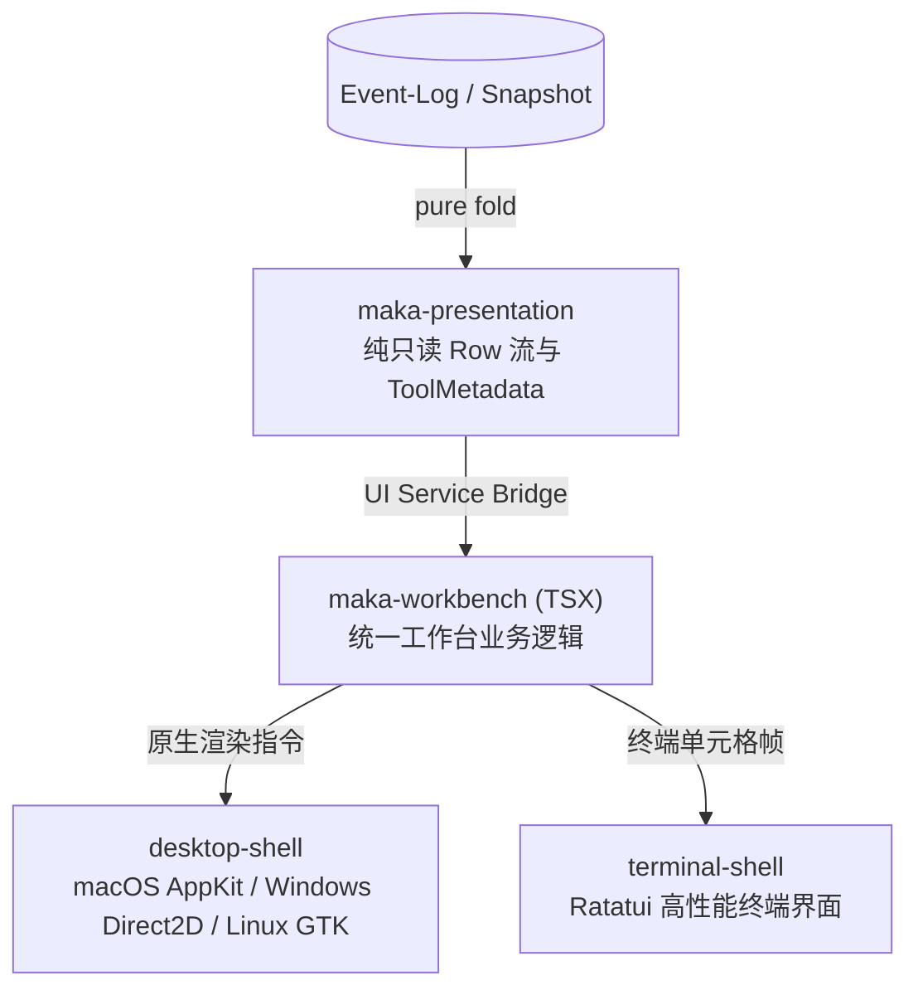

# Host 插件内核与 NSH 跨端 UI 运行时

## 1. 微内核如何把“业务功能”安全地卸载给插件？

在前代基于单进程动态脚本的框架中，扩展插件和主程序运行在同一个事件循环与模块作用域里。插件只要拿到内部引用就能直接读写全局状态、截获其它插件的连接或者绕过权限校验。这种“全信任插件模型”在面对第三方插件市场、动态热重载或原生桌面终端双宿主共享时非常脆弱。

Maka Rust 微内核将“应用拼装与插件运行”彻底收束进 `platform/plugin-core`、`platform/host-runtime`、`platform/host-js` 与 `platform/presentation` 四大平台支柱之中，建立起两条不可逾越的边界：
1. **能力与权限主权永不出宿**：无论插件用 Rust 原生编写还是跑在隔离的 JS V8 虚拟机中，**权限校验（`Policy::admit`）、资源所有权（Scope Custody）与持久化状态迁移**全部由纯 Rust Host 运行时把关。
2. **UI 展示视图严格派生与可丢弃**：UI 不参与任何调度裁决，仅仅是对核心 `Fact` 流和持久化快照的**纯只读投影（Pure, Disposable Presentation）**；且同一套声明式工作台代码可同时渲染在桌面原生窗口（AppKit / Direct2D / GTK）与全彩终端界面（TUI）上。

---

## 2. Host 服务内核：`maka-host-runtime` 的统一生命周期契约

`platform/host-runtime` 并不是仅仅运行 TypeScript 代码的脚手架，而是支撑所有 Host 级服务（无论是本地 Rust `NativeServices` 还是 JS 插件导出 `ServiceTarget`）的唯一调度与准入内核。

### 2.1 三段式准入防线：`Policy`、`Handler` 与资源归属

查看 `host-runtime/src/application.rs` 的接口签名可以看到极严密的控制反转设计：

```rust
// 教学化提炼自 platform/host-runtime/src/application.rs
trait Policy: Send + Sync {
    // 1. 必须在服务归属权（Owner Turn）内同步完成授权裁决
    fn admit(&self, invocation: Invocation<'_>) -> Result<()>;

    // 2. 仅在 admit 通过后的最终准入期调用，通过私有 Scope 关联跨请求资源
    fn bind_scope(&self, scope: &Scope, ticket: &Ticket);
}

trait Handler: Send + Sync {
    // 只有生命期核验与 Policy::admit 全数放行后才会触发
    // 注意：Handler 返回 Err 并不代表资源清理失败，Scope 清算由 Owner 单独结算
    fn call(&self, method: String, input: Value, context: Context) -> BoxFuture<'static, HandlerResult>;
}
```

这里暗藏着一句非常重要的架构注释：
> **Scope observation, package identity and a binding are not authorization.（作用域观察、包身份与实例绑定本身，绝不等同于授权）**

在分布式插件系统里，最常见的安全漏洞就是“误以为调用方拿到了合法的包名或绑定句柄，就等于有权调某个敏感方法”。Maka 在每一次方法进入前，都在 Owner Turn 内强制过一遍可信 `Policy::admit()`：不仅核验静态契约声明，还当场核对当前原始调用者的权威签名，并通过 `ResourceCapturer`（受限分片限额 `RESOURCE_CHUNK_LIMIT`）将大附件与目录资源接入受控生命周期票据 `Ticket` 中。

### 2.2 `CallerIntent` 与两阶段操作对接

宿主调用插件服务，往往会通过 `CallerIntent` / `RecordedIntent` 对接底层的两阶段操作框架（`OperationOutcome` / `OperationCleanup`）：
- **在服务崩溃或超时之际**：Host 侧 Owner 负责独立核销 `Scope` 内挂载的资源（`CallResources`），绝不因某个 `Handler` 抛出业务异常就把底层挂载的文件描述符或临时目录晾在半空。
- **在服务重启对账之际**：配合 `provider_journal` 与 `sql_completion` 状态账本，精确校验已发布的 `RecoveryRef` 凭据。

---

## 3. JS 宿主适配器（`maka-host-js`）：V8 永远只是哑巴沙箱

当某个插件的入口声明为 TypeScript/JavaScript（`usePackage: "host"`）时，`maka-host-js` 作为一个可插拔执行后端（`backend::Factory` -> `backend::Realm` -> `backend::Module`）按需拉起隔离的 `maka_js_runtime::plugin::Vm`（基于 `deno_core`）：



注意图中几个关键的工程边界：
1. **契约核验前置**：插件 `activate()` 返回后，Rust 侧立即调用 `entry.check_exports(...)` 验证实际导出的接口定义（必须为合法 `Interface::Service { methods }` 且带有非空 `service` 命名空间），凡是和清单 `package.ts` 声明对不上的导出当场拒收。
2. **ABI 窄桥接**：JS 插件只能通过显式注册的 `HostRequest`、`HostObservation` 与 `HostActivation` 桥接原语同 Rust 宿主对话。原生 `Scope` 句柄的 custody（保管权）始终留在 Rust 一侧，`maka-host-js` 只是透传调度意图的“纯函数式传声筒”。
3. **存储状态显式提交（`StateChange`）**：JS 插件内部不允许私自操作本地文件系统来保存插件状态，一切配置或持久化变更通过受控通道显式汇报并交由宿主提交。

---

## 4. 组合编排器与无停机热更新（`Composition` & `prepareReload`）

当用户安装了一个新插件，或者开发者在本地修改了一套扩展包配置，`CompositionPlanner` 如何做到不断流升级？这依赖插件机制中特有的 **`prepareReload()` 交接契约**：

1. **三类包形态**：
   - `usePackage: "host"`：提供后台核心服务（例如 Agent 引擎、模型驱动、工具宿主机）。
   - `usePackage: "ui"`：提供界面工作台组件或面板。
   - `usePackage: "composition"`：只做拓扑编排，通过 `base.package` 与 `overrides`（包括按 `configurationFields` 覆写配置、通过 `remove` 精准剔除不需要的子包、通过 `instances` 声明多实例化配置）将若干功能块组装为完整应用。
2. **热切换时的状态交接流程**：
   - 新插件组合计算完成并就绪后，宿主向旧版本实例触发可选的 `prepareReload()` 钩子，给予其封存飞行状态、等待关键内存状态刷盘的机会。
   - 同时依托 Host 底层的持久化账本与 `Event-Log`，**正在跑的长程 Agent 任务只需短暂 `Waiting` 或利用既有 `RunId` 接力即可在新旧版本 Host 之间完成交接，完全避免了粗暴重启整个客户端带来的会话断裂**。

---

## 5. `maka-presentation` 与 NSH：用一套 TSX 驱动原生桌面和终端

传统客户端生态里最痛苦的重复劳动莫过于：好不容易写好了 Web/Electron 版的对话流界面、Diff 预览与工具状态条，回头还得用 Go/Rust（例如 Ratatui）为 CLI 终端环境从零重写一套截然不同的交互逻辑，结果双端行为长期漂移。

Maka 用一套干净优雅的双层分离体系彻底根治了这个问题：

### 5.1 底层纯视图投影机：`platform/presentation`

`maka-presentation` 负责把 `maka-agent-facts` 里枯燥的底层事件流（`Fact`），按纯确定性逻辑折叠投影为前端可直接消费的结构化展示行 `Row`：

- **绝对不可僭越的只读红线**：模块开宗明义注明——“纯投影视图与喂给大模型的上下文是两条完全独立的状态机通道；即便 UI 展示层保留了某段被打断流出来的半截思考或残缺文字，也绝不代表模型下一轮上下文里能看到它”。
- **双游标秩序（`position` vs `order`）**：每条输出记录拥有两枚 `RowPosition` 坐标——`position` 记录最初产生这行数据的原始 Fact 与序号（保证流式增量追加唯一稳定），`order` 记录按真实因果时间线调整后的显示锚点。哪怕某条并行子工具完成得比主解释文本晚，投影引擎也能稳稳把它锚定回恰当的上下文位置而不引发 UI 乱跳。
- **状态机保护（`Vacant -> Active / Compact -> Ended / Poisoned`）**：内置单调序列号 `last_sequence` 校验与长度守卫（`ProjectionError::TooLarge` / `OutOfRange`），防止异常超长工具输出直接卡死客户端主渲染线程。

### 5.2 上层双宿声明式界面协议：NSH（`maka-workbench`）

在 `products/maka/workbench` 中，Maka 的全部核心界面（聊天流、Proactive Discovery 主动洞察面板、Computer Stage 实时画面舞台、审批弹窗与快捷输入历史）全部以基于 **NSH（Native Shell Host）的 TSX 代码**编写，并运行在两个共享同一套语义协议的宿主壳层之上：



这种架构彻底摆脱了对沉重 Chromium / Electron 渲染进程的捆绑：
- 在**桌面端（`desktop-shell`）**，通过 Direct2D / AppKit / GTK 极速渲染原生矢量文字、高清图片与多窗口布局，常驻内存消耗极低。
- 在**终端端（`terminal-shell`）**，通过同一个 TSX 组件树输出结构化 TUI 网格，甚至还能无缝复用桌面端的键盘快捷键、历史面板与文件预览逻辑。
- **统一的跨端辅助能力（`platform/ui-support`）**：文件拾取预览、图片剪贴板与 Windows 剪贴板历史快捷键等本地系统集成资源统一沉淀到 `ui-support`，确保无论在桌面点击还是 SSH 远端终端操作，核心体验始终同宗同源。

---

## 6. 总结

Maka 的插件与 UI 层架构证明了一件事：**“可扩展”与“低占用、高安全”完全不必二选一**。
- 在业务服务层，纯 Rust `maka-host-runtime` 握死 `Policy::admit` 与 `Scope` 保管权，即便挂上 `maka-host-js` 跑 TypeScript 插件，V8 也被死死锁在没有裸系统权限的孤立沙箱中；
- 在表现层，`maka-presentation` 切断了 UI 状态对大模型历史真相的反噬路径，而 NSH TSX 则让轻量级桌面原生图形引擎与终端 TUI 实现真正的“一套代码、双端原生”。

掌握了内部模型网关与插件 UI 内核后，还剩下一块当今 Agent 基础设施最现实、也最棘手的硬骨头：**当企业或开发者本身已经高度依赖 Claude Code、Codex CLI 或 Antigravity ACP 等强大外置闭源/半独立代理进程时，Maka 微内核如何在不魔改对方灵魂的前提下，将它们无缝收编为受控、可恢复的一等执行器？** 下一篇将为你揭开答案——[外部 CLI 执行器统一桥接架构](./external-cli-executors.md)。
