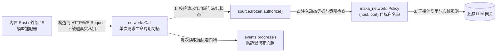
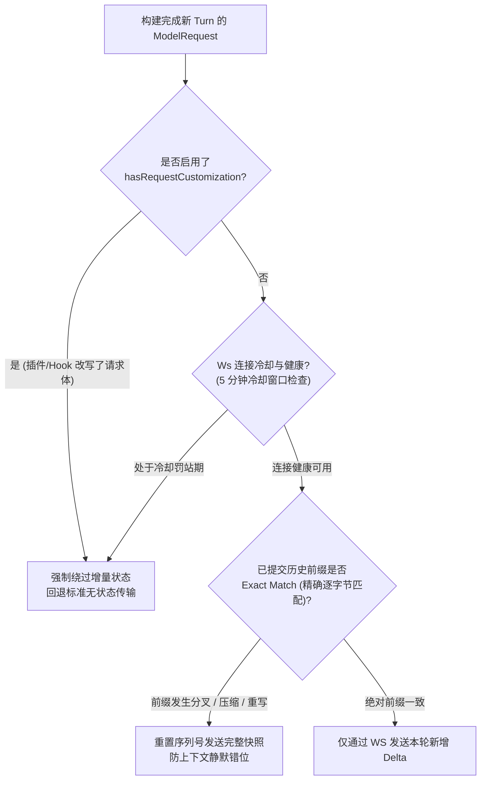

# 模型协议栈与流式网关：多协议统一、WS 增量传输与物理流清理

## 1. 为什么模型层需要独立的 Rust 协议与传输微内核？

把“发送请求给 LLM 并读取 SSE 流”写成几行 `fetch()` 调用很容易；但要在生产级微内核里长期稳定支持多家族模型协议、多形态推理思考标签、动态 OAuth 凭据隔离、WebSocket 全双工长连接状态机以及零泄露的连接清理审计，模型网关的复杂度一点也不亚于核心状态机。

Maka Rust 微内核将全部大模型对接能力收拢在独立 crate `plugins/agent/model`（对外暴露为 `maka-model`）中，确立了一条铁的隔离原则：**可信配置（`ProviderConfig`）含凭据与网络策略，永远不得序列化进入 Event-Log 或暴露给 Code Mode 沙箱；输入给模型的 `ModelRequest` 只是从规范 `Fact` 投影出来的只读瞬态载荷，永远不具备改写历史的权威性**。

---

## 2. 内置适配器矩阵与统一 `ModelEvent` 事件流

查看 `plugins/agent/model/src/adapters/` 目录架构可以看到，Maka 没有强行把所有模型塞进单一兼容格式然后硬做有损转换，而是为每一代主流原生协议维护了一等适配器，并向上统一投影为规范的 `ModelEvent`（由 `StepBuilder` 增量装配成标准推理步骤）：

| 适配器模块 (`adapters/`) | 目标协议家族 | 协议特有处理焦点 |
| :--- | :--- | :--- |
| **`responses`** | OpenAI Responses API / WebSocket 增量模式 | 原生增量状态连接、会话延续与精确前缀校验（详见第 4 节） |
| **`anthropic` & `anthropic_documents`** | Anthropic Messages API | 原生扩展思考块（Thinking）、提示词缓存断点以及原生 PDF/文档内容块直传 |
| **`chat_completions`** | OpenAI Chat Completions 及广义兼容端点 | 工具调用分片增量拼接、流式 usage 尾包补齐与非标兼容容错 |
| **`codex`** | OpenAI Codex / 专属推理接口形态 | Codex 模型专属指令字段、原生上下文压缩通道与响应事件对齐 |
| **`wire`** | 标准化线缆编码与扩展协议编解码基座 | 供内置后端与受管 JS Adapter（TypeScript 模型扩展插件）复用统一网络管道 |

### 统一错误分类：`ProviderFailure` 与 `ProviderFailureReason`

所有底层 HTTP 状态码、SSE 内部 Error 帧或 WebSocket 异常关闭，都必须先通过 `adapters/error.rs` 收束为标准化的 `ProviderFailure { reason: ProviderFailureReason, ... }`。这意味着无论是 Anthropic 返回 `overloaded_error` 还是 OpenAI 返回 429 或 Context Length Exceeded，上游的 `Reconciler` 与 `RetryStreak` 都只需要面对一套**统一故障语义枚举**来计算退避间隔（`Retry`）、识别可清理溢出（`ContextOverflow`）或触发自动备用通道切换。

---

## 3. 安全隔离：宿主统一代理的受管 I/O（`Network` & `Call`）

无论使用的是内置 Rust 原生 Adapter，还是外部 TypeScript 插件注入的模型扩展协议，**任何模型适配器都不允许私自建立裸 TCP/HTTPS 连接**。所有的出网 I/O 都必须经过 `plugins/agent/model/src/network.rs` 封装的统一宿主网络句柄 `Call`（实现 `maka_agent_ports::model::Transport`）：

这一抽象带来了三项关键安全性与稳定性保障：
1. **双重取消通道竞争监听**：`Call::request` 在 `tokio::select! { biased; ... }` 中同时监听所属 Run 的全局 `self.cancellation` 以及单次 HTTP 尝试的局部 `cancellation`。只要任何一端触发取消，立刻切断子令牌 `stop.cancel()`，避免底层 TCP 读取协程滞留在线程池空耗。
2. **源作用域授权冻结（`source.frozen.authorize()`）**：如果本次模型请求绑定了受限的宿主来源材料或临时凭据租赁（例如带工作区目录租约的模型准备期资产 `ModelPreparationResources`），在建立 WebSocket 或发送 HTTP 前必须先确认作用域仍处授权期。
3. **心跳进度推进（`self.events.progress()`）**：每当收到响应头或解码流数据块时立刻通知状态观测器刷新活跃时间戳，与网络超时/卡死看门狗严格配合。

---

## 4. 高阶优化：OpenAI Responses WebSocket 增量传输与精确前缀守卫

在支持 Responses API 的 WebSocket 长连接模式时，如果每次工具调用回流都要把过去几十轮对话、系统提示和数千行代码全量 JSON 再重新发送一遍，不仅带宽开销与序列化耗时惊人，还会显著拉高首包延迟（TTFT）。

根据 `docs/architecture/openai-responses-incremental-transport.md` 确立的架构契约，Maka 在模型传输层实现了严格受控的 **WebSocket 增量连接复用法**：

为什么条件如此苛刻？因为增量传输是把双刃剑——一旦局部内存态和服务端状态发生哪怕 1 个字节的漂移，模型在后续所有轮次都会陷入不可解释的认知幻觉。因此 Maka 设立了三条硬闸门：
1. **自定义拦截旁路（`hasRequestCustomization`）**：只要当前会话挂载了任何会动态插手改造最终请求体的插件覆盖规则（Body Overlay / Hook），直接放弃增量假设，保证自定义请求体 100% 生效。
2. **精确前缀校验（Exact Message Prefix Match）**：增量帧发送前，必须对照当前连接通道上服务端已确认的上一帧消息序列进行严格前缀等价校验。哪怕经历过一次细微的系统提示词重写或被动裁剪，宁可优雅退化为全量帧，也绝不冒险发错 Delta。
3. **5 分钟冷却退避（Cooldown）**：一旦某个端点上的 WebSocket 增量链路遭遇异常拒绝或断流重连，立刻打上 5 分钟冷却标志；期间自动回落至极稳的传统 SSE HTTP 路径，避免同一个会话在同一条有病链路上反复试错空转。

---

## 5. PDF 与多模态文档的准入拒绝与恢复契约

大模型对复杂多模态文件（尤其是高页数 PDF 文档）的吞吐支持千差万别，不同供应商、不同模型版本在页数上限、文件体积上限以及原生文档解析支持上差异巨大。常见运行时在这里很容易犯一个代价极其高昂的错误：**把 PDF 丢给 API 报错后，盲目当成网络抖动原样重试 3 次，白白烧光用户的响应时间甚至触发限流**。

结合 `docs/architecture/runtime-pdf-rejection-recovery.md` 与 `adapters/anthropic_documents` 的契约设计，Maka 为文档处理立下了明确的准入恢复原则：
- **显式能力协商与预处理边界**：发包前按 `ProviderConfig::capabilities` 与 `image_input` 约束判断当前端点是否具备原生文档吞吐资格；如果不兼容则由前置阶段按能力降级转换或拒绝，而不把未知二进制强塞给远程 API。
- **没有结构化拒绝诊断，绝不盲目原样重试（No Blind Retry）**：只有当适配器清晰捕获并解析出属于可转换/可裁剪形态的结构化拒绝反馈时，才交由上层恢复机制调整负载（例如触发文档切片、剔除超限附件或切换能力模型）；未知或模糊的格式拒收直接中止本次尝试并留存清晰错误诊断，防止死循环空耗配额。

---

## 6. 物理流清理可观测性：`ModelCleanupObserver` 与 `StreamCleanupError`

还记得上一篇 `reconcile::next()` 在宣布 `Completed` 前死等的那一句条件吗？
`attempt.cleanup == OperationCleanup::Confirmed`

为什么一个 HTTP SSE 连接的关闭也需要做到“分级可观测（Observable Cleanup）”？
设想以下故障：用户在流式输出第 10 秒按下了取消按钮，`Call` 取消了 HTTP Body 读取流。但在底层异步运行时里，某个嵌套的 JS Adapter 生成器或者外部 HTTP 连接关闭 Future 卡住了，此时底层 TCP Socket 甚至可能还在继续占用带宽、或尚未彻底释放租约里绑定的目录清理句柄。

`plugins/agent/model/src/cleanup.rs` 将物理流清理状态抽象为精细的三级管道可观测对象：

- **清理阶段定位（`StreamCleanupStage`）**：清晰界定卡顿或失联究竟发生在 **`Adapter`**（协议适配器解析协程）、**`Source`**（输入材料租赁与准备期资源释放）还是 **`Worker`**（底层传输池物理句柄归还）。
- **清理异常双态（`StreamCleanupError`）**：
  - `Pending { observer: ModelCleanupObserver, cause }`：清理尚未完成，但看门狗观察器依然活着！上层 Reconciler 可以放心地把它转为 `WaitReason::Model`，优雅挂载等待其自然收敛，而不必误报崩溃。
  - `Unobservable { stage, cause, original, material }`：清理协程意外崩溃或链路失明，无法证实物理资源是否已彻底归还。此时系统保留原始模型结局（`original`）与受损阶段标签（`stage`），避免把底层清理异常和主模型原本的成功/失败结果混为一谈。

---

## 7. 总结

`plugins/agent/model` 让我们看到，生产级大模型网关与普通 SDK 客户端的真正分水岭在于：
1. **原生优先的协议适配**：`responses`、`anthropic`、`chat_completions`、`codex` 各行其道，仅在向上输出时收敛为统一 `ModelEvent` 与 `ProviderFailure`；
2. **严防死守的增量边界**：OpenAI Responses WS 增量只在无自定义覆盖、未冷却且严格前缀匹配的窄门下开启，一有异常即平稳降级；
3. **贯穿生死的句柄主权**：`Call` 将凭据检查、策略白名单与双路取消注入网络骨架，而 `ModelCleanupObserver` 让“物理断流收尾”首次成为状态机里一等可审计的异步实体。

至此，Agent 核心推理循环与大模型网关已经彻底跑通。但一个完整的桌面与 CLI 平台不仅要调度 LLM，还必须挂载可热重载的插件宿主和横跨 Desktop/Terminal 的图形界面。下一篇剖析平台基座运行时——[Host 插件内核与 NSH 跨端 UI 运行时](./host-plugins-and-ui-runtime.md)。
