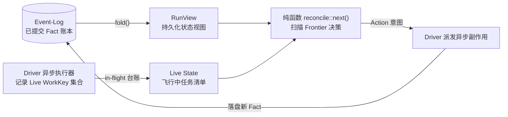
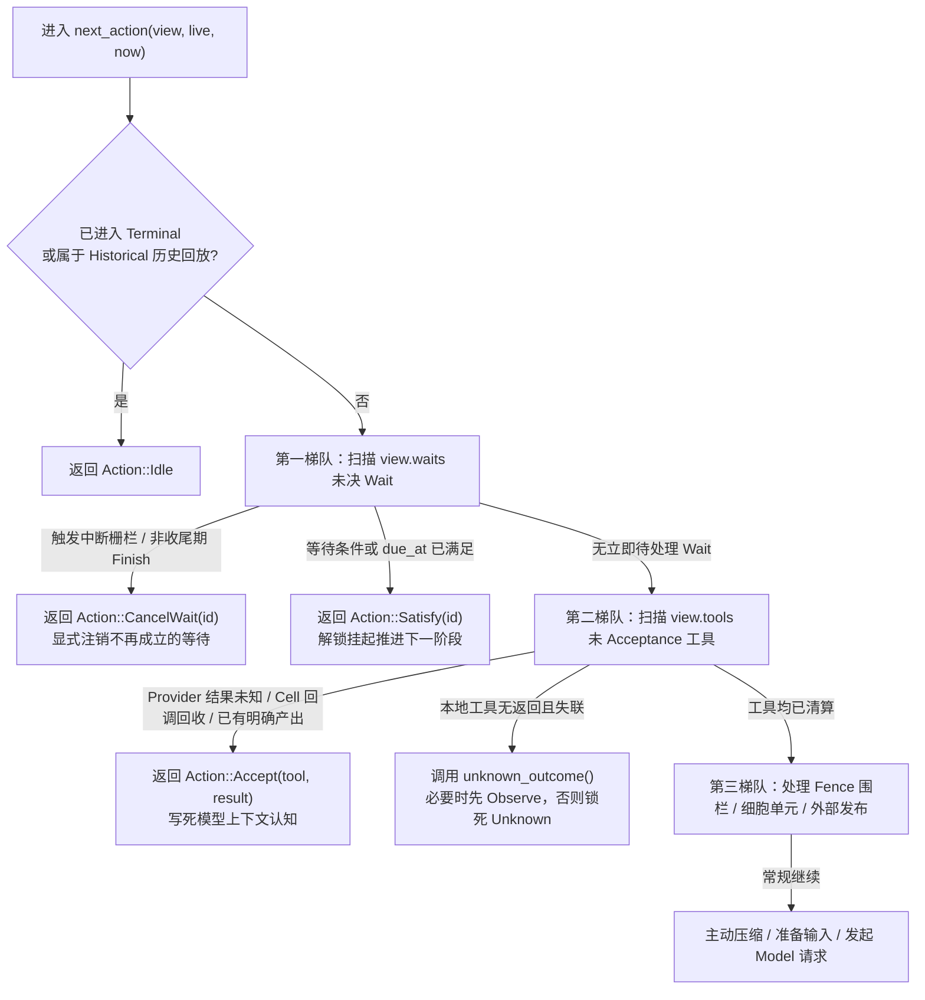

# Reconciler 与 Obligation Frontier：如何用纯意图驱动消除运行时竞态？

## 1. 为什么传统 `while` 循环与回调架构撑不住高并发 Agent？

在单线程或单进程脚本时代，一个 Agent Runtime 的主循环写起来非常直觉：`while` 循环里调一次模型、等流结束、按顺序执行工具、把结果塞回数组、再调一次模型。但只要系统跨过玩具原型期，进入以下真实并发场景，这套“过程式循环 + 回调补丁”就会迅速腐烂：

1. **多源中断交织**：大模型正在吐第 40 个 Token，用户突然发来一条纠正（Steering）；与此同时，上一步派生的 Code Mode 沙箱还在后台异步执行一个回调；此时宿主又收到了全局预算耗尽的警告。
2. **清理确认滞后于逻辑完成**：工具进程或 HTTP 流可能已经收到了中断信号，逻辑上已经算“取消”，但底层 OS 句柄、网络连接或外部锁还没完成物理释放（`OperationCleanup::Confirmed`）。如果此时立刻重开下一轮或直接结束 Run，残留的句柄就可能在下一次操作里发生资源冲突。
3. **跨重启恢复一致性**：进程在“本地工具已经返回，但模型还未被告知结果”的瞬间崩溃。重启之后，主循环该接着调用下一次模型，还是先向历史账本补全这一步的接收确认？

Maka Rust 微内核在 `plugins/agent/engine` 中彻底摒弃了过程式控制流，采用在 Kubernetes 控制面和数据库恢复引擎中久经考验的 **Declarative Reconciler（声明式调谐器）+ Obligation Frontier（未决义务前沿）** 范式。

---

## 2. 核心抽象：把“判断做什么”与“真正去执行”物理剥离

Reconciler 范式下，整个 `plugins/agent/engine` 的决策核心被提纯为一个**零 I/O、零副作用的纯状态决策函数 `reconcile::next()`**。它只接收三个只读输入：
- **`view: &RunView`**：由 Event-Log 中所有已提交 `Fact` 确定性折叠而成的持久化真相全貌。
- **`live: &Live`**：当前进程内正在飞行（In-Flight）的并发任务集合（通过 `WorkKey` 索引）。
- **`now: UnixMillis`**：单调评估时钟，用于判定截止时间（Deadline）与退避到期窗口（`due_at`）。

它的输出是一个单一枚举 **`Action`**：只描述“基于当前持久化真相与进程飞行台账，此刻唯一应当触发的下一步动作是什么（或者什么也不做返回 `Action::Idle`）”。



这种隔离带来了极高的工程确定性：**只要给定同样的 `RunView` 和 `Live`，任何机器、任何时刻调用 `next()` 永远返回完全一致的 `Action`**。所有并发时序问题，都只需为这个纯函数编写单元测试即可穷尽覆盖，再也不用为了复现一个边界竞态而去搭建复杂的模拟网络服务器。

---

## 3. 飞行台账与收尾边界：`WorkKey` 与 `Live::only_cleanup()`

`Live` 结构维护着当前进程内存中正在运行的副作用任务索引 `WorkKey`，精确划分了引擎所有异步工作面：

| `WorkKey` 变体 | 代表的并发工作面 | 是否属于阻塞收尾的“业务动作” |
| :--- | :--- | :--- |
| **`Prepare` / `PrepareProactiveSummary`** | 上下文组装、媒体素材整备与主动压缩摘要输入准备 | 是（必须先于或阻塞完成准备） |
| **`Model(ModelAttemptId)`** | 物理大模型 HTTP/WS 流式请求 | 仅在 `closed.is_some()` 后进入清理期 |
| **`CancelModel(ModelAttemptId)`** | 主动取消正在流式传输的模型尝试 | 是（必须优先落定取消态） |
| **`Tool(ToolKey)`** | 本地插件工具或宿主授权能力调用 | 在 `accepted.is_some()` 且结果已知后退化为清理 |
| **`Cell(CellId)`** | V8 / Monty 代码执行沙箱任务及观察 | 在非 `Running` 状态后退化为清理 |
| **`External` / `Publication(PublicationId)`** | 外置 CLI 执行器（Claude/Codex/ACP）及外部产物发布流水线 | 在 `closed` 或发布项全部已知后退化为清理 |
| **`Assess(AssessmentKey)`** | 运行级风控评估或辅助检查任务 | 是 |

### 关键优化：`only_cleanup(&self, view: &RunView)`

当引擎准备让当前执行器退场（比如完成或进入等待态）时，如果内存中还有飞行中的 `WorkKey`，能否退出？`Live::only_cleanup()` 给出了精确判断：**即使 `live.work` 非空，只要每一项在飞任务对应的持久化 `RunView` 实体都已经到达逻辑闭合态（模型已 `closed`、工具已 `accepted` 且结果确定、Cell 已脱离 `Running`），此时进程里剩下的工作就只剩下物理流释放和句柄关闭（Cleanup），逻辑层无需再苦等，而是转入统一的资源清理栅栏**。

---

## 4. Obligation Frontier（未决义务前沿）的判定优先级

传统引擎常常因为“到底该先响应中断、先处理工具结果、还是先执行主动压缩”而在 `if/else` 泥潭里产生死锁。`reconcile.rs` 通过 `next_action()` 将调谐扫描严格按**义务优先级队列**排列：



### 4.1 细解 `WaitReason` 与“中断围栏（Fence）”

什么是 **Obligation Frontier**？通俗地说，就是一个 Run 在宣布完成（`Terminate(Completed)`）或移交检查点（`handoff`）之前，所有**尚未履行完结的契约承诺清单**。在 `next_action` 中，所有挂起承诺均显式归入 `view.waits`，按两类围栏（Fence）统一收束：

1. **硬中断围栏（`interrupted_fence`）**：用户显式停止（`view.stopped`）、风控取消（`view.cancelled_by_risk`）、超期（`now >= deadline`）或预算耗尽（`budget_exhausted`）。一旦命中，除特定例外（例如预算耗尽时仍可保留子会话等待以允许收尾校验）外，所有不再需要等待的 `Wait` 都会立刻派发 `Action::CancelWait`。
2. **自然完成围栏（`finish`）**：当 `final_model_response()` 判定模型已经给出了干净的 `ModelFinishReason::Stop`、没有遗留未决的本地工具、没有未决子会话等待（`WaitReason::Child`）且没有活跃 Cell 通知时，只保留正在收尾物理清理的 `WaitReason::Model`、`WaitReason::Cell` 和 `WaitReason::Operation`，其余全部推进收束。

### 4.2 工具义务扫描与本地/外部优先级

在 `view.tools` 扫描阶段，Reconciler 严格区分了三种需要即刻敲定 `Action::Accept` 的情形：
- **`provider_outcome_unknown(tool)`**：由模型服务端原生代执行的工具未能返回确定结果，立刻固定为 `AcceptedResult::ProviderOutcomeUnknown`。
- **`recovered_cell(view, tool)`**：如果工具对应的回调发生在 Code Cell 内（哪怕 Cell 本身已结束但回调生命周期由主运行承接），通过 `AcceptedResult::CellRecovered { cell }` 完成恢复绑定。
- **常规 `outcome(tool)`**：汇总拒绝、拦截、本地/宿主返回或 `OutcomeUnknown`。一旦缺失任何证据，则进入 `unknown_outcome()` 流程：若存在 `RecoveryRef` 凭证且尚未向 Root 查询过，先派发 `Action::Observe` 对账；否则锁死为未知结局，防止阻塞整个会话死等。

---

## 5. 两重保护锁：`cell_action()`、`publication_action()` 与 `next()` 清理栅栏

### 5.1 Code Cell 的不确定性阻塞（`cell_action`）

Code Mode（独立 V8 或 Monty 计算单元）不像普通同步函数调用那样一次返回就完事了——它内部还会向 Host 发起嵌套的子工具调用（`cell.children`），甚至在宿主机崩溃时产生虚拟机执行态不确定性（`vm_uncertainty`）。

因此 `cell_action()` 会在推进主轮次前逐一审查所有 Cell：
- 若 Cell 仍处于 `Running` 状态且进程里没有对应活跃任务，触发 `Action::ObserveCell(id)` 向宿主求证生死。
- 若遇到虚拟机状态不确定或中断后仍有未清算子调用（`!child.known()`），除非用户在风险提示后显式确认了 `BlockerKind::CodeCellRecoveryUnavailable`，否则一律发射 `Action::Block(...)` 暂停业务推进。
- 只有当同步绑定的工具调用完成结算（`!synchronous_pending`）且不在围栏中时，才触发 `Action::AcceptCellFinal(id)` 或报告中断通知。

### 5.2 外部产物发布与对账状态机（`publication_action`）

当 Run 使用外置 CLI 执行器（如 Codex / Claude / ACP）并产生了工作区修改或制品发布需求时，会挂载一条严格的 `ExternalPublication` 状态机：
- 如果某条发布项结果未知，有 `RecoveryRef` 就走 `ObservePublication`，否则走 `LookupPublication`。
- 如果遇到 `Conflict`（文件冲突）、`Unsupported` 或 `Failed`，立刻转化为可交互的 `BlockerKind::ExternalPublicationItem`，让系统或人类介入，而不是悄悄吞掉半成品补丁。
- 当所有发布项全部落定，甚至还会校验每项的 `OperationCleanup::Confirmed`，确保外部资源锁已真正释放。

### 5.3 最外层安全闸门：`next()` 的物理清理 ACK 强制等待

很多人在读 `reconcile.rs` 时会好奇：为什么外层 `next()` 要包住内部 `next_action()`？答案就在于下面这段决定系统可靠性的核心门禁逻辑：

```rust
// 教学化伪代码：next() 对“逻辑完成”施加的物理清理强制栅栏
fn reconcile_next(view, live, now, model, complete_at_budget) -> Action {
    let action = next_action(view, live, now, model, complete_at_budget);
    let is_exiting_lifecycle = matches!(action, Action::Compact(_) | Action::AdoptCandidate(_)) && has_handoff(model)
                            || matches!(action, Action::Terminate(Terminal::Completed));

    if !is_exiting_lifecycle {
        return action;
    }

    // 1. 若有正在取消中的模型任务，绝不抢跑退出
    if live.has_active_cancel_model() {
        return Action::Idle;
    }

    // 2. 任何曾被模型接口接纳过的尝试，必须收到 OperationCleanup::Confirmed
    if let Some(uncleaned_attempt) = find_unconfirmed_admitted_attempt(view) {
        return if !uncleaned_attempt.is_closed_or_interrupted() {
            Action::Idle
        } else {
            create_or_wait(WaitReason::Model(uncleaned_attempt))
        };
    }

    // 3. 所有 Code Cell 必须确认底层进程/沙箱物理释放完成
    if let Some(uncleaned_cell) = find_cell_without_physical_cleanup(view) {
        return create_or_wait(WaitReason::Cell(uncleaned_cell));
    }

    // 4. 所有携带 RecoveryRef 的宿主操作必须先 Observe 并确认 Cleanup Confirmed
    if let Some(uncleaned_tool) = find_tool_with_unconfirmed_cleanup(view) {
        return if !live.already_observing(&uncleaned_tool) {
            Action::Observe(uncleaned_tool)
        } else {
            create_or_wait(WaitReason::Operation(uncleaned_tool))
        };
    }

    action
}
```

哪怕大模型已经说完了“任务完成”，只要上面第 1～4 条物理清理义务（模型 HTTP 连接池排空、Code Sandbox 句柄释放、Host 操作收尾对账）中还有哪怕一条未拿到 `Confirmed` 回执，`next()` 就会当场把 `Action::Terminate(Completed)` **拦截扣下**，强制转换回 `Action::Observe` 或进入 `WaitReason` 挂起。

这就保证了：**只要前端或调用方看到了 Run 的 `Completed` 终态事件，底层与这次 Run 相关的每一寸 OS 文件句柄、网络流、容器/沙箱租赁和持久操作就 100% 已经安全归零**。

---

## 6. 输出超限连续自动续跑（Output-Limit Continuation）与诊断保护

在实际模型推理中，模型有时并非不想结束，而是单次生成的输出被 `max_output_tokens` 硬截断。`reconcile.rs` 为此专门定义了精确边界常量：
- **`MAX_OUTPUT_LIMIT_CONTINUATIONS = 3`**：允许系统自动发起连续补全接力的最大次数，防止模型陷入无限输出死循环耗光配额。
- **`OUTPUT_LIMIT_TOOL_REJECTION` 与 `OUTPUT_LIMIT_DIAGNOSTIC`**：如果截断正好发生在模型吐出一个残缺工具调用 JSON 参数的中途，引擎不会把这个残缺参数盲目送给宿主报错，而是使用标准拒绝话术在 `prohibited_before_host` 阶段直接截胡，同时向上下文注入规范化诊断提示，诱导模型在下一轮重新精简拆解调用参数。

---

## 7. 总结

Maka Rust 微内核用 `reconcile.rs` 演示了什么叫做“把并发 Bug 关进纯状态机的笼子里”：
- **没有散落各地的布尔锁**：一切未尽职责统一收归 `WaitReason` 与 Obligation Frontier。
- **不以逻辑响应代替物理释怀**：`next()` 在生命周期边界强制拦截 `Completed` 与 `Handoff`，死守所有模型连接、Code Cell 与两阶段宿主操作的 `OperationCleanup::Confirmed`。
- **决策函数零 I/O**：状态折叠和行动裁决彻底独立于异步运行时调度器之外，使得最棘手的多方竞争问题具备极高的可预测性与测试验证度。

理清了纯决策层之后，下一篇我们将下沉到驱动层与执行边界，看 `Driver` 究竟是如何把 Reconciler 吐出的 `Action` 变成真实的进程并发、租约抢占以及跨重启发布对账的——[Driver 生命周期与执行准入](./driver-lifecycle-and-admission.md)。
