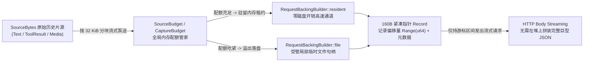

# CaptureArena 与上下文确定性投影：零内存爆炸的 Prompt 生产线

## 1. 为什么把所有消息和工具输出塞进 `Vec<Message>` 会拖垮长程 Agent？

大多数 Agent 框架组一次 LLM 请求时，代码直觉上都极其简单：从数据库把历史对话和工具返回 `SELECT` 出来，在内存里拼成一个几兆乃至几十兆的 JSON `Vec<Message>`，再传给 HTTP 客户端。这种“全内存拷贝装配”在对话不超过 20 轮、工具返回几十 KB 时毫无感觉；一旦面对工业级代码分析或长程自动化任务，就会撞上三面物理墙：

1. **峰值内存翻倍甚至 OOM**：单次上下文包含大量大文件切片、命令日志甚至几十张多模态图像（单次即可超 100 MiB）。如果每步准备（Preparation）、序列化、编码和传输都在堆上各自拷一份全量 `String` / `Vec<u8>`，一个并发跑 5 个会话的桌面端就会瞬间爆出 GB 级内存抖动。
2. **投影边界漂移（Projection Drift）**：在等待一次流式请求的同时，后台可能有新工具返回、压缩摘要正在生成、或者 UI 层保留了刚中断输出的半截文本。如果上下文拼装逻辑直接偷看“当前最新可变状态”，相邻两次重试发出的前缀字节就会对不上，直接废掉服务端 Prompt Cache 甚至破坏回放确定性。
3. **资源锁死阻塞主状态机**：将数百 MB 内容从 Content-Addressed Store 读取并拼成 HTTP Payload 的过程充满慢速磁盘 I/O；如果在读取过程中死拿着 Event-Log 或 Session 状态锁，整个宿主界面和其它并发工具通知都会跟着卡死。

Maka Rust 微内核在 `plugins/agent/engine/src/history/` 与 `plugins/agent/native/src/owner/capture_budget.rs` 中给出了一套基于**受控竞技场存储（`CaptureArena`）**、**160 字节紧凑索引指针（`Record`）**以及**纯确定性历史投影（`canonical_prompt`）**的工程解。

---

## 2. 双重隔离前提：UI 投影与模型上下文彻底分道扬镳

在探讨字节级优化前，必须先确立一个前提：**展示给用户的历史和喂给模型的历史，在 Maka 里是两套完全独立、只共享同一套 `Fact` 源头的单向投影**。

- **UI 投影通道（`maka-presentation`）**：面向人类阅读体验，允许保留被中途打断流出来的半截文字、展示折叠后的工作台工具面板，使用 `RowPosition` 独立排序。
- **模型投影通道（`canonical_prompt`）**：面向严谨推理与 Prompt Cache 稳定命中，只认 `RunView` 中已被**正式接受（`accepted` / `semantic`）**的规范事实：
  - 被 `Attempt::compactable_overflow()` 识别为纯溢出且未入账的失败尝试，会被干净剔除；
  - 被标记为 `ToolAcceptance`（哪怕是 `AcceptedResult::OutcomeUnknown`）的结果一旦进入规范时间线，就按原样永久冻结；
  - 每次发出的请求体由 `canonical_prompt` 在逻辑上完全确定，绝不因 UI 渲染细节变动而改写一个字节。

---

## 3. `CaptureArena`：驻留内存与临时文件平滑切换的 32KB 流式竞技场

为了在不撑爆宿主进程内存的前提下组装庞大的大模型 HTTP 请求 Payload，Maka 设计了 `CaptureArena`（`history/capture_arena.rs`）。它既不是纯粹把字节全塞进 `Vec<u8>` 的内存缓冲，也不是笨重地每次都写死磁盘临时文件，而是一个受配额预算监管的双模流式背书存储：

### 3.1 `CaptureArena` 的三项关键并发设计

仔细研读 `capture_arena.rs` 的源码实现，可以捕捉到极度老练的 Rust 并发工程细节：

1. **按需降级背书存储（`resident` vs `file`）**：在 `CaptureArena` 初始化时，首先向 `PreparationIo` 申请资源预算租约（Lease）。小规模、短生命周期的常规请求直接走 `RequestBackingBuilder::resident` 全内存路径以追求极速；一旦遇到多模态重负载或同时并发多个高容量会话，租约不再分配常驻 RAM，而是平稳切换至 `RequestBackingBuilder::file(reserve_local_resource)`，将字节流线性追加进受管临时文件句柄，宿主物理内存占用因此被死死锁在预算红线（`BudgetBasis`）之下。
2. **串行写入序与无状态锁 I/O（`ArenaAppend` + `with_local_io`）**：所有内容由单一生产者通过 `begin_append()` 持有 `serial` 序列化写入权；最关键的是文档明确规定的边界：**真正执行磁盘或缓冲区写入的回调是在 `with_local_io` 资源工作线程中运行的，期间不持有任何业务状态锁**！同时，每次追加以 `budget.allocate(32 * 1024)` 按 32 KiB 粒度申请临时搬运块，并在循环每步检查 `CancellationToken`，哪怕用户在 100 MiB 材料装填到一半时点击取消，也能在几十微秒内安全终止。
3. **互不阻塞的控制面固定读取（`read_control_owned::<N>`）**：在一条长写入序列正在往 Arena 末尾追加大段工具输出的同时，调度层往往还需要频繁回查前段已经写入的定长控制头或配方偏移表。`read_control_owned` 依靠文件/随机读定位点直接读取 `N` 字节只读快照，**既不发布或篡改任何范围，也不用阻塞整条流式组装流水线**。

---

## 4. 160 字节索引指针阵列与源摘要测量

在把原始历史事实“流式追加”进 `CaptureArena` 时，引擎不会在 Rust 堆上同时保留庞大的结构化 AST 字符串拷贝，而是为每一个物理片段在控制头中压入一个定长 **160 字节的 `Record`（`[u64; 20]`）索引元结构**：

| 阶段模块 | 核心职责 | 工程收益 |
| :--- | :--- | :--- |
| **`measure_source` & `source_summary`** | 在真正展开全文之前，预扫消息树并精确核算每段内容的字节规模与摘要结构 | 无需先膨胀序列化大字符串即可触发准入拒绝或主动压缩阈值判定 |
| **`serialize_source`** | 将 `canonical_prompt` 的结构化槽位直接编码泵入 `CaptureArena` 的连续追加游标 | 彻底消除“先拼出完整 `serde_json::Value` 树 -> 再 `to_string()` -> 再写 Socket”的三重内存复制 |
| **`canonical_prompt` & `references`** | 维护规范化对话角色序列、`ContentRef` 外部引用解引用与工具调用 ID 严格配对 | 保证模型请求严格满足各家上游协议的 Turn 交替与 Call/Result 闭环拓扑 |

通过将实际字节卸载至 `CaptureArena`（按 160B 定长 `Record` 寻址），引擎层即使同时维持十几个活跃的长上下文 Run，**常驻进程内存里留下的也仅仅是一批轻量级的结构索引指针与紧凑折叠态 `RunView`**，彻底消除了多模态和大输出场景下的内存毛刺。

---

## 5. 上下文投影与取消预算保障：`BudgetBasis`

`plugins/agent/native/src/owner/capture_budget.rs` 把这套内存保护进一步制度化为调度器级的 **`BudgetBasis`**：
- 不同优先级的任务（例如交互主回合 `Main`、被动摘要 `ContextCompact`、甚至旁路预测）在宿主资源池中根据统一预算基准动态争抢字节容量配额；
- 若某一瞬系统整体捕获负载迫近上限，新发起的重资产构建请求会背压排队或按约定落盘至备份暂存文件，而**绝对不会放任几十个并发请求毫无节制地吞噬物理内存直到触发 OS OOM Killer 连坐杀死正在跑的关键任务**。

此外，在 `history/frozen.rs` 配合下，一旦某轮准备材料正式通过并绑定至本次 `ModelAttempt`，其底层关联的目录租约与文件切片即进入**冻结（Frozen）授权视图**：即使执行期间远端或本地其它目录又被用户或工具改写，本次已经冻结进请求的输入材料引用也绝不会在重连读取半途发生前后矛盾的撕裂。

---

## 6. 总结

Maka Rust 版重构上下文组装流水线的最大启示是：**高性能长上下文引擎不是“买更大内存的机器”，而是把“字节搬运”和“逻辑索引”彻底解耦**。
- **`canonical_prompt`**：保证逻辑层投影纯洁、确定、严格对齐 `Fact`；
- **`CaptureArena`**：以 32 KiB 粒度配合 `SourceBudget` 自动在常驻 RAM 与受管文件背书之间弹性过渡；
- **160B `Record` 与 `serialize_source`**：让庞大上下文与多媒体流无需反复驻留堆内存即可顺畅序列化出海。

但如果对话持续拉长，终究还是会撞到模型声明的物理窗口天花板（Context Window）。如何能在不打断主思路、不丢失关键多模态引用、且不破坏底层工具配对关系的前提下把上下文平稳“压实”？下一篇深入解析 Maka 的主动摘要压缩与多模态管理机制——[主动上下文压缩与多模态管线](./proactive-compaction-and-media.md)。
