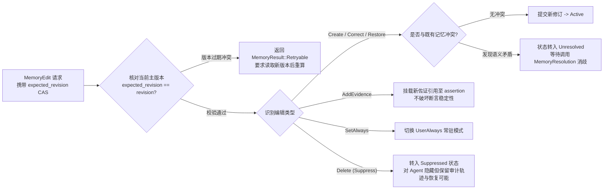

# 持久记忆系统与跨会话导入读取：事实证据链、时间区间与隐私边界

## 1. 为什么传统 RAG 向量库解决不了 Agent 的长期记忆可信度问题？

很多 Agent 系统做“长期记忆（Long-term Memory）”的办法非常粗暴：每轮对话结束后用大模型总结几句话，直接写进一张向量表，下回对话开始前按余弦相似度捞 Top-K 塞回系统提示。半年用下来，用户和工程团队都会陷入极度痛苦的困局：
1. **幽灵记忆（Ghost Memories）**：用户三个月前说“这个项目先用 Python”，上个月改口说“全部迁移到 Rust 了”，系统把两条前后矛盾的记忆按相似分一起捞了出来，模型瞬间精神分裂。
2. **无法溯源与审计**：当模型突然顽固地坚持一个错误偏好（比如强行在所有文件头加一段莫名其妙的注释），用户根本不知道它是哪一天、在哪次会话里学会这个坏习惯的，更无从精准修改或核销。
3. **隐私越权读漏**：有些临时调试、敏感安全排查或探索性草稿明明是在隐身/私密模式下跑的，一旦被全局记忆抽取器抓取或被跨会话全量捞出，立刻酿成上下文污染与隐私泄露。

Maka Rust 微内核放弃了黑盒字符串堆积路线，在 `plugins/agent/facts/src/memory.rs`、`plugins/agent/api/src/contract/memory.rs` 与 `Read("maka://session/<id>")` 协议中构建了一套**版本化历史账本、多维时间状态机、可追溯证据链与隐身零留痕**的持久化记忆架构。

---

## 2. 记忆不是一段孤立文字，而是可演进的版本化账本

在 `plugins/agent/facts/src/memory.rs` 中，一条记忆（`MemoryRecord`）拥有媲美金融账本的严谨类型结构：

| 领域属性 | 核心枚举 / 类型 | 工程设计意图 |
| :--- | :--- | :--- |
| **身份与双游标版本** | `MemoryId(Uuid)` + `revision: MemoryRevision` + `assertion: MemoryRevision` | 严格区分“最新元操作版本（如加一条新证据）”与“核心断言内容本身的版本号” |
| **加载策略（`MemoryMode`）** | `AutoRecall` / `UserRecall` / `UserAlways` | 区分由检索动态召回、用户显式调取，还是无条件常驻系统前缀（Always-on） |
| **生命周期状态（`MemoryState`）** | `Active` / `Unresolved` / `Suppressed` | 当发现新旧记忆发生语义冲突或被人工压制时，显式进入待决消歧或永久屏蔽状态 |
| **结构化分类元数据（`MemoryMetadata`）** | `kind` (`Fact`/`Preference`/`Instruction`) + `statement` (`Assertion`/`Preference`/`Intention`) + `temporal` (`Timeless` / `Interval { start, end }`) | 显式表达该记忆究竟是“永恒有效事实”、还是只在一个左闭右开时间区间 `Interval [start, end)` 内成立的阶段约束 |
| **证据与修正溯源（`MemoryVersion`）** | `source` (`Conversation { reference, operation_id }` / `UserOperation`) + `generation` (`UserInput` / `Extraction`) + `corrects: Option<MemoryRevision>` | 每一代改动都挂着明确的原始对话锚点及所纠正的前置版本链接 |

### 2.1 为什么区分 `assertion` 与 `revision`？

设想这样一种常见场景：系统在周一的对话里提取出一条记忆：“用户偏好用中文输出代码注释”（`revision = 1, assertion = 1`）。到了周三，用户在另一场会话里再次表态“注释尽量全用中文”。此时系统其实不需要重写真正的断言正文，只需追加一条佐证材料（`MemoryEdit::AddEvidence`）！
- 如果每次加新证据都把整条记录彻底改写成一个全新版本号且丢掉对原断言版本的绑定，后续审计就分不清“到底是内容变了，还是仅仅有人为旧结论新添了一笔证据”；
- Maka 将“指向当前核心内容语义的 `assertion`”与“记录整个实体变动序列的 `revision`”拆开，使得 `MemoryEvidenceRead` 可以精确针对某一个 `assertion` 版本分页拉取历次累积的所有对话佐证锚点（`MemoryEvidenceReference`），审计脉络清清楚楚。

---

## 3. CAS 并发修改、冲突消解与 `Suppressed` 屏蔽机制

多个后台会话可能同时向同一作用域（`MemoryScope`）写入新观察到的记忆。为了防止覆盖彼此的更新，所有变更全部收敛为 `MemoryEdit` 枚举下的六种原子动作：



请特别注意图中的 **`Suppressed` 状态与 `Restore` 动作**：
- 当用户删除一条由自动提取器（`Extraction`）生成的错误记忆时，系统并不会物理抹除这条历史记录，而是将其状态推进为 **`Suppressed`**；
- **为什么不能直接 `DELETE FROM memories` 物理删行？** 因为如果只是静默物理抹除，下一次重跑提取流程或者历史会话扫描时，后台模型极有可能从同一批旧对话里再次提取出完全一模一样的错误偏好重新塞回来！将它标记为 `Suppressed`（对 Agent 自动召回隐藏，但在系统记忆历史中留存痕迹），既立刻生效屏蔽，又彻底防止了“僵尸记忆反复复活”。倘若日后用户反悔，依然可以通过带版本号校验的 `Restore` 从历史档案中精准恢复。

---

## 4. 记忆可见性红线与 `incognito` 无痕模式

在企业与个人隐私场景下，记忆提取是一把双刃剑。`plugins/agent/README.zh-CN.md` 与 `api/src/session.rs` 明确刻画了**全局三道隐私与权限隔离防线**：

1. **读写总开关物理分离**：配置项清晰拆分 **`memory.enabled`**（是否允许系统维护与更新持久化记忆）与 **`memory.agentReadEnabled`**（是否允许运行时主动向 Agent 暴露读取记忆上下文）。哪怕用户暂停了自动注入给模型看，已建立的个人事实档案依然可由用户独立查看管理。
2. **会话级隐身模式（`create.incognito`）**：当用户在创建会话时传入 `incognito: true`（在 `StoredSessionConfiguration` 中持久化冻结）：
   - 该会话既不从全局持久记忆中自动抽取污染环境，其交互过程中产生的所有讨论、临时密钥或实验片段**绝对禁止被任何后台记忆提取器收录成长期记忆**；
   - 它确保了一次敏感故障排查或一次性沙箱提问在结束后不会留下跨会话的认知尾迹。
3. **派生索引可随时推翻重建**：还记得 `AGENTS.md` 中对持久化数据边界的核心规定吗？所有用于高效召回和关键词检索的 Recall/FTS 向量或全文索引全部定位为**纯粹的派生可重建视图**，真正的权威真相永远锁死在规范记忆版本表和原始 `Fact` 中。即使更换分词器或重做向量模型升级，也绝不损坏用户一丝一毫的原汁历史记忆。

---

## 5. 跨会话协议级按需读取：`maka://session/<id>` 与水位锚定

长程协同工作流或人类接力排查往往面临一个实际难题：Agent A 刚处理完一个复杂 Bug，现在新建了专注于写文档或回归测试的 Agent B，如何让 Agent B 精准查阅 Agent A 之前的推理与工具输出细节，又不至于一次性把几百万 Token 全塞爆 B 的上下文？

Maka 并没有新造一套冗余的自定义“查日志 RPC Tool”，而是将统一资源定位符思想融入标准 `Read` 工具协议，设计了 **`maka://session/<id>` URI 资源读取通道**：

```text
1. 按固定历史水位读取（防止边读边跑漂移）：
   Read("maka://session/0193a8f2-...?through=4821")

2. 按精确 FactId 穿透读取超大工具输出正文（避免摘要截断失真）：
   Read("maka://session/0193a8f2-.../tool-results/4790")
```

这套 URI 设计蕴含两个极其犀利的架构考量：
- **`through` 单调水位线保证读视图一致**：当 Target Session 仍处于活跃推进状态时，指定 `through=<fact_id>` 参数可以将投影读取死死定格在该事实游标之前的快照截面，彻底避免分页翻看跨页时因为对方正在新追加消息而导致的页码错位或重复阅读。
- **超大工具返回穿透通道（`/tool-results/<event-id>`）**：正常会话折叠向外部暴露摘要或有限预览窗口，以保护读取方自身的上下文窗口预算；一旦协调者或审查 Agent 判断某次测试输出或编译日志极为关键，便可通过附带的 `event-id` 精确按 `ContentRef` 直取全量原始载荷，既做到了日常轻量低噪，又不丢弃任何一根技术稻草。

---

## 6. 外部历史与归档会话导入（Session Import）

最后，针对从旧版本或外部工具（如过往会话归档、跨设备迁移、eval 测试用例初始化）引入既有对话的场景，`plugins/agent/engine/src/history/import.rs` 与 `maka-agent-facts` 中的 `RunOrigin::Imported` 共同构成了严密的**Session Import 机制**：
- 导入进来的运行记录不会伪装成“本地原生现跑出来的结果”，而是被永久打上 **`RunOrigin::Imported`** 身份钢印与权威历史边界校验；
- 结合 `api/src/session.rs` 中极其严格的不可篡改契约：**历史捕获的配置快照（Historical captured configurations）永远不会被悄悄静默升级或放宽权限**——哪怕当前宿主工作区放开了新的读写白名单，`StoredSessionConfiguration::resolve` 也会结合创建时冻结的 `boundary_revision` 与 `BindingStamp` 确保历史切片只能在其真实历史权限边界下被还原和续跑。

---

## 7. 总结

Maka Rust 微内核在处理“Agent 如何记住过去、如何阅读彼此”时，始终贯彻同一条底层信条：**绝不用模糊的相似文本堆砌替代严格的版本账本与权威边界**。
- 在长期记忆侧，通过 `MemoryId` + `assertion`/`revision` 双游标、时间区间 `Interval`、`Suppressed` 屏蔽防复活与 `incognito` 隐私物理隔断，让“记得住”和“忘得掉、查得清”同等可靠；
- 在跨会话读侧，用 `maka://session/<id>` 的 `through` 水位线与 `/tool-results/<event-id>` 穿透机制实现了既省 Token 又不失真的精确按需检索。

至此，我们已经看清了整个微内核是如何制造、压缩并记忆上下文的。接下来，Agent 真正开始动手改变世界——**03 工具、代码沙箱与操作系统级控制面篇**正式开启！第一篇直击业界最热门的执行范式优化：为什么代码执行单元（Code Mode）在 Maka 中拒绝快照、拒绝脚本重放，还要同时维持 `deno_core` V8 和 `Monty` Python 两套异步单元？请看：[Code Mode：V8 与 Monty 双运行时沙箱](../03-tools/code-mode-v8-and-monty.md)。
