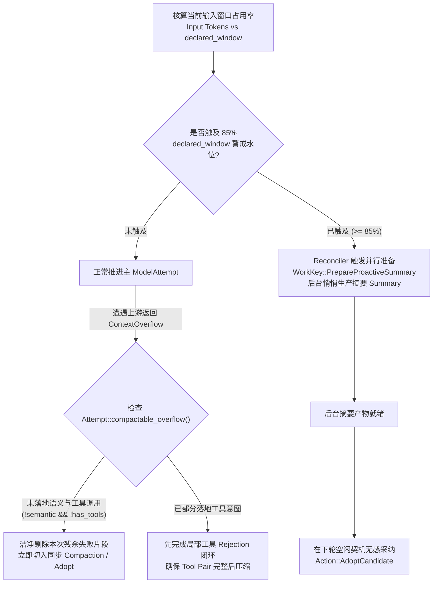

# 主动上下文压缩与多模态管线：85% 水位抢跑、原生接力与文档治理

## 1. 为什么“等模型报 Overflow 再被动截断”注定代价惨重？

几乎所有初代 Agent 都有这样一个被动救火逻辑：平时只管把消息不断塞给 LLM，直到某天接口突然抛出一个 `context_length_exceeded` 错误，再手忙脚乱地暂停主流程、临时发一条请求把前面历史全总结一遍、再重新塞回主循环。

这种“撞墙后再被动压缩（Reactive Compaction）”模式在工程上有三个致命硬伤：
1. **彻底破坏 Prompt Cache 与用户等待体验**：主流程本可以 1 秒发出推理请求，结果在用户提交新指令后突然撞墙，硬生生卡住数十秒去做一次额外的摘要生成；更糟的是，刚才那次撞墙的失败请求还白白消耗了一次完整的上行网络带宽与等待延迟。
2. **局部残废尝试污染账本**：如果模型在溢出瞬间只流出一半残缺词元或坏掉的工具调用参数，粗暴丢弃很容易导致历史状态机出现“有调用没结果”的断裂拓扑。
3. **跨模态载体丢失与盲目重试**：上下文越满时，历史上附带的高清截图和几十页 PDF 往往是吞噬 Token 的元凶；如果不加区分地重放或重传已拒绝的文档附件，只会让压缩后的新窗口再次一头撞死。

Maka Rust 微内核将上下文治理从“事后救火”升级为了结合**85% 水位抢跑式主动压缩（Proactive Compaction）**、**溢出洁净剔除（Compactable Overflow）**、**Codex 原生压缩协同**以及**结构化多模态文档防退化治理**的立体防御体系。

---

## 2. 双轨压缩机制：85% 抢跑预摘要 vs 溢出洁净恢复

通过 `plugins/agent/engine/src/driver/compaction.rs` 与 `reconcile.rs` 的协同设计，Maka 构建了截然不同的两条压缩工作流：

### 2.1 `compaction_timing()` 与 85% 水位阈值设计

在 `compaction.rs` 中，`compaction_timing()` 通过评估最近一次成功计量的上下文体积与模型预设的 `declared_window`（有效上下文窗口基线），在占用达到 **85%** 这条黄金分割线时便提前向系统亮起红灯，同时兼顾多分支策略判断：

1. **后台无感预备（`proactive_summary`）**：当用户还在阅读本轮回复或刚刚开始思考下一个问题时，后台通过 `WorkKey::PrepareProactiveSummary` 挂起一个完全独立的辅助模型请求（`ModelPurpose::Compaction` / 独立 `Attempt`）。注意我们在 `reconcile::next()` 中读到过一条精巧规则：**除非本次 Run 正在彻底收尾完成（`finish_requested` 或 `complete_at_budget`），否则后台仍在跑的主动预摘要绝不阻塞当前主回答流程的推进**；只有等到它生成成功、准备作为新历史基线切换时，再通过 `AdoptCandidate` 完成零中断移交。
2. **防压缩死循环与自定义压缩 Prompt**：用户还可以在会话配置 `StoredSessionConfiguration` 中定制 `compaction_prompt`，并且 Reconciler 会严格辨识当前 Attempt 的用途——`Trigger::ContextCompact` 本身处于摘要生成轮次中时，`final_reply()` 会明确禁止其误判为普通最终对话输出。

---

## 3. 原生压缩通道协同：Codex Native Compaction vs 通用文本回退

不同模型底座在面对超长上下文时的最佳压缩手段是不一样的。部分先进模型底座（特别是 OpenAI Codex / Responses 特定模型端点）提供了原生的上下文压缩专用端点或服务端状态压实协议（Native Compaction），能在保留高层隐式推理张力的同时压缩历史上下文。

`driver/compaction.rs` 因此设计了自适应双模式路由：
- **Codex Native 优先**：当当前选中的模型能力与后端协议支持原生压缩时，直接走专用的原生压缩交互原语，将历史切片高效折叠为上游可识别的压缩基线项；
- **标准文本摘要回退（Text Fallback）**：对于常规大模型或原生通道不可用的端点，自动降级为结构化提示词驱动的标准文本摘要，产出严格的接力摘要包（携带已完成动作、关键路径、遗留阻断项和精确文件锚点），并在本地记录全新的 Watermark 水位坐标，使得重连或新启 Turn 时只从该接力水位之后继续组装请求。

---

## 4. `RunId` 不变的背后：基于 Watermark 与 `CheckpointHandoff` 的接力边界

无论选择原地采纳压缩摘要（`Action::AdoptCandidate`）还是伴随检查点交接开启新推理单元（`Trigger::ContextCompact` / `Trigger::CheckpointHandoff`），Maka 都守住了我们在基础篇强调的铁律：**前端外部持有的 `RunId` 永不分裂**。

从数据模型来看，变化的是内部的“上下文投影基线（Compaction Watermark）”：
- 在摘要被正式写为持久化 `Fact` 后，`canonical_prompt` 进行确定性折叠时，自动以最新的被采纳摘要块取代水印线之前的所有陈旧消息和冗长工具返回值；
- 如果压缩期间还存在尚未最终归档清理的物理句柄（例如外置操作回执或 Code Cell），`reconcile::next()` 中的 `handing_off` 分支强制要求先拿到全部 `OperationCleanup::Confirmed` 回执，**决不允许在旧句柄未脱钩时提前切换上下文水位**。

---

## 5. 多模态载荷治理：图像预算、PDF 防瞎撞与材料生命周期

在当今多模态编码与桌面操控（Computer Use）场景下，把上下文撑爆、把网关拖垮的头号元凶往往不是文本代码，而是**高分辨率屏幕截图与多页 PDF 文档**。Maka 为多模态物料建立了贯穿准备期（Preparation）、传输期（Model Transport）与外部移交期（External Handoff）的三重防线：

### 5.1 准备期冻结与资源租约（`history/images.rs` & `preparation_io.rs`）

当用户通过上传附件、剪贴板粘贴或桌面监控截屏引入图像/文档时：
- 大字节多模态资产**绝不内联进 Event-Log 主事实表**，而是落入 `ArtifactStore` 成为按作用域隔离（`SessionScope`）与内容寻址的 `ContentRef`（字节长度 + 摘要）；
- 在准备一次请求前，通过 `ModelPreparationResources` 结合当前模型 `capabilities`（例如最大像素分辨率、支持的图片编码与是否支持原生文档输入）完成格式化整备，并将当前作用域引用冻结在 `history/frozen.rs` 凭证里；
- 在移交给外置 CLI 执行器（如 Claude / Codex）前，由 `attachments::prepare` 按单一安全契约解密解析到隔离临时区，并在完成移交前全程受控，确保任务取消或退出时立刻自动销毁。

### 5.2 PDF 与原生文档拒收治理契约

回顾在上一章提及的核心架构契约 `runtime-pdf-rejection-recovery.md`：
- 不同适配器（如 `adapters/anthropic_documents` 与传统视觉端点）对 PDF 页数上限（如 100 页限制）或加密形态的容忍度极不统一。
- 当远端模型拒收某份文档附件时，协议层必须提取结构化的拒绝归因（区分“暂时性速率限流”、“确定性超出单页上限/文档损坏”还是“模型根本不支持原生 PDF 块”）。
- **准入不盲重试规则**：除非拿到了明确的“可恢复降级或裁剪路径”的结构化拒绝信号，否则引擎严格禁止对着同一份被拒收的 PDF 负载做常规网络退避重试——既避免浪费高昂多模态编码算力，也防止陷入无限死循环锁死当前回合。

---

## 6. 总结

上下文管理从来不是单纯的“字符数统计与截断”，而是横跨成本、延迟、缓存命中率、工具完整性与多模态安全的一场系统工程平衡：
1. **85% 水位抢跑预压缩**：将摘要耗时平摊进空闲窗口并避开正序请求卡顿；
2. **`compactable_overflow()` 精准剔除**：确保哪怕撞墙溢出，残余失败尝试也能被干净剥离而绝不污染后续推理与重放；
3. **原生/文本双模自适应**：充分利用 Codex 原生压实红利的同时保留跨供应商兜底基座；
4. **内容寻址与 PDF 拒收契约**：把沉重的多模态资产彻底挡在核心 Event-Log 之外，用确定性规则代替碰运气重试。

压缩解决了“单次会话内部怎么活得久”的问题；而当系统需要跨多个会话记住用户习惯、纠正错误常识，甚至把过往项目对话无缝导入微内核并防止隐私泄露时，就要靠长期记忆系统与导入通道来接棒了。下一篇聚焦长期记忆与跨会话读取——[持久记忆系统与跨会话导入读取](./memory-and-session-import.md)。
