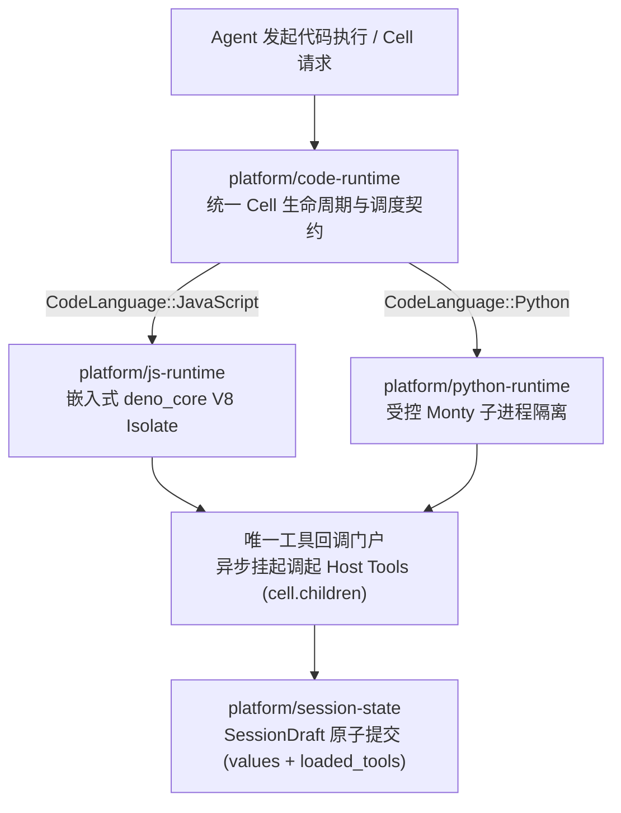

# Code Mode：V8 与 Monty 双运行时沙箱、同步 CPU 计费与状态草稿

## 1. 为什么 Agent 需要“编程执行模式（Code Mode）”而不只依赖 JSON Tool Calling？

在标准 JSON Tool Calling 范式下，如果 Agent 需要：
1. 读取目录下 30 个文件、过滤出包含特定函数的模块、统计修改分布；
2. 根据条件分支批量调用多个数据检索工具并把结果交叉聚合；

传统循环必须让大模型逐个或小批吐出 JSON 工具请求 -> 等宿主跑完 -> 全量原始字符串塞回上下文 -> 大模型再读一遍再决定下一个动作。这种反复“吐 JSON -> 塞上下文 -> 再推理”的乒乓交互（Ping-Pong Roundtrip），不仅延迟叠加、输入 Token 暴涨，还会把大量中间临时数据永久留在推理窗口里污染注意力。

**Code Mode** 允许大模型（或者外部执行器）在一个持久作用域的脚本单元格（**Code Cell**）中直接写一段编排代码（JavaScript 或 Python），在单次执行里用循环、条件和局部过滤去调用被安全注入的工具能力，最终只把精炼汇总结果吐回模型。

但一旦允许运行生成代码，四个硬核基础设施难题立刻扑面而来：
1. **死循环与堆爆炸**：模型随手写出 `while (true) {}` 或申请 1GB 数组怎么办？如果挂起一次外部工具的异步等待算进执行超时里会误杀吗？
2. **多语言生态与轻量隔离矛盾**：JS 生态适合用嵌入式 V8，但跑 Python 难道要在每个沙箱里塞进庞大的 CPython 解释器环境吗？
3. **跨 Turn 持久状态怎么办**：很多竞品想靠保存 VM 堆快照或重放历史脚本来维持变量状态，这真的安全吗？
4. **崩溃重启时的回调对账**：代码跑到一半正异步回调主宿主的一个写入工具时进程崩了，重启后怎么确认那个嵌套子调用到底成没成？

Maka Rust 微内核用 `platform/code-runtime`、`platform/js-runtime`、`platform/python-runtime` 与 `platform/session-state` 给出了一套高度一致、极度克制的双引擎解答。

---

## 2. 双运行时底座：`deno_core` V8 vs `Monty` Python

Maka 在 `AcceptedModel::code_language`（消息准入期冻结）与独立 Runtime crate 层将代码单元物理划为两套隔离执行引擎，并在上层收敛于统一的 `platform/code-runtime` 生命周期契约之下：



| 对比维度 | JavaScript 引擎 (`platform/js-runtime`) | Python 引擎 (`platform/python-runtime`) |
| :--- | :--- | :--- |
| **物理隔离形式** | 单纯依托 `deno_core` 创建严格受限的 V8 Isolate | 启动受控 **Monty 子进程**执行纯受限 Python 子集 |
| **为什么选它？** | 极速冷启动、精准异步 Promise 调度、天然绑定结构化宿主回调通道 | **无需携带庞杂 CPython 二进制与不受控原生 C 扩展生态**，天然适配极简沙箱边界 |
| **宿主网络 / 文件系统权限** | 零裸 FS / 零任意网络 API；全部通过绑定回调进出 | 同样彻底剥夺底层操作系统原生系统调用路径 |
| **模块加载与就绪握手机制** | 两步严格握手：`prepare_module` 预编译装填 + **`VmBound` ACK** 确认绑定 | 通过明确协议管道完成代码加载、调用帧与工具回传交换 |

### 为什么要设计 `prepare_module` + `VmBound` 两步握手？

在异步运行时里，最隐蔽的启动竞态是“客户端刚刚调了创建 Cell 并立刻塞入调用或取消指令，底层 V8 Isolate 还没来得及把模块脚本编译挂载上去”。`js-runtime` 强制规定：**先触发 `prepare_module` 在安全工作线程装配隔离模块，直到返回显式的 `VmBound` 确认回执后，引擎才会把该 Cell 状态正式推进并开放代码执行与回调接入**，从而让 Reconciler 可以清晰分辨“绑定前取消”与“运行中打断”。

---

## 3. 极精巧的资源计费模型：`CellLimits` 的“纯粹同步 CPU 预算”

在传统 JS 或 Python 沙箱里，设一个“30 秒总超时（Wall-Clock Timeout）”是最常见也最糟糕的做法——如果模型写的代码先循环处理 10 毫秒，接着 `await` 调用了一个耗时 45 秒的大模型子分析或审批等待工具，30 秒总计时器会极其冤枉地把正在合法等待外部返回的代码单元一刀掐死！

Maka 在 `platform/code-runtime` 中实现了精细得多的 **`CellLimits`** 约束体系：

```text
Cell 执行时间线剖析：
├── [ 同步 VM JS/Python 指令运算 0.2s ] -> 计入 30s 同步 CPU 上限！
├── [ 异步 await Host 工具调用 42.0s  ] -> 暂停 VM CPU 计时！(受各自工具/Host 独立超时监管)
└── [ 唤醒恢复后继续同步运算 0.5s     ] -> 恢复累计，总消耗仅 0.7s < 30s
```

1. **只计 VM 同步 CPU 时间（30 秒）**：只有当虚拟机内部真正占用线程死算时，30 秒同步 CPU 熔断器才会滴答走字；一旦代码进入异步挂起等待宿主外部工具回调，VM 时钟立刻冻结。死循环（`while (true) {}`）会在 30 秒内精准被 V8 Terminate / 子进程强杀，而合法编排长耗时工具的代码哪怕跑五分钟也不会被误伤。
2. **硬性 64 MiB 堆内存天花板**：通过配置 VM 堆限制锁死在 64 MiB 量级，直接阻断恶意分配炸弹把宿主拖进 OOM，触顶立即触发隔离销毁与干净清理确认。

---

## 4. 拒绝 VM 堆快照与脚本重放：`SessionDraft` 原子持久化

如果第 1 轮执行的代码定义了一个变量 `results = await scan()`，第 2 轮代码想直接用 `results` 继续过滤，宿主如何在进程重启或 Turn 切换后保住这份上下文？

正如我们在架构取舍篇中剖析过的：**Maka 坚决拒绝 V8 Heap Snapshot（堆内存二进制镜像）与历史 Script Replay（重头再跑一遍旧代码）**。

取而代之的是 `platform/session-state` 定义的极简确定性状态模型 **`SessionDraft`**：

```rust
// 教学化概念结构（源自 platform/session-state）
struct SessionDraft {
    values: BTreeMap<String, JsonValue>, // 显式跨轮次持久化导出的纯可序列化变量状态
    loaded_tools: Vec<LoadedToolSpec>,   // 本 Cell 会话当前动态装载并被准许的工具绑定清单
}
```

### 这套设计为什么能做到既可靠又能原子回滚？

1. **原子草稿与提交语义**：一段代码单元在运行中途对其变量表、动态工具加载清单所做的局部变更，均先落入瞬态的 `SessionDraft` 缓冲区中。**如果中途脚本抛出未捕获异常、遭遇 64 MiB 内存溢出或被取消（`Cancelled`），整份草稿直接丢弃，绝不留半截脏状态给下个回合**！唯有当该执行段落干净收尾，宿主才原子性地将 `values` 与 `loaded_tools` 提交合并为新一版持久化状态。
2. **跨版本免疫与零隐藏副作用**：因为存储的纯粹是 JSON 可序列化数值与声明式工具列表，系统升级了 `deno_core` 大版本、甚至把同一个计算单元转移到另一台异构 CPU 的宿主机上，都能 100% 重建一致的运行时环境，更永远不会像 Script Replay 那样因为重放而再一次执行了写文件操作。

---

## 5. `CellId` 确定性命名空间与跨边界子调用清算（`cell.children`）

把 Code Mode 真正拉进微内核“金融级状态机”视野的，是 `Cell` 与主引擎 `Reconciler` 之间严密的因果绑定：

1. **确定性 UUIDv8 身份推导**：
   - 通过 `CellId::for_agent(...)` 与 `CellId::for_external(...)` 直接从所属会话作用域与单元格名称以 UUIDv8 算法确定性算出 ID。即使进程在执行半途崩溃，重启后无需额外维护易丢的随机 ID 映射表。
2. **子工具嵌套追踪（`cell.children`）与阻塞机制**：
   - 脚本在沙箱内调用的所有 Host 工具，并不是“放飞不管的后台线程”，而是作为显式的子调用节点登记在 **`cell.children`** 中，并同步对应宿主侧两阶段操作收据（`Receipt` / `ToolSettlement`）。
   - 如果发生宿主机异常，Reconciler 里的 `cell_action()` 会对每一个非干净结束的 Cell 做严格排查：若出现 `vm_uncertainty` 或发现 `Interrupted` 后仍有未确认胜负的子调用（`!child.known()`），引擎立刻下发 **`Action::Block(CodeCellRecoveryUnavailable)`** 主动锁停后续推理，等待人工/风控介入决策，确保代码脚本内部调出来的任何写副作用都“算得清、查得到、绝不静默丢单”。
   - 若外部同步回调尚未通过主 Tool 状态接受线（`synchronous_pending`），`AcceptCellFinal` 也会耐心排队礼让，甚至如 `reconcile.rs` 注释所写：**哪怕关联 Cell 已先行结束，仍在生命周期内的活体回调结果依然通过 `AcceptedResult::CellRecovered` 被精准回收承接**。
3. **物理释放强制确认（`physical_cleanup_confirmed`）**：
   - 当主 Run 要终止退出或切换上下文快照前，`reconcile::next()` 必验每一枚曾运行的 Cell 是否已拿到物理销毁 ACK（释放线程、销毁 Isolate 或回收 Monty 子进程），未确认前一律转为 `WaitReason::Cell` 绝不抢跑退出。

---

## 6. 总结

Maka 的 Code Mode 用行动证明：**把代码执行器嵌入 Agent 内核，绝不等于随便拉个子进程 `eval()`**。
- 它用 **`deno_core` V8 + `Monty` Python** 分治双语边界，用 **30s 纯同步 CPU 计时 + 64 MiB 堆锁死** 兼顾安全熔断与长异步回调容忍；
- 它用 **`SessionDraft` 原子提交** 取代高脆弱性的堆快照与脚本重放；
- 更用 **`cell.children` 嵌套追踪 + `physical_cleanup_confirmed` 清理栅栏** 将“代码块内部的嵌套副作用”严丝合缝地并入了整台 Reconciler 的数学确定性版图之中。

当代码单元与原生工具需要走出单机封闭盒，一方面去挂载海量第三方 **MCP 工具生态**，另一方面又要通过 **Computer Use** 接管桌面屏幕与浏览器时，微内核又是如何用最小授权控制界面、用非镜像渲染守护预览安全的？下一篇直击这两大外部前沿协议——[MCP 客户端边界与 Computer Stage 安全舞台](./mcp-and-computer-stage.md)。
