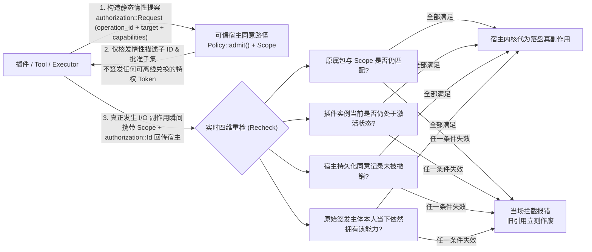
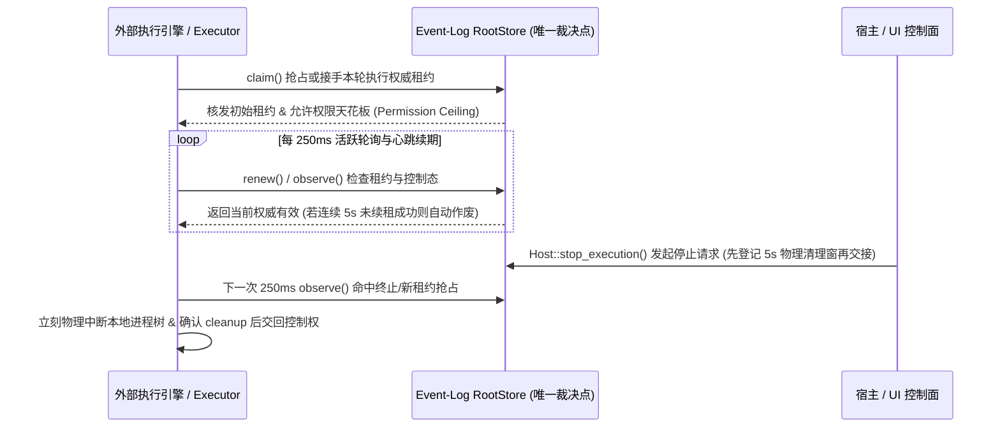

# 执行权威契约与非持有型能力模型：消除“无记名通行证”安全隐患

## 1. 分布式微内核最致命的权限幻觉：“拿到凭证字符串 = 有权执行”

在传统模块化软件甚至很多早期 Agent 框架里，权限控制往往写成下面这种极其好写却后患无穷的形态：
1. 系统启动时，用户点了一次“允许插件访问文件”，宿主塞给插件一段凭证 token（或者一段授权 JSON 对象 `Grant`）；
2. 之后不管过了一周、不管这个工具是被后台定时任务偷偷唤起，还是被一个子会话转发复用，插件只要拿着那个序列化后的 JSON 字符串往接口里一塞，服务就当场放行。

安全架构领域将这种携带即授权的凭证称为 **Bearer Capability（无记名通行证）**。只要系统里存在哪怕一个可跨进程或跨持久账本传递的 Bearer Token，就注定会埋下三颗定时炸弹：
1. **权限滞后与撤权失效（Stale Authority）**：用户在设置界面早已收回了这个插件或工作区的写入权，但它靠手里捏着的旧序列化对象依然能长驱直入。
2. **宿主崩溃后的僵死执行体（Runaway Executor）**：前端早已取消了整个 Run，或者新的一任宿主接管了会话，而早先发出去在外部跑着的子执行器如果还在靠一张老授权书继续删改本地文件，就会引发彻底失控。
3. **身份边界混叠**：一个处于只读审查模式的子代理，通过诱导高权限协调者转发引用 ID，间接骗过下游服务的权限门禁（混淆代理人攻击 / Confused Deputy）。

Maka Rust 微内核在 `platform/capabilities` 与 `platform/event-log`（`ExecutionAuthority`）中，构建了一套在 Rust 类型系统与持久化租约层面彻底消灭 Bearer Capability 的**“非持有型权威再核验（Non-Bearer Capability & Re-verified Execution Authority）”**体系。

---

## 2. 第一信条：序列化描述子永远不是能力凭据

通读 `platform/capabilities/src/authorization.rs` 与 `permissions.rs` 顶部的模块文档，几乎每几十行就能看到一句振聋发聩的工程警句：

> **Consent descriptions and durable references, never bearer capabilities.**
> （此处仅是同意书的描述文本与持久化引用凭证，永远不是可直接行使权限的无记名通行证。）

> **Returns the approved subset, not a bearer token. Every effect rechecks its authority.**
> （审批返回的是被批准的能力子集声明，而非通行令牌。每一次真实的外部副作用在落锤前，都必须重新向上核验当下活体权威。）

在架构实现上，Maka 将“**申请了什么**”与“**当下此刻到底允不允许执行**”彻底劈成两半：

这一套“**四维实时重检（4-Way Live Recheck）**”完全抹杀了静态提权路径：
- `Request`（包含唯一幂等 `operation_id`、`title`、目标作用域 `Target` 以及最小能力集 `BTreeSet<Capability>`）本身是**完全惰性（Inert）的**；哪怕这段 JSON 被打印进日志或泄露给了不受信任模块，对方拿着它也无法直接调起任何文件读写、网络出站、模型请求或进程派发。
- **`Target` 严防内部状态泄密**：当扩展工作在 `PluginWorkspace` 时，规定清晰指出“仅由宿主为该包/作用域安全派生独立暂存工作区，**绝对禁止借由授权通路直接触及微内核底层任意状态文件或全局账本**”。
- **边界修订版本号绑定（`boundary_revision`）**：还记得我们在 `api/src/session.rs` 中看过的字段设计吗？每一次权限基线判定都要绑定工作区实例的 `BindingStamp` 与 `boundary_revision`。即便是过往已经保存的历史会话，在重新加载执行时依然按当时冻结边界与当前全局撤销表取交集，**历史配置永远不会被偷偷静默升权**。

---

## 3. 第二支柱：`ExecutionAuthority`——物理长运行任务的实时心跳租约

除了静态权限边界核查，Agent 系统还有一类极其危险的动态边界问题：**如何控制一个正在运行的长时间外部任务或后台工具进程，在宿主被停掉、切换或降权时能在 5 秒内感知并自动停手？**

为此，`platform/event-log/src/checkpoints/execution.rs` 制定了严格的 **`ExecutionAuthority`（执行权威契约）**，把一次运行的物理“活着干活资格”彻底变成一份必须高速续租的短命租约：

### 拆解 `ExecutionAuthority` 的四项严苛系统律令

1. **250ms 探测频度与 5 秒死刑熔断**：只要是一个受管运行体，底层权威协调器就以 **250 毫秒** 为节拍持续 `renew` / `observe`。一旦遭遇进程卡死、宿主与 Root 失联或者心跳链断裂超过 **5 秒窗口**，该租约自动判定吊销，所有与该运行体关联的下游资源投放通道立即闭门锁死。
2. **权限天花板交集原则（Permission Ceiling Intersection）**：一个子 Agent 或后台定时任务可能宣称自己配置了较宽的权限，但整个执行链路允许到达的实际最大能力，永远等于 **“初始请求权限 ∩ 宿主全局天花板 ∩ 托管环境当前即时约束”的交集**——绝不存在下层任务擅自突破上层托管模式天花板的情况。
3. **托管模式（Managed Mode）下的 RPC 封口**：当执行体处于严格受管或隔离执行阶段时，高危或越界管理 RPC 会直接从控制平面中封禁摘除，使子执行器哪怕存在自身逻辑缺陷也找不到通往全局配置变更与宿主提权的接口。
4. **`Host::stop_execution` 的 5 秒清理前置规则**：当外部显式调用停机接口接管一个正跑在半路的执行器时，规范明确要求必须先登记不少于 **5 秒的物理清理缓冲窗（Cleanup Registration）** 并通知原任务收尾释放子进程与文件锁，才能把控制接力棒平稳移交给下一步操作——这也正是我们在 `Reconciler` 篇看到的所有工作最终必须卡在 `OperationCleanup::Confirmed` 才放行的底层遥相呼应之处！

---

## 4. `Capability` 细粒度能力矩阵：把“一切读写”拆解为十二把独立钥匙

看看 `platform/capabilities/src/authorization.rs` 里枚举出来的 `Capability` 定义，你会立刻理解微内核对最小权限原则（Principle of Least Privilege）到底抠到了多细：

| `Capability` 枚举项 | 受控行为域 | 工程意义与隔离重点 |
| :--- | :--- | :--- |
| **`ReadFiles` / `WriteFiles`** | 受定界工作区或指定目录的读写 | 读写彻底分拆，只读洞察/发现（Discovery）与检索插件天然绝不可能携带 `WriteFiles` |
| **`Network` / `Models`** | 出网代理通道与大模型 API 路由 | 严格限制纯计算或局部格式化工具擅自出网泄密或隐形偷跑高价模型请求 |
| **`Processes` / `Executions`** | 拉起沙箱化命令子进程与外部执行器生命周期 | 普通读取/MCP 元数据工具彻底剥夺拉起 Shell 子进程的权利 |
| **`ClientCapabilities`** | 调用桌面通知、剪贴板、文件选择器等端侧能力 | 隔离仅在后台跑批的插件与前端用户桌面交互面的越界骚扰 |
| **`ReadSessions` / `ReadHistory`** | 跨会话读状态、历史记录审计检索 | 严格把“能运行当前任务”与“能窥探其他用户隐私历史记录”拆开授信 |
| **`ReadUsage` / `ManagePricing`** | 用量核算查询与模型计费表维护 | 防止普通业务扩展随便读取账单数据甚至篡改本地费率定价规则 |
| **`Notifications`** | 向工作台或操作系统弹窗推送异步通知 | 管控后台定时任务（Schedule）与 Discovery 的打扰频率权限 |

---

## 5. 总结

安全领域有一句名言：“如果你没有在最底层的抽象里消灭无记名通行证，你在上层写再多 `if checkPermission()` 迟早都会被某条新加的分支绕过。”

Maka Rust 微内核在 `03-tools` 篇所呈现出的完整工具与权限防御闭环，层层紧扣：
- 最内层，**Code Mode** 用 30s 纯同步 CPU 计时、64 MiB 堆锁死与 `SessionDraft` 原子持久化锁死代码沙箱；
- 生态交互层，**MCP 与 Computer Stage** 用 5s `CleanupMaterial`、按需扩展租约与只读视觉权威分离，堵死输入注入和连接泄露；
- 物理 OS 层，**Windows MXC / bubblewrap / Seatbelt** 用零特权原生容器、可逆占位符与代理重定向拦截做到 Fail-Closed；
- 制度总闸层，**`authorization` 非持有型能力模型与 `ExecutionAuthority` 250ms/5s 租约契约** 确保一切能力凭证离宿即废、每次真正产生外部副作用瞬间都会完成“四维实时重检”。

至此，`02-context` 与 `03-tools`（共 7 篇核心章节）已全部书写完毕！接下来我们将深入微内核的“时间机器与持久化物理心脏”——**04 持久化状态、Event-Log 与传输底座篇**，第一篇首先拆解全库最底层的单写者同步持久化引擎 `maka-event-log`：[Event-Log、单写者引擎与两阶段持久化操作](../04-state/event-log-and-two-phase-ops.md)。
