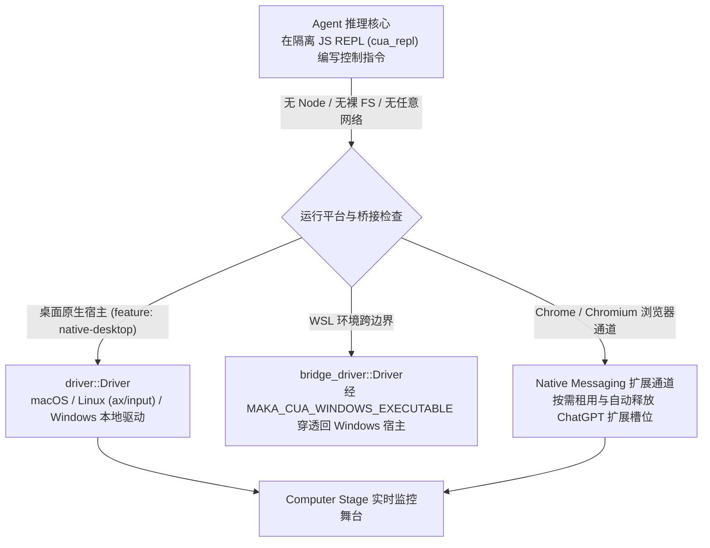
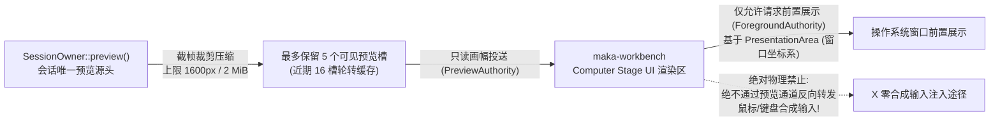

# MCP 客户端边界与 Computer Stage：受管连接池、按需租约与无注入视觉舞台

## 1. 外接生态工具与接管人类界面的双面挑战

一个强大的通用 Agent，既需要向上消费数以千计由社区和企业自建的 **Model Context Protocol (MCP)** 服务，又常常需要在没有开放 API 的老旧软件或 Web 应用里充当数字操作员（**Computer Use / 浏览器与桌面控制**）。

然而在工程落地上，这两大扩展面偏偏也是系统最容易出现**权限滑坡与资源泄露**的地方：
1. **MCP 插件擅自绕开审批与账本**：很多运行时把 MCP Client 直接做成透传工具代理，工具变更通知（Tool List Changed）一到就悄悄换掉内存列表，超时断连时底下的远端进程/HTTP 长连接成为僵尸进程。
2. **浏览器接管永久霸占用户插件、混传真实凭据**：早期桌面自动化方案往往会粗暴修改用户日常 Chrome 配置，或者通过截屏转发器不小心把“只读观测窗口”变成“可以注入恶意点击的远程木马通道”。

Maka Rust 微内核在 `plugins/agent/mcp` 与 `platform/computer-use` 中对这两个高频边界进行了极其克制的**能力收拢与权限切分**。

---

## 2. 受管 MCP 客户端边界：`maka-agent-mcp`

查看 `plugins/agent/mcp/src/lib.rs` 顶部的核心设计宣言：
> **Installation-owned MCP connections. Protocol code stays behind this boundary; the Agent owns per-call permission, journal admission and user confirmation.**
> （MCP 连接由安装级宿主统一所有；协议解析逻辑严格留在边界之内；每次调用的权限核准、日志账本准入与用户二次确认全部收归 Agent 核心所有。）

基于 Rust 官方生态库 `rmcp`，`maka-agent-mcp` 实现了对 **stdio 本地进程传输** 与 **Streamable HTTP 远程服务端** 的统一收编，但同时竖起了四道边界围栏：

| 工程维度 | `maka-agent-mcp` 的具体约束实现 | 解决的核心风险 |
| :--- | :--- | :--- |
| **双向只读标注与前置校验 (`validate`)** | 读取服务端返回工具列表后解析 `read_only` 元数据，并经由 `validation::validate` 校验 Schema 与命名规范 | 防止远端恶意 MCP 注入畸形 ToolSchema 破坏大模型工具定义槽或诱导错误参数 |
| **动态目录变更原子感知 (`invalid`)** | 在 `ClientHandler::on_tool_list_changed` 中不直接在后台回调里私自替换运行时工具集，而是置位 `invalid` 原子标记 | 保证工具目录刷新只发生在核心准入与新一轮模型请求装配的安全缝隙，避免推理半途工具契约撕裂 |
| **原初清理托管权 (`CleanupMaterial`)** | 每条 `Connection` 内部绑定不可伪造的 `CleanupMaterial` 与 `CancellationToken`，配合统一 **`CLEANUP = 5s`** 超时契约 | 即便关联业务调用意外脱落，`Inner::drop` 与底层 `RuntimeOwner` 确保远端/子进程 MCP 管道在 5 秒清理窗内干净回收 |
| **零独立授权权威** | 协议层永远无法自行决定“自动放行某个调用” | 每一次真实的 `tools/call` 依然由 `plugins/agent/engine` 的权限策略、人工审批（`ApprovalId`）与 Event-Log `RecoveryRef` 统一门禁放行 |

---

## 3. Computer Use 架构：会话隔离 REPL、原生浏览器接管与 WSL 桥接

与许多框架直接在 LLM Prompt 里硬暴露几十个碎片化工具（`mouse_move`、`click`、`type_text`、`scroll`、`screenshot`……）不同，Maka 在 `platform/computer-use` 中将整个桌面与浏览器自动化体系封装为一套**会话隔离的 REPL 控制模型（`cua_repl` / `cua_reset`）**。

### 3.1 隔离的 `cua_repl`：能力恰到好处的 JS 外壳

在 `cua_repl` 执行环境内，Agent 可以编写简短连贯的 JavaScript 操作流水（例如点击、等待控件稳定、截取局部区域、检查状态），并通过 `cua_reset` 一键重置会话级执行上下文。同时系统注入了极简只读环境变量（如 `nativePlatform`、`audioEnabled`），**绝对不提供 Node.js 标准库、不开放本地文件系统与任意网络请求能力**，将暴露面缩至最小。

### 3.2 按需租约的浏览器接管与人工交接闭环

针对现代 Web 自动化最头疼的“登录态与日常浏览器插件冲突”问题，`computer-use` 提供了两项极实用的工程原语：
1. **ChatGPT / 扩展按需租用与自动归还（On-Demand Leasing）**：支持通过 `maka browser install --provider chatgpt --on-demand` 挂载扩展通道；在活跃自动化任务发起时临时租用扩展槽位（`BrowserLeaseChildRequest`），并在回合收尾或异常退场时自动归还（必要时可由 `maka browser restore` 一键恢复用户原生态）。绝不长时间劫持用户主浏览器。
2. **交付与人工交接契约（`markDeliverable()` / `markHandoff()`）**：一旦遇上支付页面、敏感登录态、风控验证（遵循零绕过规则）或关键最终确认，脚本明确通过 `markHandoff()` 把焦点优雅交还人类操作，再通过 `markDeliverable()` 锁定最终产物切片。

### 3.3 WSL2 到 Windows 的透明原生桥接

考虑到大量开发者习惯把核心后端或 CLI 跑在 Windows 的 WSL Linux 子系统内，如果直接在 WSL 里调桌面驱动往往面对无 Display Server 的死胡同。`platform/computer-use` 借助编译期分支（`#[cfg(not(feature = "native-desktop"))]`）切换至 **`bridge_driver`**，通过环境变量 `MAKA_CUA_WINDOWS_EXECUTABLE` 自动桥接回 Windows 原生桌面可执行宿主，无缝打通文件上传（`BrowserUploadRequest`）、剪贴板与屏幕视觉控制链路。

---

## 4. Computer Stage 实时预览舞台：观测权与输入注入权的物理决裂

当 Agent 在后台浏览器或独立虚拟桌面忙碌时，人类用户希望能在工作台界面（`maka-workbench`）里像看直播舞台一样实时看到几个活跃会话正在操作什么页面，甚至偶尔把某个背景窗口切到前台自己看两眼。这个组件就是 **Computer Stage**。

然而在桌面级基础设施里，哪怕一点“预览通道”的权限混淆都极其危险：**如果用于 UI 画面监控的句柄（Preview）不小心携带了坐标点击转发能力，恶意渲染层或被污染插件就可能伪造用户鼠标点击去接管主机！**

查看 `platform/computer-use/src/preview.rs` 的源码设计与注释规范，可以看到一套堪称铁板一块的权威切分架构：

这一小段文件仅几百行，却处处透着老练的安全工程审慎：

1. **严格的画面与槽位上限防刷爆**：
   - **`MAX_PREVIEW_TARGETS = 5`**（工作台同时最多开放 5 个实时可见目标预览槽，后台保留 **`MAX_RECENT_PREVIEW_TARGETS = 16`** 个最近生产者记录以供视图平滑轮换）；
   - 单帧画面强约束在 **`MAX_PREVIEW_DIMENSION = 1600` 像素**与 **`MAX_PREVIEW_BYTES = 2 * 1024 * 1024`（2 MiB JPEG）**，既保证高分屏文字清晰可辨，又彻底杜绝无压缩高帧率投屏拖死跨端 IPC 信道。
2. **双权威严格隔离（`PreviewAuthority` vs `ForegroundAuthority`）**：
   - **`PreviewAuthority`**：由宿主使用实际已准入（admitted）的原始调用来实现，仅允许观测并读取绑定对象的画幅切片。
   - **`ForegroundAuthority`**：注释直截了当地写下了底线：**“仅供单次真实的客户端主动变更加以签发；观测权威（Observation authority）绝无权构造它。它仅许可把绑定的目标窗口呈现到前台，永远不许用于发送任何合成的鼠标或键盘输入！”**
3. **来源修订号校验与坐标语义隔离（`PresentationArea`）**：
   - 每次预览和前置授权均在 `authorize()` 内部核验绑定目标最新的 `SourceRevision`（防止张冠李戴呈现了一个已被关掉复用的旧窗口 ID）；
   - `PresentationArea` 使用目标窗口的逻辑坐标系（`f64`），明确注明“never image pixels（永非图像像素坐标）”，且整个预览舞台协议端根本不存在接收鼠标点击转发回 CUA 执行引擎的任何接口。

---

## 5. 总结

不论是挂载成千上万外部能力源的 **MCP**，还是直接伸手触碰桌面与浏览器的 **Computer Use**，Maka 的设计哲学始终如一：**能外包给生态和 OS 原语的不重复硬造，但在控制权交界处必须用 Rust 类型系统把边界切到不能再细**。
- 在 `maka-agent-mcp` 中，它切出了“协议客户端解析 vs 宿主准入决策 + `CleanupMaterial` 5s 释放权”；
- 在 `computer-use` 中，它切出了“隔离 REPL 控制流 vs 无输入转发能力的只读 `PreviewAuthority` / `ForegroundAuthority` 舞台”。

当桌面操控或 Shell 命令真正落到操作系统层面去启动本地子进程、打开本地读写通道和发起出网 HTTP 连接时，Maka 究竟靠什么确保它“不弹 UAC、不搞脏宿主机账户，同时物理锁死文件越界与代理窃密”？下一篇正式揭开跨平台系统沙箱、尤其是 Windows **Microsoft MXC** 的硬核底座——[Windows MXC 与跨平台 OS 沙箱](./windows-mxc-and-os-sandbox.md)。
