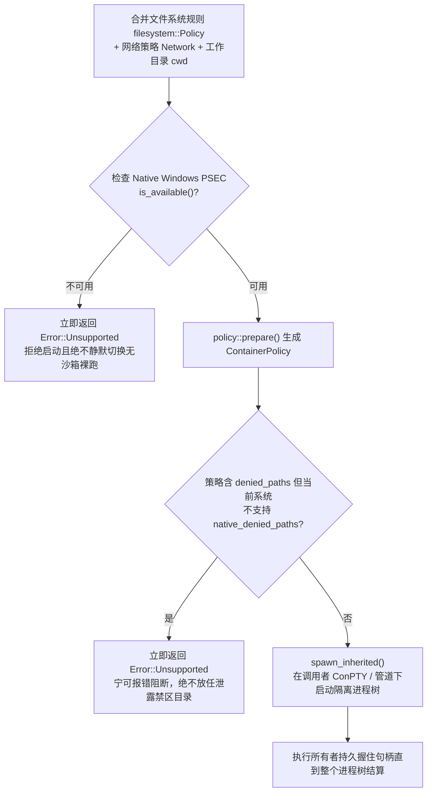

# Windows MXC 与跨平台 OS 沙箱：零特权弹窗、路径遮罩与 Fail-Closed

## 1. 为什么桌面级 Agent 不能“等 Docker 装好了再安全跑命令”？

在云端服务器环境里，给 AI Agent 套一层隔离容器几乎是自然反射：拉个 Docker 镜像、挂载个 Volume 就完事了。但在面向个人工作站和真实研发桌面的跨平台本地引擎里，“强依赖 Docker”或“强行新建本地管理员系统账号改写 NTFS ACL”几乎等于劝退用户：
1. **Windows 桌面灾难**：在 Windows 上，传统沙箱方案要么弹出刺眼的 UAC 提权弹窗让人每跑一步都胆战心惊，要么偷偷在系统里创建受限本地账号并对磁盘目录批量 `icacls` 改写 ACL——一旦程序半途崩溃没来得及回滚，用户自己电脑上的工作目录权限都会永久被搞乱！
2. **Linux 容器越权**：若依赖重型守护进程（Docker Daemon），不仅拉起开销巨大，普通非特权用户的桌面环境或无 Root 权限开发机根本跑不起来。
3. **最致命的安全滑坡（Silent Downgrade）**：市面上不少 CLI 一检测到某种内核隔离特性不可用，就会默默切回裸跑模式（“仅打印一行提示，继续执行命令”），结果用户以为自己安全着，其实 Agent 随时能一口气读光整个 `~/.ssh`。

Maka Rust 微内核在 `platform/sandbox` 中走了一条极其硬核但用户体验极其纯净的路线：**全面拥抱三大操作系统原生的轻量化无特权内核沙箱原语，对写目录中的只读子路径使用可逆占位保护，并在硬件/策略不支持时铁面执行 Fail-Closed**。

---

## 2. 三大操作系统原生沙箱架构总览

| 目标操作系统 | 首选原生隔离机制 | 前置部署与特权要求 | 文件与网络边界治理亮点 |
| :--- | :--- | :--- | :--- |
| **Windows** | **Microsoft MXC (原生进程安全环境 PSEC)** | **零 UAC 弹窗、零本地系统账号、零盘面 ACL 篡改**；常规环境无需执行 `maka sandbox setup` | 通过 `mxc_sdk` 直接构造 `ContainerPolicy`；若策略超出现代原生 MXC 支持边界，仅可基于显式路径切至“低权限 Token + WFP 防火墙 + Job 对象”组合 |
| **Linux** | **`bubblewrap` (0.11+) + 非特权 Network Namespace** | 无需 Root 守护进程，纯非特权用户命名空间启动 | 物理根文件系统重绑定隔离、独立 `unprivileged netns` 配合宿主托管唯一出口代理 |
| **macOS** | **Seatbelt 原生沙盒策略引擎** | 操作系统内建支持，零第三方安装依赖 | 精准文件系统读写规则集；严格限定系统底层例外（仅放行受限 `mDNSResponder` 解析异常，其余出网全归代理） |

---

## 3. Windows 原生隔离深潜：`mxc_sdk` 与策略防降级锁

在很长一段时间里，Windows 本地安全沙箱都是跨平台工程团队最头痛的角落。查看 `platform/sandbox/src/windows/mxc.rs` 可以看到 Maka 如何用现代 Windows 原生 **Process Security Environment（MXC）** 打破这一魔咒。

这段源码与注释里蕴含着三个非常值得品味的系统设计亮点：

### 3.1 永不隐式降级（Never Selects Another Tier）

`mxc.rs` 中 `PreparedPolicy` 的文档注释写道：
> **A policy already checked against native PSEC capabilities. SDK types and fallback dispatch remain private; a launch error never selects another tier.**

即使某个策略已经通过了底层检查，只要在 `spawn_inherited` 拉起那一瞬遇到系统拒绝或环境不匹配，系统**绝不偷偷把它塞进低一级的备选方案蒙混过关**；同样，如果策略明明要求了封禁敏感子路径（`denied_paths`），而当前版本的 Windows 底层构建刚好缺这项能力（`!BaseContainerRunner::supports_native_denied_paths()`），`PreparedPolicy::new` 当场拒签返回 `Unsupported`，将安全边界守得滴水不漏。

### 3.2 何时才会动用次级隔离组合与 `maka sandbox setup`？

只有当用户主动配置的极其复杂的边界条件确实超出了现代 MXC 原生能力范围时，系统才会依托预先明确建立好的受控通道，回退到传统但依然严格封闭的次级防线：**低权限 Token + Windows 过滤平台（WFP）出网封堵 + Job Object 进程树级联扼杀**——而即便在此模式下，宿主也对每一道文件指针与网络出口保持同等级别的零妥协监控。

### 3.3 进程树生命周期全程监护与原生任务隔离

注释同样指明：`Execution` 所有者必须一直持有原生隔离边界句柄，**直到整棵子进程树全部退出清算完毕**。与此同时，结合根模块 `platform/sandbox/src/lib.rs` 中自带的单元测试逻辑（`native_task_namespace_can_be_denied_by_policy`），像宿主内部用于挂载外置任务协调的私有路径 `maka-native-tasks`（`native_task_namespace()`）同样可以被文件策略直接标为 `Access::Deny`，**做到真正的一视同仁、连内部基础设施辅助目录也不对不受信任的子命令敞开大门**。

---

## 4. 痛点攻克：可写目录里的“只读飞地”与可逆占位守卫

无论在哪套系统沙箱里，都会碰上一个极为棘手的真实开发场景：
> **“允许 Agent 在整个项目工作区 `./repo` 里自由读写编码（`Access::Write`），但必须死死保护其中几个特定子路径——例如 `./repo/.git/hooks` 或 `./repo/.env.production`——绝对禁止 Agent 写入或篡改！”**

在传统的操作系统容器挂载或简单 ACL 方案里，想要在“一个已被授予完全写权限的父目录”下硬生生挖出一块“甚至连创建同名新文件都不允许的只读或不可见子树”，极易触发各种边缘逃逸：比如如果只是对文件加个软保护，脚本直接把上层父目录改名或删掉重建（`mv .git .git.bak && mkdir .git`），一切基于旧路径的保护当场失效！

Maka 在 `platform/sandbox` 中引入了一套巧妙的**可逆占位守卫（Reversible Placeholder Guards）**与编译期文件系统策略（`filesystem::Policy`）：
- 在工作区权限规则编译阶段，精确计算祖先与子树交叉规则的优先级，明确划分读写面与只读/拒访边界；
- 当需要在可写域内部钉牢不存在或受保护的敏感子路径锚点时，由宿主沙箱在运行前安全布设不可篡改/只读占位保护节点（或由 OS 隔离层通过独立挂载点/不可修改属性物理钉死路径门户）；
- **命令树一旦退出并进入清理阶段**，沙箱协调器按照原子回滚凭证精确撤销临时占位守卫（如果清理未拿到确切成功回执，直接触发 `Error::CleanupUnconfirmed`），既防止了命令期间绕过父目录覆写关键锚点，又不给用户的真实 Git 仓库留下一丝垃圾残留。

---

## 5. 网络出口宿主代理：目标检验与重定向防火墙

在代码沙箱与命令行工具里，放开直连公网无异于门户大开：被注入提示词的脚本不仅能把本机敏感文件用一条 `curl` 发到黑客服务器，甚至能利用云厂商元数据内网 IP（如 `169.254.169.254`）或 HTTP `302 Redirect` 跳板绕过简单的域名启动黑名单！

`platform/sandbox` 协同 `platform/network` 构建了一道物理封闭的网络闸门：
1. **沙箱内断绝裸出网路由**：在 Linux 上配置独立非特权 `netns`、在 Windows MXC/WFP 上屏蔽直接任意外部端口连通、在 macOS Seatbelt 上拦截非代理出网路径，迫使容器内进程的一切流量只能指向**由宿主机本地托管且受策略监管的唯一透明代理**。
2. **宿主侧 `(host, port)` 精准验真**：每次有 TCP 连接或 HTTP 请求打到宿主代理，网络引擎不看容易伪造的 HTTP Host 字符串头就盲目放行，而是连同真实解析的目标 `(host, port)` 与当前沙箱会话策略 `Network` 策略表逐一核对，封堵内网保留地址与非法端口探测。
3. **HTTP 重定向二次鉴权**：当目标服务器返回一个合法域名后的 `301/302/307` 跳转到另一个未经批准的新域名或本地回环端口时，宿主代理在转发跳转前主动拦截并复核新目标地，彻底截断利用开放重定向漏洞进行的 SSRF / 数据外带（Exfiltration）攻击。

---

## 6. 总结

Maka 的 OS 沙箱基础设施用硬实力回答了“本地安全到底能不能做到用户无感、开发者省心、攻击者绝望”：
1. **Windows 拥抱现代 MXC**：终于在个人主力工作站上实现了“不需要管理员权限、不建废账号、不搞坏文件夹 NTFS ACL”的纯原生进程容器；
2. **Linux/macOS 同等严密对齐**：非特权 `bubblewrap`/netns 与精确 Seatbelt 齐头并进；
3. **从头贯彻 Fail-Closed 与出网重定向拦截**：宁可在基建不满足时响亮地拒绝执行，也绝不用“半真半假的安全提醒”麻痹用户；既守住可写文件夹里的敏感小锚点，也封死利用 HTTP Redirect 外带数据的暗道。

有了底层操作系统沙箱兜底之后，微内核上层的工具、插件、外部 CLI 与远程连接又该如何划分各自的权限边界，才不会把一个低权限代理的审批结果误当作永不过期的“全局通行证（Bearer Token）”？下一篇揭晓微内核整套权限哲学的灵魂所在——[执行权威契约与非持有型能力模型](./execution-authority-and-capabilities.md)。
