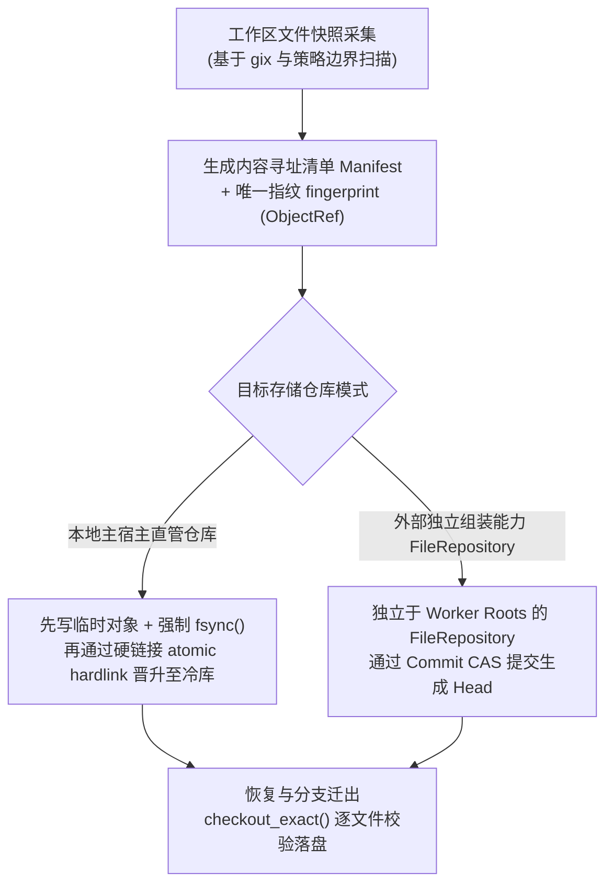

# 检查点仓库与跨宿主状态恢复：零冗余硬链接与精确工作区迁出

## 1. 为什么 Agent 项目的版本回退不能直接拿用户的 `.git` 当草稿纸用？

在编码型 Agent 运行时设计中，最常被低估也最容易搞砸的需求就是**检查点与状态回滚（Workspace Checkpointing & Restore）**。设想开发者刚写好功能、正准备分批提交本地代码，同时开着两个本地修改过的未追踪配置文件（Untracked files），此时想让 Agent 试着重构一个核心模块，并在改砸了时一键回滚到第 2 轮之前的精确快照：

1. **直接篡改用户工作区 `.git` 的灾难**：很多脚手架直接调用用户的 `git add -A && git commit` 甚至 `git stash`。这不仅会在用户的仓库日志里留下一堆垃圾提交、污染 `HEAD` 和 `stash` 栈、意外触发昂贵的 Git hooks，甚至直接把用户刻意 `.gitignore` 之外尚未 Staging 的草稿环境全搅乱！
2. **传统全量目录拷贝的存储崩溃**：如果一个带着 `node_modules` 或大量二进制产物的项目，每跑 1 个 Step 就 `cp -r` 全量拷贝一次工作区，磁盘空间几十分钟就会被直接榨干。
3. **跨宿主迁移与历史还原时的权限失真**：如果检查点不仅用于本地“撤销上一轮修改”，还要支持被导入到新会话分支、甚至打包（Portable Checkpoint）在云端评测/升级验证容器里还原，怎么保证还原出来的文件目录结构跟记录下历史快照那一刻**一比特都不差（Bit-exact）**？

Maka Rust 微内核在 `platform/event-log/src/checkpoints/` 下借助纯 Rust Git 实现 `gix` 底层原语与独立的内容寻址仓库（`Repository` / `FileRepository`），构建了一套**与用户日常工作区 `.git` 彻底零干涉、基于写时静态硬链接与 `fsync` 落盘晋升、支持严格精确检出验证的独立检查点子系统**。

---

## 2. 两条检查点轨道：本地极速物理仓储 vs 独立 `FileRepository`

翻阅 `platform/event-log/README.zh-CN.md` 与 `checkpoints/repository.rs`、`restore.rs` 可以看出，Maka 将检查点引擎设计为具备严格身份隔离与内容验证的双态模型：

### 2.1 本地 `fsync` + 硬链接晋升机制：零重复磁盘占用与崩溃抗撕裂

在处理动辄数万文件的中大型代码仓库检查点时，性能与崩盘安全往往互相冲突。Maka 的本地检查点写入管线采用了一种结合文件系统的经典零拷贝崩溃安全策略：
1. **分块与唯一内容寻址落盘**：相同文件跨 50 个历史检查点只会按内容摘要存下唯一一份不可变实体对象；
2. **`fsync` 后硬链接晋升（Hardlink Promotion）**：新的快照对象先落入暂存临时文件并严格调用 `fsync` 确保物理页真正刷入持久介质后，再通过原子链接/硬链接方式晋升入主仓库对象目录；
3. **绝不直接改写用户原目录内的 `.git` 元数据**：所有检查点分支、树对象与元数据索引全部静默栖身在受控 State Root 的隔离空间中，哪怕 Agent 连续回退 20 次，开发者的 `git log`、`git status`、`index` 暂存区与未提交 Stash 也保持绝对纯净。

### 2.2 独立组装权威：`checkpoints::repository`

如果环境处于分布式或多 Worker 架构（比如后台沙箱容器本身不应该直接挂载访问整个全局历史仓储目录），检查点操作便提升为跨界组装能力 **`Repository` / `FileRepository`**。查看 `repository.rs` 模块顶部的约束定义：

> **Checkpoint authority independent of worker Roots. Implementations are trusted assembly capabilities, not grants to execute a Session.**

检查点仓储本身是一个独立于具体执行工作区 Root 之外的可信组装基座——它不拥有把某个会话拉起来跑的权利，但严格负责校验每次写提交的四重身份与一致性凭证（`Commit` 结构体）：
- **`binding: Binding`**（精确绑定的 `SessionIdentity { session, agent }` 以及源 `Source { root_id, scope: { namespace, state_domain, deployment }, session }`）；
- **`operation: Uuid` & `fingerprint`**：幂等操作编号与真实内容指纹；
- **`expected_revision: Option<Revision>`**：乐观锁基线版本，严防多个并发节点对同一会话分支发起分叉写覆盖，成功后返回唯一单调 `CommitReceipt::Published { head }`；
- **`manifest: ObjectRef`**：经非零字节与合法摘要验证过的结构化树清单引用。

---

## 3. 精确复现与严格防篡改迁出：`checkout_exact` 与 `RestoreOperation`

普通回滚往往只做到“把记录里的文件覆盖写回去”，这在工程上遗留了一个巨大隐患：**如果在检查点之后 Agent 额外新建了十个临时文件，简单覆盖恢复根本不会清理那些多余出来的幽灵文件**！或者由于文件权限模式、符号链接乃至父目录身份变了，导致复原出来的工作区与当年快照名实不符。

Maka 用两道强保证机制消除了这种“半吊子还原”：

### 3.1 同源恢复事务模型（`restore.rs`）

当进行同 Root 下的工作区复原（`RestoreOperation`）时，系统不仅核对 `fingerprint` 与 `revision`，更强制验明承载恢复的目标根目录坐标 **`parent: PathBuf` + `parent_identity: DirectoryIdentity`**（防止因为软链接重指向或目录删改换壳导致把旧代码恢复到完全错误的物理路径上！）。

验证通过后生成 **`PreparedRestore` -> `RestoredSession`**，实现极其精妙的**对话时间线与文件系统双线同步还原**：
- **磁盘侧**：工作区物理文件树精准回滚至目标状态；
- **账本侧**：同步封装对应的 `HistorySnapshot`（历史上下文水位快照）与 `WorkspaceSnapshot`（工作区状态快照），连同受校验递增的 `session_revision` 原子并轨，使得恢复后的第一轮对话既站在干净准确的硬盘文件上，又绝不残留已经被“撤销时代”产生的废话模型推理记忆！

### 3.2 `checkout_exact` 的逐文件严苛对齐校验

无论是执行就地回滚、创建一个带工作区现状分叉的新分支会话，还是在 CI 升级兼容测试与容器评测环境中挂载 **`Portable` 便携式检查点包**，最终落实到磁盘那一刻都必须经过 **`checkout_exact`** 校验通道：
- 必须确保目标工作区内的文件路径集、文件内容字节与权限元数据同清单（`Manifest`）**完全逐一对齐**——该出现的字节一个不能错，不该存在的冗余生成文件必须清除干净，并在遇阻时明确报错中止而不是留下半新半旧的残缺工作区。

---

## 4. 跨时代时间胶囊基石：Portable 检查点

值得一提的是，这套独立的 Checkpoint 系统在 Maka 的整套质量工程体系（`upgrade_compat.rs`）中也充当了关键基础设施：
- 每次发版前的兼容性归档流水线都能封存一份与主库隔离的自包含 **`Portable` 检查点制品包**；
- 当几个月后升级了十几个版本的新二进制冷启动读入旧归档时，新内核不仅校验 SQLite 事件表能平滑升级，更能把几代版本前打出的 Portable 工作区检查点完整迁出继续做代码验证与续跑！

---

## 5. 总结

Maka 的检查点系统打破了“用临时 Git Commit 凑合当撤销按钮”的脆弱惯性：
1. **零污染工作流**：彻底远离开发者日常工作区内的 `.git` 目录与暂存区；
2. **高性能崩溃安全存储**：借助 `fsync` + 硬链接晋升实现空间去重与写入原子性，靠 `FileRepository` + `expected_revision` 支持受限工作节点的严格分治提交；
3. **目录 + 记忆双轨时间旅行**：通过 `DirectoryIdentity` 防换壳校验与 `checkout_exact` 精确比对，连同 `HistorySnapshot` 一齐做到“既复原代码现场，又精准对齐模型认知历史”。

然而，不管是 Event-Log、Checkpoints，还是插件 Runtime 和模型接口，最终都运行在需要与本地客户端、远程控制端、背景服务和健康探针持续长跑的“物理进程宿主”之内。下一篇我们就将视角展开到整个底层宿主支撑总线：`maka-transport`、`maka-host-runtime` 与 `maka-background-health` 是如何协同打通端到端通信、资源回收和独立健康探活的——[宿主生命周期、安全传输与后台健康探针](./host-lifecycle-and-transport.md)。
