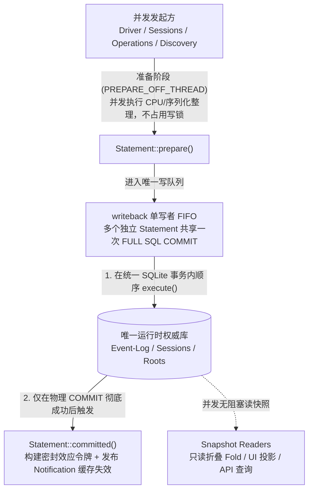
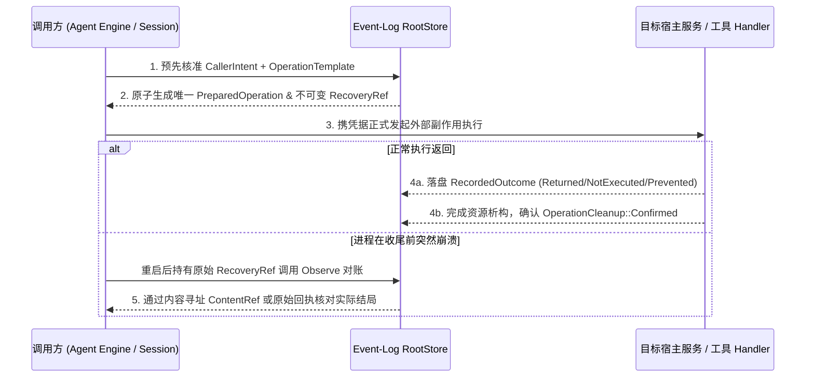

# Event-Log、单写者引擎与两阶段持久化操作

## 1. 为什么传统多连接并发写入的数据库设计会摧毁 Agent 确定性？

在常规 Web 后端开发里，连接池（Connection Pool）加 `BEGIN TRANSACTION` 几乎是下意识配置——10 个协程并发读写 PostgreSQL 或 SQLite WAL。但在嵌入式微内核和本地长程 Agent 运行时里，如果放任模型流式器、工具调度器、记忆提取器和用户操作通道各自直接往数据库写记录、并在提交前顺手发出局部副作用通知，立刻会引爆三类难以调试的灾难：

1. **通知先于提交逃逸（Pre-Commit Notification Escape）**：A 协程在数据库事务里刚刚写入“任务启动”，还没来得及 `COMMIT`，内存里的事件总线就已经广播通知 UI 刷新或调起下游副作用；紧接着数据库因为外键或版本锁回滚（Rollback），导致 UI 和外部进程拿着“从未正式发生过的幻觉事实”继续乱跑。
2. **组提交互相连坐失败（Poisoned Group Commit）**：多个互不相关的会话往同一份底层存储写状态；如果为了吞吐量做批量写入（Batch Commit），其中一笔因为业务校验冲突被拒，传统事务会把整批其他无辜会话的正常落盘全部拖着一起回滚重来。
3. **两阶段副作用对账裂缝**：外部工具或插件服务明明发出去执行了，但直到宿主重启恢复时才知道“写回结果还没成功落库”，怎么既不重跑、又能把原始返回值按原样赎回来？

Maka Rust 微内核在 `platform/event-log` 中建立了一套极致的单源真理持久层：**唯一 `RootOwner` / `RootStore` + 单写者串行 FIFO 事务管道（`writeback::Statement`）+ 基于 `OperationRequest` / `RecoveryRef` 的两阶段可恢复操作框架**。

---

## 2. 单写者、并发只读快照与后置失效广播：`RootStore`

`platform/event-log/src/root_store.rs` 开宗明义定下架构铁律：
> **One Root authority and one transactional runtime database.**
> **Session and operation handles never extend the lifetime of an idle SQL owner. An accepted call holds the original owner through its completion instead.**

整个微内核的持久化真相被严格锚定在一个唯一主控实体 `RootOwner` / `RootStore` 上，并将读写通道彻底分流：

### 2.1 `writeback::Statement` 契约的四重精巧防护

仔细观察 `platform/event-log/src/writeback.rs` 定义的 `Statement` Trait，可以看到极少在常规业务代码见到的微秒级并发控制哲学：

1. **重活剥离主写通道（`PREPARE_OFF_THREAD`）**：凡是涉及重序列化或字节预处理的工作全部在独立线程通过 `Statement::prepare()` 先行消化完毕；真正闯入单写者 FIFO 拿 `Connection` 执行 SQL 的瞬间只剩微秒级的纯同步事务落盘，彻底消除 IO 抖动锁死全局写入队列的毛病。
2. **所有权随行保护（`retain()`）**：通过 `retain() -> Vec<Arc<dyn Send + Sync>>` 将底层大负载或准备好的只读背书缓冲区寿命一直钉死到整个事务组提交结算完结，保证在专属阻塞通道流式搬运不可变字节进 SQLite 时绝对不会出现悬空引用。
3. **隔离拒绝与合并提交共存（`isolated_rejection()`）**：一个共享提交批次里装着来自 A、B、C 三个互不干扰会话的写入请求。只要某个请求报出属于可控业务约束违例的 `isolated_rejection`，单写者通道就能将其精准剥离拒绝而不波及同批另外两笔合法事务，兼顾“高并发吞吐合批”与“错误隔离”。
4. **物理提交后才放行令牌与广播（`committed()` + `Notification`）**：文件头写得一清二楚——**`no effect token or notification escapes before commit`（绝不允许任何效应令牌或通知在物理提交完成前逃逸！）**。所有的密封操作确认凭证只能在 `committed()` 回调内产生，而告诉订阅面板和会话路由刷新缓冲区的 **`Notification`**（包含 `METADATA`、`MATERIAL_RELEASED`、`sessions`、`metadata_scopes`、`with_activation`）同样只会在 SQLite 彻底落盘成功后由分发器安全发出。

### 2.2 脆弱生命周期反制：`SessionStore` 的 `Weak<EventLog>` 与 `Pins`

请注意 `root_store.rs` 中 `SessionStore` 的结构体成员：`log: Weak<EventLog>` 和 `work: Option<Arc<execution::Pins>>`。
这意味着**一个单纯握在外部手里的会话操作句柄，永远不会强引用拉长已经闲置待关闭的底层数据库拥有者的寿命（Prevent Handle Leak Extending Idle SQL Owner）**。只有真正在运行并已被准入的任务调用，才会由原始主控侧配发活跃的 `Pins` 生命周期护卫；一旦宿主主动停机关闭门禁（`gates.is_closing()`），任何过期外部操作手柄的试探都会立即感知撤权并退场。

---

## 3. 应用与两阶段持久化操作：`CallerIntent`、`RecoveryRef` 与 `Outcome/Cleanup`

当 Agent 内核要透过宿主（Host）调用某个真实插件服务或系统动作时，调用双方如何跨越“崩溃重启”、“请求发出了但回执丢在半路”以及“结果太大怕撑爆日志”这三座大山？

`platform/event-log/src/applications/operations.rs` 与 `maka-plugin-core` 协作给出了全套**两阶段受控操作模型（Two-Phase Durable Operations）**：

### 拆解两阶段操作的核心状态分治

1. **准备在先，发包在后（`OperationRequest` -> `PreparedOperation`）**：
   - 在任何外部物理动作真的发出之前，调用方必须先向 Root 注册意图（`CallerIntent`）并领取一枚持久的恢复凭据 **`RecoveryRef`**；
   - 这样就算“还没发出调用”或者“发出了刚写完本地磁盘”机器就断电了，重启后的 Reconciler 依然看得到那笔处于飞行悬空态的 `RecoveryRef`，立刻就知道自己有义务去查账对单（`Action::Observe`），而非两眼一抹黑。
2. **业务胜负（`Outcome`）与物理清理（`Cleanup`）永久正交**：
   - `OperationOutcome` 只回答一件事：工具跑成了没（`Returned { result }`、`NotExecuted`、`Prevented` 还是丢失失联后的 `Unknown`）；
   - **`OperationCleanup`** 则独立回答另一件事：伴随这次调用打开的所有临时句柄、子进程、目录锁和网络流是否已经全部安全释放确认（`Confirmed`）？
   - 正因为把二者强行分开，引擎既能在业务上早早把返回值喂给模型继续思考（甚至在 `OutcomeUnknown` 时及时让模型绕道），又能在 Run 终结边界或上下文移交瞬间，严格死锁 `OperationCleanup::Confirmed` 作为最后一道物理放行门禁，绝不提前退场！
3. **非持有型收据内容寻址与防篡改复用**：
   - 大体积返回结果按 `ContentRef`（字节数 + SHA 摘要）剥离出事件表，但凭借我们在领域模型篇验证过的 `same_outcome()` 摘要核验算法，哪怕还原出来再对比也分毫不差；
   - 同时因为整个结构严禁携带裸凭据，一个记录在日志里的 `RecoveryRef` 仅仅能用于**单向查询回溯本笔原始操作结局**，绝对没有“拿它把副作用再重新激活跑一遍”的特权。

---

## 4. 总结

`maka-event-log` 让我们看到了“本地数据库”在系统编程大师手里的真正威力：
- 用 **单写者 FIFO + 预处理脱钩（`PREPARE_OFF_THREAD`）+ 隔离拒批（`isolated_rejection`）**，在绝对保住单库事务串行强一致性的前提下榨干吞吐、拒绝阻塞；
- 用 **`committed()` 与延迟发布的 `Notification`**，根除事务回滚导致的通知幻觉幽灵；
- 用 **`CallerIntent` / `RecoveryRef` + `Outcome`/`Cleanup` 正交拆解**，把跨边界并发插件调用变成了一套崩溃后随时可追账、可安全收尸的确定性状态账本。

光记下事件流水账本还不够——当代码仓库本身被模型大刀阔斧重构到一半想随时回退时光，或者需要把一个会话完整的工作区环境安全打包移植到另一台容器里恢复继续跑时，单靠文本历史流是变不出文件树快照的。下一篇来看 `event-log` 内部另一座硬核工程设施——[检查点仓库与跨宿主状态恢复](./checkpoint-repository.md)。
