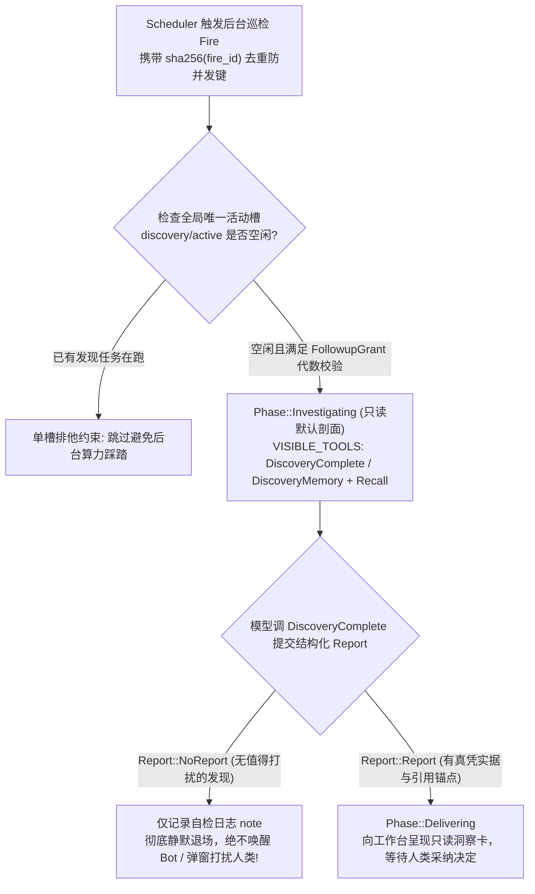

# 自主目标、定时调度与主动发现引擎：长程自治背后的预算与免打扰约束

## 1. 从“一问一答的被动工具”迈向“受控自治的后台伙伴”

当我们谈论“下一代 Agent 基础设施”时，核心分水岭往往不在一次聊天有多聪明，而在于它能不能在用户关掉屏幕离开工位之后继续稳妥运转：
- **长程目标迭代（Goals）**：面对“把这个大型单体模块拆分为四个包并把测试覆盖率推到 90% 以上”这种无法一气呵成的目标，系统需要跨多个独立执行轮次（Iterations）持续追踪进度、自我评审并对预算设防；
- **可持久化的定时编排（Scheduler）**：每天清晨 8 点例行检查流水线状态、或者每隔 30 分钟扫描构建产出，宿主崩溃重启后日程计划也不能凭空蒸发；
- **主动发现（Proactive Discovery）**：在主对话刚刚收尾的后台安静期，默默帮用户检查一下工作区是否有被遗漏的关联问题、测试缺口或环境隐患。

然而，一旦把 Agent 放进无人盯防的后台自治轨道，最可怕的工程噩梦也随之降临：**失控烧钱死循环（Runaway Cost Loop）** 和 **无意义垃圾通知轰炸（Alert Fatigue）**。Maka Rust 微内核分别利用 `plugins/agent/goal`、`plugins/agent/native/src/owner/scheduler.rs`、`discovery.rs` 以及旁路快车道（`predictions.rs` / `quick_question.rs`），为后台自治立下了滴水不漏的四重安全护栏。

---

## 2. 长程自主目标引擎：`plugins/agent/goal`

普通的 Reconciler 循环解决的是一次 `RunId` 内的收敛，而 **`maka-agent-goal`（`plugins/agent/goal/src/goal.rs`）** 则站得更高一层，统筹跨越多次触发周期（`Trigger::Goal`）的长远工程目标：

1. **显式三权分离状态机（`Status` / `Control` / `Meter`）**：
   - **`Status`（外部态快照）**：向工作台界面清晰报告当前 Goal 处于规划探索、多轮迭代推进、暂停等待人类介入还是最终收官；
   - **`Control`（干预方向盘）**：允许宿主和人类在任何跨轮间隙安全施加重定向、紧急制动或步数调整指令；
   - **`Meter`（强硬计量器）**：将总 Token 消耗、迭代轮次上限与墙上时间边界收进独立计量表。只要任何维度的红线一旦触及，Control 层便立刻拦截下一次 `Trigger::Goal` 派生，彻底阻断夜间“失控循环连跑两千轮”的账单惨案。

---

## 3. 定时调度与后台执行授权分离：`scheduler.rs`

在很多自建系统里，定时任务引擎直接用内存里的一个 `cron` 定时库加几句回调函数启动任务。结果不仅进程一重启就全部丢失，而且只要用户创建定时任务时拿过一次高权限，半年后哪怕用户早就关闭了全局网络权限或修改了策略，定时器依然靠着旧配置偷偷越权运行。

`plugins/agent/native/src/owner/scheduler.rs` 首行定下极其精炼的分权契约：
> **Task timing owns durable plans; Agent remains the only execution owner.**
> （定时层仅仅持有持久化调度的时刻表计划；Agent 引擎依然是真正执行任务的唯一所有者与准入守卫。）

具体落地为 **`Plan = TaskPlan<ScheduledEffect, Approval>`**：
- **触发意图与执行分离**：`maka-scheduler` 负责跨重启持久保管 `TaskPlan` 与每次苏醒的 `Fire` 凭证；一旦倒计时或 Cron 命中，它并不是私自找个野线程强拉大模型，而是向 Agent 主队列交付标准 `Trigger::Schedule` 激发包；
- **权限动态失效绑定（`FollowupGrant::is_current`）**：哪怕是一张之前合法签发出去的调度后继票据（`FollowupGrant`），在真正唤醒运行前一刻也必须现场过三关核验：`plan.task.status == Status::Active`、未超出 `expires_at` 有效期，且携带的代数标记 **`generation`** 必须严格吻合当前最新的用户批准代数！用户只需点击取消或重配一次任务，此前流落四方的旧版调度追踪链立刻全盘作废。

---

## 4. 主动发现（Proactive Discovery）：只读单例、零噪音静默结案

在 `products/maka/README.zh-CN.md` 与 `plugins/agent/native/src/owner/discovery.rs` 中，Maka 展示了一项极具产品克制美学的智能体能力——**Proactive Discovery（主动发现）**。

它默认在一次常规用户会话运行结束后的背景周期内（默认 **30 分钟** 间隔窗）适时悄然启动后台巡检，帮你留意遗漏的风险或线索；但为了确保它“**绝不自作主张改文件、绝不并发挤爆宿主机、绝不拿废话骚扰用户**”，微内核为其设定了四条极其苛刻的约束边界：

剖析 `discovery.rs` 中的工程细节，有三个核心亮点令人拍案叫绝：
1. **全局单并发执行槽（Single Active Execution Slot）**：借助持久化键 `discovery/active` 与按火警 ID 哈希索引的完成回执 `discovery/completed/<sha256(fire)>`，整个系统同时最多只允许 **1 个** 主动发现任务在后台跑批——绝不会出现用户连续开了 8 个会话窗口结果后台同时炸出 8 个幽灵 AI 把笔记本风扇吹爆的场面。
2. **默认只读工具天花板（`DiscoveryWorkerTools`）**：Discovery Worker 运行在一个极窄且安全的能力框里，默认仅暴露回忆检索工具（`Recall`、`RecallMore`、`RecallMaterial`）及两大结案控制工具 **`DiscoveryComplete`** 与 **`DiscoveryMemory`**，彻底剥夺写文件与运行任意高危命令的授权，连误操作搞坏工程的物理可能性都不复存在。
3. **“无事绝不冒泡”的结构化双态报告（`Report::NoReport` vs `Report::Report`）**：代码注释极其犀利地区分了两者的边界——
   - 若没查出真正值得人类留意的实质内容，模型必须调用 `DiscoveryComplete` 提交 `Report::NoReport { note, notes }`，注释清楚写道：**“Nothing worth notifying; record what was checked without waking the Bot（没有任何值得通知的事项；仅仅记下核查轨迹而绝不唤醒主对话机器人！）”**。
   - 即便真有发现而提交 `Report::Report { text, notes }`，契约也强行限定其中只得包含**客观发现和精确证据来源引用（`records::Note`），而禁止反向塞入给主机器人的霸权操纵指令（"not instructions for the Bot"）**。

---

## 5. 辅助旁路快车道：零主账本污染的即时预测与快速问答

除了厚重严谨的主推理 `Run` 与定时后台任务，人在前端桌面工作台（`maka-workbench`）交互时，还常常需要两类追求极低延迟、允许随时丢弃的轻量智能体验：`plugins/agent/native/src/owner/predictions.rs`（**输入预测 `predict_next_message`**）与 `quick_question.rs`（**快速侧边轻量问答 `QuickHistory`**）。

如果把“输入提示词补全预测”或者“顺手问一句正则怎么写”也走一遍重型 Event-Log `Fact` 落盘、启动检查点、创建 `RunView` 与修改记忆体系，既笨重慢吞吞，还会把大量临时闲聊污染进用户正式的工作台账本！

Maka 为此专门辟出了两条**非标准运行态的旁路快车道（Auxiliary Non-Turn Fast Lanes）**：

| 旁路模块 | 工程约束边界 | 核心价值 |
| :--- | :--- | :--- |
| **消息预测 (`predictions.rs`)** | 依托 `predict_next_message` 读取有限只读上下文预测下一条用户输入，零工具能力、零账本持久化写盘、随时可被用户输入敲击无痛取消 | 毫秒级输入建议反馈，完全不触发任何主对话状态机变更 |
| **快速问答 (`quick_question.rs`)** | 受 `QuickHistory` 严格界限兜底（硬性截断上限：**最多 32 轮次 / 最多 64 条消息**）的独立轻量短会话 | 允许用户在主 Agent 跑大任务的同时，在侧边弹窗做零风险极速查证，既绝不混入正式上下文，也不触动任何检查点与长期记忆抽取 |

---

## 6. 总结

纵观 `05-coordination` 的协同与后台自治布局，Maka Rust 微内核真正把“可控自治”做成了一门精密工程学：
- 前景协同靠 **七元对称 `Session*` + `Room` 定向 `@mentions` + `SubagentPreset` CAS 版本控制**；
- 后台自治靠 **`Goal` 独立预算计量器 + `Scheduler` 动态代数校验 `FollowupGrant` + `Proactive Discovery` 单槽只读静默上报**；
- 即时辅助靠 **`predict_next_message` 与 `32 Turn / 64 Message` 界定的旁路快车道**，严禁轻量化试探污染神圣的主账本。

随着功能体系日渐庞大，基础设施团队最头疼的问题来了：**下周把某个持久化表拆开重构字段、把响应格式换掉之后，怎么保证半年前装过老版本、硬盘里存着复杂 Run/Cell/Memory/Room 状态的真实用户无痛升级不炸库？没有真实烧钱模型 Key 的 CI 里又怎么用单机几千并发验证 HTTP SSE / WebSocket 增量流协议全套边缘报错？** 接下来的最后一篇收官模块——**06 兼容性演化、基准测试与架构演进对比篇**，为你一一拆解，首战直击工程守门员：不可变迁徙锁与时间胶囊升级验证体系：[持久化迁移锁与时间胶囊升级验证](../06-operations/migrations-and-upgrade-compat.md)。
